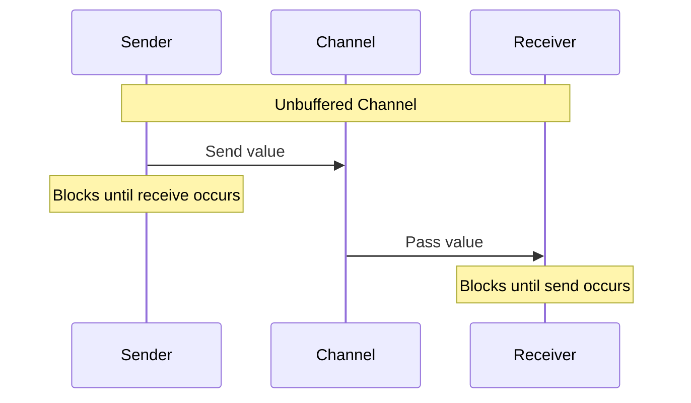

# Go Channel Operations

## Introduction

Channels are one of Go's most powerful and distinctive features, serving as the backbone of its concurrency model. A channel is a communication mechanism that allows goroutines (Go's lightweight threads) to exchange data and synchronize their execution. Think of channels as pipes through which you can send and receive values between concurrent parts of your program.

Channels are designed based on Tony Hoare's Communicating Sequential Processes (CSP), following the philosophy: "Don't communicate by sharing memory; share memory by communicating." This fundamental principle encourages you to design your concurrent programs around the flow of data rather than shared state.

In this tutorial, we'll explore channel operations in Go, from basic usage to advanced patterns, with practical examples to solidify your understanding.

## Channel Basics

### Creating Channels

In Go, channels are typed, meaning they can only transport values of a specific type. Here's how you create a channel:

```go
// Create an unbuffered channel that transports integers
ch := make(chan int)

// Create a buffered channel with a capacity of 5
bufferedCh := make(chan string, 5)
```

### Sending and Receiving Operations

Channels use the `<-` operator for both sending and receiving values:

```go
// Sending a value to a channel
ch <- 42

// Receiving a value from a channel
value := <-ch

// Receiving a value and checking if the channel is closed
value, ok := <-ch
if !ok {
    fmt.Println("Channel is closed!")
}
```

Let's see a simple example of using channels for communication between goroutines:

```go
package main

import (
    "fmt"
    "time"
)

func main() {
    // Create a channel
    ch := make(chan string)

    // Start a goroutine that sends a message
    go func() {
        time.Sleep(2 * time.Second)
        ch <- "Hello from goroutine!"
    }()

    // Receive the message
    msg := <-ch
    fmt.Println(msg)
}
```

Output:
```
Hello from goroutine!
```

In this example, the main goroutine waits for a message from the channel, effectively synchronizing with the other goroutine.

## Unbuffered vs Buffered Channels

Go offers two types of channels: unbuffered and buffered. Understanding the difference is crucial for effective concurrent programming.

### Unbuffered Channels

Unbuffered channels have no capacity for storing values. A send operation on an unbuffered channel blocks until another goroutine performs a receive operation on the same channel, and vice versa.



Because the sender and receiver must meet, an unbuffered channel acts as a synchronization point:

```go
package main

import (
    "fmt"
    "time"
)

func main() {
    ch := make(chan int) // unbuffered

    go func() {
        fmt.Println("Sender: about to send")
        ch <- 1
        fmt.Println("Sender: send completed")
    }()

    time.Sleep(1 * time.Second)
    fmt.Println("Receiver: about to receive")
    v := <-ch
    fmt.Println("Receiver: got", v)
    time.Sleep(100 * time.Millisecond) // let the sender print its last line
}
```

Output:
```text
Sender: about to send
Receiver: about to receive
Receiver: got 1
Sender: send completed
```

The sender is stuck on `ch <- 1` for a full second until the receiver is ready. (The last two lines can appear in either order, because both goroutines resume at the same moment.)

### Buffered Channels

A buffered channel has a queue of a fixed capacity. A send only blocks when the buffer is full, and a receive only blocks when the buffer is empty.

```go
package main

import "fmt"

func main() {
    ch := make(chan string, 3)

    ch <- "first"
    ch <- "second"
    ch <- "third"
    // A fourth send here would block, because the buffer is full

    fmt.Println("Length:", len(ch), "Capacity:", cap(ch))

    fmt.Println(<-ch)
    fmt.Println(<-ch)
    fmt.Println(<-ch)
}
```

Output:
```text
Length: 3 Capacity: 3
first
second
third
```

The built-in functions `len` and `cap` report how many values are currently queued and the total buffer size.

## Closing Channels

A sender can call `close` to signal that no more values will be sent. Receivers can detect this with the two-value receive form:

```go
package main

import "fmt"

func main() {
    ch := make(chan int, 2)
    ch <- 10
    ch <- 20
    close(ch)

    v, ok := <-ch
    fmt.Println(v, ok) // buffered value still available
    v, ok = <-ch
    fmt.Println(v, ok)
    v, ok = <-ch
    fmt.Println(v, ok) // channel closed and drained
}
```

Output:
```text
10 true
20 true
0 false
```

Rules to remember:

- Receiving from a closed channel never blocks: it returns remaining buffered values, then the zero value with `ok == false`.
- Sending to a closed channel causes a panic.
- Closing an already closed channel causes a panic.
- Only the sender should close a channel, never the receiver.
- Closing is not required for garbage collection. Close a channel only when receivers need to know that no more data is coming.

## Ranging Over Channels

The `for range` loop receives values until the channel is closed, which is the idiomatic way to consume a stream:

```go
package main

import "fmt"

func generate(n int) <-chan int {
    out := make(chan int)
    go func() {
        defer close(out)
        for i := 1; i <= n; i++ {
            out <- i
        }
    }()
    return out
}

func main() {
    for v := range generate(5) {
        fmt.Print(v, " ")
    }
    fmt.Println()
}
```

Output:
```text
1 2 3 4 5 
```

If the producer forgot to call `close`, the loop would block forever after the last value, and the runtime would report `fatal error: all goroutines are asleep - deadlock!`.

## Directional Channels

Function signatures can restrict a channel to sending only (`chan<- T`) or receiving only (`<-chan T`). The compiler then rejects misuse:

```go
package main

import "fmt"

// producer can only send
func producer(out chan<- int) {
    for i := 0; i < 3; i++ {
        out <- i * i
    }
    close(out)
}

// consumer can only receive
func consumer(in <-chan int, done chan<- bool) {
    for v := range in {
        fmt.Println("Received:", v)
    }
    done <- true
}

func main() {
    ch := make(chan int)
    done := make(chan bool)

    go producer(ch)
    go consumer(ch, done)

    <-done
}
```

Output:
```text
Received: 0
Received: 1
Received: 4
```

A bidirectional channel converts automatically to either directional type when passed to such a function.

## Nil Channels

The zero value of a channel type is `nil`. Sending to or receiving from a nil channel blocks forever, and closing it panics. This sounds useless, but inside a `select` it is a handy way to disable a case:

```go
package main

import "fmt"

func merge(a, b <-chan int) <-chan int {
    out := make(chan int)
    go func() {
        defer close(out)
        for a != nil || b != nil {
            select {
            case v, ok := <-a:
                if !ok {
                    a = nil // stop selecting on a
                    continue
                }
                out <- v
            case v, ok := <-b:
                if !ok {
                    b = nil // stop selecting on b
                    continue
                }
                out <- v
            }
        }
    }()
    return out
}

func main() {
    a := make(chan int)
    b := make(chan int)

    go func() { a <- 1; a <- 3; close(a) }()
    go func() { b <- 2; b <- 4; close(b) }()

    sum := 0
    for v := range merge(a, b) {
        sum += v
    }
    fmt.Println("Sum:", sum)
}
```

Output:
```text
Sum: 10
```

## Channel Operation Behavior Summary

| Operation | Nil channel | Open channel | Closed channel |
| --- | --- | --- | --- |
| Send `ch <- v` | Blocks forever | Blocks until received or buffer has space | Panics |
| Receive `<-ch` | Blocks forever | Blocks until a value is available | Returns buffered values, then zero value with `ok == false` |
| `close(ch)` | Panics | Succeeds | Panics |
| `len(ch)` | 0 | Number of queued values | Number of remaining queued values |

## Practical Example: A Processing Pipeline

Channels make it easy to connect stages that run concurrently. Each stage receives from an input channel, does some work, and sends to an output channel:

```go
package main

import (
    "fmt"
    "strings"
)

func source(words []string) <-chan string {
    out := make(chan string)
    go func() {
        defer close(out)
        for _, w := range words {
            out <- w
        }
    }()
    return out
}

func toUpper(in <-chan string) <-chan string {
    out := make(chan string)
    go func() {
        defer close(out)
        for w := range in {
            out <- strings.ToUpper(w)
        }
    }()
    return out
}

func addExclamation(in <-chan string) <-chan string {
    out := make(chan string)
    go func() {
        defer close(out)
        for w := range in {
            out <- w + "!"
        }
    }()
    return out
}

func main() {
    words := []string{"go", "channels", "are", "fun"}
    for result := range addExclamation(toUpper(source(words))) {
        fmt.Println(result)
    }
}
```

Output:
```text
GO!
CHANNELS!
ARE!
FUN!
```

Each stage closes its output when its input is exhausted, so the shutdown signal flows naturally through the whole pipeline.

## Common Mistakes

1. **Deadlock on an unbuffered channel in a single goroutine**: `ch := make(chan int); ch <- 1` in `main` blocks forever because nobody can receive.
2. **Forgetting to close**: a `for range` loop over a channel that is never closed never ends.
3. **Closing from the receiver side**: this can make the sender panic on its next send.
4. **Leaking goroutines**: a goroutine blocked on a send that no one will ever receive stays in memory for the life of the program. Use `select` with a `context` or a done channel to let it exit.

## Summary

Channels are Go's primary tool for communication and synchronization between goroutines. In this tutorial you learned:

- How to create channels with `make` and send and receive values with the `<-` operator
- The difference between unbuffered channels (synchronous hand-off) and buffered channels (queue with fixed capacity)
- How to close channels and detect closure with the `value, ok` form
- How `for range` consumes a channel until it is closed
- How directional channel types make APIs safer
- How nil channels behave and how to use them to disable `select` cases
- How to build concurrent pipelines from channel-connected stages

## Exercises

1. Write a program where one goroutine sends the numbers 1 to 10 on a channel and the main goroutine prints their sum.
2. Modify the pipeline example to add a stage that filters out words shorter than three characters.
3. Create a function `func fanIn(chs ...<-chan int) <-chan int` that merges any number of channels into one.
4. Write a program that deliberately deadlocks, read the runtime error message, and then fix it.
5. Use a buffered channel of capacity 2 to limit how many goroutines can perform a simulated "download" at the same time.

## Additional Resources

- [A Tour of Go: Channels](https://go.dev/tour/concurrency/2)
- [Effective Go: Channels](https://go.dev/doc/effective_go#channels)
- [The Go Programming Language Specification: Channel types](https://go.dev/ref/spec#Channel_types)
- [Go Blog: Go Concurrency Patterns: Pipelines and cancellation](https://go.dev/blog/pipelines)
