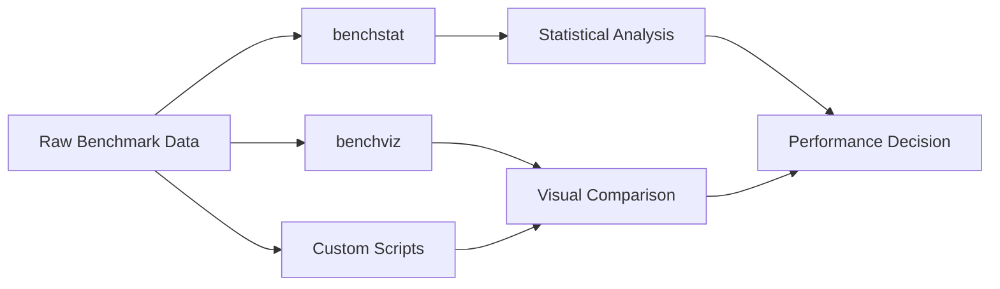

# Go Benchmarking

## Introduction

When developing applications, it's important not only to ensure your code works correctly but also that it performs efficiently. Go provides built-in benchmarking tools as part of its testing package, making it easy to measure and compare the performance of your code.

Benchmarking in Go allows you to:
- Measure execution time of functions
- Compare different implementations
- Identify performance bottlenecks
- Make data-driven optimization decisions

This guide will walk you through the fundamentals of Go benchmarking, from writing basic benchmarks to interpreting results and implementing real-world performance optimizations.

## Benchmarking Basics

### Setting Up Your First Benchmark

In Go, benchmarks are functions that live in `*_test.go` files, just like tests. The key differences are:

1. Benchmark functions start with `Benchmark` instead of `Test`
2. They take a `*testing.B` parameter instead of `*testing.T`
3. They measure performance rather than correctness

Let's create a simple benchmark:

```go
// main.go
package main

func Fibonacci(n int) int {
    if n <= 1 {
        return n
    }
    return Fibonacci(n-1) + Fibonacci(n-2)
}
```

```go
// main_test.go
package main

import "testing"

func BenchmarkFibonacci(b *testing.B) {
    // Run the Fibonacci function b.N times
    for i := 0; i < b.N; i++ {
        Fibonacci(10)
    }
}
```

### Running Benchmarks

To run a benchmark, use the `go test` command with the `-bench` flag:

```bash
go test -bench=.
```

Output:
```
goos: linux
goarch: amd64
BenchmarkFibonacci-8       702256              1693 ns/op
PASS
ok      example.com/myproject     1.425s
```

Let's break down this output:
- `BenchmarkFibonacci-8`: Name of the benchmark function followed by the number of CPUs used
- `702256`: Number of iterations executed
- `1693 ns/op`: Average time per operation in nanoseconds
- `PASS`: Indicates the benchmark ran without errors
- `1.425s`: Total time taken to run all benchmarks

### The b.N Loop

The `b.N` loop is a fundamental part of Go's benchmarking. The testing framework:

1. First tries `b.N = 1`
2. Then increases `b.N` until the benchmark runs long enough for reliable timing
3. Adjusts iterations automatically based on how fast your function runs

This adaptive approach ensures that both fast and slow functions can be benchmarked accurately.

## Advanced Benchmarking Techniques

### Benchmarking with Input Data

Often you'll want to benchmark how your function performs with different inputs:

```go
func BenchmarkFibonacciWithInput(b *testing.B) {
    for n := 5; n <= 10; n++ {
        b.Run(fmt.Sprintf("input=%d", n), func(b *testing.B) {
            for i := 0; i < b.N; i++ {
                Fibonacci(n)
            }
        })
    }
}
```

Output:
```
BenchmarkFibonacciWithInput/input=5-8         10000000          113 ns/op
BenchmarkFibonacciWithInput/input=6-8          5000000          215 ns/op
BenchmarkFibonacciWithInput/input=7-8          3000000          357 ns/op
BenchmarkFibonacciWithInput/input=8-8          2000000          582 ns/op
BenchmarkFibonacciWithInput/input=9-8          1000000          944 ns/op
BenchmarkFibonacciWithInput/input=10-8          500000         1698 ns/op
```

This shows how performance scales with different inputs, providing valuable insights for optimization.

### Measuring Memory Allocations

Go benchmarks can also measure memory allocations:

```go
func BenchmarkSliceAppend(b *testing.B) {
    b.ReportAllocs() // Enable allocation reporting
    for i := 0; i < b.N; i++ {
        s := make([]int, 0)
        for j := 0; j < 100; j++ {
            s = append(s, j)
        }
    }
}
```

Output:
```
BenchmarkSliceAppend-8    1000000        1234 ns/op    1024 B/op    8 allocs/op
```

The additional metrics tell us:
- `1024 B/op`: Bytes allocated per operation
- `8 allocs/op`: Number of heap allocations per operation

### Avoiding Benchmark Pitfalls

To ensure accurate benchmarks:

#### 1. Reset the timer for setup

```go
func BenchmarkComplexOperation(b *testing.B) {
    // Setup phase
    data := generateLargeTestData()
    
    b.ResetTimer() // Reset timer before the actual benchmark
    
    for i := 0; i < b.N; i++ {
        processData(data)
    }
}
```

#### 2. Prevent compiler optimizations

```go
func BenchmarkComputation(b *testing.B) {
    var result int
    for i := 0; i < b.N; i++ {
        result = complexCalculation(10)
    }
    // Use the result to prevent the compiler from optimizing it away
    benchmarkResult = result
}
```

## Comparative Benchmarking

One of the most valuable uses of benchmarking is comparing different implementations.

### Example: Comparing String Concatenation Methods

```go
func BenchmarkStringConcat(b *testing.B) {
    b.Run("plus-operator", func(b *testing.B) {
        var s string
        for i := 0; i < b.N; i++ {
            s = ""
            for j := 0; j < 100; j++ {
                s = s + "a"
            }
        }
    })

    b.Run("strings-builder", func(b *testing.B) {
        var sb strings.Builder
        for i := 0; i < b.N; i++ {
            sb.Reset()
            for j := 0; j < 100; j++ {
                sb.WriteString("a")
            }
            _ = sb.String()
        }
    })
}
```

Output:
```
BenchmarkStringConcat/plus-operator-8          100000         15234 ns/op    9400 B/op    99 allocs/op
BenchmarkStringConcat/strings-builder-8       1000000          1235 ns/op     168 B/op     1 allocs/op
```

From this, we can clearly see that `strings.Builder` is approximately 12 times faster and allocates significantly less memory than using the `+` operator for repeated string concatenation.

## Visualizing Benchmark Results

Visualization can help interpret benchmark results more intuitively. There are several tools available:


### Comparing Results with benchstat

A single benchmark run is noisy. The `benchstat` tool from the Go team summarizes multiple runs and tells you whether a difference is statistically significant.

Install it:

```bash
go install golang.org/x/perf/cmd/benchstat@latest
```

Run the benchmark several times before and after a change, saving the output:

```bash
go test -bench=StringConcat -count=10 > old.txt
# ... make your optimization ...
go test -bench=StringConcat -count=10 > new.txt
benchstat old.txt new.txt
```

The output shows the median time per operation for each version, the variation between runs (for example `± 2%`), and the percentage change with a p-value. If benchstat reports `~` instead of a percentage, the difference is not statistically significant and could just be noise.

## Profiling Benchmarks

When a benchmark is slower than expected, collect a profile to find out where the time goes:

```bash
go test -bench=Fibonacci -cpuprofile=cpu.out -memprofile=mem.out
go tool pprof cpu.out
```

Inside the interactive `pprof` shell, `top` lists the functions using the most CPU and `list Fibonacci` shows line-by-line costs. You can also open a browser view:

```bash
go tool pprof -http=:8080 cpu.out
```

## Parallel Benchmarks

To measure how code behaves under concurrent load, use `b.RunParallel`. It runs the body in multiple goroutines (by default `GOMAXPROCS` of them), dividing the `b.N` iterations among them:

```go
import (
    "sync"
    "testing"
)

func BenchmarkMapWithMutex(b *testing.B) {
    var mu sync.Mutex
    m := make(map[int]int)

    b.RunParallel(func(pb *testing.PB) {
        i := 0
        for pb.Next() {
            mu.Lock()
            m[i%100] = i
            mu.Unlock()
            i++
        }
    })
}

func BenchmarkSyncMap(b *testing.B) {
    var m sync.Map

    b.RunParallel(func(pb *testing.PB) {
        i := 0
        for pb.Next() {
            m.Store(i%100, i)
            i++
        }
    })
}
```

Combine this with the `-cpu` flag to see how performance scales with the number of processors:

```bash
go test -bench=Map -cpu=1,2,4,8
```

## The `b.Loop` Method (Go 1.24+)

Go 1.24 introduced `b.Loop`, a simpler and less error-prone alternative to the `b.N` loop:

```go
func BenchmarkFibonacciLoop(b *testing.B) {
    for b.Loop() {
        Fibonacci(10)
    }
}
```

With `b.Loop`, setup code before the loop and cleanup code after it are automatically excluded from the timing, so you no longer need `b.ResetTimer()`. It also keeps the compiler from optimizing away the function call inside the loop. On older Go versions, continue to use the `for i := 0; i < b.N; i++` form.

## Useful Command-Line Flags

| Flag | Purpose | Example |
| --- | --- | --- |
| `-bench` | Regular expression selecting benchmarks to run | `-bench=Concat` |
| `-benchmem` | Report memory allocations for all benchmarks | `-benchmem` |
| `-benchtime` | Run for a duration or fixed number of iterations | `-benchtime=5s`, `-benchtime=1000x` |
| `-count` | Repeat each benchmark n times | `-count=10` |
| `-cpu` | List of GOMAXPROCS values to run with | `-cpu=1,4` |
| `-run` | Select tests to run; `-run=^$` skips all regular tests | `-run=^$` |

A common command for focused benchmarking is:

```bash
go test -run=^$ -bench=. -benchmem -count=5
```

## Best Practices

1. **Benchmark on a quiet machine**: close other programs and avoid laptops on battery power, which may throttle the CPU.
2. **Run multiple times**: use `-count` and `benchstat` instead of trusting a single run.
3. **Use realistic inputs**: benchmark with data sizes and shapes that match production.
4. **Keep setup out of the measurement**: use `b.ResetTimer()`, `b.StopTimer()`/`b.StartTimer()`, or `b.Loop`.
5. **Prevent dead-code elimination**: store results in a package-level variable when using the `b.N` loop.
6. **Measure before optimizing**: use profiles to find real hotspots rather than guessing.

## Summary

Go's built-in benchmarking support makes performance measurement part of the normal testing workflow. In this tutorial you learned how to:

- Write benchmark functions with `*testing.B` and run them with `go test -bench`
- Read benchmark output, including `ns/op`, `B/op`, and `allocs/op`
- Use sub-benchmarks with `b.Run` to compare inputs and implementations
- Avoid common pitfalls such as including setup time and compiler optimizations
- Compare runs statistically with `benchstat` and find hotspots with `pprof`
- Benchmark concurrent code with `b.RunParallel` and use the newer `b.Loop` API

## Exercises

1. Write benchmarks comparing a recursive and an iterative Fibonacci implementation for `n = 20`.
2. Benchmark appending 10,000 integers to a slice with and without preallocating capacity using `make([]int, 0, 10000)`. Compare allocations with `-benchmem`.
3. Use `benchstat` to compare `strings.Builder` with `bytes.Buffer` for building a large string.
4. Write parallel benchmarks for a map protected by `sync.RWMutex` and for `sync.Map` with a read-heavy workload.
5. Generate a CPU profile for one of your benchmarks and identify the function that uses the most time.

## Additional Resources

- [testing package documentation](https://pkg.go.dev/testing)
- [benchstat documentation](https://pkg.go.dev/golang.org/x/perf/cmd/benchstat)
- [Profiling Go Programs (Go Blog)](https://go.dev/blog/pprof)
- [Diagnostics in Go](https://go.dev/doc/diagnostics)
