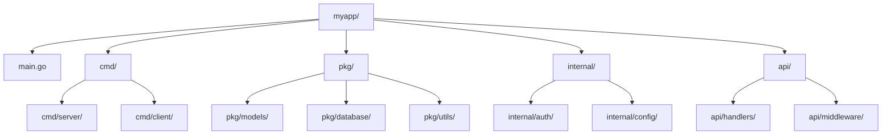

# Go Packages (Project Structure)

## Introduction

Packages are one of Go's most powerful features for organizing and reusing code. If you're coming from other programming languages, you can think of packages as similar to modules in Python, libraries in C, or namespaces in C# - but with Go's unique approach.

In this guide, we'll explore:
- What Go packages are and why they're important
- How to create and use your own packages
- Best practices for organizing packages
- Working with standard library and third-party packages

## What is a Go Package?

A package in Go is a collection of related Go source files in the same directory that are compiled together. Every Go file must declare which package it belongs to at the top of the file.

Here's the key concept: **a package is the basic unit of code reusability in Go**.

```go
// This line must appear at the beginning of every Go file
package mypackage

// Rest of your code follows...
```

### Why Packages Matter

Packages in Go provide several benefits:

1. **Code Organization**: They group related functionality together
2. **Encapsulation**: They control what's visible outside the package (public vs. private)
3. **Reusability**: They make it easy to reuse code across different projects
4. **Namespace Management**: They prevent naming conflicts

## Package Naming Conventions

In Go, package names follow these conventions:

- Use lowercase, single-word names
- Avoid underscores or mixedCaps
- The package name should match its directory name (though it's not enforced)
- Names should be short, concise, and descriptive

```
directory name: stringutil
package declaration: package stringutil
```

## Creating Your First Package

Let's create a simple package that provides string utilities:

1. First, create a directory structure:

```
myproject/
├── main.go
└── stringutil/
    └── reverse.go
```

2. In `reverse.go`, define your package:

```go
// File: stringutil/reverse.go
package stringutil

// Reverse returns the reverse of a string
func Reverse(s string) string {
    r := []rune(s)
    for i, j := 0, len(r)-1; i < j; i, j = i+1, j-1 {
        r[i], r[j] = r[j], r[i]
    }
    return string(r)
}
```

3. In `main.go`, import and use your package:

```go
// File: main.go
package main

import (
    "fmt"
    "./stringutil" // In a proper Go module, this would be your module path/stringutil
)

func main() {
    input := "Hello, Go!"
    reversed := stringutil.Reverse(input)
    fmt.Printf("Original: %s
Reversed: %s
", input, reversed)
}
```

Output:
```
Original: Hello, Go!
Reversed: !oG ,olleH
```

## Public vs. Private Elements

Go uses a simple rule to determine whether a package element (function, type, variable, etc.) is accessible outside its package:

- If the identifier starts with an uppercase letter, it's **exported** (public)
- If it starts with a lowercase letter, it's **unexported** (private)

```go
package calculator

// Add is exported (public) - usable outside this package
func Add(a, b int) int {
    return a + b
}

// multiply is unexported (private) - only usable within this package
func multiply(a, b int) int {
    return a * b
}
```

This example shows how you would use these functions:

```go
package main

import (
    "fmt"
    "myproject/calculator"
)

func main() {
    // This works because Add is exported
    sum := calculator.Add(5, 3)
    fmt.Println("5 + 3 =", sum)
    
    // This would cause a compile error because multiply is unexported
    // product := calculator.multiply(5, 3)
}
```

Output:
```
5 + 3 = 8
```

## Package Documentation

Go encourages documenting your packages using comments. These comments can be processed by the `go doc` tool.

```go
// Package calculator provides basic arithmetic operations.
package calculator

// Add returns the sum of two integers.
// It never overflows.
func Add(a, b int) int {
    return a + b
}
```

To view the documentation:

```
go doc calculator
go doc calculator.Add
```

## Package Initialization

Go packages can have initialization code that runs when the package is imported:

1. Package-level variables are initialized first
2. `init()` functions are executed next

```go
package database

import "fmt"

var connection string

// init runs when the package is imported
func init() {
    fmt.Println("Initializing database package...")
    connection = "postgresql://localhost:5432/mydb"
}
```

A package can have multiple `init()` functions, even across different files. They execute in the order they're defined.

## Working with Standard Library Packages

Go comes with a rich standard library of packages. Here's how to use them:

```go
package main

import (
    "fmt"       // Formatted I/O
    "strings"   // String manipulation
    "time"      // Time-related functions
)

func main() {
    // Using the fmt package
    fmt.Println("Hello, World!")
    
    // Using the strings package
    message := "  Go Packages are awesome  "
    trimmed := strings.TrimSpace(message)
    fmt.Printf("Original: %q
Trimmed: %q
", message, trimmed)
    
    // Using the time package
    now := time.Now()
    fmt.Println("Current time:", now.Format("15:04:05"))
}
```

Output:
```
Hello, World!
Original: "  Go Packages are awesome  "
Trimmed: "Go Packages are awesome"
Current time: 14:30:45
```

## Importing Packages

There are several ways to import packages in Go:

### Basic Import

```go
import "fmt"

func main() {
    fmt.Println("Hello!")
}
```

### Multiple Imports

```go
import (
    "fmt"
    "strings"
)
```

### Named Imports

```go
import (
    "fmt"
    str "strings" // Now we use str instead of strings
)

func main() {
    fmt.Println(str.ToUpper("hello"))
}
```

### Dot Imports (Not Recommended)

```go
import (
    "fmt"
    . "strings" // All exported identifiers are now in current namespace
)

func main() {
    // Can call ToUpper directly without strings. prefix
    fmt.Println(ToUpper("hello")) 
}
```

### Blank Imports

```go
import (
    "fmt"
    _ "image/png" // Only run the init() function, don't access any exports
)
```

## Package Organization in Real-World Applications

In larger Go applications, packages are typically organized by functionality:


What each directory is commonly used for:

| Directory | Purpose |
| --- | --- |
| `cmd/` | One subdirectory per executable, each containing a small `package main` that wires the application together |
| `internal/` | Private packages that only code inside this module can import (enforced by the Go toolchain) |
| `pkg/` | Packages intended to be importable by other projects (optional; many projects omit it) |
| `api/` | HTTP handlers, middleware, or API definitions such as OpenAPI or protobuf files |

These are conventions rather than rules. Small projects are often best served by a flat layout with a few packages at the module root, and you should only add structure when the project grows into it.

### Example: Using an `internal` Package

```text
myapp/
├── go.mod                  // module example.com/myapp
├── cmd/
│   └── server/
│       └── main.go
└── internal/
    └── config/
        └── config.go
```

```go
// file: internal/config/config.go
package config

import "os"

// Config holds the application settings.
type Config struct {
    Port string
}

// Load reads configuration from environment variables.
func Load() Config {
    port := os.Getenv("PORT")
    if port == "" {
        port = "8080"
    }
    return Config{Port: port}
}
```

```go
// file: cmd/server/main.go
package main

import (
    "fmt"

    "example.com/myapp/internal/config"
)

func main() {
    cfg := config.Load()
    fmt.Println("Starting server on port", cfg.Port)
}
```

Running it:

```bash
go run ./cmd/server
```

Output:
```text
Starting server on port 8080
```

Any other module that tries to import `example.com/myapp/internal/config` gets a compile error saying the use of an internal package is not allowed.

## Avoiding Import Cycles

Go does not allow circular imports. If package `orders` imports `customers` and `customers` imports `orders`, the build fails with an `import cycle not allowed` error.

Common ways to break a cycle:

1. **Extract shared types** into a third, lower-level package (for example `models`) that both packages import.
2. **Define an interface** in the package that needs the behavior, and let the other package satisfy it without importing back.
3. **Merge the packages** if they are so tightly coupled that they really belong together.

```go
// file: orders/orders.go
package orders

import "fmt"

// CustomerLookup is defined here, so orders does not import customers.
type CustomerLookup interface {
    CustomerName(id int) (string, error)
}

func Describe(orderID, customerID int, lookup CustomerLookup) (string, error) {
    name, err := lookup.CustomerName(customerID)
    if err != nil {
        return "", err
    }
    return fmt.Sprintf("Order %d for %s", orderID, name), nil
}
```

The `customers` package can then implement `CustomerName` and be passed in by `main`, without either package importing the other.

## Best Practices

- **Name packages after what they provide**, not what they contain: `auth` instead of `helpers`.
- **Keep packages focused**: a package should have one clear responsibility.
- **Keep `main` thin**: put logic in packages that can be tested, and use `main` only to wire them together.
- **Prefer `internal/`** for code that is not meant to be a public API.
- **Write a package comment** in one file of each package so that `go doc` shows a useful overview.

## Summary

Packages are how Go code is organized, shared, and encapsulated. In this tutorial you learned:

- What a package is and how package names relate to directories and import paths
- Naming conventions for packages
- How capitalization controls exported (public) and unexported (private) identifiers
- How to document packages and how `init()` functions run
- The different import forms: basic, grouped, named, dot, and blank imports
- How real-world projects use directories such as `cmd/`, `internal/`, and `pkg/`
- How to avoid and break import cycles

## Exercises

1. Create a module with a `cmd/app` entry point and an `internal/greeting` package that exports a `Hello(name string) string` function.
2. Add an unexported helper to `greeting` and confirm that `cmd/app` cannot call it.
3. Create two packages that import each other, observe the error, and fix it by extracting shared types into a third package.
4. Write package documentation for `greeting` and view it with `go doc`.
5. Reorganize a single-file program of a few hundred lines into at least three focused packages.

## Additional Resources

- [How to Write Go Code](https://go.dev/doc/code)
- [Organizing a Go module](https://go.dev/doc/modules/layout)
- [Effective Go: Package names](https://go.dev/doc/effective_go#package-names)
- [Go Blog: Package names](https://go.dev/blog/package-names)
