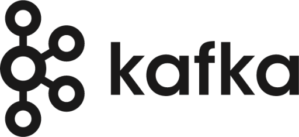
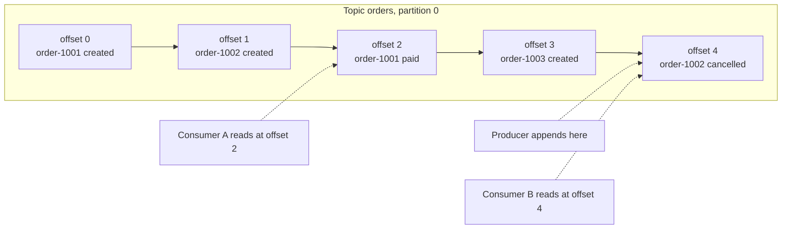
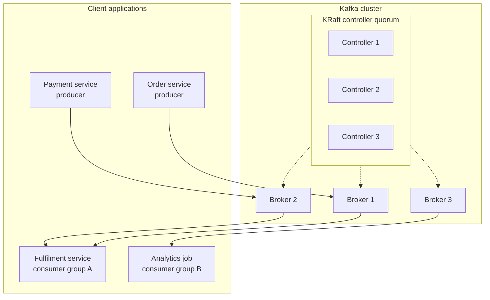
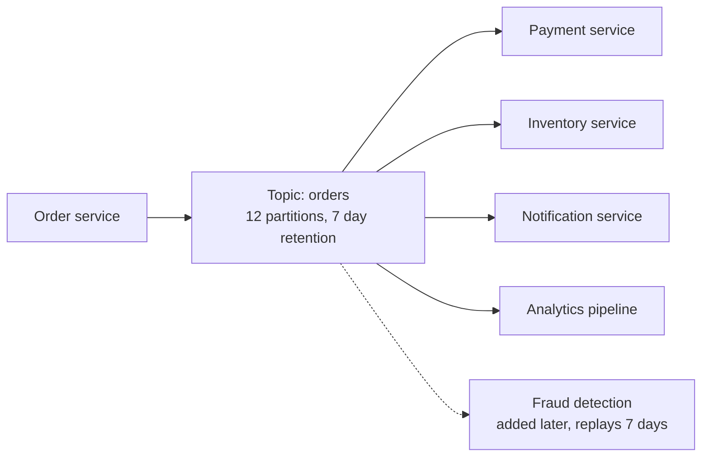

# Apache Kafka Introduction



## Introduction

Apache Kafka is a distributed system for storing and moving streams of events. An event is a small record that says "this happened": a customer placed an order, a sensor reported a temperature, a row changed in a database. Kafka receives millions of such records per second, keeps them on disk in the order they arrived and lets any number of applications read them, in real time or hours later.

Most developers meet Kafka when a system outgrows point-to-point integration. Service A calls service B, which calls C and D, and every new consumer of the data means another API call to add, another failure mode to handle and another team to coordinate with. Kafka replaces that web of calls with a shared, durable log: producers write once, and each consumer reads at its own pace without the producer knowing or caring.

By the end of this page you will be able to explain what Kafka is in one paragraph, describe the log abstraction that makes it different from a queue, name the main pieces of a Kafka deployment and recognise the kinds of workloads that companies run on it. The rest of this section then goes deeper into [event streaming concepts](./1-kafka-event-streaming-concepts.mdx), the [cluster architecture](./2-kafka-architecture.mdx) and [when Kafka is the right choice](./5-kafka-when-to-use.mdx).

## What Kafka Is

The Kafka project describes itself as an event streaming platform. That phrase covers three capabilities that usually live in three separate products:

| Capability | What it means in practice | Traditional equivalent |
|---|---|---|
| Publish and subscribe | Producers append records to named topics; consumers subscribe and read them | A message broker such as RabbitMQ or ActiveMQ |
| Durable storage | Records stay on disk for a configured retention period (days, months or forever), not just until someone reads them | A database or a file archive |
| Stream processing | Applications transform, aggregate and join streams as they flow, with the Kafka Streams library or external engines | A batch job or an ETL tool |

The combination matters more than any one part. Because records are stored, a consumer that was down for an hour catches up by itself. Because storage is a log, a new consumer can read the whole history and build a fresh view of the world. Because processing is built on the same log, the output of one job becomes the input of the next with no extra infrastructure.

Kafka was created at LinkedIn around 2010 by Jay Kreps, Neha Narkhede and Jun Rao, open-sourced in 2011 and became an Apache top-level project in October 2012. It is written in Java and Scala, and the server side needs Java 17 or later as of Kafka 4.0. The current release line in 2026 is Kafka 4.x, which runs entirely on its own built-in consensus layer called KRaft; the older ZooKeeper dependency was removed in 4.0 (March 2025). If you read a tutorial that starts ZooKeeper before Kafka, it is describing a version you should no longer deploy.

## The Log Abstraction

Everything in Kafka rests on one data structure: the append-only log. A log is a sequence of records where new records go at the end and existing records never change. Each record gets a position number called an offset. The first record in a partition has offset 0, the next has offset 1 and so on.



A good analogy is a bank statement rather than a bank balance. The balance is a single number that gets overwritten; the statement is a list of every deposit and withdrawal, and you can recompute the balance for any date by replaying it. Kafka stores statements. The applications that read them decide what balances to compute.

This design has consequences that explain most of Kafka's behaviour:

- **Reading does not delete.** A traditional queue removes a message when a consumer acknowledges it, so two consumers compete for the same messages. In Kafka each consumer keeps its own offset, a bookmark saying "I have processed everything up to here", and the record stays on disk for other readers and for replay.
- **Writes are sequential.** Appending to the end of a file and reading forward from a position are the two things that disks, SSDs and operating-system page caches do fastest. Kafka reaches throughput of hundreds of megabytes per second per broker with ordinary hardware because it never does random writes to the data files.
- **Ordering is per partition.** Within one partition, records are stored and delivered in the order they were appended. Across partitions there is no global order. This is why the choice of partition key, covered in [Ordering Guarantees and Message Keys](../2-kafka-topics-and-storage/1-kafka-ordering-and-keys.mdx), is the single most important design decision in a Kafka application.
- **Retention is a policy, not a side effect.** Records are deleted when they are older than `retention.ms` or when the partition exceeds `retention.bytes`, or they are kept forever. A compacted topic keeps only the latest record per key, which turns a log into a changelog of a table.

## A Kafka Deployment at a Glance

A production Kafka deployment has three kinds of participants: brokers that store the data, controllers that keep track of cluster metadata, and clients that produce and consume.



- A **broker** is a Kafka server process. It owns some partitions, accepts writes for them, serves reads and replicates data to other brokers so that a broker failure loses nothing.
- A **controller** is a server process that runs the KRaft consensus protocol and stores the cluster's metadata: which topics exist, which broker leads which partition, which brokers are alive. Small clusters can run brokers and controllers in the same process; production clusters keep them separate. The [KRaft page](./3-kafka-kraft-and-metadata.mdx) explains why.
- A **producer** is any application that uses a Kafka client library to append records to a topic. It never talks to a consumer directly.
- A **consumer** reads records from one or more topics. Consumers that share a `group.id` form a consumer group and split the partitions of a topic between them, which is how Kafka scales out reading.

Clients exist for most languages. The reference implementation is the Java `kafka-clients` library; Python developers usually use `confluent-kafka`, Node developers `kafkajs` or `@confluentinc/kafka-javascript`, and Go developers `franz-go` or `sarama`. All of them speak the same binary protocol to the brokers, so a Python producer and a Java consumer interoperate without any translation.

Here is the smallest useful Java producer. It sends one order event keyed by the customer id, which guarantees that all events for the same customer land in the same partition and therefore stay in order.

```java
import org.apache.kafka.clients.producer.KafkaProducer;
import org.apache.kafka.clients.producer.ProducerRecord;
import org.apache.kafka.clients.producer.RecordMetadata;
import java.util.Properties;

public class OrderProducer {
    public static void main(String[] args) throws Exception {
        Properties props = new Properties();
        props.put("bootstrap.servers", "localhost:9092");           // any broker; the client discovers the rest
        props.put("key.serializer", "org.apache.kafka.common.serialization.StringSerializer");
        props.put("value.serializer", "org.apache.kafka.common.serialization.StringSerializer");
        props.put("acks", "all");                                   // wait until all in-sync replicas have the record

        try (KafkaProducer<String, String> producer = new KafkaProducer<>(props)) {
            String key = "customer-42";
            String value = "{\"orderId\":\"order-1001\",\"status\":\"CREATED\",\"total\":59.90}";
            RecordMetadata meta = producer.send(new ProducerRecord<>("orders", key, value)).get();
            System.out.printf("Written to %s-%d at offset %d%n",
                    meta.topic(), meta.partition(), meta.offset());
        }
    }
}
```

And the matching command-line check, using the tools that ship with every Kafka distribution:

```bash
# Read the orders topic from the beginning and show keys next to values
# (Kafka 4.2 renamed --property to --formatter-property; the old name still works with a warning)
kafka-console-consumer.sh --bootstrap-server localhost:9092 \
  --topic orders --from-beginning \
  --formatter-property print.key=true --formatter-property key.separator=" => "
```

```text
customer-42 => {"orderId":"order-1001","status":"CREATED","total":59.90}
```

## Who Uses Kafka and for What

The Kafka project lists more than a thousand published use cases and states that over 80 percent of the Fortune 100 run it. The companies on that list use it in a few recurring ways:

| Pattern | Example | What Kafka provides |
|---|---|---|
| Activity tracking and clickstreams | LinkedIn feeds every page view and click through Kafka to power its feed and offline analytics | Very high write volume, many independent readers |
| Log and metrics aggregation | Cloudflare collects hundreds of billions of events per day from thousands of edge servers into its analytics pipeline | Buffering between fast producers and slower storage |
| Microservice integration | Zalando uses Kafka as the backbone between services while breaking up a monolith | Decoupling, replay, one producer and many consumers |
| Financial transactions | PayPal runs payment tracking, risk detection and compliance analytics on it, over 100 billion messages a day per use case | Durability, ordering per key, exactly-once processing |
| Content distribution | The New York Times stores every published asset in Kafka and streams it to the systems that serve readers | Long retention: the log is the source of truth |
| Change data capture | Shopify streams domain events and database changes into analytics and fraud detection | Database rows become an ordered stream of changes |
| IoT and telemetry | Factories, wind farms and vehicle fleets send sensor readings for monitoring and prediction | Millions of small records per second, time-ordered |

Notice what these have in common. None of them is "send a task to a worker and forget it". Each one has multiple readers of the same data, cares about order, or wants to go back in time. Those three properties are the signature of a Kafka workload. When your problem has none of them, a simpler queue is often the better tool; the [comparison page](./4-kafka-vs-alternatives.mdx) goes into detail.

## The Ecosystem Around the Broker

The broker on its own only stores and serves bytes. Most of what makes Kafka productive comes from the pieces built around it, which this tutorial covers section by section:

- **Kafka Connect** is a framework for moving data between Kafka and other systems without writing code. A source connector pulls rows from PostgreSQL or files from S3 into topics; a sink connector pushes topics into Elasticsearch, Snowflake or a data lake. The Debezium connectors turn a database's transaction log into Kafka events. See [Kafka Connect](../8-kafka-connect/0-kafka-connect-introduction.mdx).
- **Kafka Streams** is a Java library for processing streams inside your own application: filter, join, aggregate over time windows, and write results back to Kafka. No separate cluster to run. See [Kafka Streams](../7-kafka-streams/0-kafka-streams-introduction.mdx).
- **Schema Registry** (from Confluent, with open-source alternatives such as Apicurio and Karapace) stores Avro, Protobuf and JSON schemas so that producers and consumers agree on the shape of a record and can evolve it safely. See [Schemas and Serialization](../6-kafka-schemas/0-kafka-serialization-formats.mdx).
- **Managed services** such as Confluent Cloud, Amazon MSK, Azure Event Hubs for Kafka and Redpanda Cloud run the brokers for you. Choosing between them and self-hosting is covered in [Managed Kafka](../1-kafka-getting-started/5-kafka-managed-services.mdx).

## A Worked Scenario: From Direct Calls to a Shared Log

Imagine an online shop with four services. The order service receives a checkout. It must tell the payment service to charge the card, the inventory service to reserve stock, the notification service to email the customer and the analytics team to update their dashboards.

Without Kafka the order service makes four HTTP calls. If notifications are slow, checkout is slow. If analytics is down, either checkout fails or the team quietly loses data. When a fifth team wants the orders (say, fraud detection), they open a ticket and the order service grows another call.



With Kafka the order service writes one record to the `orders` topic and returns. Every downstream service is a consumer group reading the same topic. If notifications are slow, their consumer lag grows but checkout is unaffected. If analytics is down for an hour, its records wait on disk and are processed when it comes back. When fraud detection joins, it starts reading from the beginning of the retention window and nobody changes the order service.

The trade-off is real: the order service no longer knows whether payment succeeded. That is a different design, where the payment service publishes its own `payments` topic and the order service consumes it. Kafka pushes you toward asynchronous, event-driven architecture, which is excellent for scale and resilience and harder for the request-response flows that users wait on. The [Architecture Patterns](../9-kafka-patterns/0-kafka-event-driven-architecture.mdx) section shows how to combine the two.

:::tip
Start by replacing one fan-out integration with a topic, as in this scenario, rather than moving everything at once. You get the operational experience of running Kafka while the blast radius of a mistake is one service.
:::

## Common Mistakes

- Treating Kafka as a queue and expecting records to disappear once read. They stay until retention removes them; consumers track their own position.
- Assuming global ordering across a topic. Order holds only within a partition, so records that must be ordered need the same key.
- Starting with ZooKeeper-based guides or Docker images. Kafka 4.x is KRaft-only; a ZooKeeper cluster cannot run 4.x brokers.
- Using Kafka for a handful of messages per day between two services. The operational cost of a cluster only pays off when you need its durability, fan-out or replay.
- Skipping the schema question. Producers and consumers that agree on "it is JSON" without a shared schema break each other within months.
- Running a single broker in production. Replication across three brokers is what makes Kafka durable; one broker is a single point of failure with extra steps.

## Summary

- Kafka is an event streaming platform: publish and subscribe, durable storage and stream processing on one append-only log.
- Records are appended to partitions, addressed by offset and kept for a retention period regardless of who has read them.
- Reading does not consume; every consumer group keeps its own offsets and can replay history.
- A deployment consists of brokers (data), KRaft controllers (metadata) and clients in any language speaking one protocol.
- Kafka 4.x (2025 onwards) has no ZooKeeper, needs Java 17 on the server and is the only line you should deploy today.
- The sweet spot is workloads with many readers of the same data, per-key ordering or a need to replay; simple task queues are often better served elsewhere.

## Further Reading

- [Apache Kafka: Introduction](https://kafka.apache.org/intro) - the project's own overview of event streaming and the core concepts.
- [Apache Kafka 4.0.0 release announcement](https://kafka.apache.org/blog/2025/03/18/apache-kafka-4.0.0-release-announcement/) - the release that removed ZooKeeper and made the new consumer protocol generally available.
- [Powered By](https://kafka.apache.org/powered-by) - company-submitted descriptions of production Kafka use cases.
- [Kafka documentation: Design](https://kafka.apache.org/documentation/#design) - the reasoning behind the log, the page cache, batching and replication.
- [The Log: What every software engineer should know about real-time data's unifying abstraction](https://engineering.linkedin.com/distributed-systems/log-what-every-software-engineer-should-know-about-real-time-datas-unifying) - Jay Kreps' essay on why the log is the right primitive.
