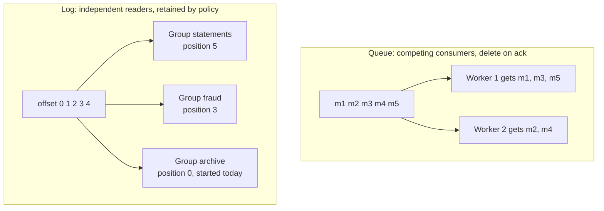
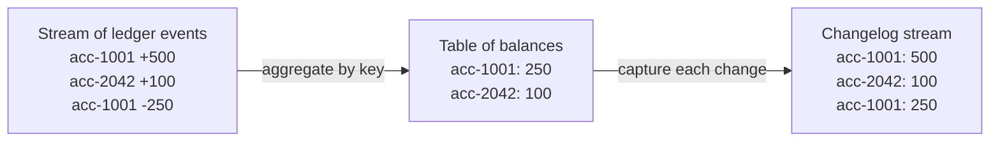
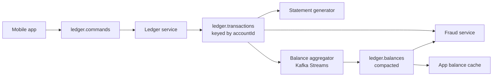

# Event Streaming Concepts

## Introduction

Kafka is easier to use well once you stop thinking of it as a faster message queue and start thinking in terms of events. The vocabulary matters: an event is a fact about the past, a command is a request for the future, and a message is just the envelope either one travels in. Systems that confuse the three end up with topics named `send-email` that twenty teams depend on and nobody dares to change.

This page builds the conceptual toolkit that the rest of the tutorial assumes. You will learn the difference between events, messages and commands, why a log and a queue solve different problems, how a stream of events and a table of current state are two views of the same data, and what "time" means when records arrive late. Each idea is illustrated with a bank ledger, because banking is the oldest event-sourced system there is.

## Events, Messages and Commands

Three words get used interchangeably and should not be.

An **event** records something that has already happened. It is written in the past tense, it is immutable and the producer does not know or care who will read it. `OrderPlaced`, `PaymentCaptured`, `TemperatureMeasured`, `AccountDebited` are events. The producer's job ends when the event is durably stored.

A **command** asks a specific receiver to do something. It is imperative, it may be rejected and the sender usually wants to know the outcome. `ChargeCard`, `ReserveStock`, `SendWelcomeEmail` are commands. Commands create coupling by design: the sender knows which service handles them.

A **message** is the transport unit. In Kafka a message (the documentation also says record) is a key, a value, a timestamp and optional headers, stored at an offset in a partition. Events and commands are both carried as messages; the difference lies in intent and in who owns the contract, not in the bytes.

| | Event | Command |
|---|---|---|
| Tense | Past: `AccountDebited` | Imperative: `DebitAccount` |
| Number of consumers | Any; zero is fine | Exactly one handler |
| Who owns the schema | The producer (it describes its own domain) | The receiver (it defines what it accepts) |
| Can it be rejected? | No; it already happened | Yes |
| Typical topic name | `ledger.account-debited` or `ledger.account-events` | `payments.commands` |
| Replaying it later | Safe: rebuilds state | Dangerous: re-executes side effects |

Kafka is built for events. Nothing stops you from sending commands through it, and some patterns such as [request-reply](../9-kafka-patterns/5-kafka-request-reply.mdx) and [sagas](../9-kafka-patterns/6-kafka-sagas.mdx) do, but the defaults (retention, replay, fan-out to many groups) all assume that re-reading a record is harmless. Re-reading `ChargeCard` is not harmless.

A ledger example makes the distinction concrete. First, a command: the mobile app asks the ledger service to move money.

```json
{
  "type": "TransferFunds",
  "transferId": "tr-88213",
  "from": "acc-1001",
  "to": "acc-2042",
  "amount": "250.00",
  "currency": "EUR",
  "requestedAt": "2026-10-16T09:14:03Z"
}
```

Then one of the two events the ledger service records after it accepts the command (the matching `AccountCredited` event for `acc-2042` looks the same):

```json
{
  "type": "AccountDebited",
  "accountId": "acc-1001",
  "transferId": "tr-88213",
  "amount": "250.00",
  "currency": "EUR",
  "balanceAfter": "1180.50",
  "occurredAt": "2026-10-16T09:14:03.412Z"
}
```

The command lands on a topic that one service consumes. The events land on a topic keyed by `accountId` that the statement generator, the fraud model, the regulatory archive and the mobile app's balance cache all consume, each at its own pace.

## Logs Versus Queues

A queue and a log both hold messages between a producer and a consumer, which is why they are so often confused. Their contracts are opposite.

A **queue** hands each message to one consumer and then forgets it. Several consumers compete for messages, which spreads work across them. The queue's state is "what has not yet been handled". Once it is empty, the history is gone. RabbitMQ queues, Amazon SQS and the classic JMS queue work this way, and so do Kafka's newer share groups, which are described below.

A **log** appends each message at the end and keeps it. Consumers read from a position of their choosing and remember where they are. Many independent consumers can read the same log without interfering. The log's state is "everything that happened, in order, for the retention window". Kafka topics, Kinesis streams, Pulsar topics and RabbitMQ streams work this way.



The practical consequences:

| Concern | Queue | Log |
|---|---|---|
| Adding a new reader | Needs a new queue and a fan-out exchange, or changes to the producer | Start a new consumer group; nothing else changes |
| Replaying last week's data | Not possible; it was deleted on ack | Reset the group's offset and read again |
| Per-message acknowledgement | Yes; a failed message can be retried or dead-lettered on its own | No; a group commits a position, so a poison record blocks the partition unless you skip it or route it to a retry topic |
| Ordering | Usually only with a single consumer | Guaranteed per partition, for any number of groups |
| Scaling consumers | Add workers; each gets a share of messages | Add consumers up to the partition count; each gets whole partitions |
| Routing by content | Rich: exchanges, bindings, header matching | Minimal: the producer picks the topic and the key picks the partition |

Neither is better; they answer different questions. "Which worker should process this job?" is a queue question. "What happened to this account, in order, and can three teams see it?" is a log question. The [comparison page](./4-kafka-vs-alternatives.mdx) applies this to specific products.

:::note
Kafka 4.x adds share groups (KIP-932, "Queues for Kafka"), which let consumers in a group acknowledge individual records and share a partition between several members. They were early access in 4.0, a preview in 4.1 and declared production-ready in Kafka 4.2. A share group gives you queue semantics on top of the log without giving up retention or the other groups' independence. The [share groups page](../4-kafka-consumers/7-kafka-share-groups.mdx) covers them.
:::

## Streams and Tables Are Two Views of the Same Data

Once you store events in a log, a second idea follows: a table of current state is just a stream of changes folded together, and a stream of changes is just a table observed over time. The Kafka Streams documentation calls this the stream-table duality.

Take the ledger. The stream is the sequence of `AccountDebited` and `AccountCredited` events. The table is the current balance per account. Replay the stream from offset 0 and apply each event, and you have rebuilt the balance table. Watch the balance table and emit a record every time a row changes, and you have recreated the stream.



The two kinds of stream are not interchangeable, and the distinction decides how a topic should be configured:

- A **record stream** (Kafka Streams calls it a `KStream`) treats every record as an independent fact, an insert. Two records with the same key both count. The sum of `("acc-1001", 500)` and `("acc-1001", -250)` is 250. A record stream must never be compacted, because deleting the older record would change the result.
- A **changelog stream** (a `KTable`) treats every record as the latest value for its key, an upsert. A record with the same key replaces the previous one; a record with a `null` value, called a tombstone, deletes the key. Given `("acc-1001", 500)` then `("acc-1001", 250)`, the current value is 250. A changelog stream is exactly what Kafka's log compaction preserves: the newest record per key.

This is why Kafka has two cleanup policies. `cleanup.policy=delete` removes old segments by age or size and suits record streams such as `ledger.transactions`. `cleanup.policy=compact` keeps the latest record for every key and suits changelog streams such as `ledger.balances` or `customers.profile`. [Retention and Log Compaction](../2-kafka-topics-and-storage/3-kafka-retention-and-compaction.mdx) shows how each works on disk.

A small Kafka Streams program turns the transaction stream into a balance table and writes the table's changelog to a compacted topic:

```java
import org.apache.kafka.common.serialization.Serdes;
import org.apache.kafka.streams.KafkaStreams;
import org.apache.kafka.streams.StreamsBuilder;
import org.apache.kafka.streams.StreamsConfig;
import org.apache.kafka.streams.kstream.*;
import java.util.Properties;

public class BalanceTable {
    public static void main(String[] args) {
        Properties props = new Properties();
        props.put(StreamsConfig.APPLICATION_ID_CONFIG, "ledger-balances");   // also the consumer group id
        props.put(StreamsConfig.BOOTSTRAP_SERVERS_CONFIG, "localhost:9092");
        props.put(StreamsConfig.DEFAULT_KEY_SERDE_CLASS_CONFIG, Serdes.String().getClass());
        props.put(StreamsConfig.DEFAULT_VALUE_SERDE_CLASS_CONFIG, Serdes.Long().getClass());

        StreamsBuilder builder = new StreamsBuilder();

        // Record stream: each record is one movement in cents, keyed by account id.
        KStream<String, Long> movements = builder.stream("ledger.transactions");

        // Fold the stream into a table: the running sum per account.
        KTable<String, Long> balances = movements
                .groupByKey()
                .reduce(Long::sum, Materialized.as("balances-store"));

        // Emit the table's changelog to a compacted topic other services can read.
        balances.toStream().to("ledger.balances");

        KafkaStreams streams = new KafkaStreams(builder.build(), props);
        streams.start();
        Runtime.getRuntime().addShutdownHook(new Thread(streams::close));
    }
}
```

The `balances-store` state store is itself backed by a compacted changelog topic that Kafka Streams creates, so if the application restarts on another machine it restores the table by replaying that topic. The duality is not only a way of thinking; it is how fault tolerance is implemented.

## Time: Event Time, Processing Time and Ingestion Time

Every Kafka record carries a timestamp, and three different clocks could have set it:

- **Event time** is when the thing happened, stamped by the producer at the source. A card terminal records the purchase at 09:14:03 even if it uploads the batch at 09:40.
- **Ingestion time** is when the broker appended the record. Topics configured with `message.timestamp.type=LogAppendTime` overwrite the producer's timestamp with the broker clock; the default `CreateTime` keeps the producer's value.
- **Processing time** is when a consumer handles the record, which could be milliseconds or days later.

The gap between them is where bugs live. A fraud rule that says "more than five withdrawals in ten minutes" must use event time, or a terminal that reconnects after an outage and uploads an hour of transactions in two seconds will trigger it. A dashboard that counts "events received per minute" can use processing time, because it is measuring the pipeline, not the world.

Stream processors therefore reason in event time and tolerate late arrivals with a grace period: a ten-minute window stays open for, say, one extra minute to catch records whose event time belongs in it but that arrived after it closed. [Windowing and Time Semantics](../7-kafka-streams/4-kafka-streams-windowing.mdx) covers the mechanics. For now, the rule is: decide which clock each computation needs before you write it, and make producers set event time explicitly rather than relying on whatever the client library defaults to.

## A Worked Scenario: Designing the Ledger Topics

A bank is replacing a nightly batch that computes balances and statements with a streaming design. Here is how the concepts above shape the topic layout.

| Topic | Kind | Key | Cleanup | Why |
|---|---|---|---|---|
| `ledger.commands` | Commands | `transferId` | delete, 1 day | Only the ledger service reads it; once handled, history is not needed |
| `ledger.transactions` | Record stream of events | `accountId` | delete, 10 years | Every movement is a fact; the regulator wants all of them, in order per account |
| `ledger.balances` | Changelog stream | `accountId` | compact | Only the latest balance per account matters; new services can bootstrap from it in seconds |
| `ledger.statements` | Events | `accountId` | delete, 90 days | Generated monthly from the transaction stream; consumers are the PDF renderer and the app |

Three design decisions follow from the concepts:

1. Commands and events live on different topics with different owners. The mobile team owns the shape of `TransferFunds`; the ledger team owns `AccountDebited`. Neither can break the other by accident.
2. `ledger.transactions` is keyed by account, not by transfer, because the ordering guarantee that matters is "debits and credits for one account are applied in sequence". A transfer between two accounts becomes two events on two partitions, which is fine: each account's balance is still correct in isolation.
3. `ledger.balances` is compacted and small, so the fraud team's new service does not replay ten years of transactions to learn current balances; it reads the compacted topic, then follows `ledger.transactions` from the present.



The alternative that was rejected: one `ledger` topic carrying commands and events together, keyed by `transferId`. It would have been simpler on day one and unworkable by month three: per-account ordering lost, replay unsafe because commands would be re-executed, and every consumer forced to filter out record types it does not want.

## Common Mistakes

- Naming topics after actions you want performed (`send-email`, `update-inventory`) when the data is really a fact that happened. This hides commands inside an event stream and makes replay dangerous.
- Compacting a record stream. Compaction keeps one record per key; a transaction topic keyed by account would lose every movement except the last.
- Using processing time for business logic. Windows, deadlines and rate limits must be computed in event time or late data corrupts them.
- Letting the client library stamp the timestamp. Set it explicitly from the event's own clock so that event time survives retries and replays.
- Expecting queue semantics such as per-message acknowledgement from a classic consumer group. Use a share group, a retry topic or an idempotent consumer instead.
- Choosing the key by what is convenient to look up rather than by what must stay ordered.

## Summary

- Events are immutable past-tense facts owned by the producer; commands are requests owned by the receiver; messages are the envelope for either.
- A queue deletes on acknowledgement and spreads work; a log retains by policy and lets many readers proceed independently. Kafka is a log, with share groups available when you need queue behaviour.
- A table is a stream aggregated; a stream is a table's changes. Record streams need `cleanup.policy=delete`; changelog streams fit `cleanup.policy=compact`.
- Event time, ingestion time and processing time differ; pick the clock before writing the computation.
- Design topics around these distinctions: separate commands from events, key by the ordering you need, compact only changelogs.

## Further Reading

- [Kafka Streams: Core Concepts](https://kafka.apache.org/documentation/streams/core-concepts) - the official description of streams, tables, time and processing guarantees.
- [KIP-932: Queues for Kafka](https://cwiki.apache.org/confluence/display/KAFKA/KIP-932%3A+Queues+for+Kafka) - the design of share groups and per-record acknowledgement.
- [Kafka documentation: Log Compaction](https://kafka.apache.org/documentation/#compaction) - how compacted topics retain the latest value per key.
- [KIP-32: Add timestamps to Kafka message](https://cwiki.apache.org/confluence/display/KAFKA/KIP-32+-+Add+timestamps+to+Kafka+message) - where `CreateTime` and `LogAppendTime` come from.
- [Streams and Tables in Apache Kafka](https://www.confluent.io/blog/kafka-streams-tables-part-1-event-streaming/) - a four-part series on the stream-table duality.
