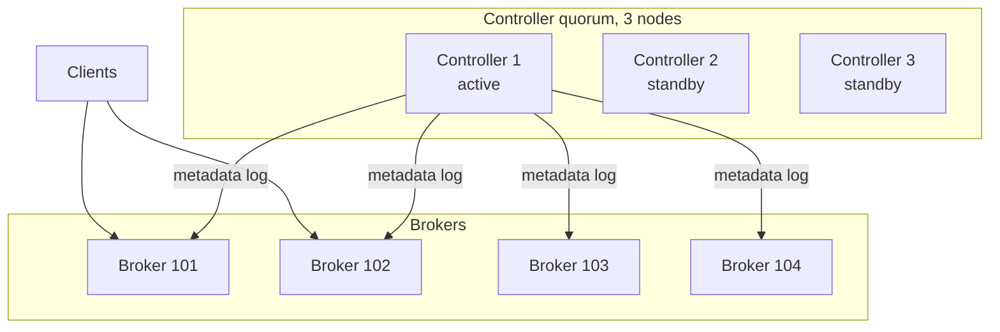
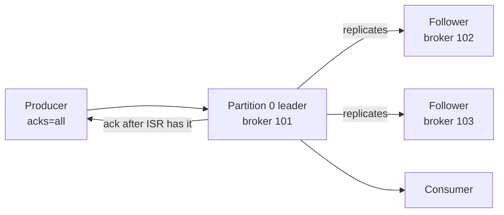
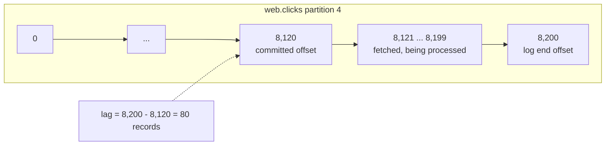
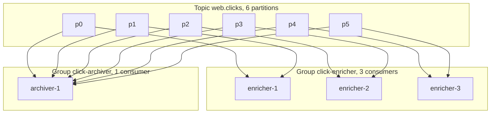

# Kafka Architecture: Brokers, Topics, Partitions and Offsets

## Introduction

A Kafka cluster looks simple from the outside: you point a client at a `bootstrap.servers` address, name a topic and start writing or reading. Underneath, a handful of mechanisms work together to make that durable, ordered and fast across many machines. Knowing them is what separates a developer who can use Kafka from one who can design for it, size it and debug it at three in the morning.

This page walks through the architecture one layer at a time: the broker and controller processes, the topic and its partitions, how partitions are replicated across brokers, how offsets give every consumer its own position, and how consumer groups divide work. A clickstream example runs through the whole page so that each mechanism has a concrete number attached to it. The next page, [KRaft](./3-kafka-kraft-and-metadata.mdx), zooms in on the metadata layer; the [Topics, Partitions and Storage](../2-kafka-topics-and-storage/0-kafka-topics-and-partitions.mdx) section zooms in on the disk.

## Brokers and Controllers

A Kafka server process runs in one of two roles, or both. The role is set with `process.roles` in the server configuration.

A **broker** stores partition data on local disks, accepts produce requests, serves fetch requests and copies data from other brokers to keep replicas in sync. Each broker has a numeric `node.id` that is unique in the cluster. Brokers are the machines you add when you need more storage or more throughput.

A **controller** maintains the cluster's metadata: the list of topics and partitions, which broker is the leader of each partition, which brokers are registered and healthy, configuration overrides, ACLs and quotas. Controllers run the KRaft consensus protocol among themselves; one of them is the active controller at any time and the others are hot standbys with a complete copy of the metadata. Brokers follow the controller's metadata log so they always know the current state.



In development you run one process with `process.roles=broker,controller`. In production you run three or five dedicated controllers on small machines and as many brokers as the data needs. The separation lets you restart or upgrade brokers without touching the quorum, and keeps a busy broker from delaying a metadata decision.

Clients never talk to controllers for data. A client connects to one of the addresses in `bootstrap.servers`, asks for metadata, learns which broker leads each partition it cares about, and then speaks directly to those brokers. This is why `bootstrap.servers` only needs two or three entries: it is a way in, not a load balancer.

## Topics and Partitions

A **topic** is a named stream of records, the unit that producers write to and consumers subscribe to. Topic names are strings such as `web.clicks` or `orders`; a cluster can have thousands of them.

A topic is divided into one or more **partitions**. Each partition is an independent append-only log stored on a broker's disk. Partitions are the unit of parallelism, of ordering and of replication:

- **Parallelism.** Different partitions can live on different brokers and be written and read at the same time. A topic with 12 partitions spread over 4 brokers uses the disks and network of all 4.
- **Ordering.** Records within one partition are strictly ordered by offset. There is no ordering between partitions.
- **Placement.** The producer decides the partition. If the record has a key, the default partitioner hashes it (with murmur2) and takes the result modulo the partition count, so the same key always maps to the same partition as long as the count does not change. If there is no key, records are spread across partitions in batches by the sticky partitioner.

```bash
# Create a topic with 12 partitions, each copied to 3 brokers
kafka-topics.sh --bootstrap-server localhost:9092 --create \
  --topic web.clicks --partitions 12 --replication-factor 3

kafka-topics.sh --bootstrap-server localhost:9092 --describe --topic web.clicks
```

```text
Topic: web.clicks   TopicId: pR7mJ2vXQxuEZ1kTo9Dq1A   PartitionCount: 12   ReplicationFactor: 3   Configs: segment.bytes=1073741824
    Topic: web.clicks   Partition: 0    Leader: 101   Replicas: 101,102,103   Isr: 101,102,103   Elr:    LastKnownElr:
    Topic: web.clicks   Partition: 1    Leader: 102   Replicas: 102,103,104   Isr: 102,103,104   Elr:    LastKnownElr:
    Topic: web.clicks   Partition: 2    Leader: 103   Replicas: 103,104,101   Isr: 103,104       Elr:    LastKnownElr:
    ...
```

Every line of that output is explained in the next two sections. For now note that partition 2 has only two replicas in sync: broker 101 has fallen behind, and the next section explains what that means.

Choosing the partition count is a real decision. More partitions mean more parallel consumers and more throughput, but also more open files, more metadata, longer leader elections after a failure and more memory in clients. You can add partitions to a topic later but not remove them, and adding them changes which partition each key maps to, which breaks ordering for keyed data during the transition. [Choosing the Number of Partitions](../12-kafka-performance/4-kafka-partition-count.mdx) gives a sizing method; a common starting point is 6 to 12 for a new topic that is expected to grow.

## Replication: Leaders, Followers and the ISR

Each partition is copied to `replication.factor` brokers, three in most production clusters. One copy is the **leader**; the others are **followers**. All produce and fetch requests for a partition go to its leader. Followers continuously fetch from the leader and append the same records to their own logs, so that if the leader's broker dies, a follower can take over with no data loss.



The **in-sync replica set (ISR)** is the subset of replicas that are fully caught up with the leader, within `replica.lag.time.max.ms` (default 30 seconds). The leader itself is always in the ISR. A record is **committed** once every replica in the ISR has written it; only committed records are visible to consumers. The highest committed offset is called the **high watermark**.

This is what the producer's `acks` setting controls:

| `acks` | The leader replies when | Risk |
|---|---|---|
| `0` | It has received the request, before writing | Lost if the leader dies in the next millisecond; no error returned |
| `1` | It has written the record to its own log | Lost if the leader dies before followers copy it |
| `all` (default since Kafka 3.0) | Every replica in the ISR has written it | Lost only if every ISR member dies at once |

`acks=all` on its own is not enough, because the ISR can shrink to just the leader. The topic setting `min.insync.replicas` (default 1, usually set to 2 with a replication factor of 3) tells the leader to reject writes if fewer than that many replicas are in sync. Together, `acks=all` and `min.insync.replicas=2` guarantee that an acknowledged record exists on at least two brokers. [acks, min.insync.replicas and Durability](../3-kafka-producers/2-kafka-producer-acks-and-durability.mdx) works through the failure cases.

When a leader fails, the controller elects a new leader from the ISR. If the ISR is empty, the default is to wait rather than elect an out-of-date follower (`unclean.leader.election.enable=false`), trading availability for not losing committed data. Kafka 4.x adds **eligible leader replicas (ELR)**, enabled by default on new clusters since 4.1: a set of replicas that are known to hold everything up to the high watermark even if they have dropped out of the ISR, which gives the controller more safe candidates. The `Elr` and `LastKnownElr` columns in the describe output above come from this feature. [Replication, Leaders, Followers and the ISR](../2-kafka-topics-and-storage/2-kafka-replication.mdx) covers the full protocol.

The controller also spreads leadership. In the describe output, partition 0 is led by broker 101, partition 1 by 102 and partition 2 by 103, so client traffic is shared across the cluster rather than funnelled to one machine.

## Offsets and the Consumer Position

An **offset** is the position of a record within a partition: a 64-bit integer starting at 0 and increasing by one for each appended record. The pair (partition, offset) uniquely identifies a record in a topic, and it never changes, which is what makes replay and exactly-once processing possible.

Consumers track three offsets per partition:

- The **current position** is the offset of the next record the consumer will read. It advances as `poll()` returns records.
- The **committed offset** is the position the consumer has saved to Kafka as "processed up to here". If the consumer restarts, it resumes from this value. Commits go to an internal, compacted topic called `__consumer_offsets`, keyed by group, topic and partition.
- The **log end offset** is the offset of the next record the leader will append; the difference between it and the committed offset is the **consumer lag**, the single most-watched Kafka metric.



Committing is where delivery guarantees are decided. Commit before processing and a crash loses the records in flight (at-most-once). Commit after processing and a crash reprocesses them (at-least-once, the default and the sensible starting point). Make processing idempotent or use transactions and you reach exactly-once. [Offsets, Commits and Where to Resume](../4-kafka-consumers/3-kafka-offsets-and-commits.mdx) and [Delivery Semantics](../4-kafka-consumers/4-kafka-delivery-semantics.mdx) go through each choice.

A consumer with no committed offset, such as a brand-new group, starts where `auto.offset.reset` says: `latest` (the default, only new records) or `earliest` (everything still retained). Forgetting this is the most common reason a new consumer "sees nothing" in a test.

```bash
# Where does the group stand on each partition, and how far behind is it?
kafka-consumer-groups.sh --bootstrap-server localhost:9092 --describe --group click-enricher
```

```text
GROUP           TOPIC       PARTITION  CURRENT-OFFSET  LOG-END-OFFSET  LAG   CONSUMER-ID                      HOST          CLIENT-ID
click-enricher  web.clicks  0          41203           41210           7     enricher-1-3f9c...               /10.0.4.11    enricher-1
click-enricher  web.clicks  1          40987           40987           0     enricher-1-3f9c...               /10.0.4.11    enricher-1
click-enricher  web.clicks  2          39950           40120           170   enricher-2-a81d...               /10.0.4.12    enricher-2
```

## Consumer Groups

A **consumer group** is a set of consumers that share a `group.id` and together read a topic once. The group coordinator, a broker chosen by hashing the group id, assigns each partition to exactly one consumer in the group. Two consumers in the same group never read the same partition at the same time; a consumer may own several partitions.



This gives you two kinds of scaling from one mechanism. To process a topic faster, add consumers to the group, up to the number of partitions; a seventh consumer on a six-partition topic sits idle. To add a completely independent use of the data, start a new group; it gets every partition and its own offsets, and the existing group is unaffected.

When a consumer joins, leaves or crashes, the coordinator **rebalances**: it reassigns partitions so that every partition has exactly one owner. Kafka 4.0 made a new rebalance protocol (KIP-848) generally available, in which the coordinator computes assignments on the server and moves partitions incrementally, so a rebalance no longer pauses the whole group. Clients opt in with `group.protocol=consumer`; the classic protocol remains the client default for now and Kafka 4.3 logs a recommendation to switch. [Rebalancing](../4-kafka-consumers/2-kafka-rebalancing.mdx) compares the protocols in depth.

## How a Record Travels: The Clickstream End to End

Put the pieces together with a concrete workload. A news site records every page view as a record on `web.clicks`: 20,000 clicks per second at peak, each about 600 bytes, so roughly 12 MB per second. Three teams consume the data: an enricher that joins each click with the article's metadata, an archiver that writes hourly Parquet files, and a real-time dashboard.

The design:

- **Topic:** `web.clicks`, 12 partitions, replication factor 3, 7-day retention. Twelve partitions give each of the three enricher instances four partitions and leave headroom to add consumers up to twelve.
- **Key:** the anonymous session id. All clicks from one session land on one partition in order, so the enricher can compute "pages per session" without a shuffle. The alternative, keying by article id, would create hot partitions when one story goes viral.
- **Producer:** the web tier batches records for up to 20 ms (`linger.ms=20`) and compresses them with `zstd`. `acks=all` with `min.insync.replicas=2` on the topic, because losing analytics data is acceptable but silently losing it is not.
- **Consumers:** three groups. The enricher group has three instances; the archiver group has one instance that is happy to lag a few minutes; the dashboard group uses `auto.offset.reset=latest` because it only cares about now.

The journey of one click:

1. The producer hashes `session-9f2a` to partition 7 and adds the record to the batch for partition 7.
2. After 20 ms the batch is sent to broker 102, the leader of partition 7, as found in the metadata the client fetched at startup.
3. Broker 102 appends the batch to the partition 7 log at offsets 8,200 to 8,247 and waits for brokers 103 and 104 (the ISR) to replicate it.
4. Once both followers have it, the high watermark moves to 8,248 and the producer receives an acknowledgement with each record's offset.
5. `enricher-2`, which owns partition 7 in the `click-enricher` group, fetches from offset 8,200, joins, writes results to `web.clicks.enriched` and commits offset 8,248 to `__consumer_offsets`.
6. The archiver, 90 seconds behind, fetches the same records later from the same log. Nothing about the enricher's progress affects it.
7. If broker 102 crashes, the controller elects broker 103 as leader of partition 7 within a few seconds. Producers and consumers refresh their metadata and continue; the records are already on 103, so nothing is lost.

:::warning
Everything in the scenario depends on the partition count staying at 12. If someone later raises it to 24 to add consumers, `session-9f2a` may hash to a different partition and the enricher's per-session ordering breaks for sessions that were in flight. Plan partition counts with growth in mind, or create a new topic and migrate when you must change it.
:::

## Common Mistakes

- Pointing `bootstrap.servers` at a load balancer that hides broker addresses. Clients must reach each broker directly by the address the broker advertises in `advertised.listeners`.
- Running one partition per topic "to keep ordering", then discovering that one consumer is the maximum parallelism. Key your records and use several partitions.
- Setting `acks=all` without `min.insync.replicas=2`. When the ISR shrinks to the leader alone, `acks=all` means one copy.
- Adding partitions to a keyed topic in production without planning for the change in key-to-partition mapping.
- Treating consumer lag as an error rather than a measurement. Some lag is normal; lag that grows without bound is the problem.
- Having more consumers in a group than partitions, and wondering why the extra instances do nothing.

## Summary

- Brokers store partition data; controllers hold cluster metadata via KRaft; clients discover brokers through `bootstrap.servers` and then talk to partition leaders directly.
- A topic is split into partitions, each an ordered, append-only log; the key decides the partition and therefore the ordering scope.
- Each partition is replicated to a leader and followers; the ISR is the set of replicas that are caught up, and `acks=all` plus `min.insync.replicas` decide how many copies an acknowledged write has.
- Offsets identify records within a partition; consumers commit their position to `__consumer_offsets`, and lag is the distance to the log end.
- A consumer group divides a topic's partitions among its members; independent groups read the same data independently; rebalances reassign partitions when membership changes.

## Further Reading

- [Kafka documentation: Replication](https://kafka.apache.org/documentation/#replication) - the leader, follower and ISR protocol as the project describes it.
- [Kafka documentation: Eligible Leader Replicas](https://kafka.apache.org/documentation/#eligible_leader_replicas) - how ELR extends safe leader election in 4.x.
- [KIP-848: The Next Generation of the Consumer Rebalance Protocol](https://cwiki.apache.org/confluence/display/KAFKA/KIP-848%3A+The+Next+Generation+of+the+Consumer+Rebalance+Protocol) - the server-side assignment protocol that became GA in Kafka 4.0.
- [KIP-966: Eligible Leader Replicas](https://cwiki.apache.org/confluence/display/KAFKA/KIP-966%3A+Eligible+Leader+Replicas) - the motivation ("last replica standing") and design of ELR.
- [Kafka documentation: Broker configs](https://kafka.apache.org/documentation/#brokerconfigs) - reference for `num.partitions`, `default.replication.factor`, `min.insync.replicas` and the rest.
