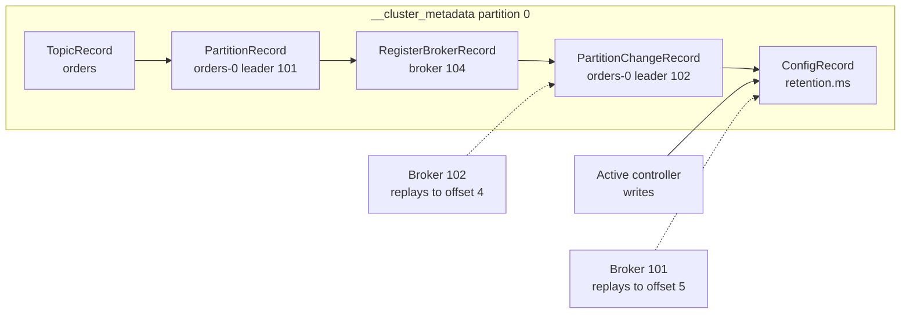
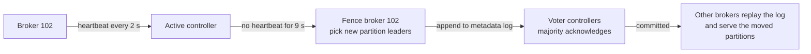
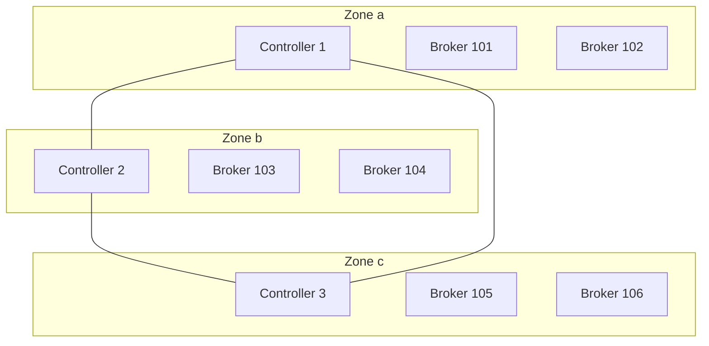

# KRaft: How Kafka Runs Without ZooKeeper

## Introduction

Every Kafka cluster has to remember a lot of facts that are not messages: which topics exist, how many partitions each one has, which broker leads each partition, which replicas are in sync, which brokers are alive, which ACLs and quotas apply. This is the cluster's metadata, and if it is wrong or unavailable, nothing else works.

For its first twelve years Kafka kept that metadata in Apache ZooKeeper, a separate distributed coordination service. Since Kafka 4.0 (March 2025) that option is gone. Metadata now lives inside Kafka itself, in a replicated log managed by a built-in consensus protocol called **KRaft** (Kafka Raft). Every Kafka 4.x cluster you create runs in KRaft mode; there is no switch to turn it off.

This page explains why the change was made, how KRaft works, what you configure when you deploy it, and what to watch in production. By the end you will be able to read a KRaft server configuration, choose between a static and a dynamic controller quorum, and inspect the quorum's health from the command line.

## Why ZooKeeper Was Replaced

ZooKeeper did its job for a long time, but it imposed three costs that grew with the size of the clusters people ran.

**Two systems to operate.** A production Kafka deployment meant a Kafka cluster plus a ZooKeeper ensemble, each with its own configuration, security model, monitoring, upgrade procedure and failure modes. Teams had to learn ZooKeeper's quirks just to keep Kafka alive. Securing both with TLS and SASL doubled the work.

**Slow recovery in big clusters.** In ZooKeeper mode one broker acted as the controller. When that broker failed, a new controller had to read the entire cluster state from ZooKeeper before it could make decisions. With hundreds of thousands of partitions that took minutes, during which leader elections were stalled. The same happened during controlled shutdowns, which made rolling restarts painfully slow.

**A scaling ceiling.** Because every metadata change was a ZooKeeper write and every broker had to be updated by RPC, practical clusters topped out at roughly 200,000 partitions. KRaft's design target was millions.

The replacement was proposed in KIP-500 in 2019. KRaft became production-ready for new clusters in Kafka 3.3 (2022), migration from ZooKeeper became production-ready in 3.6, Kafka 3.9 was the last release that could run ZooKeeper (the "bridge" release for migration), and Kafka 4.0 removed ZooKeeper support entirely.

:::warning
A ZooKeeper-mode cluster cannot be upgraded straight to 4.x. It must first be migrated to KRaft on a 3.x bridge release (3.9 is the last), and only then upgraded. If you inherit an old cluster, plan the migration as a project of its own.
:::

## The Metadata Log

The central idea of KRaft is that Kafka already has an excellent tool for storing an ordered history of changes: the log. So cluster metadata is stored as a log too.

Every metadata change, such as "topic `orders` created with 12 partitions", "broker 104 registered", "partition `orders-3` now led by broker 102 with ISR 102,103", is written as a record to a single-partition internal topic called `__cluster_metadata`. The current state of the cluster is the result of replaying that log from the start, exactly like the stream-table duality described in [Event Streaming Concepts](./1-kafka-event-streaming-concepts.mdx).



Two consequences make this much better than the ZooKeeper design:

- **Standby controllers are always warm.** Every controller replicates the metadata log continuously, so when the active controller fails, a standby already holds the full state in memory. Failover takes about as long as a Raft election, typically well under a second to a few seconds, instead of minutes.
- **Brokers pull changes instead of being pushed state.** Each broker fetches new records from the metadata log, the same way a follower fetches partition data, and applies them in order. A broker that was offline for a while simply resumes from its last offset. The controller does not have to send RPCs to hundreds of brokers.

The log would grow forever if nothing trimmed it, so controllers and brokers periodically write **snapshots**: a compact image of the full state at a given offset. A snapshot is taken after `metadata.log.max.record.bytes.between.snapshots` bytes of new records (default 20 MiB) or after `metadata.log.max.snapshot.interval.ms` (default one hour), whichever comes first. Older log segments behind a snapshot can then be deleted. A node that starts up loads the latest snapshot and replays only the records written after it.

## Controllers, Brokers and the Raft Quorum

A Kafka 4.x server runs as a controller, a broker or both, set by `process.roles`.

The **controllers** form a Raft quorum. One of them is elected leader and becomes the **active controller**; it is the only node that appends to the metadata log. The others are **voters** that replicate the log and take part in elections. A record is committed when a majority of voters have it, so a quorum of three tolerates one failure and a quorum of five tolerates two. In general, surviving N failures needs 2N+1 controllers.

The **brokers** are **observers** of the metadata log: they replicate it but do not vote. Each broker also sends a heartbeat to the active controller every `broker.heartbeat.interval.ms` (2 seconds by default). If the controller hears nothing for `broker.session.timeout.ms` (9 seconds), it **fences** the broker: it marks the broker as not alive and moves leadership of its partitions to other in-sync replicas. This heartbeat-and-fence loop is how Kafka detects dead brokers now; ZooKeeper's ephemeral nodes used to play that role.



Elections are governed by `controller.quorum.election.timeout.ms` (default 1 second) and `controller.quorum.fetch.timeout.ms` (default 2 seconds): if a voter has not heard from the leader within the fetch timeout, it starts an election. Raft guarantees that only a voter with the complete committed log can win.

### Combined Versus Dedicated Controllers

You can run a node with `process.roles=broker,controller`, called **combined mode**. It is convenient for laptops, CI and small test clusters, because one process does everything. The Kafka documentation does not recommend it for critical production clusters, for three reasons:

| Concern | Combined mode | Dedicated controllers |
|---|---|---|
| Resource isolation | A broker under heavy load can slow metadata decisions | Controllers have their own CPU, memory and disk |
| Rolling restarts | Restarting a broker also restarts a voter, shrinking the quorum | Brokers restart without touching the quorum |
| Scaling | Adding brokers may add voters you did not want | Broker count and quorum size are independent |
| Footprint | Fewest machines | Three or five extra small nodes |

Dedicated controllers are modest: the documentation suggests that around 5 GB of memory and 5 GB of disk for the metadata log is enough for a typical cluster. Managed services such as Amazon MSK and Confluent Cloud hide the controllers from you entirely.

## Configuring a KRaft Cluster

A minimal production layout has three controllers and three or more brokers. Here is the configuration for one controller and one broker in such a cluster.

```properties
# controller-1.properties
process.roles=controller
node.id=1
# Where this controller listens for Raft traffic from other controllers and brokers
listeners=CONTROLLER://ctrl-1.internal:9093
controller.listener.names=CONTROLLER
# How every node finds the quorum; list as many controllers as you can
controller.quorum.bootstrap.servers=ctrl-1.internal:9093,ctrl-2.internal:9093,ctrl-3.internal:9093
log.dirs=/var/lib/kafka/metadata
```

```properties
# broker-101.properties
process.roles=broker
node.id=101
listeners=PLAINTEXT://broker-101.internal:9092
advertised.listeners=PLAINTEXT://broker-101.internal:9092
# Brokers still need to know the name of the controller listener to connect to it
controller.listener.names=CONTROLLER
controller.quorum.bootstrap.servers=ctrl-1.internal:9093,ctrl-2.internal:9093,ctrl-3.internal:9093
log.dirs=/var/lib/kafka/data
```

Notice that `node.id` must be unique across controllers and brokers together. A common convention is single digits for controllers and three digits for brokers, so a log line mentioning node 2 is obviously a controller.

### Formatting Storage

Kafka 4.x refuses to start on an unformatted directory. You generate a cluster id once and format every node's storage with it. This explicit step exists on purpose: auto-formatting a blank disk could silently create a new, empty cluster where an old one used to be.

There are two quorum styles, chosen at format time:

- A **static quorum** lists every voter in `controller.quorum.voters` (for example `1@ctrl-1.internal:9093,2@ctrl-2.internal:9093,3@ctrl-3.internal:9093`). Changing the voter set later means reconfiguring and restarting every node. This was the only option before Kafka 3.9.
- A **dynamic quorum** (KIP-853, available from 3.9 and requiring `kraft.version=1`) leaves `controller.quorum.voters` unset. Voters are recorded in the metadata log itself and can be added or removed at runtime with `kafka-metadata-quorum.sh`. This is the recommended choice for new clusters, and `controller.quorum.voters` is deprecated once `kraft.version=1` is active.

```bash
# Once, anywhere: create the cluster id
CLUSTER_ID=$(kafka-storage.sh random-uuid)

# Option A: bootstrap a dynamic quorum from a single controller, then grow it
kafka-storage.sh format --cluster-id "$CLUSTER_ID" \
  --config controller-1.properties --standalone

# On controllers 2 and 3, and on every broker: join an existing cluster
kafka-storage.sh format --cluster-id "$CLUSTER_ID" \
  --config controller-2.properties --no-initial-controllers
```

The third option, `--initial-controllers`, formats all initial voters at once with entries of the form `id@host:port:directory-id`; it must be given the same value on every controller.

### Inspecting the Quorum

`kafka-metadata-quorum.sh` is the tool for checking KRaft health. It can talk to brokers (`--bootstrap-server`) or directly to controllers (`--bootstrap-controller`).

```bash
kafka-metadata-quorum.sh --bootstrap-server broker-101.internal:9092 describe --status
```

```text
ClusterId:              q1Sh-9_ISia_zwGINzRvyQ
LeaderId:               1
LeaderEpoch:            7
HighWatermark:          184213
MaxFollowerLag:         0
MaxFollowerLagTimeMs:   12
CurrentVoters:          [{"id": 1, ...}, {"id": 2, ...}, {"id": 3, ...}]
CurrentObservers:       [{"id": 101, ...}, {"id": 102, ...}, {"id": 103, ...}]
```

`describe --replication` shows each voter's and observer's log end offset and lag. After a controller has caught up, `add-controller` promotes it to a voter; before you shut a controller down for good, `remove-controller --controller-id 3 --controller-directory-id ...` removes it from the voter set.

## A Worked Scenario: Planning a Payments Cluster

A fintech team is building a new Kafka 4.3 cluster for payment events across three availability zones. Losing metadata or stalling elections means stalling payments, so the controller design gets real attention.

**Decision 1: dedicated controllers, three of them, one per zone.** Three voters tolerate one failure, which matches the "survive the loss of one zone" requirement. Five voters would survive two failures, but with only three zones, two of the five would share a zone, and losing that zone would still take out two voters. Three is the honest answer for a three-zone deployment.

**Decision 2: a dynamic quorum.** The team expects to replace controller hosts during OS upgrades. With a dynamic quorum they can add a fourth controller in the same zone, wait for `describe --replication` to show it caught up, run `add-controller`, then `remove-controller` on the old host, all without restarting brokers. With a static quorum, every node's `controller.quorum.voters` would have to change.

**Decision 3: six brokers, two per zone, separate from the controllers.** Brokers will be restarted weekly for patches; keeping them out of the quorum means a broker restart never reduces the number of voters.



**What they monitor:** the active controller count (exactly one across the quorum at any time), the leader epoch (frequent increases mean unstable elections, often a network or disk latency problem), the metadata log's max follower lag, and fenced broker count. These metrics are covered in [Monitoring: The Metrics That Matter](../10-kafka-operations/1-kafka-monitoring-metrics.mdx).

The alternative they rejected was combined mode on six nodes, which saves three small VMs. The saving was not worth a weekly restart that temporarily drops the quorum to a bare majority.

## Common Mistakes

- Following an old tutorial that starts ZooKeeper first. Kafka 4.x has no ZooKeeper support at all; such guides describe 3.x or older.
- Running an even number of controllers. Four voters tolerate one failure, the same as three, while adding one more node that must acknowledge each write.
- Using combined mode in production because it worked in development, then discovering that broker restarts and load spikes destabilise the quorum.
- Reusing a `node.id` between a controller and a broker. The id space is shared.
- Formatting a node with a new cluster id by accident. The node will refuse to join the existing cluster; always reuse the original id.
- Putting controllers on slow shared disks. Every metadata commit waits for a majority of controllers to write; disk latency becomes election instability.
- Planning a 3.x-to-4.x upgrade without checking whether the cluster is still in ZooKeeper mode.

## Summary

- Kafka 4.x stores all cluster metadata in an internal, single-partition, Raft-replicated log called `__cluster_metadata`; ZooKeeper support was removed in 4.0.
- Controllers vote in the Raft quorum and one is the active controller; brokers observe the metadata log and heartbeat to the controller, which fences brokers that go silent.
- Snapshots keep the metadata log short, and warm standby controllers make failover fast.
- Use three or five dedicated controllers in production; combined mode is for development.
- Prefer a dynamic quorum (KIP-853) so controllers can be added and removed at runtime with `kafka-metadata-quorum.sh`.
- Format storage explicitly with `kafka-storage.sh` and one shared cluster id.

## Further Reading

- [Kafka documentation: KRaft operations](https://kafka.apache.org/documentation/#kraft) - configuration, quorum types, formatting and the quorum tools.
- [KIP-500: Replace ZooKeeper with a Self-Managed Metadata Quorum](https://cwiki.apache.org/confluence/display/KAFKA/KIP-500%3A+Replace+ZooKeeper+with+a+Self-Managed+Metadata+Quorum) - the original motivation and design.
- [KIP-595: A Raft Protocol for the Metadata Quorum](https://cwiki.apache.org/confluence/display/KAFKA/KIP-595%3A+A+Raft+Protocol+for+the+Metadata+Quorum) - how Kafka adapted Raft to its log replication model.
- [KIP-853: KRaft Controller Membership Changes](https://cwiki.apache.org/confluence/display/KAFKA/KIP-853%3A+KRaft+Controller+Membership+Changes) - dynamic quorums and the add and remove controller operations.
- [Apache Kafka 4.0.0 release announcement](https://kafka.apache.org/blog/2025/03/18/apache-kafka-4.0.0-release-announcement/) - the release that removed ZooKeeper.
