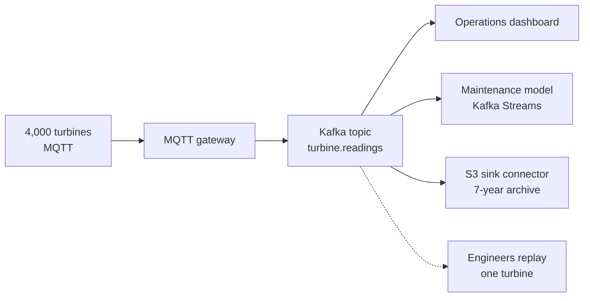

# Kafka vs RabbitMQ, Pulsar, Kinesis and Redpanda

## Introduction

Choosing a messaging or streaming system is one of those decisions that is cheap to make and expensive to undo. Once a dozen services publish to it and a few hundred dashboards depend on it, switching costs months. It pays to understand what each candidate is actually good at before the first producer goes live.

This page compares Kafka with the four alternatives that come up most often in 2026: RabbitMQ, Apache Pulsar, Amazon Kinesis Data Streams and Redpanda. For each one you will learn its storage model, what it does better than Kafka, what it does worse, and the kind of team and workload that should pick it. A summary table and a worked decision for a sensor platform close the page.

The comparison is about architecture and trade-offs, not benchmarks. Published benchmarks are almost always run by a vendor on a workload that flatters its own product; treat them as marketing until you have measured your own traffic.

## The Two Questions That Decide Most Comparisons

Before looking at products, two questions sort the field.

**Do you need a log or a queue?** A log keeps records after they are read, so many consumers can read the same data independently and replay it later. A queue hands each message to one worker and deletes it once acknowledged. The difference is explained in [Event Streaming Concepts](./1-kafka-event-streaming-concepts.mdx). Kafka, Pulsar, Kinesis and Redpanda are logs first. RabbitMQ is a queue first, with a log type (streams) added later. Kafka 4.2 and later also offer queue semantics through share groups, which narrows the gap from the other side.

**Who operates it?** A self-managed cluster gives you full control and the lowest unit cost at scale, but someone must patch, monitor and expand it. A managed service such as Kinesis, Amazon MSK, Confluent Cloud or Redpanda Cloud costs more per gigabyte and removes most of that work. For a small team the operational question often matters more than any feature.

## Kafka vs RabbitMQ

RabbitMQ is a message broker built around the AMQP model. Producers publish to **exchanges**, which route messages to **queues** using bindings: by exact routing key, by pattern, by header values, or to every bound queue. Consumers take messages from queues and acknowledge them one by one. In RabbitMQ 4.x the recommended replicated queue type is the **quorum queue** (Raft-replicated), and classic mirrored queues have been removed.

RabbitMQ also has **streams**, an append-only, replicated log type with non-destructive reads, and **super streams**, which partition a logical stream across several nodes. A super stream is roughly a Kafka topic and each underlying stream roughly a partition.

| Aspect | Kafka | RabbitMQ |
|---|---|---|
| Core model | Partitioned log, consumers track offsets | Exchanges route to queues, per-message ack; streams as an add-on |
| Routing | Topic and key only | Rich: direct, topic patterns, headers, fan-out |
| Per-message features | Share groups add per-record ack; no TTL or priority per message | TTL, priorities, delayed retries, dead-letter exchanges built in |
| Replay | Native for every topic | Only with streams |
| Throughput sweet spot | Hundreds of MB per second per cluster, sustained | Tens of thousands of messages per second per queue; more with streams |
| Ordering at scale | Per partition across many consumers | Per queue; single active consumer for strict order |
| Ecosystem | Connect, Streams, Schema Registry, CDC | Plugins, many protocols (AMQP 0.9.1, AMQP 1.0, MQTT, STOMP) |

**Choose RabbitMQ** when the problem is task distribution: background jobs, work queues with retries and priorities, complex routing between a moderate number of services, or IoT devices that speak MQTT. A team that needs "send this job to a worker, retry it three times, then dead-letter it" gets that from RabbitMQ in an afternoon.

**Choose Kafka** when many independent consumers need the same data, when you need to replay history, when volumes reach hundreds of thousands of events per second, or when the data also feeds analytics, a data lake or stream processing. The [RabbitMQ tutorial](/docs/middleware/rabbitmq) on this site covers the other side in depth.

Many companies run both: RabbitMQ for commands and job queues inside a product, Kafka as the event backbone between products.

## Kafka vs Apache Pulsar

Pulsar, originally built at Yahoo, is also a partitioned log, but it splits the work into layers. **Brokers** are stateless and handle client connections. **Apache BookKeeper** nodes (bookies) store the data in segments spread across many bookies. A metadata store (ZooKeeper, etcd or Oxia) holds cluster state.

That separation is Pulsar's main selling point. Because a partition's data is not tied to one broker's disk, you can add brokers and have them serve traffic immediately, without copying partitions around. Pulsar also has built-in multi-tenancy (tenants and namespaces with their own policies), built-in geo-replication, tiered storage to object stores, and four subscription types on the same topic: exclusive, failover, shared (queue-like) and key-shared.

| Aspect | Kafka | Pulsar |
|---|---|---|
| Storage | Brokers own partitions on local disk, optional tiered storage | Stateless brokers over BookKeeper; tiered storage |
| Components to run | Brokers and KRaft controllers | Brokers, bookies and a metadata store |
| Scaling out | New brokers need partition reassignment | New brokers serve immediately |
| Queue semantics | Share groups (4.2 and later) | Shared and key-shared subscriptions from the start |
| Multi-tenancy | Quotas and ACLs; tenants are a naming convention | First-class tenants and namespaces |
| Ecosystem and talent | Very large; most tools and hires assume Kafka | Smaller; Kafka protocol handlers exist but add complexity |

**Choose Pulsar** if you are building a platform that serves many internal tenants with strict isolation, need geo-replication as a core feature, and have a team willing to operate three kinds of components. **Choose Kafka** for almost everything else, mainly because of its ecosystem: managed offerings from every cloud, Kafka Connect connectors for hundreds of systems, client libraries in every language and engineers who already know it. Kafka's tiered storage and share groups have also removed two of Pulsar's historic advantages.

## Kafka vs Amazon Kinesis Data Streams

Kinesis Data Streams is AWS's fully managed streaming log. A stream is split into **shards**, the equivalent of partitions. In provisioned mode each shard accepts up to 1 MB per second or 1,000 records per second of writes and serves up to 2 MB per second of reads; in on-demand mode AWS adds and removes shards for you. Records are kept for 24 hours by default and up to 365 days for an extra charge. Consumers use the Kinesis Client Library or AWS Lambda, and up to 20 consumers per stream (more in some modes) can use enhanced fan-out for dedicated read throughput.

```bash
# Kinesis: create a stream and write one record (AWS CLI v2)
aws kinesis create-stream --stream-name sensor-readings --stream-mode-details StreamMode=ON_DEMAND
aws kinesis put-record --stream-name sensor-readings \
  --partition-key turbine-17 --data '{"rpm":14.2}' --cli-binary-format raw-in-base64-out
```

```bash
# Kafka: the equivalent topic and record (--reader-property replaced --property in Kafka 4.2)
kafka-topics.sh --bootstrap-server localhost:9092 --create --topic sensor-readings --partitions 12
echo 'turbine-17:{"rpm":14.2}' | kafka-console-producer.sh --bootstrap-server localhost:9092 \
  --topic sensor-readings --reader-property parse.key=true --reader-property key.separator=:
```

| Aspect | Kafka (self-managed or MSK) | Kinesis Data Streams |
|---|---|---|
| Operations | You run it, or MSK runs the brokers | Nothing to run; capacity mode only |
| Throughput unit | Partitions, limited by broker resources | 1 MB per second write per shard |
| Retention | Any length, including forever, plus tiered storage | 24 hours default, up to 365 days |
| Read fan-out | Unlimited consumer groups | Shared 2 MB per second per shard, or enhanced fan-out consumers |
| Exactly-once | Idempotent producer and transactions | At-least-once; deduplicate in consumers |
| Portability | Runs anywhere; open protocol | AWS only; proprietary API |
| Integrations | Kafka Connect, Kafka Streams, Flink | Lambda, Firehose, Flink on AWS, native AWS wiring |

**Choose Kinesis** when you are all-in on AWS, your team is small, throughput is moderate and predictable, and the consumers are mostly Lambda functions or Firehose deliveries to S3. Nothing beats it for "stream these events into S3 by tomorrow with zero servers".

**Choose Kafka** (often as Amazon MSK on AWS) when you need many consumer groups, long retention, transactions, the Connect and Streams ecosystem, or the option to leave AWS. At high sustained volumes, Kafka also tends to be cheaper per gigabyte than per-shard pricing.

## Kafka vs Redpanda

Redpanda is a reimplementation of the Kafka protocol in C++, built on the Seastar framework with one thread per CPU core and no JVM. It uses Raft per partition for replication and has no separate controller tier. Existing Kafka clients, and most tools, connect to it unchanged because it speaks the same wire protocol.

The pitch is operational simplicity and lower tail latency: one binary, fewer tuning knobs, efficient use of modern NVMe disks. The community edition is source-available under the Business Source License rather than Apache 2.0, and features such as tiered storage and some security integrations need an enterprise license or Redpanda Cloud.

| Aspect | Apache Kafka | Redpanda |
|---|---|---|
| Implementation | Java, JVM | C++, thread-per-core, no JVM |
| Protocol | The reference | Kafka-compatible; check edge features such as newest KIPs |
| License | Apache 2.0, governed by the ASF | BSL community edition, commercial enterprise edition |
| Ecosystem | The reference for Connect, Streams and clients | Uses Kafka clients; ships its own connectors and console |
| New features | Land first: KIP-848, share groups, ELR | Follows; compatibility lags for brand-new APIs |

**Choose Redpanda** if a smaller team wants a Kafka-compatible system that is simple to run on a few large machines, latency at high percentiles matters, and the license is acceptable. **Choose Apache Kafka** when you want a vendor-neutral open-source foundation with every managed provider available, or need the newest protocol features the day they ship.

:::tip
Because Redpanda, Azure Event Hubs, WarpStream and others speak the Kafka protocol, writing your applications against the standard Kafka clients keeps the door open. The protocol has become the real standard, more than any one server.
:::

## The Comparison at a Glance

| | Kafka | RabbitMQ | Pulsar | Kinesis | Redpanda |
|---|---|---|---|---|---|
| Model | Log | Queue, plus streams | Log, plus queue subscriptions | Log | Log |
| Replay | Yes | Streams only | Yes | Up to 365 days | Yes |
| Rich routing | No | Yes | Limited | No | No |
| Self-hosting effort | Medium | Low to medium | High | Not possible | Low to medium |
| Managed options | Many | Several | Few | AWS only | Redpanda Cloud |
| License | Apache 2.0 | MPL 2.0 | Apache 2.0 | Proprietary | BSL, commercial |
| Best at | Event backbone, data integration | Task queues, routing | Multi-tenant platforms | Serverless AWS pipelines | Simple, low-latency Kafka API |

## A Worked Scenario: Choosing for a Wind Farm Telemetry Platform

An energy company is building a platform for 4,000 wind turbines. Each turbine sends a 400-byte reading every second, about 1.6 MB per second in total, peaking at 5 MB per second during storms when sampling increases. The data feeds a live operations dashboard, a predictive maintenance model, a regulatory archive kept for seven years and, occasionally, engineers who want to replay a week of data from one turbine after a failure.

The team evaluated each option against those needs.

- **RabbitMQ** handled the volume easily and the MQTT plugin fitted the turbines, but four independent consumers, multi-year retention and replay pointed at a log. Using RabbitMQ streams would have worked for replay but left them without Connect sinks to the data lake. They kept RabbitMQ's MQTT idea and put an MQTT gateway in front of the log instead.
- **Kinesis** fitted the volume with on-demand mode, but the seven-year archive exceeded its 365-day retention, so the archive would need a separate Firehose-to-S3 path anyway, and the company runs its control centres on-premises as well as in the cloud.
- **Pulsar** offered everything functionally, but nobody on the five-person team had run BookKeeper, and the hiring market for Pulsar skills was thin.
- **Redpanda** was attractive operationally; the license review stalled it.
- **Kafka** met every requirement: one topic `turbine.readings` keyed by turbine id with 24 partitions, tiered storage for long retention, an S3 sink connector for the archive, Kafka Streams for the maintenance features, and the option to move to a managed service later without changing application code.



The decision was not "Kafka is best". It was "this workload has many readers, long retention and replay, and a team that can hire for Kafka". A workload of 200 background jobs per minute would have ended at RabbitMQ.

## Common Mistakes

- Choosing by benchmark headlines instead of by data model and operational fit.
- Picking Kafka for a simple job queue with retries and priorities, then rebuilding RabbitMQ features on top of it.
- Picking RabbitMQ for an event backbone with many consumers, then building replay and fan-out by hand.
- Forgetting the total cost of a self-managed cluster: on-call, upgrades and capacity planning are part of the price.
- Assuming "Kafka-compatible" means identical. Test transactions, consumer group protocols and admin APIs your code relies on.
- Ignoring license terms until legal review blocks a rollout.

## Summary

- First decide log or queue, then decide who operates it; those two answers eliminate most options.
- RabbitMQ wins for task queues, rich routing and per-message features; Kafka wins for fan-out, replay, high volume and data integration.
- Pulsar separates serving from storage and has first-class multi-tenancy, at the cost of more components and a smaller ecosystem.
- Kinesis is the zero-operations choice inside AWS, with per-shard limits and a 365-day retention ceiling.
- Redpanda speaks the Kafka protocol with a different implementation and license; writing to the standard Kafka clients keeps all Kafka-compatible options open.

## Further Reading

- [RabbitMQ: Streams and Super Streams](https://www.rabbitmq.com/docs/streams) - RabbitMQ's log data structure and how it partitions streams.
- [RabbitMQ: Quorum Queues](https://www.rabbitmq.com/docs/quorum-queues) - the replicated queue type recommended in RabbitMQ 4.x.
- [Apache Pulsar: Architecture Overview](https://pulsar.apache.org/docs/next/concepts-architecture-overview/) - brokers, BookKeeper and the metadata store.
- [Amazon Kinesis Data Streams: Quotas and Limits](https://docs.aws.amazon.com/streams/latest/dev/service-sizes-and-limits.html) - shard throughput, record size and retention limits.
- [Redpanda documentation](https://docs.redpanda.com/) - architecture, Kafka compatibility notes and licensing.
- [KIP-932: Queues for Kafka](https://cwiki.apache.org/confluence/display/KAFKA/KIP-932%3A+Queues+for+Kafka) - share groups, Kafka's answer to queue workloads.
