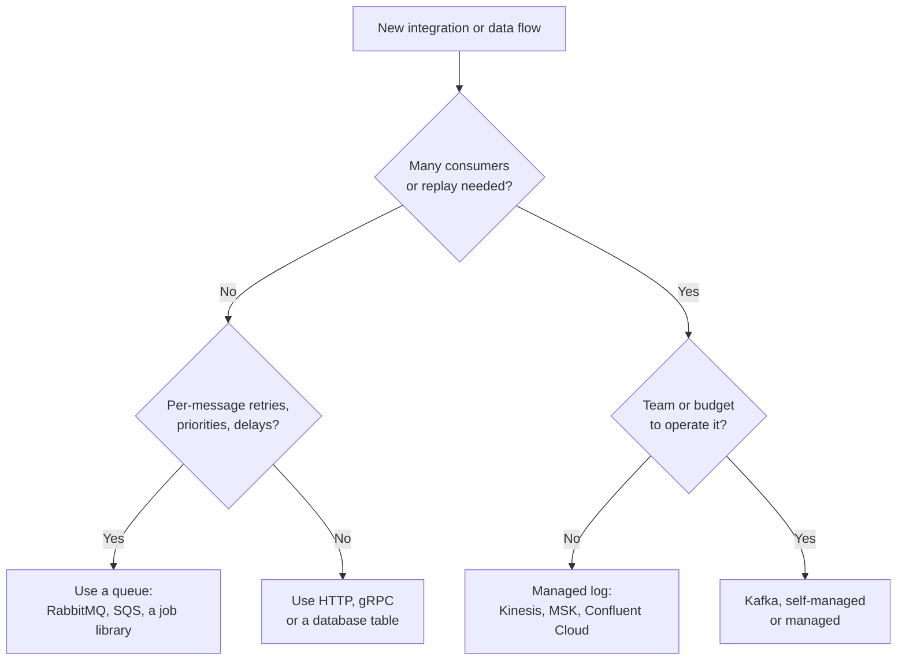
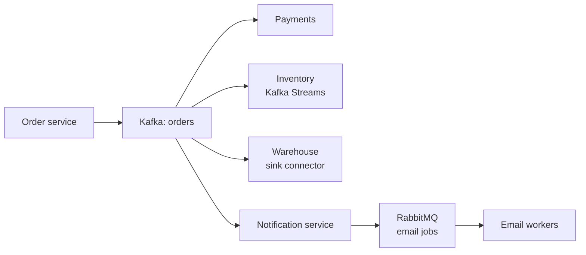

# When Should You Use Kafka?

## Introduction

Kafka has a reputation problem in both directions. Some teams adopt it because large companies use it, then spend a year operating a cluster that moves a few thousand messages a day. Other teams avoid it because it sounds heavy, then build a fragile web of webhooks, cron jobs and database polling that Kafka would have replaced with one topic.

This page gives you a way to decide. You will learn the signals that a workload fits Kafka, the signals that it does not, what Kafka really costs to run, and which simpler tools to reach for instead. A worked decision for a growing e-commerce company ties it together. By the end you should be able to write a one-paragraph justification for or against Kafka that a sceptical colleague would accept.

## The Signals That Point to Kafka

Kafka earns its keep when a workload has several of the following properties at once. One alone is rarely enough.

**Many consumers of the same data.** If the same event, say `OrderPlaced`, is needed by five services and two analytics pipelines, Kafka lets the producer write it once. Each consumer group reads at its own pace, and adding the eighth consumer requires no change anywhere else.

**History matters.** If a new service should be able to read the last month of events on day one, or a bug fix should be applied by reprocessing yesterday's data, you need a retained log. Queues delete on acknowledgement; Kafka keeps records for as long as you configure, including forever with compaction or tiered storage.

**Ordering per entity.** If events for one customer, account or device must be processed in order, but different entities can be processed in parallel, Kafka's partition-by-key model gives you exactly that, at any scale.

**Sustained high volume.** Tens of thousands to millions of events per second, or tens to hundreds of megabytes per second, are routine for a modest Kafka cluster. Below a few hundred events per second, almost any tool works.

**Decoupling in time.** If producers must keep working while consumers are down for maintenance, or consumers run in bursts (hourly batch jobs, nightly reports), Kafka's durable buffer absorbs the difference.

**Data integration.** If data has to flow between databases, search indexes, warehouses and services, Kafka Connect and change data capture with Debezium turn "integrate system A with system B" into configuration rather than code.

**Stream processing.** If you need continuous aggregates, joins between streams or windows over time (fraud scores, live dashboards, alerting), Kafka Streams or Flink on top of Kafka is the standard architecture.

## The Signals That Point Away

Kafka is the wrong tool, or at least an expensive one, in these situations.

**Low volume, few consumers.** Two services exchanging a few hundred messages an hour do not need a distributed log. A database table, a managed queue or a direct HTTP call is simpler and cheaper.

**Task queues with per-message control.** If you need per-message retries with backoff, priorities, delayed delivery or a per-message time-to-live, RabbitMQ, Amazon SQS or a job library like Sidekiq, Celery or BullMQ give you that out of the box. Kafka 4.2 and later can do per-record acknowledgement with [share groups](../4-kafka-consumers/7-kafka-share-groups.mdx), but priorities and delays are still things you build yourself.

**Synchronous request-response.** If the caller needs an answer in 50 milliseconds before rendering a page, use HTTP or gRPC. [Request-reply over Kafka](../9-kafka-patterns/5-kafka-request-reply.mdx) is possible but adds latency and complexity for little benefit.

**Large payloads.** Kafka's default maximum message size is about 1 MB. Videos, images and large documents belong in object storage; put a reference (a URL or key) in the Kafka record instead. This is the claim-check pattern.

**Querying by arbitrary fields.** Kafka is not a database. You can read a partition from an offset, but you cannot ask "all orders over 100 euros from Berlin". Stream the data into a database or search index and query there.

**No one to run it.** A self-managed cluster needs someone who understands replication, partition reassignment, upgrades and monitoring. If that person does not exist, either use a managed service or pick a simpler tool.

## What Kafka Really Costs

The license is free; running it is not. Before adopting Kafka, count these costs honestly.

| Cost | Self-managed | Managed (MSK, Confluent Cloud, Event Hubs, Redpanda Cloud) |
|---|---|---|
| Infrastructure | At least 3 brokers plus 3 controllers for production, with fast disks | Billed by throughput, storage and partitions; minimums apply |
| Engineering time | Upgrades, patching, reassignment, capacity planning, on-call | Mostly configuration; still need to design topics and monitor clients |
| Learning curve | Partitions, offsets, rebalancing, delivery semantics for every developer | Same for application developers |
| Surrounding services | Schema registry, Connect workers, monitoring stack | Often included or add-on priced |
| Cross-zone networking | Replication traffic between zones is billed on most clouds | Usually folded into the price |

The learning curve deserves emphasis. Every developer who writes a consumer needs to understand commit semantics and rebalancing, or they will ship duplicate processing and lost messages. Budget time for that, starting with the [Consumers](../4-kafka-consumers/0-kafka-consumer-basics.mdx) section of this tutorial.

:::note
A common middle path is to start on a managed service, learn which features and volumes you actually need, and only self-host if the bill justifies a dedicated platform team. Moving between Kafka services is mostly a change of `bootstrap.servers` and credentials.
:::

## A Decision Checklist

Use this checklist when someone proposes Kafka. Score one point for each "yes".

| Question | Yes means |
|---|---|
| Will three or more independent consumers need this data? | Fan-out favours a log |
| Do consumers need to replay or start from history? | Retention favours a log |
| Must events per entity be processed in order? | Partition-by-key fits |
| Will peak volume exceed a few thousand events per second, or grow to it within a year? | Throughput favours Kafka |
| Must producers keep working while consumers are down for hours? | Durable buffering fits |
| Does the data also feed analytics, search or a warehouse? | Connect and CDC help |
| Is there a team, or a budget for a managed service, to operate it? | Operations are covered |

Zero to two points: use something simpler. Three or four: Kafka is reasonable, and a managed service is probably the right start. Five or more: Kafka is likely the best fit, and the question becomes how to run it, not whether.

The checklist can also be expressed as a quick flow:

## Use Cases That Fit Well

These are the workloads where Kafka is the default choice in 2026, each with a short reason.

- **Microservice event backbone.** Services publish domain events (`OrderPlaced`, `PaymentCaptured`) and subscribe to each other's, without point-to-point calls. Fan-out and replay are the reasons.
- **Change data capture.** Debezium reads a database's write-ahead log and publishes every row change, so search indexes, caches and warehouses stay in sync without dual writes. See [Change Data Capture with Debezium](../8-kafka-connect/5-kafka-connect-debezium-cdc.mdx).
- **Clickstream and product analytics.** Every page view and click flows into Kafka, then to real-time dashboards and the warehouse. Volume and multiple readers are the reasons.
- **Log and metrics pipelines.** Kafka buffers logs between thousands of hosts and slower storage such as Elasticsearch or object storage, smoothing out spikes.
- **IoT and telemetry.** Millions of devices send small readings; keying by device id preserves per-device order. Often paired with an MQTT gateway in front.
- **Fraud detection and alerting.** Stream processing over payment events with windows and joins, producing decisions in milliseconds.
- **Feeding machine learning features.** Real-time features computed from event streams and served to models, with the same log used to backfill training data.

## A Worked Scenario: An E-Commerce Company at Three Sizes

Consider the same online shop at three points in its life.

**Year one: 5 engineers, 2,000 orders a day.** The shop is a monolith with a PostgreSQL database. A new requirement arrives: send a confirmation email after each order. Someone proposes Kafka. The checklist scores one point (ordering, maybe). The right answer is a job queue: the monolith inserts a row into a `jobs` table or pushes onto a managed queue, and a worker sends the email with retries. Kafka here would be a cluster to operate for one consumer.

**Year three: 30 engineers, 80,000 orders a day, eight services.** Orders now need to reach payments, inventory, shipping, notifications, a recommendation engine, a fraud model and the data warehouse. Each new consumer has meant another API endpoint on the order service, and when the warehouse load job failed for two days, the data had to be backfilled by hand. The checklist now scores six: many consumers, replay, per-order ordering, decoupling, warehouse integration, and a budget for a managed service. The team adopts Amazon MSK, publishes an `orders` topic keyed by order id and moves consumers over one at a time, starting with the warehouse because it benefits most from replay.

**Year five: 120 engineers, peak 3,000 orders a second on sale days.** Kafka is now the backbone. Debezium streams the product catalogue into the search index, Kafka Streams computes live stock levels, and a platform team runs the clusters. The job queue for emails still exists, and that is fine: the notification service consumes `orders` from Kafka and enqueues individual email jobs into RabbitMQ, which handles retries and rate limits per email provider.

The lesson is that the answer changed with the workload, and that Kafka and a queue were complements, not rivals, once both were justified.

## Common Mistakes

- Adopting Kafka for résumé reasons or because a large company uses it, with a workload that scores two points on the checklist.
- Using Kafka as a database: querying topics by scanning them, or keeping records forever without a plan for how they will be read.
- Sending large files through Kafka instead of storing them in object storage and sending a reference.
- Building a synchronous request-response API on top of Kafka to avoid HTTP.
- Self-hosting without anyone trained to operate it, then discovering replication and reassignment during an outage.
- Rejecting Kafka for a clear fan-out and replay workload because "it is too complex", then rebuilding half of it with database polling.

## Summary

- Kafka fits workloads with several of: many consumers, replay, per-entity ordering, high volume, decoupling in time, data integration and stream processing.
- It fits poorly for low-volume point-to-point messaging, per-message task queues, synchronous calls, large payloads and ad-hoc queries.
- The real costs are operations and the learning curve, not the license; managed services trade money for operational effort.
- Score a proposal against the checklist; three or more points make Kafka reasonable, five or more make it likely.
- Kafka and queues often coexist: Kafka as the event backbone, a queue for per-message work.

## Further Reading

- [Apache Kafka: Use Cases](https://kafka.apache.org/uses) - the project's own list of common workloads.
- [Apache Kafka: Introduction](https://kafka.apache.org/intro) - what event streaming is and the guarantees Kafka provides.
- [Kafka documentation: Design](https://kafka.apache.org/documentation/#design) - the motivation and trade-offs behind Kafka's architecture.
- [KIP-932: Queues for Kafka](https://cwiki.apache.org/confluence/display/KAFKA/KIP-932%3A+Queues+for+Kafka) - share groups, which extend Kafka toward queue workloads.
- [Debezium documentation](https://debezium.io/documentation/) - change data capture, one of the strongest reasons teams adopt Kafka.
