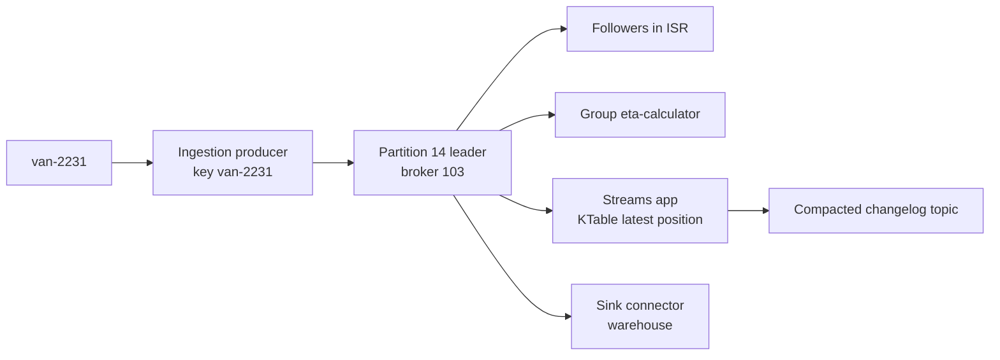

# Kafka Terminology Cheat Sheet

## Introduction

Kafka has a vocabulary of its own, and many of its words mean something slightly different from what they mean elsewhere. A "commit" is not a database commit, a "group" is not a permission group, and a "leader" has nothing to do with management. Misreading one term in a design review or an incident channel can send a whole team in the wrong direction.

This page is a reference you can keep open while reading the rest of the tutorial. Terms are grouped by area, each with a one or two sentence definition in plain words and a pointer to the page that explains it properly. A short worked scenario at the end shows the terms in action by following one record through a fleet-tracking system.

You do not need to memorise everything here. Read the first two groups now, skim the rest, and come back when a word in a later page is unfamiliar.

## Core Data Model

| Term | Meaning |
|---|---|
| Event | A fact that something happened, such as "order 1001 was paid". Kafka's main unit of meaning. |
| Record (message) | The unit Kafka stores: a key, a value, a timestamp and optional headers. The documentation uses "record"; most people say "message". |
| Key | Optional bytes that decide the partition a record goes to. Records with the same key go to the same partition and stay in order. |
| Value | The payload, as bytes. Kafka does not look inside it; serializers turn objects into bytes and back. |
| Header | A key-value pair attached to a record for metadata such as a trace id or content type, kept separate from the value. |
| Timestamp | Every record has one, set by the producer (`CreateTime`) or by the broker (`LogAppendTime`). |
| Topic | A named stream of records, like `orders` or `web.clicks`. Producers write to topics; consumers subscribe to them. |
| Partition | One ordered, append-only log within a topic. The unit of parallelism, ordering and replication. |
| Offset | The position of a record within a partition, starting at 0. A record is identified by topic, partition and offset. |
| Log | The general idea of an ordered, append-only sequence of records. Each partition is a log. |
| Tombstone | A record with a key and a `null` value, meaning "delete this key" in a compacted topic. |

See [Kafka Architecture](./2-kafka-architecture.mdx) for how these fit together and [Topics and Partitions in Depth](../2-kafka-topics-and-storage/0-kafka-topics-and-partitions.mdx) for the details.

## Cluster and Storage

| Term | Meaning |
|---|---|
| Cluster | A set of Kafka servers that share metadata and serve the same topics. |
| Broker | A server process that stores partitions, accepts writes and serves reads. Identified by `node.id`. |
| Controller | A server process that manages cluster metadata. Controllers form a Raft quorum; one is active at a time. |
| KRaft | Kafka's built-in consensus protocol for metadata, which replaced ZooKeeper. The only mode in Kafka 4.x. |
| Metadata log | The internal topic `__cluster_metadata` where controllers record every change to cluster state. |
| Bootstrap servers | The list of broker addresses a client uses to make its first connection and discover the rest of the cluster. |
| Listener | A network endpoint a broker or controller accepts connections on, with a name, protocol and port. |
| Advertised listener | The address a broker tells clients to use to reach it. Wrong values are the most common connection problem. |
| Segment | A file on disk holding a contiguous range of a partition's records. Retention deletes whole segments. |
| Retention | How long or how much data a topic keeps (`retention.ms`, `retention.bytes`) before old segments are deleted. |
| Log compaction | A cleanup policy (`cleanup.policy=compact`) that keeps only the latest record per key. |
| Tiered storage | Moving older segments to object storage such as S3 while keeping recent data on broker disks. |

[KRaft: How Kafka Runs Without ZooKeeper](./3-kafka-kraft-and-metadata.mdx) and [Retention and Log Compaction](../2-kafka-topics-and-storage/3-kafka-retention-and-compaction.mdx) go deeper.

## Replication and Durability

| Term | Meaning |
|---|---|
| Replication factor | How many copies of each partition exist across brokers. Three is the production norm. |
| Replica | One copy of a partition on one broker. |
| Leader | The replica that handles all reads and writes for a partition. |
| Follower | A replica that copies data from the leader and can take over if the leader fails. |
| ISR (in-sync replicas) | The replicas that are fully caught up with the leader. Only ISR members are normally eligible to become leader. |
| ELR (eligible leader replicas) | Replicas outside the ISR that are known to hold all committed data, giving more safe leader candidates. On by default for new clusters since Kafka 4.1. |
| High watermark | The offset up to which every ISR member has copied the data. Consumers only see records below it. |
| Log end offset | The offset the next appended record will get on a replica. |
| `acks` | Producer setting for how many replicas must confirm a write: `0`, `1` or `all` (the default). |
| `min.insync.replicas` | Topic or broker setting: the minimum ISR size for an `acks=all` write to succeed. Usually 2 with replication factor 3. |
| Unclean leader election | Letting an out-of-sync replica become leader, trading lost data for availability. Off by default. |
| Under-replicated partition | A partition whose ISR is smaller than its replica set; a key health metric. |

See [Replication, Leaders, Followers and the ISR](../2-kafka-topics-and-storage/2-kafka-replication.mdx).

## Producers

| Term | Meaning |
|---|---|
| Producer | A client that writes records to topics. |
| Partitioner | The producer logic that picks a partition: hash of the key, or sticky batching for records without a key. |
| Batch | A group of records for the same partition sent together. Controlled by `batch.size` and `linger.ms`. |
| Compression | Producer-side compression of batches (`gzip`, `snappy`, `lz4`, `zstd`). |
| Idempotent producer | A producer that tags records with sequence numbers so retries never create duplicates within a partition. On by default. |
| Transaction | A group of writes across partitions, and optionally consumer offset commits, that become visible all together or not at all. |
| `transactional.id` | A stable id that lets a transactional producer survive restarts and fence older instances of itself. |
| Serializer | Code that converts a key or value object into bytes. |

See [Producer Basics](../3-kafka-producers/0-kafka-producer-basics.mdx) and [Transactions](../3-kafka-producers/7-kafka-transactions.mdx).

## Consumers

| Term | Meaning |
|---|---|
| Consumer | A client that reads records from topics by calling `poll()` in a loop. |
| Consumer group | Consumers sharing a `group.id` that divide a topic's partitions among themselves. Each partition goes to one member. |
| Group coordinator | The broker that manages a group's membership, assignments and committed offsets. |
| Assignment | The set of partitions a consumer currently owns. |
| Rebalance | Reassigning partitions when members join, leave or fail. |
| KIP-848 protocol | The newer consumer group protocol, GA in Kafka 4.0, where the broker computes assignments incrementally. Enabled with `group.protocol=consumer`. |
| Committed offset | The position a group has saved as "processed up to here", stored in `__consumer_offsets`. |
| Auto commit | Committing offsets automatically every `auto.commit.interval.ms` (on by default). |
| `auto.offset.reset` | Where a group with no committed offset starts: `latest` (default) or `earliest`. |
| Consumer lag | How far a group is behind: log end offset minus committed offset, per partition. |
| Static membership | Giving each consumer a `group.instance.id` so a quick restart does not trigger a rebalance. |
| Share group | A Kafka 4.x group type (KIP-932, "Queues for Kafka") where several consumers can read the same partition and acknowledge records individually. |

See [Consumer Groups](../4-kafka-consumers/1-kafka-consumer-groups.mdx), [Rebalancing](../4-kafka-consumers/2-kafka-rebalancing.mdx) and [Share Groups](../4-kafka-consumers/7-kafka-share-groups.mdx).

## Delivery Guarantees

| Term | Meaning |
|---|---|
| At-most-once | Each record is processed zero or one times. Possible loss, no duplicates. Commit before processing. |
| At-least-once | Each record is processed one or more times. No loss, possible duplicates. Commit after processing. The usual default. |
| Exactly-once (EOS) | Each record affects the output once. In Kafka this means transactions for read-process-write within Kafka, or idempotent consumers when writing elsewhere. |
| Idempotent consumer | A consumer whose processing gives the same result if a record is handled twice, often by tracking processed ids. |
| `isolation.level` | Consumer setting: `read_committed` hides records from aborted transactions; `read_uncommitted` (default) shows everything. |
| Dead letter topic | A topic where records that repeatedly fail processing are sent for later inspection, so they stop blocking the partition. |

See [At-Most-Once, At-Least-Once and Exactly-Once](../4-kafka-consumers/4-kafka-delivery-semantics.mdx).

## Ecosystem

| Term | Meaning |
|---|---|
| Kafka Connect | A framework and runtime for moving data between Kafka and external systems using connectors. |
| Source connector | Reads from an external system (database, files, API) and writes to Kafka. |
| Sink connector | Reads from Kafka and writes to an external system (warehouse, search index, object storage). |
| SMT | Single message transform: a small per-record change applied inside Connect. |
| Debezium | A family of source connectors that turn database change logs into Kafka events (change data capture). |
| Kafka Streams | A Java library for stream processing inside your own application. |
| KStream and KTable | Kafka Streams abstractions for a stream of independent events and a table of latest values per key. |
| Schema Registry | A service that stores Avro, Protobuf or JSON schemas and checks compatibility as they evolve. |
| MirrorMaker 2 | A Connect-based tool that replicates topics between clusters. |
| KIP | Kafka Improvement Proposal: the design document for every significant change, numbered, such as KIP-500 or KIP-848. |

## A Worked Scenario: The Terms in One Record's Life

A logistics company tracks 50,000 delivery vans. Each van sends its GPS position every five seconds. Follow one position update and notice how many terms it touches.

1. Van `van-2231` sends a position. The ingestion service, a **producer**, creates a **record** with **key** `van-2231`, a JSON **value** with latitude and longitude, a **header** `trace-id` and a **timestamp** from the van's clock (`CreateTime`).
2. The **partitioner** hashes the key and picks **partition** 14 of the **topic** `fleet.positions`, which has 24 partitions. The record joins a **batch** that is sent after `linger.ms=10` with `zstd` **compression**.
3. The **idempotent producer** sends the batch with `acks=all` to the **leader** of partition 14, broker 103. It is found via the **bootstrap servers** and the **advertised listener** of broker 103.
4. Broker 103 appends the batch to the active **segment** at **offset** 9,442,018. The two **followers** in the **ISR** copy it. The **high watermark** advances and the producer receives its acknowledgement. `min.insync.replicas=2` ensured at least two copies existed.
5. Three **consumer groups** read partition 14 independently. The `eta-calculator` group's member owns partition 14 in its current **assignment**, processes the record and commits its **offset**. Its **consumer lag** on that partition is 40 records.
6. The `position-latest` Kafka Streams app folds positions into a **KTable** of the latest location per van, backed by a **compacted** changelog topic.
7. A **sink connector** in **Kafka Connect** writes positions to the analytics warehouse every minute.
8. When broker 103 is restarted for patching, the active **controller** in the **KRaft** quorum moves leadership of partition 14 to broker 105, one of the ISR members. Clients refresh their metadata; the `eta-calculator` group notices nothing beyond a brief pause.
9. Seven days later **retention** deletes the segment containing offset 9,442,018. The KTable's compacted topic still holds the van's latest position, because compaction keeps the newest record per key.

The design chose keys by van rather than by region because ordering per van is what makes "latest position" correct; a region key would have mixed updates from vans crossing boundaries.

## Common Mistakes

- Saying "the queue" when you mean a topic. Kafka topics do not delete records on read, and the difference matters in every design discussion.
- Confusing a consumer's committed offset with its current position. After a crash, the consumer resumes from the committed offset, not from where it was.
- Thinking "leader" refers to the active controller. Every partition has its own leader replica; the cluster has one active controller.
- Using "exactly-once" loosely. Ask whether the speaker means idempotent writes, Kafka transactions or end-to-end deduplication.
- Reading "replication factor 3" as "three times the throughput". Replicas add durability, not read capacity; consumers read from leaders by default.
- Calling any group a consumer group. Kafka 4.x also has share groups and Streams groups with different semantics.

## Summary

- Records (messages) have a key, value, timestamp and headers; topics are split into partitions; offsets locate records within a partition.
- Brokers store data, controllers manage metadata through KRaft, and clients connect through bootstrap servers and advertised listeners.
- Replication uses a leader and followers per partition; the ISR, `acks` and `min.insync.replicas` define durability.
- Consumer groups divide partitions, commit offsets and rebalance; share groups add per-record acknowledgement.
- Delivery guarantees are at-most-once, at-least-once and exactly-once, each tied to when offsets are committed and whether transactions are used.
- Connect, Streams, Schema Registry and MirrorMaker 2 form the ecosystem around the broker.

## Further Reading

- [Apache Kafka: Introduction](https://kafka.apache.org/intro) - the project's overview of the main concepts and terms.
- [Kafka documentation](https://kafka.apache.org/documentation/) - the authoritative reference for every configuration key named on this page.
- [Kafka Streams: Core Concepts](https://kafka.apache.org/documentation/streams/core-concepts) - streams, tables, state stores and time.
- [Kafka Improvement Proposals](https://cwiki.apache.org/confluence/display/KAFKA/Kafka+Improvement+Proposals) - the index of every KIP, with status and target release.
- [Kafka Connect documentation](https://kafka.apache.org/documentation/#connect) - connectors, workers, converters and transforms.
