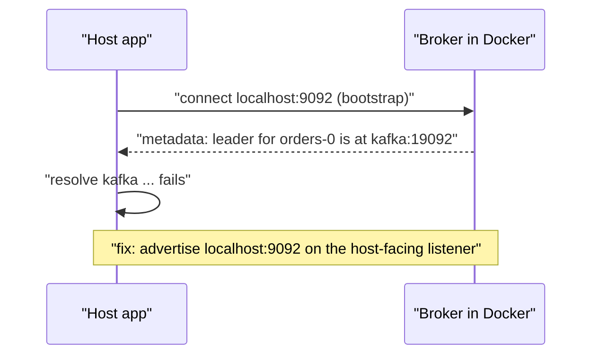
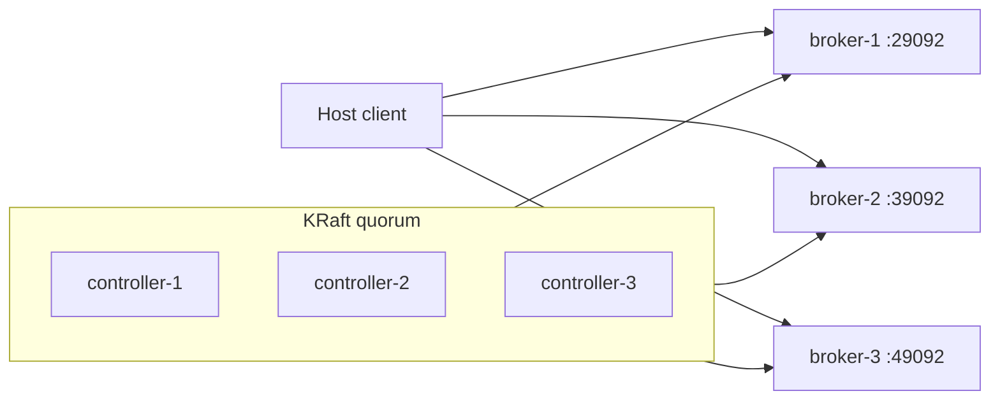

# Running Kafka Locally with Docker Compose (KRaft)

## Introduction

The fastest way to get a working Kafka broker on your laptop is a Docker Compose file and the official `apache/kafka` image. There is no ZooKeeper to run any more: since Kafka 4.0 the broker stores its own metadata using the KRaft protocol, so a single container is a complete cluster.

This page builds that Compose file one setting at a time. By the end you will be able to start a one-node cluster that both your host machine and other containers can reach, keep its data between restarts, add a web UI, and grow it into a three-broker cluster with separate controllers when you want to practise replication. Just as important, you will understand why each environment variable is there, so the first time a client prints `Connection to node -1 (localhost/127.0.0.1:9092) could not be established` you know where to look.

We use the `apache/kafka:4.3.1` tag throughout. Pin a tag in your own files too; `latest` moves with every release and a Compose file that works today should still work in six months.

## Why Compose, and Why the Apache Image

You have three realistic ways to run Kafka for development: Docker Compose, the binary distribution on your own JVM, or a free tier of a managed service.

| Option | Start-up effort | Matches production? | Best for |
|---|---|---|---|
| Docker Compose with `apache/kafka` | One file, one command | Same broker code, same configs, different networking | Day-to-day development, demos, CI |
| Binary distribution (`kafka_2.13-4.3.1.tgz`) | Install Java 17, format storage, start | Closest to a real server | Learning how the pieces fit, running the CLI without `docker exec` |
| Managed service free tier | Sign up, copy credentials | Exactly production, but someone else's | Teams already committed to a cloud vendor |

Compose wins for everyday work because the whole environment is a text file you can commit next to your code. A new teammate clones the repository, runs `docker compose up`, and has the same broker version and the same topic defaults as everyone else. The binary install is still worth doing once, and the [next page](./1-kafka-local-installation.mdx) walks through it, because it shows you what the container is hiding.

Why the Apache image rather than Confluent's `cp-kafka` or Bitnami's? All of them run the same broker. The Apache image is maintained by the Kafka project itself, ships with each release, and uses the same `KAFKA_*` convention the others popularised, so you avoid depending on a vendor's packaging decisions. There is also `apache/kafka-native`, a GraalVM build that starts in well under a second; it is meant for tests, so we stay with the JVM image here.

## How the Image Configures Itself

The container has no configuration wizard. On start-up it does three things:

1. Reads every environment variable that starts with `KAFKA_`, turns it into a broker property, and writes the result to `/opt/kafka/config/server.properties`.
2. Formats the storage directory with `kafka-storage.sh` if it has not been formatted yet, using the `CLUSTER_ID` you pass.
3. Runs `kafka-server-start.sh`.

The variable naming rule is mechanical: take the property name, replace each dot with an underscore, upper-case it, and prefix `KAFKA_`. So `log.dirs` becomes `KAFKA_LOG_DIRS` and `offsets.topic.replication.factor` becomes `KAFKA_OFFSETS_TOPIC_REPLICATION_FACTOR`. Two edge cases: an underscore in the original name becomes a double underscore, and a hyphen becomes a triple underscore.

Two rules of the image trip people up. First, if you set any `KAFKA_*` variable at all, the image stops using its built-in `server.properties`, so you must supply everything a KRaft node needs to boot (roles, node id, listeners, quorum). Second, every KRaft node needs a `CLUSTER_ID`. If you leave it out, the start-up script quietly fills in a fixed id baked into the image, which means every unconfigured container on every laptop claims to be the same cluster. Generate your own once with `kafka-storage.sh random-uuid` and keep it in the file; a volume that was formatted under one id refuses to start under another.

You can run the image with no variables at all (`docker run -p 9092:9092 apache/kafka:4.3.1`) and it boots a combined broker-and-controller that advertises `localhost:9092`. That is fine for a one-off experiment and useless the moment a second container needs to talk to it, which brings us to listeners.

## The Listener Puzzle

Almost every "my client cannot connect" problem with Kafka in Docker is a listener problem, so it is worth five minutes to understand the mechanism.

A Kafka client connects to one bootstrap address, asks for metadata, and receives the list of brokers and partitions. Crucially, the addresses in that list are not where the client connected; they are whatever each broker *advertises*. The client then opens new connections to those advertised addresses. If a broker inside Docker advertises `kafka:9092`, a program on your host machine will try to resolve `kafka`, fail, and give up, even though its bootstrap connection to `localhost:9092` worked perfectly.



The solution is to give the broker two client-facing listeners, each advertised with the name that its audience can resolve:

- `PLAINTEXT_HOST` on port 9092, advertised as `localhost:9092`, published to the host.
- `PLAINTEXT` on port 19092, advertised as `kafka:19092`, used by other containers on the Compose network.

Plus a third, `CONTROLLER`, which the KRaft controller uses for metadata traffic and which nobody else connects to. Three variables describe this arrangement: `KAFKA_LISTENERS` (what to bind), `KAFKA_ADVERTISED_LISTENERS` (what to tell clients), and `KAFKA_LISTENER_SECURITY_PROTOCOL_MAP` (which security protocol each named listener speaks). The names are arbitrary labels; the protocol map is what gives them meaning.

## A Single-Node Compose File

Save this as `docker-compose.yml`.

```yaml
services:
  kafka:
    image: apache/kafka:4.3.1
    container_name: kafka
    hostname: kafka
    ports:
      - "9092:9092"          # host-facing listener only; 19092 and 29093 stay internal
    environment:
      # --- identity and roles --------------------------------------------
      KAFKA_NODE_ID: 1
      KAFKA_PROCESS_ROLES: broker,controller        # combined mode: fine for dev
      CLUSTER_ID: MkU3OEVBNTcwNTJENDM2Qk            # any 22-char base64 id; keep it stable
      # --- listeners -------------------------------------------------------
      KAFKA_LISTENERS: PLAINTEXT_HOST://:9092,PLAINTEXT://:19092,CONTROLLER://:29093
      KAFKA_ADVERTISED_LISTENERS: PLAINTEXT_HOST://localhost:9092,PLAINTEXT://kafka:19092
      KAFKA_LISTENER_SECURITY_PROTOCOL_MAP: PLAINTEXT_HOST:PLAINTEXT,PLAINTEXT:PLAINTEXT,CONTROLLER:PLAINTEXT
      KAFKA_INTER_BROKER_LISTENER_NAME: PLAINTEXT
      KAFKA_CONTROLLER_LISTENER_NAMES: CONTROLLER
      KAFKA_CONTROLLER_QUORUM_VOTERS: 1@kafka:29093
      # --- single-node overrides (defaults assume 3 brokers) ---------------
      KAFKA_OFFSETS_TOPIC_REPLICATION_FACTOR: 1
      KAFKA_TRANSACTION_STATE_LOG_REPLICATION_FACTOR: 1
      KAFKA_TRANSACTION_STATE_LOG_MIN_ISR: 1
      KAFKA_SHARE_COORDINATOR_STATE_TOPIC_REPLICATION_FACTOR: 1
      KAFKA_SHARE_COORDINATOR_STATE_TOPIC_MIN_ISR: 1
      KAFKA_GROUP_INITIAL_REBALANCE_DELAY_MS: 0     # do not wait 3 s before the first rebalance
      # --- developer conveniences -----------------------------------------
      KAFKA_NUM_PARTITIONS: 3                       # new topics get 3 partitions, not 1
      KAFKA_AUTO_CREATE_TOPICS_ENABLE: "false"      # make typos fail loudly
      KAFKA_LOG_DIRS: /var/lib/kafka/data
    volumes:
      - kafka-data:/var/lib/kafka/data
    healthcheck:
      test: ["CMD-SHELL", "/opt/kafka/bin/kafka-broker-api-versions.sh --bootstrap-server localhost:9092 > /dev/null 2>&1"]
      interval: 10s
      timeout: 5s
      retries: 12
      start_period: 10s

volumes:
  kafka-data:
```

A few of these deserve a comment beyond the inline ones.

The three `*_REPLICATION_FACTOR` and `*_MIN_ISR` settings exist because Kafka's internal topics (`__consumer_offsets`, `__transaction_state` and `__share_group_state`) default to replication factor 3 and a minimum ISR of 2. On one broker that is impossible, and the symptom is not a start-up error but a consumer that hangs forever waiting for the coordinator. Setting them to 1 is the single most important line for a single-node file.

`KAFKA_LOG_DIRS` points at `/var/lib/kafka/data` rather than the image's `/tmp/kafka-logs` example because the image declares that path as a volume and pre-creates it owned by the unprivileged `appuser` the broker runs as. Mounting a named volume there just works; mounting one at an arbitrary new path can fail with a permission error.

Turning off `auto.create.topics.enable` is a matter of taste. The default `true` means a producer that misspells a topic name silently creates a new one with the broker defaults. For learning, an explicit `kafka-topics.sh --create` step teaches more, and in production nearly every team disables auto-creation anyway.

## Start, Verify, Stop

```bash
docker compose up -d
docker compose ps
```

```
NAME      IMAGE                COMMAND                  SERVICE   STATUS
kafka     apache/kafka:4.3.1   "/__cacert_entrypoin…"   kafka     Up 20 seconds (healthy)
```

Now prove the two listeners do what we said. From inside the container the broker is reachable on either of its own names:

```bash
docker compose exec kafka /opt/kafka/bin/kafka-topics.sh \
  --bootstrap-server localhost:9092 --create --topic orders --partitions 3 --replication-factor 1
```

```
Created topic orders.
```

From a second, throwaway container on the Compose network, use the internal listener:

```bash
docker run --rm --network "$(basename "$PWD")_default" apache/kafka:4.3.1 \
  /opt/kafka/bin/kafka-topics.sh --bootstrap-server kafka:19092 --describe --topic orders
```

```
Topic: orders	TopicId: 7y3Sg2VbRJq1ZQw7dE1h3A	PartitionCount: 3	ReplicationFactor: 1	Configs: 
	Topic: orders	Partition: 0	Leader: 1	Replicas: 1	Isr: 1	Elr: 	LastKnownElr: 
	Topic: orders	Partition: 1	Leader: 1	Replicas: 1	Isr: 1	Elr: 	LastKnownElr: 
	Topic: orders	Partition: 2	Leader: 1	Replicas: 1	Isr: 1	Elr: 	LastKnownElr: 
```

And from the host, if you have the Kafka binaries installed, `kafka-topics.sh --bootstrap-server localhost:9092 --list` returns `orders`. Any client library you write on the host uses `localhost:9092`; any application container you add to the Compose file uses `kafka:19092`.

When you are done, `docker compose down` stops the broker and keeps the volume, so topics and data survive. `docker compose down -v` deletes the volume too, which is the right way to get a clean slate: the next `up` formats a fresh data directory with the same `CLUSTER_ID`.

:::tip
To check what the broker really advertises, run `docker compose logs kafka | grep advertised.listeners`. The configuration dump printed at start-up contains a line like `advertised.listeners = PLAINTEXT_HOST://localhost:9092,PLAINTEXT://kafka:19092`. If those addresses are not ones your client can resolve, nothing else matters.
:::

## Adding a Web UI

A browser view of topics, partitions, messages and consumer groups makes the first week with Kafka far less abstract. Kafbat UI (the community-maintained fork of the former Provectus kafka-ui, Apache 2.0 licensed) runs as one extra service:

```yaml
  kafka-ui:
    image: ghcr.io/kafbat/kafka-ui:v1.5.0
    ports:
      - "8080:8080"
    environment:
      KAFKA_CLUSTERS_0_NAME: local
      KAFKA_CLUSTERS_0_BOOTSTRAPSERVERS: kafka:19092   # the container-facing listener
      DYNAMIC_CONFIG_ENABLED: "true"
    depends_on:
      kafka:
        condition: service_healthy
```

Note the bootstrap address: the UI is a container, so it uses `kafka:19092`, not `localhost:9092`. AKHQ and Redpanda Console are alternatives; for one local cluster any of them is fine.

## Growing to Three Brokers

A one-node cluster cannot show you replication, leader election or what `acks=all` really waits for. When you reach those pages, switch to this layout: three controller-only nodes and three broker-only nodes, which is the shape the Kafka documentation recommends for production ("isolated mode"). The file is long but repetitive; here is one controller and one broker, and you copy each twice with the ids and ports changed.

```yaml
services:
  controller-1:
    image: apache/kafka:4.3.1
    environment:
      KAFKA_NODE_ID: 1
      KAFKA_PROCESS_ROLES: controller
      KAFKA_LISTENERS: CONTROLLER://:9093
      KAFKA_CONTROLLER_LISTENER_NAMES: CONTROLLER
      KAFKA_CONTROLLER_QUORUM_VOTERS: 1@controller-1:9093,2@controller-2:9093,3@controller-3:9093
      CLUSTER_ID: MkU3OEVBNTcwNTJENDM2Qk
      KAFKA_LOG_DIRS: /var/lib/kafka/data
    volumes:
      - controller-1-data:/var/lib/kafka/data
  # controller-2 and controller-3: identical except KAFKA_NODE_ID 2 and 3

  broker-1:
    image: apache/kafka:4.3.1
    hostname: broker-1
    ports:
      - "29092:9092"            # broker-2 publishes 39092, broker-3 publishes 49092
    environment:
      KAFKA_NODE_ID: 4
      KAFKA_PROCESS_ROLES: broker
      KAFKA_LISTENERS: PLAINTEXT://:19092,PLAINTEXT_HOST://:9092
      KAFKA_ADVERTISED_LISTENERS: PLAINTEXT://broker-1:19092,PLAINTEXT_HOST://localhost:29092
      KAFKA_LISTENER_SECURITY_PROTOCOL_MAP: CONTROLLER:PLAINTEXT,PLAINTEXT:PLAINTEXT,PLAINTEXT_HOST:PLAINTEXT
      KAFKA_INTER_BROKER_LISTENER_NAME: PLAINTEXT
      KAFKA_CONTROLLER_LISTENER_NAMES: CONTROLLER
      KAFKA_CONTROLLER_QUORUM_VOTERS: 1@controller-1:9093,2@controller-2:9093,3@controller-3:9093
      CLUSTER_ID: MkU3OEVBNTcwNTJENDM2Qk
      KAFKA_DEFAULT_REPLICATION_FACTOR: 3
      KAFKA_MIN_INSYNC_REPLICAS: 2
      KAFKA_LOG_DIRS: /var/lib/kafka/data
    volumes:
      - broker-1-data:/var/lib/kafka/data
    depends_on: [controller-1, controller-2, controller-3]
  # broker-2 (node 5) and broker-3 (node 6): change hostname, ports, advertised host port, volume

volumes:
  controller-1-data:
  controller-2-data:
  controller-3-data:
  broker-1-data:
  broker-2-data:
  broker-3-data:
```

Three things changed compared with the single node. Every node lists the same three voters, and that list is the cluster's source of truth for who may become the active controller. Each broker advertises a *different* host port (29092, 39092, 49092) on `localhost`, because the host can only publish each port once; the client's bootstrap list is `localhost:29092,localhost:39092,localhost:49092`. And the single-node replication-factor overrides are gone, so the internal topics get their safe defaults of 3.



Expect this cluster to want about 4 GB of memory from Docker. If your laptop is tight, three combined-mode nodes (each `broker,controller`) halve the container count and still show replication.

## Worked Scenario: A Shared Dev Environment for an Order Service

A team of five is building an order service that publishes `order.placed` events consumed by a fulfilment service and a notification service. Before Compose, two people ran Kafka from a tarball with different versions, one used a vendor's cloud sandbox, and the CI pipeline used an in-memory stub that hid every partitioning bug until staging.

They commit the single-node file above plus the Kafbat UI, and add their own two services to it with `KAFKA_BOOTSTRAP_SERVERS=kafka:19092`. They chose Compose over the managed sandbox because tests can start and destroy a broker in seconds without touching shared quotas, and over the tarball because `docker compose up` is the whole onboarding document. Three partitions by default means the fulfilment consumer group can run two instances locally and they immediately see one instance owning two partitions and the other owning one, which is the behaviour production will have.

When they begin work on the ledger that must survive a broker loss, they switch the same repository to the three-broker file under a Compose profile, and `min.insync.replicas=2` lets them demonstrate, on a laptop, that a producer with `acks=all` blocks when two brokers are stopped.

## Common Mistakes

- Advertising a name the client cannot resolve. Host programs need `localhost:9092`; containers need `kafka:19092`. The bootstrap connection succeeding while everything after it times out is the fingerprint of this mistake.
- Leaving the internal topic replication factors at 3 on a single broker. The broker starts fine; consumers never get a coordinator and hang.
- Changing `CLUSTER_ID` after the volume has been formatted. The broker exits with a message about mismatched cluster ids. Either restore the old id or run `docker compose down -v`.
- Using `latest`. A Compose file that pulled 4.2 last month and 4.3 today behaves differently (new configs, new CLI deprecation warnings). Pin the tag.
- Mapping the data volume to a fresh path without permissions. The broker runs as a non-root user; use `/var/lib/kafka/data`, which the image prepares for you.
- Relying on auto-created topics and then wondering why a topic has one partition and a misspelt name.
- Forgetting that `docker compose down` keeps the volume. If a test needs a pristine broker, use `down -v`.

## Summary

- The official `apache/kafka` image boots a KRaft cluster from `KAFKA_*` environment variables; a property name maps to a variable by replacing dots with underscores and upper-casing.
- Setting any `KAFKA_*` variable disables the image defaults, and `CLUSTER_ID` becomes mandatory once `KAFKA_PROCESS_ROLES` is set.
- Give the broker separate listeners for the host (`localhost:9092`) and for other containers (`kafka:19092`); the advertised address, not the bootstrap address, is what clients ultimately connect to.
- On a single node, set the internal topic replication factors and minimum ISR to 1, or consumer groups will never initialise.
- Store data in a named volume at `/var/lib/kafka/data`, keep the cluster id stable, and use `down -v` to reset.
- A three-controller, three-broker file is the shape to use when you want to study replication and failure handling.

## Further Reading

- [Apache Kafka Docker image on Docker Hub](https://hub.docker.com/r/apache/kafka) - tags and the canonical single-node and multi-node examples.
- [Kafka Docker image usage guide](https://github.com/apache/kafka/blob/trunk/docker/examples/README.md) - environment variable rules, mounted config files, SSL and SASL examples.
- [Kafka Quickstart](https://kafka.apache.org/43/getting-started/quickstart/) - the project's own walkthrough, including the `docker run` form.
- [KRaft operations documentation](https://kafka.apache.org/43/operations/kraft/) - process roles, quorum configuration and the advice on combined versus isolated mode.
- [Docker Compose documentation](/docs/devops/docker) - the Compile N Run tutorial on Compose files, networks and volumes.
