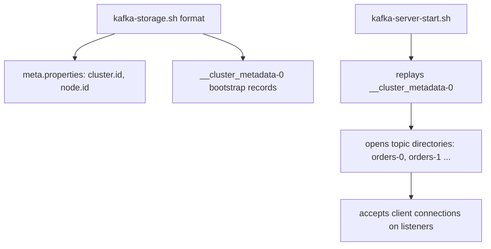

# Installing Kafka from the Binary Distribution

## Introduction

Docker hides a lot. That is usually a feature, but the first time you have to debug a broker that will not start, or size a disk for a production machine, you need to know what is actually on the filesystem: which JVM runs the broker, where the data lives, what `kafka-storage.sh format` writes, and what a Kafka process looks like to the operating system.

This page installs Kafka 4.3.1 from the tarball the project publishes, on a Linux or macOS machine, and runs it as a single KRaft node. You will verify the download, format the metadata log, start the broker, make it survive a reboot with systemd, and inspect the data directory it creates. The commands also give you a local copy of the `kafka-*.sh` tools, which is the comfortable way to talk to a broker running in Docker or in the cloud without `docker exec`.

If you only want a broker to develop against and never intend to run Kafka on a server yourself, the [Docker Compose page](./0-kafka-docker-compose.mdx) is enough. Read on if you want to know what the container does, or if you are heading towards operating Kafka.

## Prerequisites

Kafka is a Java application. Since version 4.0, the broker, Kafka Connect and the command-line tools require Java 17 or newer; clients and Kafka Streams applications can still run on Java 11. Kafka 4.2 added support for Java 25. Any recent OpenJDK build (Temurin, Microsoft, Amazon Corretto, your distribution's package) works.

```bash
java -version
```

```
openjdk version "21.0.4" 2024-07-16 LTS
OpenJDK Runtime Environment Temurin-21.0.4+7 (build 21.0.4+7-LTS)
OpenJDK 64-Bit Server VM Temurin-21.0.4+7 (build 21.0.4+7-LTS, mixed mode, sharing)
```

If you see a version below 17, install one: `sudo apt install openjdk-21-jre-headless` on Debian or Ubuntu, `sudo dnf install java-21-openjdk-headless` on Fedora or RHEL, `brew install openjdk@21` on macOS. You do not need the JDK (compiler) to run a broker; a JRE is enough. You will want the JDK on a developer machine for the [first Java client](./3-kafka-first-topic.mdx).

The operating system matters more than you might expect. Kafka is developed and tested on Linux; macOS is fine for development; native Windows is not well supported and the project documents known problems with it. On Windows, use WSL 2 and follow the Linux steps inside it. Expect a laptop broker to want 1 GB of heap and a couple of gigabytes of disk for a day of experiments.

## Downloading and Verifying

Kafka's binary tarballs are named `kafka_<scala-version>-<kafka-version>.tgz`. The Scala version refers to the compiler used for the small amount of Scala left in the broker; since 4.0 only 2.13 builds are published, so there is one file to pick: `kafka_2.13-4.3.1.tgz`.

```bash
cd /tmp
curl -LO https://downloads.apache.org/kafka/4.3.1/kafka_2.13-4.3.1.tgz
curl -LO https://downloads.apache.org/kafka/4.3.1/kafka_2.13-4.3.1.tgz.sha512
sha512sum -c kafka_2.13-4.3.1.tgz.sha512
```

```
kafka_2.13-4.3.1.tgz: OK
```

The checksum confirms the file was not corrupted in transit. For a machine you care about, also check the PGP signature, which proves the file was produced by a Kafka release manager:

```bash
curl -LO https://downloads.apache.org/kafka/4.3.1/kafka_2.13-4.3.1.tgz.asc
curl -s https://downloads.apache.org/kafka/KEYS | gpg --import
gpg --verify kafka_2.13-4.3.1.tgz.asc kafka_2.13-4.3.1.tgz
```

If `downloads.apache.org` no longer carries 4.3.1 because a newer patch release replaced it, the same path under `https://archive.apache.org/dist/kafka/` always works.

Unpack into `/opt` and create a version-free symlink so scripts and service files do not need to change on upgrade:

```bash
sudo tar -xzf kafka_2.13-4.3.1.tgz -C /opt
sudo ln -sfn /opt/kafka_2.13-4.3.1 /opt/kafka
ls /opt/kafka
```

```
LICENSE  NOTICE  bin  config  libs  licenses  site-docs
```

Finally put the tools on your `PATH`:

```bash
echo 'export PATH="$PATH:/opt/kafka/bin"' >> ~/.bashrc && source ~/.bashrc
kafka-topics.sh --version
```

```
4.3.1
```

## What Is in the Tarball

| Directory | Contents | Why you care |
|---|---|---|
| `bin/` | Forty-odd `kafka-*.sh` and `connect-*.sh` scripts, plus `windows/` | Every operational task is one of these; see [The Kafka CLI Tools](./2-kafka-cli-tools.mdx) |
| `config/` | `server.properties`, `broker.properties`, `controller.properties`, client and Connect templates, `log4j2.yaml` | The three server files are the starting points for combined, broker-only and controller-only nodes |
| `libs/` | The broker, clients, Connect, Streams and dependency jars | `kafka-clients-4.3.1.jar` here is the same artifact your applications will pull from Maven |
| `site-docs/` | A tarball of the HTML documentation for this exact version | Useful offline; config defaults change between versions |

The scripts are thin. `kafka-topics.sh` is three lines that call `kafka-run-class.sh` with a Java class name; `kafka-run-class.sh` builds the classpath from `libs/` and honours `KAFKA_HEAP_OPTS`, `KAFKA_OPTS` and `KAFKA_JMX_OPTS`. That is why `--bootstrap-server` and the Java-style `--command-config client.properties` options look the same across every tool: they share one argument-parsing library.

## Formatting Storage and Starting the Broker

This is the step Docker performs for you and the one with no ZooKeeper equivalent. A KRaft node stores the cluster's metadata in a special internal partition called `__cluster_metadata`, and that log has to be initialised with a cluster id before the first start. Think of it as `mkfs` for a new disk: done once, never again for that directory.

```bash
KAFKA_CLUSTER_ID="$(kafka-storage.sh random-uuid)"
echo "$KAFKA_CLUSTER_ID"
```

```
5L6g3nShT-eMCtK--X86sw
```

```bash
kafka-storage.sh format --standalone -t "$KAFKA_CLUSTER_ID" -c /opt/kafka/config/server.properties
```

```
Formatting metadata directory /tmp/kraft-combined-logs with metadata.version 4.3-IV0.
```

Two flags matter. `-t` (or `--cluster-id`) sets the id that every node in this cluster must share. `--standalone` tells the tool that this single node is the entire controller quorum, and records that in the metadata log. That is the "dynamic quorum" style introduced by KIP-853: the default `config/server.properties` sets `controller.quorum.bootstrap.servers=localhost:9093` and leaves the older static `controller.quorum.voters` list unset. When you later build a multi-controller cluster you will use `--initial-controllers` instead of `--standalone`; a broker joining an existing cluster uses `--no-initial-controllers`.

Now start it:

```bash
kafka-server-start.sh /opt/kafka/config/server.properties
```

The log scrolls for a few seconds and ends with the line you want to see:

```
[KafkaRaftServer nodeId=1] Kafka Server started (kafka.server.KafkaRaftServer)
```

Leave it running in that terminal. In another, confirm the broker answers:

```bash
kafka-broker-api-versions.sh --bootstrap-server localhost:9092 | head -3
```

```
localhost:9092 (id: 1 rack: null isFenced: false) -> (
	Produce(0): 0 to 13 [usable: 13],
	Fetch(1): 4 to 18 [usable: 18],
```

Stop the broker with `Ctrl-C`, or from another terminal with `kafka-server-stop.sh`, which sends `SIGTERM` and lets the broker perform a controlled shutdown (flush, hand off partition leadership, close the metadata log). Never `kill -9` a broker you care about; it will recover, but recovery of large logs takes time you do not need to spend.

:::note
The default `server.properties` is a combined broker-and-controller on `localhost`, with `log.dirs=/tmp/kraft-combined-logs`. On many Linux distributions `/tmp` is cleared at reboot, which is why the next section moves the data directory before setting up a service.
:::

## What the Broker Wrote to Disk

Look at the data directory while the broker is running:

```bash
ls /tmp/kraft-combined-logs
```

```
__cluster_metadata-0  bootstrap.checkpoint  cleaner-offset-checkpoint  log-start-offset-checkpoint
meta.properties  recovery-point-offset-checkpoint  replication-offset-checkpoint
```

```bash
cat /tmp/kraft-combined-logs/meta.properties
```

```
#
#Thu Oct 15 20:41:03 UTC 2026
cluster.id=5L6g3nShT-eMCtK--X86sw
directory.id=rJ0y6mK2RA2T5Bq4xN7a0Q
node.id=1
version=1
```

`meta.properties` is what `format` created; it is how a broker knows which cluster it belongs to and refuses to join another. `__cluster_metadata-0` is the KRaft log, holding every topic, partition assignment, configuration change and broker registration as records. Every topic you create will appear here as a directory named `topic-partition`, for example `orders-0`, `orders-1`, `orders-2`, each containing segment files (`.log`), offset and time indexes (`.index`, `.timeindex`) and a `partition.metadata` file. The checkpoint files record how far each partition has been flushed and replicated so that start-up knows where recovery must begin. The [storage page](../2-kafka-topics-and-storage/4-kafka-segments-and-indexes.mdx) goes through the segment format in detail.



## Running Kafka as a systemd Service

For anything beyond a one-off experiment, run the broker under a service manager so it starts at boot, restarts on crash and logs to the journal. Create a dedicated user and a durable data directory first, then point the configuration at it.

```bash
sudo useradd --system --home /opt/kafka --shell /usr/sbin/nologin kafka
sudo mkdir -p /var/lib/kafka/data /etc/kafka
sudo cp /opt/kafka/config/server.properties /etc/kafka/server.properties
sudo sed -i 's|^log.dirs=.*|log.dirs=/var/lib/kafka/data|' /etc/kafka/server.properties
sudo chown -R kafka:kafka /var/lib/kafka /opt/kafka_2.13-4.3.1 /etc/kafka
sudo -u kafka /opt/kafka/bin/kafka-storage.sh format --standalone \
  -t "$KAFKA_CLUSTER_ID" -c /etc/kafka/server.properties
```

Then the unit file:

```properties
# /etc/systemd/system/kafka.service
[Unit]
Description=Apache Kafka broker (KRaft)
After=network-online.target
Wants=network-online.target

[Service]
Type=simple
User=kafka
Group=kafka
Environment="KAFKA_HEAP_OPTS=-Xms1g -Xmx1g"
Environment="LOG_DIR=/var/log/kafka"
ExecStart=/opt/kafka/bin/kafka-server-start.sh /etc/kafka/server.properties
ExecStop=/opt/kafka/bin/kafka-server-stop.sh
Restart=on-failure
RestartSec=5
# Kafka keeps one file handle per segment and index; raise the limit well above the default 1024
LimitNOFILE=100000
TimeoutStopSec=180

[Install]
WantedBy=multi-user.target
```

```bash
sudo mkdir -p /var/log/kafka && sudo chown kafka:kafka /var/log/kafka
sudo systemctl daemon-reload
sudo systemctl enable --now kafka
systemctl status kafka --no-pager
journalctl -u kafka -f
```

Two settings in that unit come straight from the project's hardware guidance. `LimitNOFILE=100000` matters because a broker holds an open file descriptor for every log segment and index on every partition, and the default limit of 1024 is exhausted by a few hundred partitions. `TimeoutStopSec=180` gives controlled shutdown time to migrate leadership; with the default 90 seconds a busy broker can be killed mid-handoff. The heap of 1 GB is plenty for a laptop; production brokers rarely need more than 6 GB of heap because Kafka relies on the operating system's page cache, not the JVM, to hold hot data.

## Installing with Homebrew

On macOS, Homebrew packages the same release (`brew info kafka` shows 4.3.1 and pulls in OpenJDK as a dependency). Its post-install step also formats storage for you.

```bash
brew install kafka
brew services start kafka
```

The configuration lives at `$HOMEBREW_PREFIX/etc/kafka/server.properties` and the data under `$HOMEBREW_PREFIX/var/lib/kraft-combined-logs`. The scripts are on your `PATH` without the `.sh` suffix (`kafka-topics` rather than `kafka-topics.sh`), which is worth remembering when copying commands from documentation. Homebrew is convenient for a developer machine; it is not how you would install on a server, where the tarball plus systemd gives you control over the Java version and the data path.

## Worked Scenario: A Sensor Gateway on an Industrial PC

A manufacturing firm collects readings from a few hundred machine sensors on each factory floor and forwards them to a central cluster. Network links to the floors are unreliable, so each floor needs a local buffer that keeps accepting data when the link is down. Options were a RabbitMQ node per floor, a message queue built on the local database, or a single-node Kafka broker.

They chose a single-node Kafka installed from the tarball on an industrial PC running Debian, because the same topic names and client code will be used centrally, because Kafka's log retention gives them a cheap, time-bounded buffer (`log.retention.hours=72`, three days of readings on a 256 GB SSD), and because MirrorMaker 2 can replicate the floor topics to the central cluster when the link returns. Docker was ruled out because the PCs are managed by a configuration tool that already knows how to install Debian packages and systemd units, and adding a container runtime would have been a second thing to patch.

The installation is exactly this page: a `kafka` user, `/var/lib/kafka/data` on the SSD, the unit file above, and a `server.properties` that advertises the PC's floor-network hostname on port 9092. The only failure they hit in testing was `/tmp` cleaning: the first prototype left `log.dirs` at the default, a reboot emptied it, and the broker refused to start because `meta.properties` was gone. Moving the data directory, as the systemd section does, fixed it for good.

## Common Mistakes

- Running the broker on Java 11 or 8. The tools fail with an `UnsupportedClassVersionError`; brokers and tools need Java 17 or newer since Kafka 4.0.
- Forgetting to run `kafka-storage.sh format` before the first start, or running it a second time on a formatted directory. The first fails with a message about a missing `meta.properties`; the second refuses unless you pass `--ignore-formatted`, and you almost never want that.
- Leaving `log.dirs` under `/tmp`. The data disappears at reboot or when a cleaner runs, and with it the metadata log.
- Running the broker as root or from your own account on a shared machine. Use a dedicated user with a dedicated data directory.
- Keeping the default file descriptor limit. A few hundred partitions later the broker starts throwing `Too many open files`.
- Mixing `controller.quorum.voters` with `--standalone`. The default config uses the dynamic quorum; set either the static voters list or the bootstrap servers, not both.
- Copying Homebrew commands onto Linux or vice versa: the script names differ by the `.sh` suffix, and the config paths differ entirely.

## Summary

- Kafka 4.x brokers and tools need Java 17 or later; clients need Java 11 or later. Linux is the supported platform; use WSL 2 on Windows.
- The only tarball to download is `kafka_2.13-<version>.tgz`; verify the SHA-512 and, for real machines, the PGP signature.
- A KRaft node must be formatted once with `kafka-storage.sh format --standalone -t <cluster-id> -c server.properties` before it can start.
- `meta.properties` ties a data directory to a cluster and node id; `__cluster_metadata-0` holds all cluster metadata.
- For anything that should survive a reboot: a dedicated user, a data path outside `/tmp`, a systemd unit with a raised file descriptor limit and a generous stop timeout.
- Having the binaries installed locally also gives you the CLI for brokers that run in Docker or in the cloud.

## Further Reading

- [Apache Kafka downloads](https://kafka.apache.org/downloads) - current releases, checksums, signatures and the KEYS file.
- [Kafka Quickstart](https://kafka.apache.org/43/getting-started/quickstart/) - the project's own tarball walkthrough.
- [KRaft operations documentation](https://kafka.apache.org/43/operations/kraft/) - storage tool flags, provisioning nodes, dynamic versus static quorums.
- [Hardware and OS recommendations](https://kafka.apache.org/43/operations/hardware-and-os/) - file descriptors, page cache, filesystems and JVM settings.
- [KIP-853: KRaft Controller Membership Changes](https://cwiki.apache.org/confluence/display/KAFKA/KIP-853%3A+KRaft+Controller+Membership+Changes) - why `--standalone` exists and how quorums grow and shrink.
