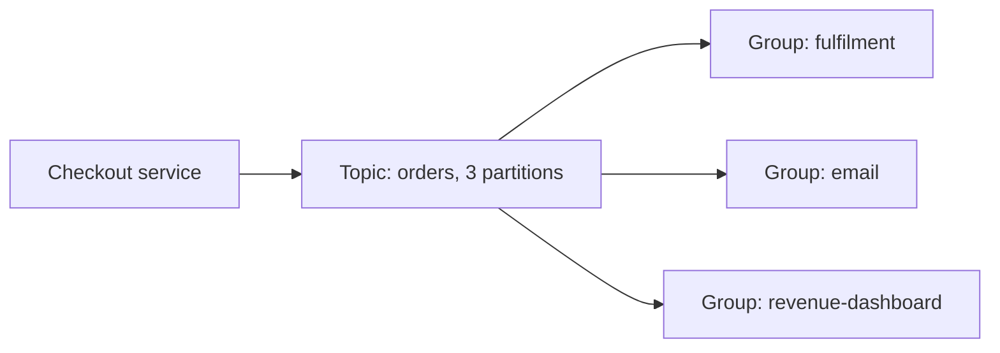
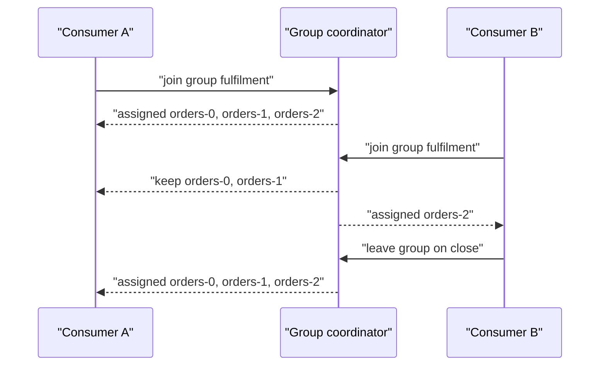

# Your First Topic, Producer and Consumer

## Introduction

Reading about logs, partitions and consumer groups only gets you so far. The ideas click when you watch two consumers split a topic between them, kill one, and see the survivor pick up its partitions within seconds.

This page walks through that experience end to end for a small online shop. You will create an `orders` topic, send keyed order events first from the terminal and then from a Java program, read them back with a consumer in a consumer group, scale the group to two instances, and inspect the committed offsets. A short Python version at the end shows that nothing here is specific to Java.

You need a running broker on `localhost:9092` (the [Docker Compose page](./0-kafka-docker-compose.mdx) gives you one in a minute), Java 17 or newer, and Maven. The CLI commands are explained in more depth on [The Kafka CLI Tools](./2-kafka-cli-tools.mdx).

## The Scenario: Order Events for a Small Shop

The shop's checkout service records every order. Three downstream jobs care about those orders: fulfilment, email confirmations and a revenue dashboard. Today the checkout service calls each of them over HTTP, so a slow email provider makes checkout slow, and a new consumer means a new deployment of checkout.

Kafka was chosen over adding a work queue such as RabbitMQ because the shop wants each downstream job to read the same history independently, at its own pace, and to be able to replay it, for example to rebuild the dashboard after a bug. A queue removes a message once one consumer takes it; a Kafka topic keeps it for its retention period and lets any number of groups read it.



Each order event uses the customer id as its key. That choice matters: Kafka sends all records with the same key to the same partition, so one customer's orders stay in the order they were placed, while different customers' orders spread across partitions and can be processed in parallel.

## Step 1: Create the Topic

```bash
kafka-topics.sh --bootstrap-server localhost:9092 \
  --create --topic orders --partitions 3 --replication-factor 1
```

```
Created topic orders.
```

Three partitions means at most three consumers in one group can work in parallel; a fourth would sit idle. Replication factor 1 is only acceptable because this is a single-broker development cluster. On a real cluster you would use 3, as the [replication page](../2-kafka-topics-and-storage/2-kafka-replication.mdx) explains.

## Step 2: A First Round Trip from the Terminal

Open two terminals. In the first, start a consumer that prints the partition, offset and key of each record:

```bash
kafka-console-consumer.sh --bootstrap-server localhost:9092 --topic orders \
  --group order-debug --from-beginning \
  --formatter-property print.partition=true \
  --formatter-property print.offset=true \
  --formatter-property print.key=true
```

In the second, send three keyed records:

```bash
kafka-console-producer.sh --bootstrap-server localhost:9092 --topic orders \
  --reader-property parse.key=true --reader-property key.separator=:
```

```
>cust-42:{"orderId":"o-1001","total":25.00}
>cust-7:{"orderId":"o-1002","total":9.50}
>cust-42:{"orderId":"o-1003","total":12.75}
```

The consumer prints something like this (your partition numbers may differ, because they depend on a hash of the key):

```
Partition:1	Offset:0	cust-42	{"orderId":"o-1001","total":25.00}
Partition:2	Offset:0	cust-7	{"orderId":"o-1002","total":9.50}
Partition:1	Offset:1	cust-42	{"orderId":"o-1003","total":12.75}
```

Notice three things. Offsets are per partition: partition 1 and partition 2 each start at 0. Both `cust-42` records are in partition 1, in send order. And nothing was deleted by reading: run the consumer again with a different `--group` and the same three records come back. Stop both programs with `Ctrl-C` before moving on.

## Step 3: A Java Producer

Create a Maven project with this dependency section in `pom.xml`:

```xml
<dependencies>
  <dependency>
    <groupId>org.apache.kafka</groupId>
    <artifactId>kafka-clients</artifactId>
    <version>4.3.1</version>
  </dependency>
  <dependency>
    <groupId>org.slf4j</groupId>
    <artifactId>slf4j-simple</artifactId>
    <version>2.0.17</version>
  </dependency>
</dependencies>
```

The producer below sends ten orders for a handful of customers and prints where each one landed.

```java
package shop;

import org.apache.kafka.clients.producer.KafkaProducer;
import org.apache.kafka.clients.producer.ProducerConfig;
import org.apache.kafka.clients.producer.ProducerRecord;
import org.apache.kafka.common.serialization.StringSerializer;

import java.util.Properties;

public class OrderProducer {
    public static void main(String[] args) {
        Properties props = new Properties();
        props.put(ProducerConfig.BOOTSTRAP_SERVERS_CONFIG, "localhost:9092");
        props.put(ProducerConfig.KEY_SERIALIZER_CLASS_CONFIG, StringSerializer.class.getName());
        props.put(ProducerConfig.VALUE_SERIALIZER_CLASS_CONFIG, StringSerializer.class.getName());
        // These two are already the defaults in Kafka 3.0+; set explicitly so the intent is visible.
        props.put(ProducerConfig.ACKS_CONFIG, "all");
        props.put(ProducerConfig.ENABLE_IDEMPOTENCE_CONFIG, true);

        String[] customers = {"cust-42", "cust-7", "cust-13", "cust-99"};

        // try-with-resources calls close(), which flushes anything still buffered
        try (KafkaProducer<String, String> producer = new KafkaProducer<>(props)) {
            for (int i = 0; i < 10; i++) {
                String customer = customers[i % customers.length];
                String orderId = "o-" + (2000 + i);
                String value = "{\"orderId\":\"" + orderId + "\",\"customer\":\"" + customer
                        + "\",\"total\":" + (10 + i) + ".00}";

                ProducerRecord<String, String> record = new ProducerRecord<>("orders", customer, value);

                // send() is asynchronous: it returns at once and the callback runs when the broker answers
                producer.send(record, (metadata, exception) -> {
                    if (exception != null) {
                        System.err.println("Failed to send " + orderId + ": " + exception.getMessage());
                    } else {
                        System.out.printf("%s key=%s -> partition %d, offset %d%n",
                                orderId, customer, metadata.partition(), metadata.offset());
                    }
                });
            }
        }
    }
}
```

Run it with `mvn -q compile exec:java -Dexec.mainClass=shop.OrderProducer` (add the `exec-maven-plugin` or run it from your IDE):

```
o-2000 key=cust-42 -> partition 1, offset 2
o-2004 key=cust-42 -> partition 1, offset 3
o-2008 key=cust-42 -> partition 1, offset 4
o-2001 key=cust-7 -> partition 2, offset 1
...
```

The lines may print out of send order, because callbacks for different partitions complete independently. Within one partition they are always in order.

Why `send` with a callback instead of `send(record).get()`? Calling `get()` waits for each record's acknowledgement before sending the next, which turns a producer capable of hundreds of thousands of records per second into one that manages a few hundred. The callback keeps the speed and still tells you about every failure. The [producer basics page](../3-kafka-producers/0-kafka-producer-basics.mdx) covers batching and error handling in detail.

## Step 4: A Java Consumer in a Group

The consumer is a loop: ask the broker for records, process them, repeat. The group id is what makes several instances cooperate.

```java
package shop;

import org.apache.kafka.clients.consumer.ConsumerConfig;
import org.apache.kafka.clients.consumer.ConsumerRecord;
import org.apache.kafka.clients.consumer.ConsumerRecords;
import org.apache.kafka.clients.consumer.KafkaConsumer;
import org.apache.kafka.common.errors.WakeupException;
import org.apache.kafka.common.serialization.StringDeserializer;

import java.time.Duration;
import java.util.List;
import java.util.Properties;

public class FulfilmentConsumer {
    public static void main(String[] args) {
        Properties props = new Properties();
        props.put(ConsumerConfig.BOOTSTRAP_SERVERS_CONFIG, "localhost:9092");
        props.put(ConsumerConfig.GROUP_ID_CONFIG, "fulfilment");
        props.put(ConsumerConfig.KEY_DESERIALIZER_CLASS_CONFIG, StringDeserializer.class.getName());
        props.put(ConsumerConfig.VALUE_DESERIALIZER_CLASS_CONFIG, StringDeserializer.class.getName());
        // A brand-new group has no committed offsets; start from the oldest record instead of the newest
        props.put(ConsumerConfig.AUTO_OFFSET_RESET_CONFIG, "earliest");

        KafkaConsumer<String, String> consumer = new KafkaConsumer<>(props);

        // On Ctrl-C, wake the consumer so poll() throws and we can close cleanly
        Thread mainThread = Thread.currentThread();
        Runtime.getRuntime().addShutdownHook(new Thread(() -> {
            consumer.wakeup();
            try { mainThread.join(); } catch (InterruptedException ignored) { }
        }));

        try {
            consumer.subscribe(List.of("orders"));
            while (true) {
                ConsumerRecords<String, String> records = consumer.poll(Duration.ofMillis(500));
                for (ConsumerRecord<String, String> r : records) {
                    System.out.printf("partition=%d offset=%d key=%s value=%s%n",
                            r.partition(), r.offset(), r.key(), r.value());
                }
                // Offsets are committed automatically every 5 s by default (enable.auto.commit=true)
            }
        } catch (WakeupException e) {
            // expected on shutdown
        } finally {
            consumer.close(); // leaves the group promptly so its partitions are reassigned at once
        }
    }
}
```

Start it, and it prints all thirteen orders (three from the terminal, ten from the Java producer). Leave it running and run the producer again: the new orders appear within a second.

:::note
Kafka 4.0 made the new consumer group protocol from KIP-848 generally available. It moves partition assignment to the broker and makes rebalances much less disruptive. The Java client still defaults to the classic protocol; opt in with `props.put(ConsumerConfig.GROUP_PROTOCOL_CONFIG, "consumer")`. Everything on this page works with either. The [rebalancing page](../4-kafka-consumers/2-kafka-rebalancing.mdx) compares them.
:::

## Step 5: Scale the Group and Watch a Rebalance

Start a second copy of `FulfilmentConsumer` in another terminal. Within a few seconds the two instances divide the three partitions between them. Ask the cluster how:

```bash
kafka-consumer-groups.sh --bootstrap-server localhost:9092 --describe --group fulfilment --members --verbose
```

```
GROUP       CONSUMER-ID                 HOST         CLIENT-ID     #PARTITIONS  ASSIGNMENT
fulfilment  consumer-fulfilment-1-6f0e  /172.18.0.1  consumer-...  2            orders(0,1)
fulfilment  consumer-fulfilment-1-b3a1  /172.18.0.1  consumer-...  1            orders(2)
```

Run the producer again and each record appears in exactly one of the two terminals, always the one that owns its partition. Now stop one consumer with `Ctrl-C`. Its `close()` tells the group it is leaving, the group rebalances, and the survivor takes over all three partitions and continues from the last committed offsets.



This is the property that makes Kafka consumers easy to scale and to operate: add instances to share load, remove or lose instances and the work moves, with no coordination code of your own. The limit is the partition count. Start a fourth instance and it gets nothing.

## Step 6: Offsets, Lag and Replay

Stop all consumers, run the producer once more, and describe the group:

```bash
kafka-consumer-groups.sh --bootstrap-server localhost:9092 --describe --group fulfilment
```

```
GROUP       TOPIC   PARTITION  CURRENT-OFFSET  LOG-END-OFFSET  LAG  CONSUMER-ID  HOST  CLIENT-ID
fulfilment  orders  0          6               8               2    -            -     -
fulfilment  orders  1          10              13              3    -            -     -
fulfilment  orders  2          7               12              5    -            -     -
```

The group remembers where it stopped (`CURRENT-OFFSET`), and `LAG` counts the ten orders waiting. Start a consumer and the lag drops to zero. These committed offsets live in the internal `__consumer_offsets` topic, not in your application, which is why a restarted or replaced instance resumes correctly.

To replay everything, perhaps because fulfilment had a bug, stop the consumers and reset the group:

```bash
kafka-consumer-groups.sh --bootstrap-server localhost:9092 --group fulfilment \
  --topic orders --reset-offsets --to-earliest --execute
```

Other groups (`email`, `revenue-dashboard`) are untouched. Each group has its own offsets, which is what allows independent consumers of the same history.

## The Same Thing in Python

Kafka's protocol is language-neutral. With `pip install confluent-kafka`, the Python equivalents are short:

```python
from confluent_kafka import Consumer, Producer

producer = Producer({"bootstrap.servers": "localhost:9092"})

def report(err, msg):
    # Called from poll() or flush() once the broker has answered
    if err:
        print(f"failed: {err}")
    else:
        print(f"{msg.key().decode()} -> partition {msg.partition()}, offset {msg.offset()}")

for i, customer in enumerate(["cust-42", "cust-7", "cust-42"]):
    producer.produce("orders", key=customer, value=f'{{"orderId":"py-{i}"}}', callback=report)
producer.flush()  # wait for outstanding deliveries before exiting

consumer = Consumer({
    "bootstrap.servers": "localhost:9092",
    "group.id": "email",
    "auto.offset.reset": "earliest",
})
consumer.subscribe(["orders"])
try:
    while True:
        msg = consumer.poll(1.0)
        if msg is None:
            continue
        if msg.error():
            print(msg.error())
            continue
        print(msg.partition(), msg.offset(), msg.key(), msg.value())
except KeyboardInterrupt:
    pass
finally:
    consumer.close()
```

The `email` group reads the full history independently of `fulfilment`. The [Python client page](../5-kafka-clients/2-kafka-python-client.mdx) covers it properly.

## Common Mistakes

- Expecting a global order across a topic. Kafka orders records within a partition only; use a key when related records must stay in sequence.
- Forgetting `auto.offset.reset=earliest` for a new group and seeing nothing, because the default `latest` starts at the end of the topic.
- Calling `send(...).get()` for every record in a hot path. Use a callback and let the producer batch.
- Exiting a producer without `close()` or `flush()`. Records still in the buffer are lost silently.
- Killing consumers with `kill -9` and wondering why the rebalance takes 45 seconds. Without `close()`, the group waits for the session timeout before reassigning partitions.
- Running more consumers in a group than there are partitions and expecting more throughput.
- Using the same `group.id` for two different applications. They will split the partitions between them and each will see only part of the data.

## Summary

- A topic is split into partitions; a record's key decides its partition, and order is guaranteed only within a partition.
- Producers send asynchronously; a callback reports success or failure without slowing the producer down.
- Consumers with the same `group.id` share the partitions; different groups each receive every record.
- Adding or losing a consumer triggers a rebalance that moves partitions between the remaining instances.
- Committed offsets live in Kafka, so a restarted consumer resumes where the group stopped, and `--reset-offsets` lets a group replay history.
- The same concepts and configuration keys apply in every client language.

## Further Reading

- [Kafka Quickstart](https://kafka.apache.org/43/getting-started/quickstart/) - the official minimal walkthrough with the console tools.
- [KafkaProducer Javadoc](https://kafka.apache.org/43/javadoc/org/apache/kafka/clients/producer/KafkaProducer.html) - the producer API and its threading model.
- [KafkaConsumer Javadoc](https://kafka.apache.org/43/javadoc/org/apache/kafka/clients/consumer/KafkaConsumer.html) - the poll loop, offsets and group membership explained by the authors.
- [KIP-848: The Next Generation of the Consumer Rebalance Protocol](https://cwiki.apache.org/confluence/display/KAFKA/KIP-848%3A+The+Next+Generation+of+the+Consumer+Rebalance+Protocol) - the design behind `group.protocol=consumer`.
- [confluent-kafka-python documentation](https://docs.confluent.io/platform/current/clients/confluent-kafka-python/html/index.html) - the Python client used above.
