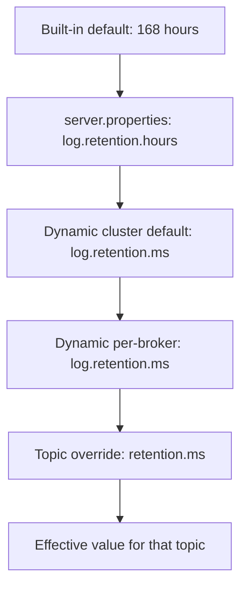

# Broker Configuration Basics

## Introduction

A Kafka broker has several hundred configuration settings, and the reference page lists them alphabetically with no hint of which ones you should care about on day one. The good news is that a working, safe cluster needs only about twenty, and most of the rest exist for tuning or for features you may never use.

This page groups those twenty into the questions they answer: who is this node, how do clients reach it, where does it keep data, what do new topics look like, how long is data kept, and how safe are writes. For each group you will see the default in Kafka 4.3, what it means, and when to change it. You will also learn the layering that decides which value wins when the same setting appears in several places, and how to change most settings on a running cluster without a restart.

The examples build on the `server.properties` that ships in the tarball, described on the [binary installation page](./1-kafka-local-installation.mdx). In Docker, every setting becomes a `KAFKA_*` environment variable, as shown on the [Docker Compose page](./0-kafka-docker-compose.mdx).

## Where Configuration Lives

A broker reads its static configuration from one properties file passed on the command line, typically `config/server.properties`. Kafka 4.x also ships two templates for the production layout where controllers and brokers run as separate processes: `controller.properties` and `broker.properties`.

On top of that file sits dynamic configuration, stored in the cluster's metadata log and changed with `kafka-configs.sh` or the Admin API. When the same broker setting is defined in several places, the most specific one wins:

| Precedence | Source | Changed with |
|---|---|---|
| 1 (highest) | Dynamic per-broker value | `kafka-configs.sh --entity-type brokers --entity-name 2` |
| 2 | Dynamic cluster-wide default | `kafka-configs.sh --entity-type brokers --entity-default` |
| 3 | Static value in `server.properties` | Edit the file and restart |
| 4 (lowest) | Kafka's built-in default | Upgrade Kafka |

Topics add one more layer. Many broker settings that start with `log.` are only defaults for a topic-level setting with a shorter name: `log.retention.ms` on the broker, `retention.ms` on a topic. A topic override always beats the broker default. This is the most useful rule in Kafka configuration: set safe cluster-wide defaults in the broker, and override per topic only where a topic is genuinely different.



Read the diagram bottom up: each layer, if set, replaces the one below it.

Not every setting can change at runtime. The configuration reference marks each with an update mode: `read-only` needs a restart, `per-broker` can be changed for one broker, and `cluster-wide` can be changed for one broker or all of them. Listener names, `node.id`, `process.roles` and `log.dirs` are read-only; retention, thread counts and `min.insync.replicas` are cluster-wide.

## Identity: Who Is This Node?

These settings have no safe default for a real cluster, and getting them wrong prevents a node from starting.

```properties
# This node acts as a broker only; controllers run as separate processes
process.roles=broker
# Unique across the whole cluster, controllers included; never reuse a retired id
node.id=4
# How to find the controller quorum (dynamic quorum, KIP-853)
controller.quorum.bootstrap.servers=ctrl-1:9093,ctrl-2:9093,ctrl-3:9093
# Which listener name the controllers speak on
controller.listener.names=CONTROLLER
```

`process.roles` is `broker`, `controller` or `broker,controller`. The combined form is what development setups use; the Kafka documentation recommends separate controller nodes for production so that a broker under heavy load cannot starve the metadata quorum.

Kafka 4.x supports two ways to describe the quorum. The newer `controller.quorum.bootstrap.servers` gives a list of controllers to contact and lets the membership itself be stored and changed in the metadata log. The older `controller.quorum.voters` hard-codes the voter set as `id@host:port` entries. Use one or the other, never both; new clusters should prefer the bootstrap form, which allows adding and removing controllers later. The [KRaft page](../0-kafka-fundamentals/3-kafka-kraft-and-metadata.mdx) explains the quorum itself.

## Listeners: How Do Clients Reach It?

```properties
listeners=INTERNAL://0.0.0.0:9092,EXTERNAL://0.0.0.0:9094,CONTROLLER://0.0.0.0:9093
advertised.listeners=INTERNAL://broker-4.kafka.internal:9092,EXTERNAL://kafka-4.example.com:9094
listener.security.protocol.map=INTERNAL:SASL_SSL,EXTERNAL:SASL_SSL,CONTROLLER:SSL
inter.broker.listener.name=INTERNAL
```

`listeners` is what the process binds to. `advertised.listeners` is what it tells clients in metadata responses, and clients then connect to exactly those addresses. The names (`INTERNAL`, `EXTERNAL`) are labels you choose; the security protocol map gives each one its meaning. A broker typically has one listener for traffic inside the data centre or VPC and another for clients that come through a load balancer or a different network.

If you remember one thing: an advertised address must be resolvable and reachable by the clients that use that listener. Every "connects, then times out" problem traces back to this line. Controllers do not advertise to clients, so a controller-only node has no `advertised.listeners` for client traffic.

## Storage: Where Is the Data?

```properties
log.dirs=/data/kafka-1,/data/kafka-2
num.recovery.threads.per.data.dir=2
```

`log.dirs` is a comma-separated list of directories, usually one per physical disk. Kafka spreads partitions across them and, since KRaft supports it, can keep running when one disk fails (the partitions on it move elsewhere). The tarball default is `/tmp/kraft-combined-logs`, which many systems clear on reboot. Change it before anything else.

`num.recovery.threads.per.data.dir` (default 2 since Kafka 4.0) controls how many threads check segment files after an unclean shutdown. On a broker with thousands of partitions, raising it shortens recovery time considerably.

A note on what you should not configure: `log.flush.interval.messages` and `log.flush.interval.ms` default to "never force a flush". Kafka deliberately leaves flushing to the operating system and gets durability from replication, not from `fsync`. Setting these low is a classic way to destroy throughput while gaining very little.

## New Topic Defaults and Durability

These settings shape every topic created without explicit options, and they are where development and production configurations differ most.

| Setting | Default | Typical production value | Why |
|---|---|---|---|
| `num.partitions` | 1 | 6 or more | One partition caps a consumer group at one active instance |
| `default.replication.factor` | 1 | 3 | Survive the loss of a broker without losing data |
| `min.insync.replicas` | 1 | 2 | With `acks=all`, a write needs two copies before it is acknowledged |
| `auto.create.topics.enable` | true | false | A typo in a producer should fail, not create a new topic |
| `unclean.leader.election.enable` | false | false | Never elect an out-of-sync replica as leader and silently lose data |
| `offsets.topic.replication.factor` | 3 | 3 | Committed consumer offsets must survive a broker loss |
| `transaction.state.log.replication.factor` | 3 | 3 | Same for transaction state |
| `transaction.state.log.min.isr` | 2 | 2 | Same durability rule as `min.insync.replicas` |

The pair `default.replication.factor=3` and `min.insync.replicas=2` is the standard trade-off for a three-broker cluster. One broker can be down, for maintenance or failure, and producers using `acks=all` (the default since Kafka 3.0) keep writing. Lose two and those producers get errors instead of silently writing to a single copy. The [durability page](../3-kafka-producers/2-kafka-producer-acks-and-durability.mdx) works through the arithmetic.

On a single development broker, the three internal-topic settings must be lowered to 1, otherwise consumer groups and transactions never initialise. The tarball's `server.properties` already does this; production configs must undo it.

:::warning
`default.replication.factor` and `num.partitions` apply only when a topic is created without explicit values. Changing them later does nothing to existing topics. Decide them before the first application goes live.
:::

## Retention: How Long Is Data Kept?

```properties
log.retention.hours=168
log.retention.bytes=-1
log.segment.bytes=1073741824
log.retention.check.interval.ms=300000
log.cleanup.policy=delete
```

Kafka deletes old data per partition, a whole segment file at a time, when the segment is older than the retention time or the partition is larger than the retention size. The defaults keep seven days with no size limit, in 1 GiB segments, checked every five minutes.

Three consequences surprise newcomers. Retention is a minimum, not an exact time: the active segment is never deleted, so a quiet partition can hold data much longer than seven days until the segment rolls. `log.retention.bytes` is per partition, not per topic, so a topic with 12 partitions and a 10 GB limit can use 120 GB per replica. And there are three time settings (`log.retention.ms`, `log.retention.minutes`, `log.retention.hours`); the most precise one that is set wins.

The other cleanup policy, `compact`, keeps the latest record for each key instead of deleting by age, and is used for changelog and state topics. It is usually set per topic rather than as the broker default. The [retention and compaction page](../2-kafka-topics-and-storage/3-kafka-retention-and-compaction.mdx) covers both.

## Limits and Threads

```properties
message.max.bytes=1048588
num.network.threads=3
num.io.threads=8
socket.request.max.bytes=104857600
```

`message.max.bytes` caps the size of a record batch the broker accepts, about 1 MB. Raising it is possible but has knock-on effects: the producer's `max.request.size`, the consumer's `max.partition.fetch.bytes` and the replica fetcher must all allow the larger size, and big records hurt latency for everyone sharing the partition. Storing large payloads in object storage and sending a reference through Kafka is usually the better design.

The thread counts are reasonable starting points. `num.network.threads` handles reading requests from sockets and writing responses; `num.io.threads` does the actual disk work. Increase them only when the broker's request-handler or network-processor idle metrics show they are saturated, as described in the [broker tuning page](../12-kafka-performance/3-kafka-broker-and-os-tuning.mdx).

Two settings outside the properties file matter just as much. The JVM heap is set with the `KAFKA_HEAP_OPTS` environment variable (the start script defaults to 1 GB); 4 to 6 GB is plenty for most brokers because Kafka serves hot data from the operating system's page cache, not the heap. And the process needs a high open-file limit, since each segment and index is an open file.

## Changing Configuration on a Live Cluster

Suppose disk usage is climbing and you want the cluster-wide default retention cut from seven days to three, without restarting anything:

```bash
kafka-configs.sh --bootstrap-server localhost:9092 \
  --entity-type brokers --entity-default \
  --alter --add-config log.retention.ms=259200000
```

```
Completed updating default config for brokers in the cluster.
```

Check what a broker is really using, and where each value comes from:

```bash
kafka-configs.sh --bootstrap-server localhost:9092 \
  --entity-type brokers --entity-name 1 --describe --all | grep log.retention
```

```
  log.retention.ms=259200000 sensitive=false synonyms={DYNAMIC_DEFAULT_BROKER_CONFIG:log.retention.ms=259200000}
  log.retention.hours=168 sensitive=false synonyms={STATIC_BROKER_CONFIG:log.retention.hours=168, DEFAULT_CONFIG:log.retention.hours=168}
  ...
```

The `synonyms` list shows the precedence chain in action: the dynamic default beats the static hours setting. Topics with their own `retention.ms` override keep it.

Dynamic changes are stored in the metadata log, so they survive restarts and apply to brokers added later, but they are invisible if you only read `server.properties`. Keep a record of them, ideally by applying them from version-controlled scripts or an operator such as Strimzi, rather than by hand.

## Worked Scenario: From Laptop Config to a Ledger Cluster

A fintech team prototyped a payment ledger against a single Docker broker. Moving to three brokers on virtual machines, they reviewed every setting the prototype had relied on. They considered a managed service, but data-residency rules required the cluster in their own data centre, so the configuration was theirs to own.

What changed and why:

- `log.dirs` moved from the container volume to two dedicated SSDs per broker.
- `default.replication.factor=3` and `min.insync.replicas=2`, so a lost broker never costs a ledger entry and a second loss stops writes rather than risking a single copy.
- The internal topics went back to their defaults of 3 and 2, which the single-node config had lowered to 1.
- `auto.create.topics.enable=false`. Topics are created by a reviewed script that sets partitions, replication and retention explicitly.
- `num.partitions=12` as a default for the few topics created by tools that cannot pass a count.
- Retention left at seven days cluster-wide, with `retention.ms=-1` (keep forever) set only on the `ledger.entries` topic, which is the system of record. Everything else is derived and can be rebuilt.
- Separate `INTERNAL` and `EXTERNAL` listeners, both `SASL_SSL`, and three dedicated controller nodes with `process.roles=controller`.

The prototype's code did not change at all. Every difference was configuration, which is typical: Kafka's application-facing behaviour is the same on a laptop and in production, and the gap is almost entirely in these settings.

## Common Mistakes

- Leaving `log.dirs` under `/tmp`. Data, and the cluster's metadata with it, can vanish on reboot.
- Copying a single-node config to production with the internal topic replication factors still at 1.
- Setting `min.insync.replicas` equal to the replication factor. Any single broker restart then blocks all `acks=all` producers.
- Expecting `num.partitions` or `default.replication.factor` changes to affect existing topics.
- Reading `log.retention.bytes` as a per-topic limit. It is per partition.
- Forcing flushes with `log.flush.interval.messages`. Rely on replication for durability.
- Making dynamic changes by hand and forgetting them. The next engineer reads `server.properties` and is misled.

## Summary

- Static settings live in `server.properties`; dynamic settings live in the metadata log and override them, per broker or cluster-wide. Topic overrides beat broker defaults.
- Identity (`process.roles`, `node.id`, controller quorum) and listeners must be right for a node to start and be reachable.
- Put `log.dirs` on durable disks; leave flushing to the operating system.
- For a three-broker cluster, use replication factor 3, `min.insync.replicas=2`, auto-creation off, and unclean leader election off.
- Retention is per partition, a minimum, and enforced one segment at a time.
- Change what you can at runtime with `kafka-configs.sh`, and keep those changes in version control.

## Further Reading

- [Broker configuration reference](https://kafka.apache.org/43/configuration/broker-configs/) - every setting with type, default and update mode.
- [Topic configuration reference](https://kafka.apache.org/43/configuration/topic-configs/) - the per-topic overrides and the broker defaults they map to.
- [KRaft operations](https://kafka.apache.org/43/operations/kraft/) - process roles, quorum settings and controller deployment advice.
- [KIP-226: Dynamic Broker Configuration](https://cwiki.apache.org/confluence/display/KAFKA/KIP-226+-+Dynamic+Broker+Configuration) - the design behind runtime config changes and their precedence.
- [Hardware and operating system](https://kafka.apache.org/43/operations/hardware-and-os/) - disks, file descriptors, page cache and JVM guidance.
