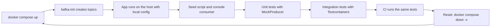

# A Local Development Workflow for Kafka Applications

## Introduction

Getting a broker running is the easy part. The friction starts a week later: a teammate's topic has one partition while yours has three, the integration tests pass on your laptop and fail in CI, and nobody remembers which command recreates the test data. Kafka applications have more moving parts than a typical web service, because the broker holds state between runs, and that state quietly drifts.

This page assembles a workflow that removes the drift. You will define topics as code next to the broker, keep every client setting in configuration so the same binary runs locally and in production, seed and inspect data with scripts, reset to a clean state in seconds, and test at three levels: plain unit tests with mock clients, integration tests against a real broker in Testcontainers, and the same tests in CI.

The examples use the single-node Compose file from the [Docker Compose page](./0-kafka-docker-compose.mdx) and Java for code, but the structure carries over to any language.

## The Shape of the Workflow



The guiding rule is that everything a developer needs is in the repository and starts with one command. No wiki page of manual steps, no shared development cluster that one person's test can break for everyone else.

A shared remote development cluster is the alternative many teams start with. It saves laptop memory, but every developer's consumers, topics and test data collide, and offline work becomes impossible. A local broker per developer, plus a shared staging environment for end-to-end testing, avoids both problems.

## Topics as Code

Auto-created topics are the main source of drift: they get the broker defaults, and whichever developer's code touched a topic first decided its shape. Turn auto-creation off on the local broker (`KAFKA_AUTO_CREATE_TOPICS_ENABLE: "false"`) and create topics explicitly with a one-shot service in the same Compose file:

```yaml
services:
  kafka:
    image: apache/kafka:4.3.1
    # ... the single-node configuration from the Docker Compose page ...

  kafka-init:
    image: apache/kafka:4.3.1
    depends_on:
      kafka:
        condition: service_healthy     # wait for the broker's healthcheck to pass
    entrypoint: ["/bin/bash", "/scripts/create-topics.sh"]
    volumes:
      - ./kafka/create-topics.sh:/scripts/create-topics.sh:ro
    restart: "no"                       # run once and exit
```

```bash
#!/usr/bin/env bash
# kafka/create-topics.sh: the single source of truth for topic layout in development
set -euo pipefail
BOOTSTRAP="kafka:19092"
TOPICS=/opt/kafka/bin/kafka-topics.sh

create() {
  # name, partitions, then any extra --config flags
  local name=$1 partitions=$2; shift 2
  "$TOPICS" --bootstrap-server "$BOOTSTRAP" --create --if-not-exists \
    --topic "$name" --partitions "$partitions" --replication-factor 1 "$@"
}

create clicks.raw            6
create clicks.sessionized    6
create users.profile         3 --config cleanup.policy=compact
create clicks.raw.dlq        1 --config retention.ms=1209600000   # 14 days

echo "Topics ready:"
"$TOPICS" --bootstrap-server "$BOOTSTRAP" --list
```

`--if-not-exists` makes the script safe to rerun. Partition counts match production, so a developer running two consumer instances sees the same assignment behaviour production will have. Replication factor is 1 only because there is one broker. In production the same topic list usually lives in Terraform, a Strimzi `KafkaTopic` resource or a script using the [Admin API](../2-kafka-topics-and-storage/6-kafka-admin-api.mdx); keeping the development script next to it in review keeps them aligned.

## Configuration-Driven Clients

An application should not know whether it is talking to a laptop broker, a CI container or a managed cloud cluster. Load every Kafka property from the environment or a profile file, and keep code free of addresses and credentials.

```java
package clicks;

import java.util.Map;
import java.util.Properties;

public final class KafkaConfig {
    private KafkaConfig() { }

    /**
     * Builds client properties from environment variables.
     * KAFKA_BOOTSTRAP_SERVERS -> bootstrap.servers, KAFKA_SECURITY_PROTOCOL -> security.protocol, ...
     * Anything not set falls back to the client defaults, which suit a local plaintext broker.
     */
    public static Properties fromEnv(Map<String, String> env) {
        Properties props = new Properties();
        props.put("bootstrap.servers", env.getOrDefault("KAFKA_BOOTSTRAP_SERVERS", "localhost:9092"));
        env.forEach((key, value) -> {
            if (key.startsWith("KAFKA_") && !key.equals("KAFKA_BOOTSTRAP_SERVERS")) {
                String property = key.substring("KAFKA_".length()).toLowerCase().replace('_', '.');
                props.put(property, value);
            }
        });
        return props;
    }
}
```

Locally nothing needs to be set. In production the deployment adds `KAFKA_BOOTSTRAP_SERVERS`, `KAFKA_SECURITY_PROTOCOL=SASL_SSL`, `KAFKA_SASL_MECHANISM` and a JAAS config from a secret store. The same convention as the Docker image keeps the mental model simple, and a [managed service](./5-kafka-managed-services.mdx) becomes a configuration change. Frameworks give you this for free: Spring Boot maps `spring.kafka.*` properties and profiles, as shown on the [Spring Kafka page](../5-kafka-clients/1-kafka-spring-kafka.mdx).

One local-only override worth setting is a distinct `client.id` and `group.id` per developer when several people share any environment, so their consumer groups do not steal each other's partitions.

## Seeding, Inspecting and Resetting

Write the commands you run every day into a `Makefile` (or `justfile`, or npm scripts) so they are discoverable and identical for everyone:

```bash
# Makefile targets, shown as the commands they run

# make up: start the broker, create topics, start the UI
docker compose up -d

# make seed: replay a fixture file of realistic events (key|value per line)
docker compose exec -T kafka /opt/kafka/bin/kafka-console-producer.sh \
  --bootstrap-server localhost:9092 --topic clicks.raw \
  --reader-property parse.key=true --reader-property key.separator='|' \
  < fixtures/clicks-sample.txt

# make tail TOPIC=clicks.sessionized: watch a topic with keys and partitions
docker compose exec kafka /opt/kafka/bin/kafka-console-consumer.sh \
  --bootstrap-server localhost:9092 --topic clicks.sessionized --from-beginning \
  --formatter-property print.key=true --formatter-property print.partition=true

# make lag: is my local consumer keeping up?
docker compose exec kafka /opt/kafka/bin/kafka-consumer-groups.sh \
  --bootstrap-server localhost:9092 --describe --all-groups

# make reset: throw away all topics, offsets and data, then start fresh
docker compose down -v && docker compose up -d
```

Fixture files beat hand-typed messages. Capture a few hundred realistic records once (anonymised), commit them, and every developer debugs against the same data, including the awkward cases: a missing field, a very long value, two events for the same key within a millisecond.

The reset is the most valuable target. Because topics are created by `kafka-init`, a full reset costs about fifteen seconds and returns everyone to an identical state. For a narrower reset, keep the data and rewind just your consumer group with `kafka-consumer-groups.sh --reset-offsets --to-earliest --execute`, as described on [The Kafka CLI Tools](./2-kafka-cli-tools.mdx).

## Testing in Layers

Different questions need different test setups. Use the cheapest one that can answer each.

| Layer | Tool | Runs in | Good for |
|---|---|---|---|
| Unit | `MockProducer`, `MockConsumer` from `kafka-clients` | Milliseconds, no broker | Your logic around send and poll: keys, headers, error handling |
| Stream topology | `TopologyTestDriver` from `kafka-streams-test-utils` | Milliseconds, no broker | Kafka Streams transformations, windows, joins |
| Integration | Testcontainers with `apache/kafka` | Seconds, Docker | Serialization, real partitioning, rebalances, transactions |
| End to end | Shared staging cluster | Minutes | Cross-service contracts, security, real configs |

A unit test with `MockProducer` checks that a service sends the right key and value without any broker:

```java
import org.apache.kafka.clients.producer.MockProducer;
import org.apache.kafka.clients.producer.ProducerRecord;
import org.apache.kafka.clients.producer.RoundRobinPartitioner;
import org.apache.kafka.common.serialization.StringSerializer;
import org.junit.jupiter.api.Test;

import static org.junit.jupiter.api.Assertions.assertEquals;

class ClickPublisherTest {
    @Test
    void keysClicksByUserId() {
        // autoComplete=true: every send() succeeds immediately
        MockProducer<String, String> producer = new MockProducer<>(
                true, new RoundRobinPartitioner(), new StringSerializer(), new StringSerializer());

        new ClickPublisher(producer, "clicks.raw").publish("user-17", "/checkout");

        ProducerRecord<String, String> sent = producer.history().get(0);
        assertEquals("clicks.raw", sent.topic());
        assertEquals("user-17", sent.key());   // same user, same partition, ordered clicks
    }
}
```

Integration tests start a real broker in a container. Testcontainers 2.x ships a Kafka module (`org.testcontainers:testcontainers-kafka`) whose `org.testcontainers.kafka.KafkaContainer` runs the official `apache/kafka` image in KRaft mode:

```java
import org.apache.kafka.clients.consumer.ConsumerConfig;
import org.apache.kafka.clients.consumer.ConsumerRecords;
import org.apache.kafka.clients.consumer.KafkaConsumer;
import org.apache.kafka.clients.producer.KafkaProducer;
import org.apache.kafka.clients.producer.ProducerConfig;
import org.apache.kafka.clients.producer.ProducerRecord;
import org.apache.kafka.common.serialization.StringDeserializer;
import org.apache.kafka.common.serialization.StringSerializer;
import org.junit.jupiter.api.Test;
import org.testcontainers.junit.jupiter.Container;
import org.testcontainers.junit.jupiter.Testcontainers;
import org.testcontainers.kafka.KafkaContainer;

import java.time.Duration;
import java.util.List;
import java.util.Map;

import static org.junit.jupiter.api.Assertions.assertEquals;

@Testcontainers
class ClickPipelineIT {
    // static: one broker shared by every test in this class, started once
    @Container
    static KafkaContainer kafka = new KafkaContainer("apache/kafka:4.3.1");

    @Test
    void roundTripsAKeyedClick() throws Exception {
        String bootstrap = kafka.getBootstrapServers();

        try (var producer = new KafkaProducer<String, String>(Map.of(
                ProducerConfig.BOOTSTRAP_SERVERS_CONFIG, bootstrap,
                ProducerConfig.KEY_SERIALIZER_CLASS_CONFIG, StringSerializer.class,
                ProducerConfig.VALUE_SERIALIZER_CLASS_CONFIG, StringSerializer.class))) {
            producer.send(new ProducerRecord<>("clicks.raw", "user-17", "/checkout")).get();
        }

        try (var consumer = new KafkaConsumer<String, String>(Map.of(
                ConsumerConfig.BOOTSTRAP_SERVERS_CONFIG, bootstrap,
                ConsumerConfig.GROUP_ID_CONFIG, "it-" + System.nanoTime(),   // fresh group per test
                ConsumerConfig.AUTO_OFFSET_RESET_CONFIG, "earliest",
                ConsumerConfig.KEY_DESERIALIZER_CLASS_CONFIG, StringDeserializer.class,
                ConsumerConfig.VALUE_DESERIALIZER_CLASS_CONFIG, StringDeserializer.class))) {
            consumer.subscribe(List.of("clicks.raw"));
            ConsumerRecords<String, String> records = ConsumerRecords.empty();
            // The first polls may return nothing while the group forms; keep polling briefly
            for (int i = 0; i < 20 && records.isEmpty(); i++) {
                records = consumer.poll(Duration.ofMillis(500));
            }
            assertEquals(1, records.count());
            assertEquals("user-17", records.iterator().next().key());
        }
    }
}
```

Calling `get()` on the send is fine in a test, where clarity matters more than throughput. The test containers' broker auto-creates topics, so the test is self-contained. Two habits keep integration suites fast and reliable: share one container per test class (or per suite with a singleton), and give every test its own topic names or group ids so tests never see each other's records. Never use `Thread.sleep` to wait for Kafka; poll with a deadline, or use a library such as Awaitility.

:::tip
Pin the image tag in tests to the version you run in production. A test suite on `latest` can start failing, or worse, start passing, for reasons unrelated to your change.
:::

## Running the Same Tests in CI

Testcontainers needs only a Docker daemon, which hosted CI runners such as GitHub Actions' Ubuntu images provide. No separate Kafka service definition is required: the build runs `mvn verify`, the containers start and stop with the tests, and the CI run uses the same broker image and version as every laptop.

```yaml
# .github/workflows/build.yml
name: build
on: [push, pull_request]
jobs:
  test:
    runs-on: ubuntu-24.04
    steps:
      - uses: actions/checkout@v4
      - uses: actions/setup-java@v4
        with:
          distribution: temurin
          java-version: "21"
          cache: maven
      - name: Unit and integration tests
        run: mvn -B verify      # Testcontainers starts apache/kafka:4.3.1 for the IT classes
```

Keep the end-to-end suite out of every push; run it on merges to the main branch against staging, where real security settings and multiple brokers catch what a single plaintext container cannot.

## Worked Scenario: Onboarding onto a Clickstream Team

A team of six owns a clickstream service: a collector writes `clicks.raw`, a Kafka Streams job sessionizes into `clicks.sessionized`, and a sink loads sessions into the warehouse. Before adopting this workflow, onboarding took two days, mostly spent creating topics by hand from a wiki page and asking why a consumer saw no data (the answer was usually a misspelt auto-created topic).

They now keep the Compose file, `create-topics.sh`, fixtures and a Makefile in the service repository. A new developer runs `make up seed`, starts the Streams job from the IDE and watches sessions appear with `make tail`. Unit tests cover the collector's keying and the Streams topology with `TopologyTestDriver`; a dozen Testcontainers tests cover serialization and the dead letter path. CI runs both on every pull request in about four minutes.

They considered an embedded broker started inside the JVM for tests, which avoids Docker. They rejected it because it drags broker internals onto the test classpath, lags behind real broker versions and behaves differently in subtle ways, while Testcontainers runs the exact image production uses. Onboarding now takes under an hour, and "works on my machine" bugs about topic layout have disappeared.

## Common Mistakes

- Relying on auto-created topics in development, so local partition counts and configs differ from production.
- Sharing one remote development cluster, where developers' consumer groups and test data collide.
- Hard-coding `localhost:9092` in application code instead of reading it from configuration.
- Using `Thread.sleep` in integration tests to wait for records. Poll with a deadline instead.
- Reusing topic names or group ids across tests, so one test consumes another's records.
- Testing against `latest` or a different Kafka version than production.
- Expecting a single plaintext container to catch security or multi-broker problems. Keep an end-to-end stage for those.

## Summary

- Put the broker, topic definitions, fixtures and common commands in the repository, started by one command.
- Disable auto-creation locally and create topics with an idempotent script whose partition counts match production.
- Read every client setting from configuration so the same code runs locally, in CI and against managed services.
- Make reset cheap (`docker compose down -v`) and use it freely.
- Test in layers: mock clients and `TopologyTestDriver` for logic, Testcontainers with the pinned `apache/kafka` image for integration, staging for end-to-end.
- CI runs the same Testcontainers tests with nothing more than Docker.

## Further Reading

- [Testcontainers Kafka module](https://java.testcontainers.org/modules/kafka/) - `KafkaContainer` for `apache/kafka` and `apache/kafka-native`.
- [MockProducer Javadoc](https://kafka.apache.org/43/javadoc/org/apache/kafka/clients/producer/MockProducer.html) - the in-memory producer for unit tests.
- [Testing Kafka Streams](https://kafka.apache.org/43/streams/developer-guide/testing/) - `TopologyTestDriver` and the test utilities module.
- [Apache Kafka Docker image examples](https://github.com/apache/kafka/blob/trunk/docker/examples/README.md) - Compose files for single-node, cluster and secured setups.
- [Docker Compose tutorial](/docs/devops/docker) - Compose services, healthchecks, volumes and networks on Compile N Run.
