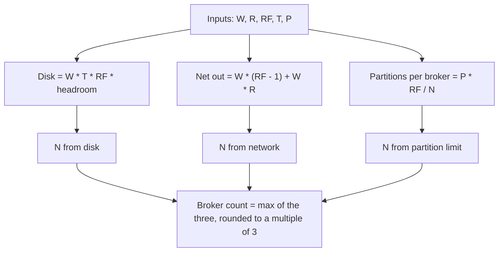

# Cluster Sizing and Capacity Planning

## Introduction

Most Kafka clusters are sized by guesswork: somebody picks three brokers because three is the smallest number that survives a failure, picks the disk size the cloud console suggests, and finds out six months later that the cluster is either 80 percent idle or running out of disk at 3 a.m. Both outcomes are expensive. An oversized cluster burns money every month; an undersized one causes the kind of outage where producers block and consumers fall hours behind.

The good news is that Kafka's resource usage is unusually predictable. It appends bytes to a log and reads them back. If you know how many bytes per second arrive, how long you keep them and how many times you copy them, you can compute disk, network and broker count with a calculator. This page walks through that arithmetic, then covers the two resources that are harder to reason about: partitions and page cache.

By the end you will be able to size a new cluster from a short list of inputs, explain the result to whoever approves the budget, and know which numbers to re-check as the workload grows.

## The Inputs You Need

Before any arithmetic, collect five numbers. Estimate generously; it is far cheaper to shrink a cluster than to grow one in a hurry.

| Input | Symbol | How to estimate it |
|---|---|---|
| Peak write throughput | W (MB/s) | Messages per second at peak multiplied by average message size after compression. Measure a producer with `kafka-producer-perf-test.sh` if you can. |
| Read fan-out | R | How many consumer groups read each byte. A topic read by three groups has R = 3. |
| Replication factor | RF | Almost always 3 in production. |
| Retention | T (seconds) | `retention.ms` on your busiest topics, or the longest retention you need anywhere. |
| Partition count | P | Total partitions across all topics, including replicas when counting per-broker load. |

A useful habit is to express throughput in megabytes per second rather than messages per second. Kafka does not care how many messages it stores; it cares about bytes written, bytes replicated and bytes read.

:::tip
Measure compression before you size. A JSON clickstream that is 1 KB per event on the wire often compresses to 150-250 bytes with `compression.type=zstd` or `lz4`. Sizing on uncompressed numbers can overestimate disk by a factor of five.
:::

## Disk: The Easiest Calculation

Disk is where sizing mistakes hurt most, because a full disk takes a broker offline. The total bytes a cluster must hold is:

```
total_disk = W * T * RF * headroom
```

Take an order-events platform ingesting 50 MB/s at peak, keeping data for 7 days, with replication factor 3:

```
50 MB/s * 604,800 s = 30.2 TB   (one copy, one week)
30.2 TB * 3 (RF)     = 90.7 TB  (all replicas)
90.7 TB * 1.4         = 127 TB  (40 percent headroom)
```

Why 40 percent headroom? Three reasons. Segment files are only deleted when the whole segment is older than retention, so a topic with 1 GB segments holds up to one extra segment per partition beyond its nominal retention. Log compaction and index files add overhead. And when a broker fails, its partitions are re-replicated onto the survivors, which need the spare space to absorb them.

If you plan to use [tiered storage](../2-kafka-topics-and-storage/7-kafka-tiered-storage.mdx), split the calculation. Local disk only has to hold `local.retention.ms` worth of data (often a few hours to a day), while object storage holds the rest at a fraction of the price. For the example above, keeping 12 hours locally brings local disk down to about 7.8 TB across the cluster.

Kafka's own guidance on hardware favours several independent disks (JBOD) over RAID. Partitions are assigned round-robin to the configured `log.dirs`, and Kafka's replication already provides redundancy, so RAID rebuild time buys little. Use XFS, mount with `noatime`, and never share Kafka's disks with application logs or other chatty processes. Watch out for one JBOD trap: partition sizes are rarely uniform, so a few hot partitions can fill one directory while others are mostly empty.

## Network and Broker Count

Each byte a producer sends generates several bytes of traffic inside the cluster. The leader receives it once, sends it to RF-1 followers, and later sends it once to each consumer group. Per broker, the inbound and outbound traffic is roughly:

```
inbound  per broker = (W + W * (RF - 1)) / N
outbound per broker = (W * (RF - 1) + W * R) / N
```

With the order platform's 50 MB/s, RF 3 and three consumer groups, cluster-wide outbound is 50 * 2 + 50 * 3 = 250 MB/s, or 2 Gbit/s. Spread over six brokers that is a comfortable 330 Mbit/s each; on three brokers it is 670 Mbit/s each, which is fine on 10 Gbit NICs but leaves little room for a reassignment or a consumer replaying history at full speed.

Rather than choosing the broker count from a single formula, check it against three constraints and take the largest:

1. **Disk**: total_disk divided by the usable disk per broker.
2. **Network**: peak outbound divided by about 50-60 percent of NIC capacity, so replication catch-up and replays have room.
3. **Failure tolerance**: with RF 3 you need at least three brokers, and ideally one more than the minimum so that losing a broker does not leave you at exactly `min.insync.replicas`.

A fourth constraint applies in cloud deployments: spread brokers across three availability zones and set `broker.rack` so replicas land in different zones. That means your broker count should be a multiple of three.



## Memory and the Page Cache

Kafka brokers do not need big JVM heaps. A heap of 6-8 GB is plenty for most clusters; the rest of the machine's RAM should be left free for the operating system's page cache, because that cache is what makes Kafka fast. Consumers reading the tail of a topic are served from memory, and the broker never copies the bytes into its own process.

The Kafka documentation gives a simple rule for how much page cache you want: enough to hold about 30 seconds of writes, so `W * 30`. For 50 MB/s that is only 1.5 GB, which is why Kafka can run on surprisingly modest machines. In practice you want much more than the minimum, because consumers that fall behind by a few minutes will otherwise read from disk and compete with producers for I/O. A broker with 32-64 GB of RAM and an 8 GB heap gives tens of gigabytes of cache, which covers most lag spikes.

Two operating-system settings matter here. Raise the file descriptor limit to at least 100,000, because every segment and every index on the broker is an open file. And raise `vm.max_map_count`: every segment maps two files, so a broker with 50,000 segments needs 100,000 map areas, above the common default of 65,530. More on this in [Tuning Brokers, JVM and the Operating System](../12-kafka-performance/3-kafka-broker-and-os-tuning.mdx).

## Partitions: The Hidden Capacity Limit

Partitions are the one resource people consistently underestimate. Each partition replica costs the broker open files, memory for indexes, a fetcher thread share and a slot in every metadata update. The cluster-wide limit got much higher with KRaft, which handles millions of partitions where ZooKeeper clusters struggled past 200,000. The per-broker cost did not change.

A widely used planning rule is to keep each broker under roughly 4,000 partition replicas, with well-tuned large instances handling 10,000 or more. Count replicas, not leaders: a cluster with 1,000 partitions at RF 3 has 3,000 replicas to place.

The number also affects recovery time. When a broker restarts, it has to recover every partition in its log directories before it can serve them. `num.recovery.threads.per.data.dir` (default 2) controls how many it recovers in parallel, and a broker with 8,000 replicas on two disks can take many minutes to come back after an unclean stop. See [Choosing the Number of Partitions](../12-kafka-performance/4-kafka-partition-count.mdx) for the throughput side of the decision.

| Partition replicas per broker | What to expect |
|---|---|
| Under 1,000 | Comfortable. Restarts and controller failovers finish in seconds. |
| 1,000-4,000 | Normal production range. Watch file descriptors and restart times. |
| 4,000-10,000 | Works on large machines with tuned OS limits. Plan reassignments carefully. |
| Over 10,000 | Possible, but you should have a specific reason and have measured it. |

## A Worked Scenario: Sizing a Clickstream Cluster

An e-commerce company wants to replace a nightly batch export with a Kafka-based clickstream. They chose Kafka over Amazon Kinesis because they want 30 days of replayable history for analytics backfills and three teams will consume the same events; Kinesis caps retention at a year but charges per shard-hour and per read, so the fan-out and retention would have dominated the bill.

The inputs:

- 40,000 events per second at peak, 600 bytes each uncompressed, compressing to about 150 bytes: W = 6 MB/s at peak, with bursts to 12 MB/s on sale days. Plan for 12.
- Three consumer groups (analytics, personalization, fraud): R = 3.
- RF = 3, retention 30 days: T = 2,592,000 s.
- 12 topics with 24 partitions each: P = 288, so 864 replicas.

Disk: 12 MB/s * 2,592,000 s = 31.1 TB for one copy, 93.3 TB replicated, 131 TB with headroom. That is a lot of expensive block storage for a cluster that only writes 12 MB/s, so they enable tiered storage with `local.retention.ms` of one day: local disk falls to 12 * 86,400 * 3 * 1.4 = 4.4 TB, and the remaining 90 TB sits in object storage.

Network: outbound is 12 * 2 + 12 * 3 = 60 MB/s cluster-wide. Trivial.

Brokers: disk and network both allow three brokers. Failure tolerance pushes them to six brokers across three zones, two per zone, each with 1 TB of SSD, 32 GB RAM and an 8 GB heap. Partition replicas per broker: 864 / 6 = 144. The cluster is dominated by the failure-tolerance constraint, not by load, which is the healthiest place to be.

```bash
# Sanity check the per-topic layout once the cluster exists.
kafka-topics.sh --bootstrap-server broker-1:9092 --describe --topic clickstream.page-views
# Topic: clickstream.page-views  PartitionCount: 24  ReplicationFactor: 3
#   Configs: retention.ms=2592000000,remote.storage.enable=true,local.retention.ms=86400000
```

They also set `default.replication.factor=3`, `min.insync.replicas=2` and `broker.rack` per zone in each broker's `server.properties` so that new topics inherit the safe defaults:

```properties
# server.properties on a broker in zone a
process.roles=broker
node.id=1
broker.rack=us-east-1a
log.dirs=/var/kafka/data-0,/var/kafka/data-1
default.replication.factor=3
min.insync.replicas=2
num.recovery.threads.per.data.dir=4
log.retention.hours=720
```

## Controllers Count Too

KRaft controllers are a separate sizing question. The Kafka documentation recommends three or five dedicated controller nodes; a quorum of 2N+1 tolerates N failures. They need little hardware. The documentation's rule of thumb is about 5 GB of memory and 5 GB of disk for the metadata log directory, and a modest CPU, because controllers only handle metadata.

Combined mode, where the same process is both broker and controller, is acceptable for development and small clusters, but the documentation says it is not recommended for critical deployments, because you cannot roll or scale controllers independently of brokers. For anything you would be paged about, run three dedicated controllers. See [KRaft: How Kafka Runs Without ZooKeeper](../0-kafka-fundamentals/3-kafka-kraft-and-metadata.mdx) for how the quorum works.

## Leaving Room to Grow

Sizing is not a one-time event. Set up three recurring checks:

- **Disk growth per broker**: alert at 70 percent used, because a reassignment or a retention change can need the remaining space quickly.
- **Peak throughput versus plan**: compare `BytesInPerSec` at peak to the W you planned for. When it crosses 60 percent, start the conversation about adding brokers.
- **Partition replicas per broker**: track `PartitionCount` on each broker and check it against the limits above whenever a team asks for a new topic.

When you do add brokers, remember that Kafka does not move existing partitions onto them automatically. You need a [partition reassignment](./3-kafka-partition-reassignment.mdx), or an automated balancer like Cruise Control, before the new brokers carry any load.

## Common Mistakes

- Sizing on uncompressed message sizes and buying three to five times the disk you need.
- Forgetting the replication factor: 30 TB of data at RF 3 is 90 TB of disk.
- Running at exactly `min.insync.replicas` brokers, so the first broker failure stops all producers with `acks=all`.
- Giving the JVM 32 GB of heap and starving the page cache that actually serves reads.
- Creating topics with 100 partitions "to be safe" and hitting file descriptor and recovery-time limits long before hitting throughput limits.
- Putting all brokers in one availability zone, which makes RF 3 pointless against the most common cloud failure.
- Leaving `default.replication.factor=1` and `num.partitions=1` at their defaults so that auto-created topics are unsafe.

## Summary

- Kafka's resource usage is predictable: disk is `W * T * RF * headroom`, network is write bytes times replication and consumer fan-out.
- Pick the broker count as the maximum of what disk, network and failure tolerance each demand, rounded to a multiple of your availability zones.
- Keep the JVM heap small (6-8 GB) and give the rest of RAM to the page cache; aim for far more than the 30-second minimum.
- Partitions are a real capacity limit: stay under a few thousand replicas per broker unless you have measured higher.
- Tiered storage changes the disk calculation completely; size local disk for `local.retention.ms`, not for full retention.
- Use three or five dedicated controllers; they need almost no hardware.
- Re-check disk, peak throughput and partition counts on a schedule, and plan a reassignment whenever you add brokers.

## Further Reading

- [Kafka documentation: Hardware and OS](https://kafka.apache.org/documentation/#hwandos) - the page-cache rule, file descriptor and `vm.max_map_count` guidance, and the JBOD versus RAID discussion.
- [Kafka documentation: KRaft](https://kafka.apache.org/documentation/#kraft) - controller count and hardware recommendations.
- [KIP-405: Kafka Tiered Storage](https://cwiki.apache.org/confluence/display/KAFKA/KIP-405%3A+Kafka+Tiered+Storage) - the design behind separating local and remote retention.
- [Kafka documentation: Broker configs](https://kafka.apache.org/documentation/#brokerconfigs) - defaults for `num.recovery.threads.per.data.dir`, `log.dirs` and the replication settings used above.
