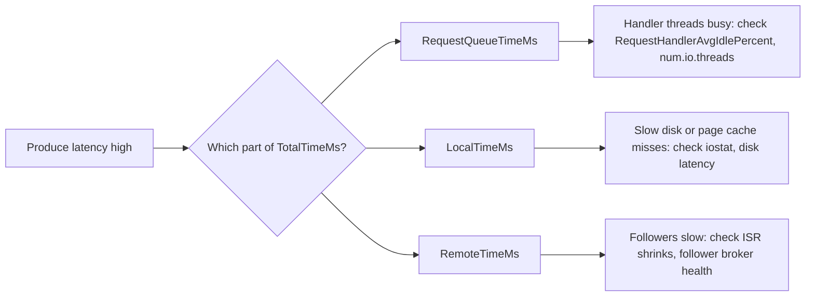

# Monitoring: The Metrics That Matter

## Introduction

A Kafka broker exposes thousands of metrics through JMX. Turn them all into dashboards and nobody will look at any of them; alert on all of them and the on-call engineer will mute the channel within a week. The hard part of monitoring Kafka is not collecting numbers, it is choosing the dozen that tell you whether the cluster is healthy and the few that should wake somebody up.

This page sorts Kafka's metrics into three tiers: a handful of alerts that mean data is at risk right now, a set of saturation metrics that predict trouble hours or days ahead, and client-side metrics that tell you whether applications are getting the service they need. It also shows how to get those metrics into Prometheus, which is how most teams run it in 2026.

By the end you will be able to build a small, useful dashboard, write alert rules you will not regret, and know where to look first when something is wrong.

## How Kafka Exposes Metrics

Every Kafka process (broker, controller, Connect worker, and every Java client) registers metrics as JMX MBeans. An MBean name looks like `kafka.server:type=ReplicaManager,name=UnderReplicatedPartitions`: a domain, a type, a name and sometimes extra tags such as `topic` or `client-id`.

JMX on its own is awkward to use from modern monitoring stacks, so almost everyone runs a translator. The common choices are:

| Option | How it works | When to choose it |
|---|---|---|
| Prometheus JMX Exporter (Java agent) | Runs inside the broker JVM, converts MBeans to Prometheus format using regex rules | Self-managed clusters with Prometheus; the default choice |
| Strimzi metrics support | Strimzi configures the JMX Exporter (or its own metrics reporter) for you | Kafka on Kubernetes with Strimzi |
| Datadog, New Relic, Dynatrace agents | Vendor agents read JMX and ship metrics | You already pay for one of these |
| Managed service metrics | Confluent Cloud, MSK and Event Hubs expose their own metrics APIs | Managed Kafka; you cannot attach agents |

Running the JMX Exporter as a Java agent is a one-line change to the broker's environment. The rules file decides which MBeans become Prometheus metrics; start from the example rules published with the exporter or with Strimzi rather than writing your own.

```bash
# Attach the Prometheus JMX Exporter to a broker started from the binary distribution.
# The agent serves metrics on port 7071 at /metrics.
export KAFKA_OPTS="-javaagent:/opt/jmx_exporter/jmx_prometheus_javaagent.jar=7071:/opt/jmx_exporter/kafka-rules.yml"
bin/kafka-server-start.sh config/server.properties
```

:::note
Remote JMX is off by default, and when you turn it on with `JMX_PORT` it has no authentication. Prefer the Java agent, which only opens an HTTP metrics endpoint, and keep that port on a private network.
:::

If you are new to Prometheus itself, the [Prometheus tutorial](/docs/observability/prometheus) covers scraping, PromQL and alert rules.

## Tier 1: Alerts That Mean Data Is at Risk

These metrics should page a human. Each one means that either writes are failing, reads are failing, or the cluster has lost the redundancy that protects against the next failure.

| Metric | MBean | Healthy value | What a bad value means |
|---|---|---|---|
| Offline partitions | `kafka.controller:type=KafkaController,name=OfflinePartitionsCount` | 0 | Partitions with no leader. Producers and consumers for those partitions are stuck. |
| Under-min-ISR partitions | `kafka.server:type=ReplicaManager,name=UnderMinIsrPartitionCount` | 0 | `acks=all` producers get `NotEnoughReplicasException`. Writes are failing. |
| Active controller count | `kafka.controller:type=KafkaController,name=ActiveControllerCount` | Exactly 1 summed across controllers | 0 means no controller: no leader elections, no topic changes. |
| Under-replicated partitions | `kafka.server:type=ReplicaManager,name=UnderReplicatedPartitions` | 0 | A follower has fallen out of the ISR. Not an outage yet, but one more failure might be. |
| Fenced brokers | `kafka.controller:type=KafkaController,name=FencedBrokerCount` | 0 outside planned restarts | A broker stopped heartbeating to the controller and was removed from service. |

Two of these need care in alert rules. `UnderReplicatedPartitions` goes above zero during every rolling restart, so alert only if it stays non-zero for several minutes. And `ActiveControllerCount` is reported by every controller; sum it across the quorum and alert if the sum is not exactly 1.

```yaml
# Prometheus alert rules. Metric names depend on your JMX Exporter rules file;
# these match the common kafka_server_... / kafka_controller_... naming.
groups:
  - name: kafka-critical
    rules:
      - alert: KafkaOfflinePartitions
        expr: max(kafka_controller_kafkacontroller_offlinepartitionscount) > 0
        for: 1m
        labels: { severity: page }
        annotations:
          summary: "Partitions without a leader; reads and writes are failing"
      - alert: KafkaUnderMinIsr
        expr: sum(kafka_server_replicamanager_underminisrpartitioncount) > 0
        for: 2m
        labels: { severity: page }
      - alert: KafkaNoActiveController
        expr: sum(kafka_controller_kafkacontroller_activecontrollercount) != 1
        for: 1m
        labels: { severity: page }
      - alert: KafkaUnderReplicated
        expr: sum(kafka_server_replicamanager_underreplicatedpartitions) > 0
        for: 10m
        labels: { severity: ticket }
```

## Tier 2: Saturation Metrics That Predict Trouble

These rarely need a page at night, but they tell you that a broker is running out of something long before clients notice. Put them on the main dashboard and review them weekly.

**Request handler idle ratio.** `kafka.server:type=KafkaRequestHandlerPool,name=RequestHandlerAvgIdlePercent` is the fraction of time the I/O threads that process requests are idle. Above 0.7 is comfortable. Below 0.3 the broker is close to CPU or disk saturation and request latency will rise sharply. The sibling metric `kafka.network:type=SocketServer,name=NetworkProcessorAvgIdlePercent` does the same for network threads.

**Request latency.** `kafka.network:type=RequestMetrics,name=TotalTimeMs,request=Produce` (and `FetchConsumer`, `FetchFollower`) is the time a request spends inside the broker. The same MBean family breaks this into `RequestQueueTimeMs`, `LocalTimeMs`, `RemoteTimeMs` and `ResponseSendTimeMs`. That breakdown is the single most useful diagnostic Kafka has: high queue time means not enough handler threads, high local time means slow disks, and high remote time on produce means followers are slow (the leader waits for them when `acks=all`).

**ISR churn.** `IsrShrinksPerSec` and `IsrExpandsPerSec` under `kafka.server:type=ReplicaManager` should be near zero in steady state. A broker that keeps falling out of and back into the ISR usually has a slow disk, a GC problem, or a network path that drops packets.

**Throughput and balance.** `kafka.server:type=BrokerTopicMetrics,name=BytesInPerSec` and `BytesOutPerSec` (omit the `topic` tag for the broker total) show load per broker. Compare brokers with each other: if one broker carries twice the traffic of the others, you have a partition placement problem, which [Partition Reassignment](./3-kafka-partition-reassignment.mdx) fixes. Also compare `LeaderCount` and `PartitionCount` across brokers.

**Disk.** Kafka has no metric for disk free space that is as reliable as the operating system's own. Use node_exporter or your cloud's agent, and alert at 70 percent and 85 percent used. A full disk stops a broker; see [Cluster Sizing](./0-kafka-cluster-sizing.mdx) for headroom rules.

**KRaft health.** Controllers expose `kafka.server:type=raft-metrics` with the node's current Raft state, the high watermark of the metadata log and commit latency. On brokers, `kafka.server:type=broker-metadata-metrics` reports how far behind the metadata log the broker is applying records. A broker whose metadata lag keeps growing is serving stale cluster information. `MetadataErrorCount` on the controller should always be 0.



## Tier 3: Client-Side Metrics

Broker metrics tell you the cluster is healthy. They do not tell you that the payment service's producer has been retrying for ten minutes, or that a consumer group is two hours behind. For that you need metrics from the clients themselves, which Java clients expose as JMX MBeans and librdkafka-based clients (Python, Go, .NET, Node) expose as a statistics JSON callback.

The client metrics worth exporting from every application:

| Client | Metric | Why it matters |
|---|---|---|
| Producer | `record-error-rate` | Records that failed after all retries. Should be 0. |
| Producer | `record-retry-rate` | Rising retries are an early sign of broker trouble. |
| Producer | `request-latency-avg`, `request-latency-max` | Latency as the application experiences it, including the network. |
| Producer | `buffer-available-bytes` | Near 0 means `send()` is about to block. |
| Consumer | `records-lag-max` | Largest lag across this consumer's partitions. |
| Consumer | `commit-latency-avg` | Slow commits often mean a struggling group coordinator. |
| Consumer | `rebalance-rate-per-hour` | Frequent rebalances point to liveness problems. |

Consumer lag deserves its own page because it is the metric most teams care about most. See [Consumer Lag: Measuring and Fixing It](./2-kafka-consumer-lag.mdx).

## A Worked Scenario: The Slow Tuesday

A food-delivery platform runs a six-broker cluster for order events. On a Tuesday lunchtime peak, the order service's p99 produce latency jumps from 15 ms to 900 ms. No Tier 1 alert has fired. Here is how the on-call engineer works through it using only the metrics above.

First, Tier 1: offline partitions 0, under-min-ISR 0, one active controller. Data is safe; this is a performance problem, not an availability problem.

Next, the client side. The order service's `request-latency-max` is high, but only for requests to broker 4. `record-error-rate` is 0, so requests are slow, not failing.

Then broker 4's request breakdown. `TotalTimeMs` for `Produce` is high, and almost all of it is `RemoteTimeMs`. Remote time on a produce request is time spent waiting for followers to replicate, so the leader on broker 4 is waiting for some other broker.

`IsrShrinksPerSec` is spiking on broker 4 for partitions whose followers live on broker 2. On broker 2, `RequestHandlerAvgIdlePercent` has dropped to 0.1 and node_exporter shows the disk at 100 percent utilization. Somebody started a consumer that replays 30 days of history from broker 2, and the reads are coming from disk rather than page cache, starving the follower fetches.

The fix is immediate (throttle the replay with a [client quota](../11-kafka-security/4-kafka-quotas.mdx)) and the lesson goes into the runbook: big replays need a quota or a scheduled window. The whole diagnosis took ten minutes because the dashboard had exactly the right dozen panels on it.

## Building the Dashboard

A good first dashboard fits on one screen. Order the rows from "is data at risk" to "is anything getting close to a limit":

1. **Status row**: offline partitions, under-min-ISR, under-replicated, active controller, fenced brokers. Single numbers, red when non-zero.
2. **Traffic row**: bytes in, bytes out and messages in per broker, stacked.
3. **Latency row**: produce and fetch `TotalTimeMs` p99 per broker, plus the breakdown for produce.
4. **Saturation row**: request handler idle, network processor idle, disk used percent, CPU.
5. **Replication row**: ISR shrinks and expands per broker, leader count and partition count per broker.
6. **Consumers row**: lag per group for the groups that matter.

Grafana dashboards for Kafka are published by the JMX Exporter community and by Strimzi; importing one and deleting what you do not need is faster than building from scratch.

## Common Mistakes

- Paging on `UnderReplicatedPartitions` with no `for:` duration, so every rolling restart wakes someone up.
- Alerting on `ActiveControllerCount` per node instead of summing it, which fires on every non-active controller.
- Watching only averages. Kafka latency problems show up in p99 and max long before the average moves.
- Collecting broker metrics but no client metrics, so the first sign of a stuck producer is a customer complaint.
- Exporting every MBean with a catch-all JMX Exporter rule, which produces hundreds of thousands of time series once per-partition metrics are included.
- Leaving remote JMX open without authentication on a reachable network.
- Forgetting the operating system: disk usage, disk latency and network errors come from node_exporter, not from Kafka.

## Summary

- Kafka exposes metrics as JMX MBeans; most teams translate them to Prometheus with the JMX Exporter Java agent.
- Page on offline partitions, under-min-ISR partitions and a missing active controller; ticket on sustained under-replicated partitions.
- Use the `TotalTimeMs` breakdown (queue, local, remote, send) to locate the cause of latency.
- Watch request handler idle ratio, ISR churn, per-broker traffic balance and disk usage as leading indicators.
- Export client metrics too: producer error and retry rates, consumer lag and rebalance rate.
- Keep the dashboard to one screen ordered from data safety to saturation.

## Further Reading

- [Kafka documentation: Monitoring](https://kafka.apache.org/documentation/#monitoring) - the full list of broker, controller, KRaft and client MBeans.
- [Prometheus JMX Exporter](https://github.com/prometheus/jmx_exporter) - the Java agent and its configuration format.
- [Strimzi documentation: Introducing metrics](https://strimzi.io/docs/operators/latest/deploying#assembly-metrics-str) - example Prometheus rules and Grafana dashboards for Kafka on Kubernetes.
- [librdkafka STATISTICS.md](https://github.com/confluentinc/librdkafka/blob/master/STATISTICS.md) - the client statistics available to Python, Go, .NET and Node clients.
