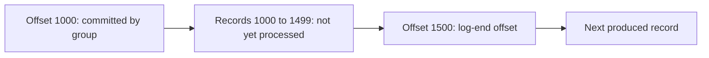

# Consumer Lag: Measuring and Fixing It

## Introduction

Consumer lag is the distance between the newest record in a partition and the record a consumer group has processed. It is the closest thing Kafka has to a single number for "is this pipeline keeping up?", and it is usually the first metric a team puts on a dashboard.

Lag matters because Kafka decouples producers from consumers on purpose. The producer never slows down because a consumer is slow; the records simply pile up in the log. That is a feature (a slow consumer cannot take down the order service) but it also means a consumer can fall hours behind without anything visibly breaking. Fraud checks run on stale data, search results show yesterday's prices, notifications arrive after they are useful.

This page explains how lag is computed, why lag in offsets can mislead you, how to measure it with the CLI and with exporters, and a systematic way to find out why a group is behind and what to do about it.

## What Lag Actually Measures

Every partition has a log-end offset: the offset the next produced record will receive. Every consumer group has a committed offset per partition: the offset of the next record it intends to read. Lag is the difference.

```
lag(partition) = log-end offset - committed offset
lag(group)     = sum of lag over all partitions the group consumes
```

Two details make this less simple than it looks.

First, lag is based on **committed** offsets, not on what the consumer has actually processed. A consumer that commits every five seconds can show up to five seconds of lag even when it is perfectly caught up. A consumer that processes records but fails to commit shows growing lag even though it is doing work (and will reprocess everything after a restart). See [Offsets, Commits and Where to Resume](../4-kafka-consumers/3-kafka-offsets-and-commits.mdx).

Second, for consumers that read with `isolation.level=read_committed`, the relevant end of the log is the last stable offset, not the log-end offset. Open transactions hold it back. Tools that use the log-end offset will report a small lag that the consumer cannot close until the transactions commit.



## Offsets Versus Time

A lag of 50,000 records sounds alarming. On a clickstream topic receiving 100,000 records per second it is half a second behind. On a bank's end-of-day settlement topic receiving ten records per minute it is three and a half days behind. Lag in offsets only means something relative to the topic's write rate.

That is why mature teams alert on **time lag**: how old is the oldest unprocessed record? There are two ways to get it.

| Approach | How it works | Trade-off |
|---|---|---|
| Estimate from rates | time lag is roughly offset lag divided by the partition's produce rate | Cheap, but wrong when traffic is bursty or the topic is idle |
| Look up timestamps | Read the timestamp of the record at the committed offset and compare it to now | Accurate, but costs a fetch per partition per scrape |
| Measure in the consumer | The consumer records `now - record.timestamp()` as it processes | Most accurate end-to-end view, needs application code |

For alerting, measuring in the consumer is the most honest option, because it is exactly what users experience. Burrow and several exporters can do the timestamp lookup for you.

:::tip
Alert on the trend, not the absolute number. Lag that is high but shrinking is a consumer catching up after a deploy. Lag that is low but growing steadily for 20 minutes is a consumer that cannot keep up, and it will be high soon.
:::

## Measuring Lag

### With the CLI

`kafka-consumer-groups.sh` reads committed offsets from the group coordinator and log-end offsets from the partition leaders, then prints one line per partition.

```bash
kafka-consumer-groups.sh --bootstrap-server localhost:9092 --describe --group order-fulfillment
```

```
GROUP              TOPIC   PARTITION  CURRENT-OFFSET  LOG-END-OFFSET  LAG    CONSUMER-ID                 HOST          CLIENT-ID
order-fulfillment  orders  0          4820113         4820140         27     fulfill-1-3c1e...           /10.0.3.17    fulfill-1
order-fulfillment  orders  1          4799870         4799874         4      fulfill-1-3c1e...           /10.0.3.17    fulfill-1
order-fulfillment  orders  2          3110042         4812201         1702159 fulfill-2-91ab...          /10.0.3.22    fulfill-2
order-fulfillment  orders  3          4805530         4805561         31     fulfill-3-77d0...           /10.0.3.31    fulfill-3
```

Partition 2 stands out immediately: one consumer is 1.7 million records behind while the rest are a few dozen behind. Uneven lag like this points to a problem with one consumer instance or one partition, not with the group as a whole. Use `--describe --members --verbose` to see which partitions each member owns, and `--describe --state` to see whether the group is stable or rebalancing.

### With Exporters

For continuous monitoring, run something that polls offsets and exposes them to Prometheus:

- **Kafka Exporter** (`danielqsj/kafka_exporter`) exposes `kafka_consumergroup_lag` per group, topic and partition. Strimzi can deploy it alongside the cluster.
- **Burrow** from LinkedIn evaluates lag over a sliding window and classifies each partition as OK, WARNING, STALLED or STOPPED, which is closer to the "trend" idea above.
- **Managed services** (Confluent Cloud, MSK, Event Hubs) publish consumer lag as a built-in metric.
- **Client metrics**: every Java consumer reports `records-lag-max` for the partitions it owns. It is useful for per-instance views but goes silent when the consumer is dead, which is exactly when you need it.

```yaml
# Prometheus alert: the group's lag has grown for 15 minutes straight.
- alert: KafkaConsumerLagGrowing
  expr: |
    sum by (consumergroup, topic) (kafka_consumergroup_lag) > 1000
    and
    deriv(sum by (consumergroup, topic) (kafka_consumergroup_lag)[15m:1m]) > 0
  for: 15m
  labels: { severity: ticket }
  annotations:
    summary: "Consumer group {{ $labels.consumergroup }} is falling behind on {{ $labels.topic }}"
```

## Why Consumers Fall Behind

Every lag problem comes down to one inequality: records arrive faster than the group processes them. Work through the possible causes from the cheapest to check to the most expensive to fix.

1. **The consumer is not running.** The group has no members, or the members are crash-looping. `--describe --state` shows `Empty` or constant rebalancing.
2. **Rebalance storms.** Consumers that exceed `max.poll.interval.ms` get kicked out, the group rebalances, nothing is processed during the rebalance, and the cycle repeats. See [Heartbeats, max.poll.interval.ms and Liveness](../4-kafka-consumers/5-kafka-consumer-liveness.mdx). The KIP-848 protocol in Kafka 4.x makes rebalances far less disruptive, but a consumer that stalls in processing still loses its partitions.
3. **One hot partition.** A skewed key (one huge customer, one busy sensor) sends most traffic to one partition, and only one consumer can read it. Adding consumers does not help.
4. **Slow processing per record.** The consumer calls a database or HTTP API for each record, synchronously. This is by far the most common cause.
5. **Not enough parallelism.** Every consumer is busy and there are as many consumers as partitions. You need more partitions, or more concurrency inside each consumer.
6. **Fetch settings.** Rarely the cause, but tiny `max.poll.records` or `fetch.min.bytes` settings can limit throughput on high-volume topics. See [Tuning Consumers](../12-kafka-performance/2-kafka-consumer-tuning.mdx).

## Fixing It

The fix depends on the cause, and the wrong fix wastes time. Adding consumers to a group with a hot partition does nothing; adding partitions to a group whose consumers are crash-looping does nothing either.

| Cause | Fix | Notes |
|---|---|---|
| Slow per-record work | Batch database writes, call APIs asynchronously, cache lookups | Usually gives 10x or more |
| Not enough consumers | Scale consumers up to the partition count | Free, if partitions allow |
| Not enough partitions | Add partitions, then scale consumers | Changes key-to-partition mapping for keyed topics |
| Need more parallelism without repartitioning | Process records concurrently inside the consumer, keyed by record key | Confluent's Parallel Consumer library does this while preserving per-key order |
| Hot partition | Change the key, or add a salt to the hottest keys | See [Designing Partition Keys](../13-kafka-best-practices/1-kafka-partition-key-design.mdx) |
| Rebalance storms | Shorten processing per poll, lower `max.poll.records`, move to the consumer protocol | Check for long GC pauses too |
| Lag too old to matter | Reset the group to latest and backfill separately | Only when old records have no value; see [Seeking and Resetting](../4-kafka-consumers/6-kafka-consumer-seek-and-reset.mdx) |

:::warning
Adding partitions to a keyed topic changes which partition each key hashes to. Records for the same order may then be processed out of order across the old and new partitions for a short time. For topics where per-key order matters, plan the change during a quiet period or create a new topic and migrate.
:::

## A Worked Scenario: The Inventory Consumer

A retailer's `inventory-updater` group reads `orders` (12 partitions) and decrements stock in PostgreSQL. It runs four instances. During a flash sale, orders jump from 200 to 3,000 per second and lag climbs to 900,000 records, about five minutes behind. Customers start buying items that are already sold out.

The on-call engineer checks the group state: stable, four members, no rebalances. Lag is spread evenly across all 12 partitions, so it is not a hot key. The consumers are running but slow.

A look at the code finds the problem: each record triggers one `UPDATE` statement and one commit to PostgreSQL. At about 4 ms per round trip, each instance handles roughly 250 records per second, so four instances top out at 1,000 per second.

The short-term fix is scaling to 12 instances, one per partition, which brings capacity to 3,000 per second and stops the growth. The real fix ships the next day: process each poll's batch in a single database transaction.

```java
// Before: one database round trip per record.
// After: one transaction per poll batch, then commit offsets.
while (running) {
    ConsumerRecords<String, OrderEvent> records = consumer.poll(Duration.ofMillis(500));
    if (records.isEmpty()) continue;

    try (Connection conn = dataSource.getConnection()) {
        conn.setAutoCommit(false);
        try (PreparedStatement stmt = conn.prepareStatement(
                "UPDATE stock SET qty = qty - ? WHERE sku = ?")) {
            for (ConsumerRecord<String, OrderEvent> r : records) {
                stmt.setInt(1, r.value().quantity());
                stmt.setString(2, r.value().sku());
                stmt.addBatch();
            }
            stmt.executeBatch();   // one round trip for the whole batch
        }
        conn.commit();
    }
    consumer.commitSync();         // commit offsets only after the database commit
}
```

With batching, each instance handles about 5,000 records per second. The group drops back to four instances, lag stays under a second at peak, and the team adds a time-lag alert at 30 seconds so they hear about the next problem before customers do.

## Common Mistakes

- Alerting on a fixed offset-lag threshold across all topics, which is too sensitive for busy topics and too lax for quiet ones.
- Relying only on the consumer's own `records-lag-max`, which disappears exactly when the consumer dies.
- Adding consumers beyond the partition count; the extra ones sit idle.
- Treating lag as zero-or-bad. Some lag is normal with periodic commits and batch processing.
- Resetting offsets to latest to "fix" lag without telling the downstream owners that records were skipped.
- Ignoring idle groups. A group for a decommissioned service still holds committed offsets and shows ever-growing lag until it is deleted with `kafka-consumer-groups.sh --delete`.

## Summary

- Lag is the log-end offset minus the group's committed offset, summed over partitions.
- Offset lag means little without the write rate; alert on time lag or on a sustained upward trend.
- Measure with `kafka-consumer-groups.sh --describe` for spot checks and with Kafka Exporter, Burrow or managed metrics for alerts.
- Uneven lag across partitions points to a hot key or one bad instance; even lag points to slow processing or too little parallelism.
- Fix slow processing first (batching, async I/O), then scale consumers, then add partitions.

## Further Reading

- [Kafka documentation: Managing consumer groups](https://kafka.apache.org/documentation/#basic_ops_consumer_group) - the `kafka-consumer-groups.sh` options for describing, resetting and deleting groups.
- [Burrow](https://github.com/linkedin/Burrow) - lag evaluation with sliding windows and partition status.
- [Kafka Exporter](https://github.com/danielqsj/kafka_exporter) - Prometheus exporter for consumer group lag.
- [KIP-848: The Next Generation of the Consumer Rebalance Protocol](https://cwiki.apache.org/confluence/display/KAFKA/KIP-848%3A+The+Next+Generation+of+the+Consumer+Rebalance+Protocol) - why rebalances disrupt consumption less in Kafka 4.x.
- [Confluent Parallel Consumer](https://github.com/confluentinc/parallel-consumer) - per-key concurrent processing without adding partitions.
