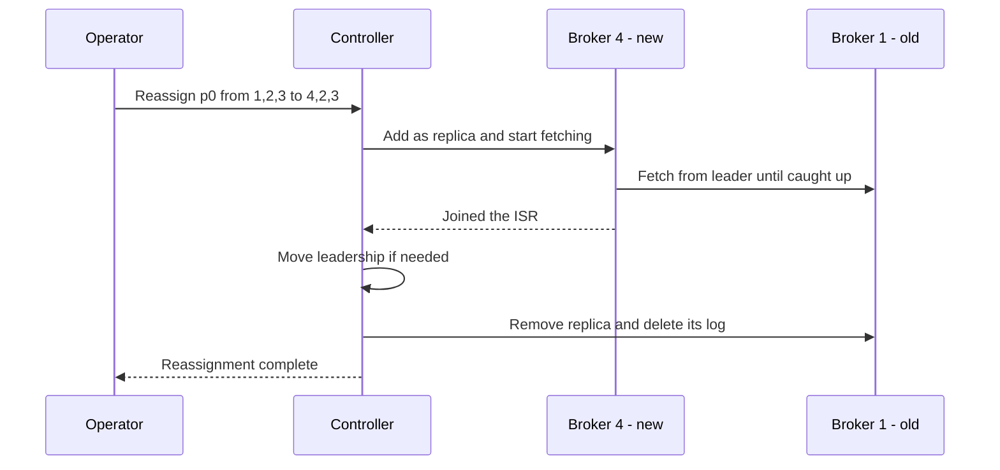

# Partition Reassignment and Rebalancing a Cluster

## Introduction

Kafka places each partition's replicas on brokers when the topic is created, and then it leaves them there. It does not move data when you add a broker, when one broker gets much busier than the others, or when a disk fills up. A brand new broker joins the cluster and sits empty until somebody tells Kafka to move partitions onto it.

That somebody is you, and the tool is partition reassignment. It copies replicas to new brokers, waits for them to catch up, switches leadership and deletes the old copies, all while producers and consumers keep running. Done carelessly, it can saturate the network, push latency through the roof and fill the destination disks. Done well, nobody outside the platform team notices.

This page covers when you need a reassignment, how the built-in `kafka-reassign-partitions.sh` tool works, how to throttle it, how to decommission a broker in a KRaft cluster, and when an automated balancer such as Cruise Control is the better choice.

## When You Need to Move Partitions

There are five common reasons:

| Situation | What you move | Urgency |
|---|---|---|
| Added brokers for capacity | A share of existing replicas onto the new brokers | Medium: new brokers do nothing until you do this |
| Removing a broker | Every replica off that broker | Must finish before shutdown |
| One broker much hotter than others | Leaders or replicas of the busiest partitions | Medium |
| A disk filling up | Replicas off that broker or log directory | High |
| Raising the replication factor | Add replicas to more brokers | Low |

Not every imbalance needs a reassignment. If load is skewed only because leaders are unevenly spread (for example after a broker restart), a **preferred leader election** fixes it in seconds without moving any data. The preferred leader is the first replica in a partition's replica list; `auto.leader.rebalance.enable=true`, the default, moves leadership back to it periodically, and you can force it at any time:

```bash
kafka-leader-election.sh --bootstrap-server localhost:9092 \
  --election-type preferred --all-topic-partitions
```

## How a Reassignment Works

A reassignment changes a partition's replica list from, say, `[1, 2, 3]` to `[4, 2, 3]`. Kafka does not swap them in one step. It first grows the replica set to include both old and new replicas, lets the new ones copy the data, and only shrinks back once they are in sync.



The expensive part is the copy. Broker 4 must fetch the entire partition from the leader, which for a topic with 7 days of retention might be hundreds of gigabytes. That traffic competes with normal replication and with consumers on the same network and disks. That is why throttling matters.

## The Built-in Tool in Three Steps

`kafka-reassign-partitions.sh` has three modes: `--generate` proposes a plan, `--execute` starts it, `--verify` checks progress and removes throttles at the end.

### Step 1: Generate a Plan

Describe which topics to move in a JSON file and which brokers they may land on.

```json
{
  "version": 1,
  "topics": [
    { "topic": "orders" },
    { "topic": "payments" }
  ]
}
```

```bash
kafka-reassign-partitions.sh --bootstrap-server localhost:9092 \
  --topics-to-move-json-file topics.json \
  --broker-list "1,2,3,4,5,6" \
  --generate
```

The tool prints two JSON documents: the current assignment and a proposed one. **Save the current assignment** to a file; it is your rollback plan. The proposal spreads replicas across all listed brokers and respects `broker.rack` so replicas of a partition stay in different racks or zones.

The generated plan is a reasonable start but not clever. It ignores how big each partition is and how much traffic it carries, and it often moves far more partitions than necessary. Many operators edit the plan by hand, or write a small script, to move only what is needed.

```json
{
  "version": 1,
  "partitions": [
    { "topic": "orders", "partition": 0, "replicas": [4, 2, 3] },
    { "topic": "orders", "partition": 5, "replicas": [5, 6, 1] },
    { "topic": "payments", "partition": 2, "replicas": [6, 4, 2] }
  ]
}
```

### Step 2: Execute With a Throttle

```bash
kafka-reassign-partitions.sh --bootstrap-server localhost:9092 \
  --reassignment-json-file plan.json \
  --execute \
  --throttle 50000000
```

`--throttle` is in bytes per second (here 50 MB/s) and limits replication traffic for the partitions being moved. Under the hood the tool sets `leader.replication.throttled.rate` and `follower.replication.throttled.rate` on the brokers involved, and `leader.replication.throttled.replicas` and `follower.replication.throttled.replicas` on the topics. Normal replication for other partitions is not throttled.

If the move is going too slowly or hurting clients, change the rate without restarting:

```bash
kafka-reassign-partitions.sh --bootstrap-server localhost:9092 \
  --reassignment-json-file plan.json \
  --execute --additional --throttle 100000000
```

To abandon a reassignment in progress, run the same command with `--cancel` instead of `--execute`. Kafka reverts the affected partitions to their original replica lists.

### Step 3: Verify and Remove Throttles

```bash
kafka-reassign-partitions.sh --bootstrap-server localhost:9092 \
  --reassignment-json-file plan.json \
  --verify
```

```
Status of partition reassignment:
Reassignment of partition orders-0 is completed.
Reassignment of partition orders-5 is still in progress.
Reassignment of partition payments-2 is completed.
```

Run `--verify` until every partition is complete. The final successful run also clears the throttle configs. **Do not skip this.** A leftover throttle silently limits replication on those brokers forever, and the next time a follower needs to catch up it will crawl.

:::warning
Choose the throttle from your traffic, not a round number. If the throttle is lower than the write rate of the partitions being moved, the new replicas never catch up and the reassignment never finishes. A safe starting point is the larger of twice the partition's write rate and about 30 percent of spare NIC capacity.
:::

## Removing a Broker in KRaft

In a KRaft cluster, decommissioning a broker has three parts: stop new data landing on it, move existing data off, then remove it from the cluster metadata. Kafka 4.3 added cordoning (KIP-1066), which tells the controller not to place new replicas on a broker or log directory.

```bash
# 1. Cordon broker 6 so new topics and partitions avoid it.
kafka-configs.sh --bootstrap-server localhost:9092 --alter \
  --entity-type brokers --entity-name 6 \
  --add-config cordoned.log.dirs="*"

# 2. Build a plan that moves every replica off broker 6, then execute and verify it.
kafka-reassign-partitions.sh --bootstrap-server localhost:9092 \
  --reassignment-json-file drain-broker-6.json --execute --throttle 80000000
kafka-reassign-partitions.sh --bootstrap-server localhost:9092 \
  --reassignment-json-file drain-broker-6.json --verify

# 3. Confirm nothing is left, shut the broker down, and unregister it.
kafka-log-dirs.sh --bootstrap-server localhost:9092 --describe --broker-list 6
kafka-cluster.sh unregister --bootstrap-server localhost:9092 --id 6
```

On versions before 4.3 there is no cordon, so create no new topics during the drain or check that new partitions did not land on the broker before shutting it down.

The same idea works for a single disk: cordon one log directory (`cordoned.log.dirs=/data/dir1`), move its replicas, then remove it from `log.dirs` and restart.

## Automating It: Cruise Control

Writing reassignment plans by hand works for occasional changes. Clusters with dozens of brokers and thousands of partitions need something that considers disk usage, network in and out, CPU and rack placement at the same time. **Cruise Control**, open-sourced by LinkedIn, is the standard tool. It samples broker and partition metrics, models the cluster, and computes a plan that satisfies a ranked list of goals (rack awareness first, then capacity limits, then even distribution).

| Approach | Strengths | Weaknesses |
|---|---|---|
| `kafka-reassign-partitions.sh` by hand | Built in, fully predictable, no extra service | Ignores load; tedious at scale; easy to forget throttles |
| Cruise Control | Load-aware plans, automatic broker add and remove, self-healing | Another service to run and tune; needs a metrics reporter on brokers |
| Strimzi `KafkaRebalance` | Cruise Control managed for you on Kubernetes, approval workflow in YAML | Kubernetes only |
| Managed services | Confluent Cloud and MSK Express rebalance automatically | No control over timing |

On Kubernetes with Strimzi, you ask for a rebalance with a custom resource, review the proposal in its status, and approve it with an annotation:

```yaml
apiVersion: kafka.strimzi.io/v1
kind: KafkaRebalance
metadata:
  name: add-brokers-6-7
  labels:
    strimzi.io/cluster: my-cluster
spec:
  mode: add-brokers
  brokers: [6, 7]
```

```bash
kubectl get kafkarebalance add-brokers-6-7 -o yaml   # wait for ProposalReady, read the summary
kubectl annotate kafkarebalance add-brokers-6-7 strimzi.io/rebalance=approve
```

See [Kafka on Kubernetes with Strimzi](./6-kafka-kubernetes-strimzi.mdx) for the rest of the setup.

## A Worked Scenario: Expanding a Logistics Cluster

A parcel-tracking company runs six brokers across three zones. Scans from 40,000 handheld devices flow into a `parcel-scans` topic with 48 partitions and 14 days of retention, about 18 TB of replicated data. Disk usage has reached 72 percent and Black Friday is three weeks away. The team adds three brokers, one per zone, bringing the cluster to nine.

They choose hand-built plans over deploying Cruise Control because this is the first expansion in two years and they want to see every move. The steps:

1. **Measure**: each `parcel-scans` partition is about 125 GB per replica and receives 0.6 MB/s. The NICs are 10 Gbit with about 4 Gbit spare at night.
2. **Plan**: to even out disk, a third of the replicas (48 of 144) must move. They generate a plan with `--broker-list "1,2,3,4,5,6,7,8,9"`, then trim it so that each new broker receives 16 replicas and each move stays within its zone, which avoids cross-zone transfer costs.
3. **Batch**: they split the plan into four batches of 12 partitions so that each batch finishes in one night and a problem only affects a quarter of the moves.
4. **Throttle**: 12 partitions at once with a 100 MB/s per-broker throttle moves 1.5 TB in roughly two to four hours, well within the window.
5. **Watch**: during each batch they watch produce `TotalTimeMs` p99, `UnderReplicatedPartitions` (the new replicas count as under-replicated until they catch up), and disk on the destination brokers.
6. **Finish**: after each batch, `--verify` until complete, then a preferred leader election so the new brokers take their share of leaders.

After four nights, disk usage is 48 percent on every broker and produce latency never moved more than a few milliseconds. The JSON files go into Git alongside a short note, so the next expansion starts from a known template.

## Common Mistakes

- Adding brokers and assuming Kafka will use them automatically. Existing partitions stay where they are.
- Running a reassignment with no throttle during peak hours and saturating the network.
- Forgetting the final `--verify`, leaving throttle configs in place indefinitely.
- Not saving the current assignment before executing, leaving no simple rollback.
- Moving huge partitions in one batch, so one stuck move blocks verifying the rest.
- Setting a throttle lower than the partitions' write rate, so the reassignment never completes.
- Generating a plan with a broker list that ignores racks or zones, putting two replicas of a partition in the same zone.

## Summary

- Kafka never moves partitions on its own; adding or removing brokers requires a reassignment.
- Try a preferred leader election first if only leadership is unbalanced.
- Use `--generate` to propose, `--execute` with `--throttle` to run, and `--verify` to finish and clear throttles; keep the original assignment for rollback.
- Decommission KRaft brokers by cordoning (Kafka 4.3+), draining, shutting down and running `kafka-cluster.sh unregister`.
- Use Cruise Control, or Strimzi's `KafkaRebalance`, once clusters are large enough that hand-built plans become guesswork.

## Further Reading

- [Kafka documentation: Expanding your cluster](https://kafka.apache.org/documentation/#basic_ops_cluster_expansion) - the reassignment tool, throttling and decommissioning.
- [KIP-455: Create an Administrative API for Replica Reassignment](https://cwiki.apache.org/confluence/display/KAFKA/KIP-455%3A+Create+an+Administrative+API+for+Replica+Reassignment) - the incremental reassignment design and cancel support.
- [KIP-1066: Mechanism to cordon brokers and log directories](https://cwiki.apache.org/confluence/display/KAFKA/KIP-1066%3A+Mechanism+to+cordon+brokers+and+log+directories) - why and how cordoning works.
- [Cruise Control](https://github.com/linkedin/cruise-control) - goals, anomaly detection and the REST API.
- [Strimzi: Using Cruise Control for cluster rebalancing](https://strimzi.io/docs/operators/latest/deploying#cruise-control-concepts-str) - the `KafkaRebalance` workflow.
