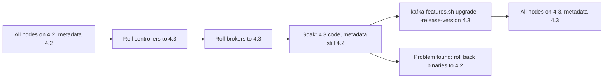

# Rolling Upgrades and Version Compatibility

## Introduction

Apache Kafka ships three feature releases a year, plus bug-fix releases for the most recent ones. A cluster that is not upgraded for two years falls out of support, misses security fixes and eventually cannot be upgraded in one step. Upgrading regularly is part of running Kafka, not a special project.

The good news is that Kafka was designed for upgrades without downtime. Brokers are restarted one at a time while the rest of the cluster keeps serving traffic, and new features that change how data is stored stay switched off until you explicitly turn them on. That two-phase design is what makes upgrades safe: you can run the new code for days, and roll back if something looks wrong, before committing to anything that cannot be undone.

This page explains the two version numbers that matter in a KRaft cluster, walks through a rolling upgrade from Kafka 4.2 to 4.3, and covers the compatibility rules between clients and brokers, including the changes that tripped up many teams moving to 4.0.

## Two Versions: Software and Metadata

A KRaft cluster has two separate notions of "version".

The **software version** is the Kafka release installed on each node: the jars in `libs/`. During a rolling upgrade, different nodes run different software versions for a while, and Kafka is built to handle that.

The **metadata version** (`metadata.version`, part of the cluster's finalized features) controls which on-disk formats and inter-node protocols the cluster uses. It is stored in the KRaft metadata log and is the same for the whole cluster. New software can always run at an older metadata version. It only switches to new formats when you raise the metadata version.



The soak period between step C and step E is the safety net. As long as the metadata version has not been raised, going back to the previous binaries is just another rolling restart. Once you raise it, and if the new version contains metadata changes, there is no supported downgrade. Kafka 4.3's upgrade notes say exactly that.

| Version | What it is | Where it lives | Can you go back? |
|---|---|---|---|
| Software version | The installed Kafka release | Each node's binaries | Yes, by rolling back the binaries before finalizing |
| `metadata.version` | Cluster-wide feature level | KRaft metadata log | Only if the versions involved have no metadata changes |
| Other feature flags | For example `group.version`, `transaction.version` | KRaft metadata log | Depends on the feature |

You can see the current state at any time:

```bash
kafka-features.sh --bootstrap-server localhost:9092 describe
```

```
Feature: group.version        SupportedMinVersion: 0  SupportedMaxVersion: 1  FinalizedVersionLevel: 1    Epoch: 4821
Feature: kraft.version        SupportedMinVersion: 0  SupportedMaxVersion: 1  FinalizedVersionLevel: 1    Epoch: 4821
Feature: metadata.version     SupportedMinVersion: 3.3-IV3  SupportedMaxVersion: 4.3-IV0  FinalizedVersionLevel: 4.2-IV1  Epoch: 4821
Feature: transaction.version  SupportedMinVersion: 0  SupportedMaxVersion: 2  FinalizedVersionLevel: 2    Epoch: 4821
```

Here the software supports up to `4.3-IV0` but the cluster is still finalized at `4.2-IV1`: the binaries have been upgraded but the upgrade has not been finalized.

## Supported Upgrade Paths

Kafka supports upgrading directly from fairly old versions, but not from all of them. The rules as of Kafka 4.3:

- You can upgrade to 4.3 directly from any KRaft cluster on 3.3.x or later, up to 4.2.
- KRaft clusters older than 3.3 should upgrade to 3.9 first.
- **ZooKeeper-based clusters cannot upgrade to 4.x at all.** ZooKeeper support was removed in 4.0. You must first migrate the cluster to KRaft on 3.9 (the last release with ZooKeeper and the migration tooling), then upgrade. See [KRaft: How Kafka Runs Without ZooKeeper](../0-kafka-fundamentals/3-kafka-kraft-and-metadata.mdx).

Kafka 4.x also raised the Java requirements. Brokers, Connect and the command-line tools need Java 17 or later; clients and Kafka Streams need Java 11 or later.

## The Rolling Upgrade, Step by Step

This is the procedure for a cluster with three dedicated controllers and six brokers, moving from 4.2.2 to 4.3.1.

### 1. Prepare

Read the upgrade notes for every version between yours and the target. They list removed configs, changed defaults and behaviour changes. Fix any deprecated configs your `server.properties` still uses before you start, because a removed config can stop the new version from starting.

Check that the cluster is healthy: zero under-replicated partitions, zero offline partitions, the metadata quorum in sync.

```bash
kafka-metadata-quorum.sh --bootstrap-server localhost:9092 describe --status
```

```
ClusterId:              Xo9tgN4TQ2yNfwk8bCpk3w
LeaderId:               9001
LeaderEpoch:            37
HighWatermark:          1288204
MaxFollowerLag:         0
MaxFollowerLagTimeMs:   0
CurrentVoters:          [{"id": 9001, ...}, {"id": 9002, ...}, {"id": 9003, ...}]
CurrentObservers:       [{"id": 1, ...}, {"id": 2, ...}, ...]
```

`MaxFollowerLag: 0` means every controller is caught up. Upgrade in a staging cluster with the same configuration first.

### 2. Roll the Controllers

Upgrade controllers one at a time, waiting after each until it has rejoined the quorum and caught up. Do the non-leader controllers first and the active controller last, so the cluster changes controller leadership only once.

```bash
# On each controller node, one at a time:
systemctl stop kafka-controller
ln -sfn /opt/kafka_2.13-4.3.1 /opt/kafka        # switch the symlink to the new release
systemctl start kafka-controller

# Wait until this node shows lag 0 before moving on.
kafka-metadata-quorum.sh --bootstrap-server localhost:9092 describe --replication
```

### 3. Roll the Brokers

Upgrade brokers one at a time. Stop each broker cleanly so it hands over leadership before shutting down (controlled shutdown is on by default), and do not move on until the restarted broker has caught up.

```bash
# On each broker, one at a time:
systemctl stop kafka-broker                     # controlled shutdown moves leaders away
ln -sfn /opt/kafka_2.13-4.3.1 /opt/kafka
systemctl start kafka-broker

# Wait for under-replicated partitions to return to 0 before the next broker.
kafka-topics.sh --bootstrap-server localhost:9092 --describe --under-replicated-partitions
```

The last command prints nothing when every partition is fully replicated. With RF 3 and `min.insync.replicas=2`, one broker down at a time never blocks `acks=all` producers. Restarting a second broker before the first has caught up can.

:::warning
Never restart two brokers that share partitions at the same time unless you have verified that every affected partition still has `min.insync.replicas` in-sync replicas. A rushed upgrade that takes down two of three replicas stops writes for those partitions until one comes back.
:::

### 4. Soak

Run the cluster on the new binaries at the old metadata version for long enough to see normal peaks: a day at minimum, a week for critical clusters. Watch request latency, error rates and GC. This is your last cheap rollback point.

### 5. Finalize

When you are satisfied, raise the feature levels to match the new release:

```bash
kafka-features.sh --bootstrap-server localhost:9092 upgrade --release-version 4.3
```

This sets `metadata.version` and the other feature flags to the defaults for 4.3. Afterwards, `describe` shows `FinalizedVersionLevel: 4.3-IV0`. Restarting nodes is not needed.

Finally, re-enable or adopt any new features you want, one change at a time, and update the binaries on all client hosts that use the CLI tools.

## Client and Broker Compatibility

Kafka's wire protocol is versioned per request type, and clients and brokers negotiate the highest version both support. In practice that means:

- **New clients work with older brokers**, within limits: a client simply uses older request versions.
- **Old clients work with newer brokers**, within limits: the broker still accepts older request versions.

Kafka 4.0 tightened those limits with KIP-896, which removed very old protocol versions. The practical rules:

| Situation | Requirement since Kafka 4.0 |
|---|---|
| Upgrading brokers to 4.x | Every Java client (including Connect and Streams apps) must be 2.1 or newer |
| Upgrading Java clients to 4.x | Brokers must be 2.1 or newer |
| Non-Java clients | librdkafka, franz-go, Sarama, KafkaJS and others must be versions that support the remaining protocol versions; check KIP-896 and each client's notes |

Before a broker upgrade across this boundary, find out which client versions are actually connected. Brokers report this in the `kafka.server:type=socket-server-metrics` MBeans tagged with client software name and version, which is the most reliable inventory you will get.

Kafka Streams and Connect have their own upgrade notes. Streams applications in particular may need a two-step rolling bounce with `upgrade.from` when the internal format changes; read the Streams upgrade guide for every version in between.

## A Worked Scenario: The Bank That Waited Too Long

A retail bank runs a nine-broker ledger cluster on Kafka 3.6 with ZooKeeper. It has not been upgraded in two years because "it works". Then a security audit flags an unsupported version, and the team discovers they cannot go straight to 4.x.

Their plan, spread over six weeks:

1. **Inventory clients.** Using the socket-server metrics they find a nightly reconciliation job using a 2.0 Java client and an old Python service on librdkafka 1.2. Both are upgraded first; nothing else changes on the brokers.
2. **Upgrade to 3.9 on ZooKeeper.** A normal rolling upgrade, finalized only after a week of soak.
3. **Migrate to KRaft.** Provision three controllers, run the 3.9 ZooKeeper-to-KRaft migration, and keep the cluster in dual-write mode for two weeks before finalizing the migration and retiring ZooKeeper.
4. **Upgrade to 4.3.** Upgrade Java to 17 on the brokers, remove configs that 4.0 dropped (such as `log.message.format.version`), then perform the rolling upgrade described above. They finalize with `--release-version 4.3` after a week.

The lesson they write down: a yearly upgrade takes two days; skipping two years cost six weeks. The bank now upgrades within three months of each feature release, always one release behind the newest, which keeps them on a supported version without being the first to find new bugs.

## Common Mistakes

- Finalizing the metadata version immediately after rolling the binaries, throwing away the only easy rollback.
- Restarting the next broker before under-replicated partitions return to zero.
- Upgrading brokers without checking connected client versions, then breaking a forgotten 1.x client.
- Starting a 4.x broker with configs that were removed in 4.0, so it refuses to start mid-upgrade.
- Skipping the ZooKeeper-to-KRaft migration step and expecting a 3.x ZooKeeper cluster to upgrade directly to 4.x.
- Running brokers on Java 11 after moving to 4.x; brokers need Java 17.
- Rolling all three controllers in quick succession and losing quorum.

## Summary

- A KRaft cluster has a software version per node and a cluster-wide `metadata.version`; upgrades change the first, then finalize the second.
- Roll controllers first, then brokers, one at a time, waiting for full replication between nodes.
- Soak on the new binaries before running `kafka-features.sh upgrade --release-version`; after finalizing, downgrade may not be possible.
- ZooKeeper clusters must migrate to KRaft on 3.9 before upgrading to 4.x.
- Since 4.0, clients and brokers must both be at least 2.1; inventory connected clients before upgrading.
- Upgrade little and often; one release behind the newest is a sensible policy.

## Further Reading

- [Kafka documentation: Upgrading](https://kafka.apache.org/documentation/#upgrade) - per-version upgrade notes, supported paths and removed configs.
- [KIP-584: Versioning scheme for features](https://cwiki.apache.org/confluence/display/KAFKA/KIP-584%3A+Versioning+scheme+for+features) - the finalized feature mechanism behind `kafka-features.sh`.
- [KIP-896: Remove old client protocol API versions in Kafka 4.0](https://cwiki.apache.org/confluence/display/KAFKA/KIP-896%3A+Remove+old+client+protocol+API+versions+in+Kafka+4.0) - exactly which client versions still work with 4.x brokers.
- [Kafka documentation: ZooKeeper to KRaft migration](https://kafka.apache.org/39/documentation/#kraft_zk_migration) - the 3.9 migration procedure for clusters still on ZooKeeper.
- [Kafka Streams upgrade guide](https://kafka.apache.org/documentation/streams/upgrade-guide) - application-level steps for Streams users.
