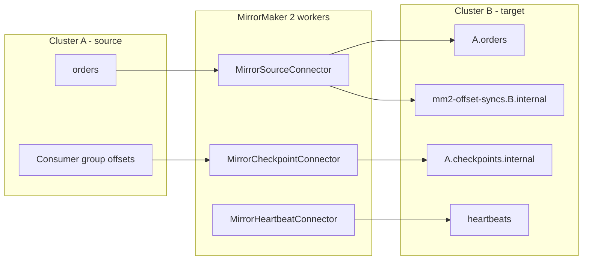

# Replicating Clusters with MirrorMaker 2

## Introduction

Replication inside a cluster, with its leaders, followers and ISR, protects you against a broker or a zone going down. It does not protect you against losing a whole region, and it does not help when data produced in one place has to be read somewhere else: a factory's edge cluster feeding a central analytics cluster, or a migration from a self-managed cluster to a managed service. For those jobs you copy data between clusters, and the tool that ships with Apache Kafka for that is MirrorMaker 2 (MM2).

MM2 is built on Kafka Connect. It consumes from a source cluster and produces to a target cluster, and it also copies topic configuration, ACLs and, crucially, consumer group progress, so that consumers can switch clusters without starting from the beginning. The original MirrorMaker (a simple consume-and-produce loop) was removed in Kafka 4.0; MM2 is the supported tool.

This page explains how MM2 works, how to configure and run it, how topic naming and offset translation behave during a failover, and how to monitor it. The architecture choices (active-passive, active-active, aggregation) are covered in [Multi-Region and Disaster Recovery Topologies](../9-kafka-patterns/7-kafka-multi-region.mdx); this page is about running the tool.

## How MirrorMaker 2 Works

MM2 runs three Kafka Connect connectors for each replication flow, such as "cluster A to cluster B":

| Connector | Job | Writes to |
|---|---|---|
| `MirrorSourceConnector` | Copies records from source topics to remote topics on the target; syncs topic configs and ACLs; records offset mappings | Remote topics such as `A.orders`, and the offset-syncs topic |
| `MirrorCheckpointConnector` | Translates consumer group offsets from source to target using the offset mappings | `A.checkpoints.internal` on the target, and optionally the target's `__consumer_offsets` |
| `MirrorHeartbeatConnector` | Emits a heartbeat record every second so you can check that the flow is alive end to end | `heartbeats` topic |



### Remote Topics and the Replication Policy

By default MM2 does not copy `orders` to a topic called `orders` on the target. It writes to `A.orders`, prefixing the source cluster's alias. This is the `DefaultReplicationPolicy`, and the prefix exists for two reasons. It makes the origin of every record obvious. And it prevents loops in active-active setups: MM2 never replicates a topic whose name says it already came from the target cluster, so `A.orders` on B is not copied back to A.

The alternative is `IdentityReplicationPolicy`, which keeps topic names unchanged. It is the natural choice for one-way migrations and for simple active-passive disaster recovery, where you want applications to fail over without changing topic names. It cannot be used for bidirectional replication of the same topics, because MM2 can no longer tell local records from replicated ones.

| Policy | Target topic name | Good for | Not suitable for |
|---|---|---|---|
| `DefaultReplicationPolicy` | `A.orders` | Active-active, aggregation, anything bidirectional | Consumers that must not change topic names |
| `IdentityReplicationPolicy` | `orders` | Migrations, one-way DR | Replicating the same topic in both directions |

### Offset Translation

Offsets are not portable between clusters. Record 1,000,000 in `orders` on A might be record 3,200 in `A.orders` on B, because replication started later, or because retention on B deleted older data. MM2 handles this with two pieces:

1. The source connector periodically writes **offset syncs**: pairs of (source offset, target offset) for each partition.
2. The checkpoint connector reads each consumer group's committed offsets on the source, uses the offset syncs to translate them, and writes **checkpoints** to the target.

With `sync.group.offsets.enabled=true` the checkpoint connector also writes the translated offsets directly into the target's `__consumer_offsets`, so a consumer that starts on B with the same group ID resumes near where it left off on A. It only does this for groups that are not active on the target, so it never fights with a live consumer.

Translation is approximate. Offset syncs are emitted only every so often (controlled by `offset.lag.max`, default 100), so a translated offset can point slightly before the true position. After a failover, consumers will usually reprocess a small number of records. Design consumers to be [idempotent](../9-kafka-patterns/4-kafka-idempotent-consumers.mdx).

## A Minimal Configuration

MM2 can run in two ways. **Dedicated mode** uses the `connect-mirror-maker.sh` script and a single properties file that describes all clusters and flows. **Connect mode** deploys the three connectors into an existing Kafka Connect cluster through its REST API. Dedicated mode is simpler and is what most teams start with; Connect mode makes sense if you already operate Connect and want one platform. On Kubernetes, Strimzi's `KafkaMirrorMaker2` resource manages it for you.

Here is a dedicated-mode configuration that replicates order and payment topics from a primary cluster to a DR cluster:

```properties
# mm2.properties
# Cluster aliases. These names appear in remote topic names and config keys.
clusters = primary, dr

primary.bootstrap.servers = kafka-p1:9092,kafka-p2:9092,kafka-p3:9092
dr.bootstrap.servers      = kafka-d1:9092,kafka-d2:9092,kafka-d3:9092

# Enable one direction only: primary -> dr.
primary->dr.enabled = true
primary->dr.topics  = orders, payments, shipments.*
primary->dr.groups  = .*

# Keep topic names identical on the DR cluster (one-way DR only).
replication.policy.class = org.apache.kafka.connect.mirror.IdentityReplicationPolicy

# Replication factor for topics MM2 creates on the target (default is 2).
replication.factor = 3
checkpoints.topic.replication.factor = 3
heartbeats.topic.replication.factor  = 3
offset-syncs.topic.replication.factor = 3

# Copy consumer group offsets into the target's __consumer_offsets.
sync.group.offsets.enabled = true
sync.group.offsets.interval.seconds = 30
emit.checkpoints.interval.seconds   = 30

# Store offset syncs on the target so MM2 needs only read access to the source.
offset-syncs.topic.location = target

# Parallelism: tasks are spread across all MM2 worker processes.
tasks.max = 8

# Internal Connect topics for dedicated mode, created on the target cluster.
dr.config.storage.replication.factor = 3
dr.offset.storage.replication.factor = 3
dr.status.storage.replication.factor = 3
```

Start it on two or more machines with the same file; the processes form a Connect group and share the work. Pass `--clusters dr` so each process only produces to the cluster near it, which is the recommended way to run MM2: close to the target, consuming across the long network link.

```bash
bin/connect-mirror-maker.sh config/mm2.properties --clusters dr
```

The settings worth knowing, with their defaults in Kafka 4.3:

| Setting | Default | What it controls |
|---|---|---|
| `topics` / `topics.exclude` | `.*` / internal and `__` topics | Which topics to replicate (regex lists) |
| `groups` / `groups.exclude` | `.*` / `console-consumer-.*`, `connect-.*`, `__.*` | Which consumer groups to checkpoint |
| `refresh.topics.interval.seconds` | 600 | How often new matching topics are discovered |
| `sync.topic.configs.enabled` | true | Copy topic configs such as retention to the target |
| `sync.topic.acls.enabled` | true | Copy ACLs (only works with a supported authorizer) |
| `emit.checkpoints.enabled` | true | Run offset translation |
| `sync.group.offsets.enabled` | false | Write translated offsets into the target's `__consumer_offsets` |
| `emit.heartbeats.enabled` | true | Emit heartbeat records |
| `offset-syncs.topic.location` | source | Which cluster holds the offset-syncs topic |
| `exactly.once.source.support` | disabled | Exactly-once delivery into the target (dedicated mode needs `dedicated.mode.enable.internal.rest=true`) |

:::tip
New topics that match your patterns are only picked up every `refresh.topics.interval.seconds`, which is ten minutes by default. If teams create topics and immediately expect them on the DR cluster, lower it to 60 seconds, or create the topics on both clusters as part of your topic provisioning.
:::

## Running MirrorMaker 2 on Kubernetes

With Strimzi, MM2 is a single custom resource. Since Strimzi 1.0 the CRDs use the `kafka.strimzi.io/v1` API, and `KafkaMirrorMaker2` describes one target cluster and a list of mirrors, each with its own source:

```yaml
apiVersion: kafka.strimzi.io/v1
kind: KafkaMirrorMaker2
metadata:
  name: primary-to-dr
  namespace: kafka
spec:
  version: 4.3.1
  replicas: 2
  target:
    alias: dr
    bootstrapServers: dr-kafka-bootstrap:9092
    groupId: mm2-primary-to-dr
    configStorageTopic: __mm2-config
    offsetStorageTopic: __mm2-offsets
    statusStorageTopic: __mm2-status
  mirrors:
    - source:
        alias: primary
        bootstrapServers: primary-kafka-bootstrap.kafka-primary.svc:9092
      sourceConnector:
        tasksMax: 8
        config:
          replication.factor: 3
          offset-syncs.topic.location: target
          replication.policy.class: org.apache.kafka.connect.mirror.IdentityReplicationPolicy
      checkpointConnector:
        tasksMax: 2
        config:
          sync.group.offsets.enabled: "true"
          offset-syncs.topic.location: target
          replication.policy.class: org.apache.kafka.connect.mirror.IdentityReplicationPolicy
      topicsPattern: "orders|payments|shipments.*"
      groupsPattern: ".*"
```

The `offset-syncs.topic.location` and `replication.policy.class` values must match between the source and checkpoint connectors, or offset translation silently stops working. See [Kafka on Kubernetes with Strimzi](./6-kafka-kubernetes-strimzi.mdx).

## Monitoring Replication

MM2 publishes metrics under the `kafka.connect.mirror` JMX domain, tagged by source, target, topic and partition:

- `replication-latency-ms` (with `-avg`, `-max`): how long a record takes from source to target. This is your replication lag in time, and the number that decides how much data a disaster would lose.
- `record-age-ms`: how old records are when MM2 replicates them. Growing values mean MM2 is falling behind.
- `byte-rate` and `record-rate`: throughput per topic.
- `checkpoint-latency-ms`: how far behind offset translation is.

MM2 is also an ordinary consumer group on the source cluster, so the [consumer lag](./2-kafka-consumer-lag.mdx) tools work on it too. The heartbeats topic gives an end-to-end check: if the newest heartbeat on the target is more than a few seconds old, the flow is broken, whatever the metrics say.

## A Worked Scenario: Failing Over an Order Platform

An online marketplace runs its order platform in `eu-west` with a DR cluster in `eu-central`, replicated by the MM2 configuration above with `IdentityReplicationPolicy`. Their recovery point objective (RPO) is one minute; `replication-latency-ms-max` normally sits around 300 ms.

At 14:02 the `eu-west` region loses network connectivity. The failover runbook:

1. **Declare the incident and stop writes to the primary** (producers are already failing).
2. **Check how far behind DR was** using the last values of `replication-latency-ms` and the newest heartbeat on the DR cluster: about 400 ms. A small number of orders in that window are lost or must be re-sent from the order database's outbox.
3. **Check consumer offsets on DR.** Because `sync.group.offsets.enabled=true`, the `order-fulfillment` group already has offsets on DR:

```bash
kafka-consumer-groups.sh --bootstrap-server kafka-d1:9092 --describe --group order-fulfillment
```

4. **Repoint applications** to the DR bootstrap servers through a DNS name change. Topic names are identical, so no code changes.
5. **Accept some duplicates.** Translated offsets are slightly behind, so fulfillment reprocesses about 40 orders. The consumer deduplicates on order ID, so customers notice nothing.

Failing back is a separate project: once `eu-west` returns, they reverse the flow (`dr->primary`), let it catch up, and switch applications back during a quiet hour. The team rehearses the whole sequence every quarter, because a DR plan that has never run is a guess.

## Common Mistakes

- Using `IdentityReplicationPolicy` with replication enabled in both directions, creating an infinite loop.
- Leaving `replication.factor` at its default of 2 for topics MM2 creates on the target.
- Forgetting that `sync.group.offsets.enabled` defaults to false, then finding no consumer offsets on the DR cluster during a failover.
- Running MM2 close to the source and producing across the WAN, which is slower and less reliable than consuming across it.
- Assuming offset translation is exact and not designing consumers to tolerate a few duplicates.
- Setting `offset-syncs.topic.location` or `replication.policy.class` differently on the source and checkpoint connectors.
- Never rehearsing failover, so the first run is during a real outage.

## Summary

- MirrorMaker 2 is Kafka's built-in cross-cluster replication tool, built on Kafka Connect; the original MirrorMaker was removed in 4.0.
- It runs source, checkpoint and heartbeat connectors per flow, copying records, topic configs, ACLs and consumer offsets.
- `DefaultReplicationPolicy` prefixes topics with the source alias and supports active-active; `IdentityReplicationPolicy` keeps names and suits one-way DR and migrations.
- Offset translation is approximate; enable `sync.group.offsets.enabled` and make consumers idempotent.
- Run MM2 near the target, monitor `replication-latency-ms` and heartbeats, and rehearse failovers.

## Further Reading

- [Kafka documentation: Geo-replication](https://kafka.apache.org/documentation/#georeplication) - MM2 concepts, configuration and monitoring.
- [Kafka documentation: MirrorMaker configs](https://kafka.apache.org/documentation/#mirrormakerconfigs) - every MM2 setting with defaults.
- [KIP-382: MirrorMaker 2.0](https://cwiki.apache.org/confluence/display/KAFKA/KIP-382%3A+MirrorMaker+2.0) - the original design, including remote topics and checkpoints.
- [KIP-618: Exactly-Once Support for Source Connectors](https://cwiki.apache.org/confluence/display/KAFKA/KIP-618%3A+Exactly-Once+Support+for+Source+Connectors) - the basis for exactly-once MM2.
- [Strimzi: Configuring Kafka MirrorMaker 2](https://strimzi.io/docs/operators/latest/deploying#con-config-mirrormaker2-str) - the `KafkaMirrorMaker2` resource reference.
