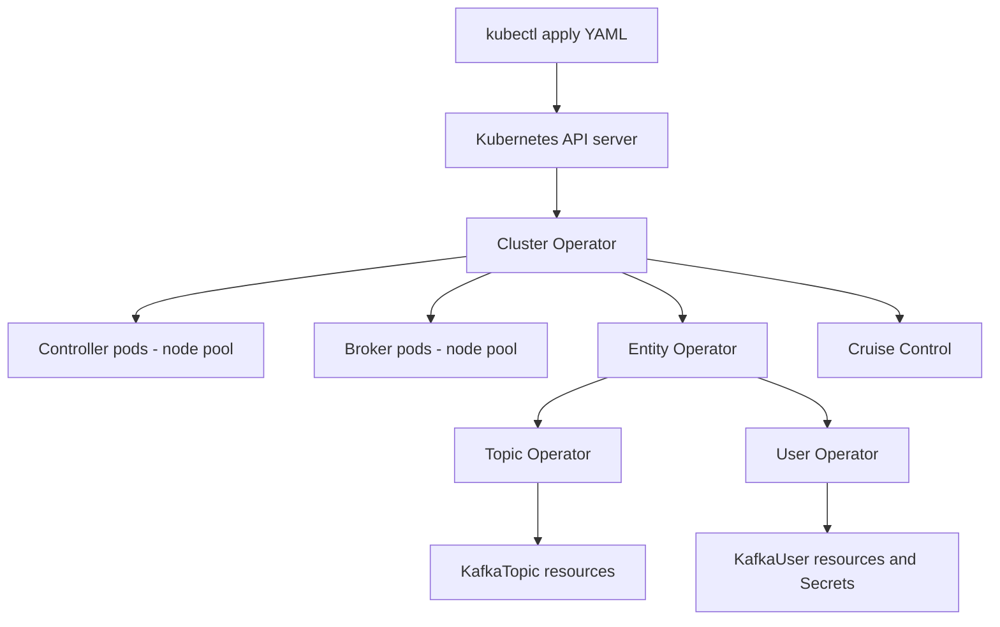

# Kafka on Kubernetes with Strimzi

## Introduction

Kafka was designed for long-lived machines with local disks and stable hostnames. Kubernetes was designed for stateless containers that come and go. Running one on the other used to be a bad idea, and plenty of early attempts with hand-written StatefulSets ended in lost data or clusters that could not be upgraded.

What changed is the operator pattern. An operator is a program running in the cluster that knows how to manage one specific application: it watches custom resources that describe what you want ("a three-broker Kafka cluster on version 4.3.1") and does the work of getting there, including the delicate parts such as rolling brokers one at a time, renewing certificates and never restarting a broker that would take a partition below its minimum in-sync replicas. **Strimzi**, a CNCF incubating project, is the most widely used open-source Kafka operator.

This page explains Strimzi's resources, walks through a production-shaped cluster definition, covers storage, networking, topics, users and upgrades, and ends with an honest look at when Kubernetes is the wrong home for Kafka. It assumes you know basic Kubernetes; if not, start with the [Kubernetes tutorial](/docs/devops/kubernetes).

## What Strimzi Manages

Strimzi installs a **Cluster Operator** that watches a set of custom resources. As of Strimzi 1.3 (October 2026), all of them use the `kafka.strimzi.io/v1` API; the older `v1beta2` API was removed in Strimzi 1.0, and ZooKeeper-based clusters were dropped back in 0.46. Strimzi 1.3 supports Kafka 4.2.x and 4.3.x on Kubernetes 1.32 and newer.

| Resource | What it describes |
|---|---|
| `Kafka` | The cluster: version, listeners, broker config, plus optional Entity Operator, Cruise Control and Kafka Exporter |
| `KafkaNodePool` | A group of nodes with the same roles (controller, broker, or both), replica count, storage and resources |
| `KafkaTopic` | A topic: partitions, replicas and config, managed by the Topic Operator |
| `KafkaUser` | A client identity with authentication (TLS or SCRAM) and ACLs, managed by the User Operator |
| `KafkaConnect` and `KafkaConnector` | A Connect cluster and the connectors running on it |
| `KafkaMirrorMaker2` | Cross-cluster replication; see [MirrorMaker 2](./5-kafka-mirrormaker.mdx) |
| `KafkaRebalance` | A Cruise Control rebalance proposal you can review and approve |
| `KafkaBridge` | An HTTP interface to Kafka |



The key idea is that you never run `kubectl edit pod` or `kafka-configs.sh` against a Strimzi-managed cluster for anything the operator owns. You change the YAML and the operator reconciles. Manual changes get overwritten.

## Installing the Operator

The quickest install uses the published manifests. For production, most teams use the Helm chart or OperatorHub so the operator version is pinned and upgradable.

```bash
kubectl create namespace kafka
kubectl create -f 'https://strimzi.io/install/latest?namespace=kafka' -n kafka

# Wait for the operator to be running.
kubectl get pods -n kafka
# NAME                                        READY   STATUS    RESTARTS   AGE
# strimzi-cluster-operator-6b9c8d7f5d-x2kqp   1/1     Running   0          45s
```

## Defining a Cluster

A Strimzi cluster is one `Kafka` resource plus one or more `KafkaNodePool` resources, linked by the `strimzi.io/cluster` label. Separate pools let controllers and brokers have different sizes and storage, which is what the Kafka documentation recommends for production.

```yaml
apiVersion: kafka.strimzi.io/v1
kind: KafkaNodePool
metadata:
  name: controller
  namespace: kafka
  labels:
    strimzi.io/cluster: orders
spec:
  replicas: 3
  roles:
    - controller
  resources:
    requests: { memory: 4Gi, cpu: "1" }
    limits: { memory: 4Gi }
  storage:
    type: jbod
    volumes:
      - id: 0
        type: persistent-claim
        size: 20Gi
        class: gp3
        kraftMetadata: shared        # this volume also holds the KRaft metadata log
        deleteClaim: false
---
apiVersion: kafka.strimzi.io/v1
kind: KafkaNodePool
metadata:
  name: broker
  namespace: kafka
  labels:
    strimzi.io/cluster: orders
spec:
  replicas: 6
  roles:
    - broker
  resources:
    requests: { memory: 32Gi, cpu: "4" }
    limits: { memory: 32Gi }
  jvmOptions:
    -Xms: 6g                         # small heap; the rest of memory is page cache
    -Xmx: 6g
  storage:
    type: jbod
    volumes:
      - id: 0
        type: persistent-claim
        size: 1000Gi
        class: gp3
        kraftMetadata: shared
        deleteClaim: false           # keep the disk if the pool is deleted
---
apiVersion: kafka.strimzi.io/v1
kind: Kafka
metadata:
  name: orders
  namespace: kafka
spec:
  kafka:
    version: 4.3.1
    metadataVersion: 4.3-IV0
    rack:
      topologyKey: topology.kubernetes.io/zone   # sets broker.rack from the node's zone
    listeners:
      - name: tls
        port: 9093
        type: internal
        tls: true
        authentication:
          type: tls
      - name: external
        port: 9094
        type: loadbalancer
        tls: true
        authentication:
          type: scram-sha-512
    authorization:
      type: simple
    config:
      default.replication.factor: 3
      min.insync.replicas: 2
      offsets.topic.replication.factor: 3
      transaction.state.log.replication.factor: 3
      transaction.state.log.min.isr: 2
  entityOperator:
    topicOperator: {}
    userOperator: {}
  cruiseControl: {}
```

```bash
kubectl apply -f orders-cluster.yaml
kubectl wait kafka/orders --for=condition=Ready --timeout=600s -n kafka
```

A few things are worth noticing. `rack.topologyKey` makes Strimzi set `broker.rack` from the Kubernetes zone label, so replicas spread across zones automatically. Strimzi creates a bootstrap Service (`orders-kafka-bootstrap`) for clients inside the cluster. And the operator generates a cluster CA and broker certificates, storing them as Secrets and renewing them before they expire.

## Storage: The Part That Matters Most

Kafka's data must survive pod restarts, so production clusters always use `persistent-claim` storage backed by PersistentVolumes. The choices that matter:

| Choice | Recommendation | Why |
|---|---|---|
| Storage type | `persistent-claim` in a `jbod` | `ephemeral` loses data on every restart; JBOD lets you add volumes later |
| Storage class | SSD-backed block storage, `volumeBindingMode: WaitForFirstConsumer` | The volume is created in the same zone as the pod |
| Volume expansion | Use a class with `allowVolumeExpansion: true` | Strimzi can grow volumes when you raise `size` |
| `deleteClaim` | `false` | Deleting the YAML should not delete your data |
| Local persistent volumes | Only with a mature local-volume provisioner | Best performance, but a node failure means re-replicating the data |

:::warning
Network block storage (EBS, Persistent Disk, Azure Disk) is already replicated by the cloud provider, and Kafka replicates again with RF 3. That is fine and normal, but it means you pay for storage several times over. [Tiered storage](../2-kafka-topics-and-storage/7-kafka-tiered-storage.mdx) is a common way to keep the expensive local volumes small.
:::

## Topics and Users as Code

The Topic Operator turns `KafkaTopic` resources into real topics, and keeps them in sync. This puts topic definitions in Git, reviewed like any other change.

```yaml
apiVersion: kafka.strimzi.io/v1
kind: KafkaTopic
metadata:
  name: orders.placed
  namespace: kafka
  labels:
    strimzi.io/cluster: orders
spec:
  partitions: 24
  replicas: 3
  config:
    retention.ms: 604800000        # 7 days
    min.insync.replicas: 2
    cleanup.policy: delete
```

The User Operator does the same for client identities. A `KafkaUser` with `authentication.type: tls` produces a Secret with a client certificate and key; one with `scram-sha-512` produces a Secret with a generated password. ACLs live in the same resource:

```yaml
apiVersion: kafka.strimzi.io/v1
kind: KafkaUser
metadata:
  name: fulfillment-service
  namespace: kafka
  labels:
    strimzi.io/cluster: orders
spec:
  authentication:
    type: tls
  authorization:
    type: simple
    acls:
      - resource: { type: topic, name: orders.placed, patternType: literal }
        operations: [Describe, Read]
      - resource: { type: group, name: fulfillment, patternType: literal }
        operations: [Read]
```

Applications mount the generated Secret and connect to the internal TLS listener. See [Authorization with ACLs](../11-kafka-security/3-kafka-acls-authorization.mdx) for how to design the permissions.

## Day-Two Operations

**Scaling.** Change `replicas` on the broker node pool. New brokers start empty; with `cruiseControl.autoRebalance` configured for `add-brokers` mode, Strimzi runs a [rebalance](./3-kafka-partition-reassignment.mdx) automatically, otherwise create a `KafkaRebalance`. Scaling down is blocked if the brokers being removed still hold partitions, which protects you from losing data.

**Configuration changes.** Edit `spec.kafka.config`. Strimzi applies dynamic configs without a restart and rolls brokers one at a time for static ones, checking before each restart that no partition would drop below `min.insync.replicas`.

**Upgrading Kafka.** Upgrade the Strimzi operator first (it supports a range of Kafka versions), then change `spec.kafka.version`. Strimzi rolls controllers and brokers onto the new image. When you are satisfied, change `metadataVersion` to finalize, the same two-phase process described in [Rolling Upgrades](./4-kafka-upgrades.mdx).

**Monitoring.** Add `metricsConfig` to the `Kafka` resource to enable Prometheus metrics, and use the example PodMonitors and Grafana dashboards shipped with Strimzi. Add `kafkaExporter` for consumer lag metrics.

**Disruptions.** Strimzi creates PodDisruptionBudgets so that node drains do not evict two brokers at once. The Strimzi Drain Cleaner goes further and lets the operator handle evictions, so drained brokers are rolled in a safe order.

## When Not to Use Kubernetes for Kafka

Strimzi is good, but Kafka on Kubernetes is still a stateful system on a platform built for stateless ones. It is a strong choice when your organization already runs everything on Kubernetes, has people who understand PersistentVolumes and node pools, and wants Kafka managed by the same GitOps workflow.

It is a weaker choice when:

- **Nobody owns the Kubernetes platform deeply.** Debugging a broker that will not start because its PersistentVolume is stuck in another zone requires Kubernetes and Kafka expertise at the same time.
- **The cluster is very large or latency-critical.** Dedicated VMs or bare metal with local NVMe give more predictable performance than shared nodes and network storage.
- **You do not want to operate Kafka at all.** A [managed service](../1-kafka-getting-started/5-kafka-managed-services.mdx) removes the problem entirely, at a price.

## A Worked Scenario: A Platform Team's First Cluster

A SaaS company runs 200 microservices on Amazon EKS, all deployed through Argo CD. They need Kafka for an event-driven billing system and choose Strimzi over Amazon MSK because they want topics and users defined in the same Git repository as the services that use them, reviewed in the same pull requests.

They create a dedicated node group of `r6i.2xlarge` instances across three zones for brokers, with a taint so only Kafka pods schedule there, and a smaller group for controllers. The `gp3` storage class uses `WaitForFirstConsumer` and allows expansion. The cluster definition above goes into the platform repository; each service's repository contains its own `KafkaTopic` and `KafkaUser` resources.

The first incident comes two months later: a broker pod is stuck `Pending` after a node replacement. `kubectl describe pod` shows its PersistentVolume is in `us-east-1b` but no node in that zone has capacity. The fix is adding capacity to the zone's node group, and the lesson is to keep spare capacity in every zone and use one node group per zone. After that, the team upgrades Kafka from 4.2.2 to 4.3.1 by changing two lines of YAML, and the operator rolls the nine pods over 40 minutes with no client errors.

## Common Mistakes

- Using `ephemeral` storage outside development, then losing all data when pods restart.
- Setting `deleteClaim: true` and deleting the data along with a mistaken `kubectl delete`.
- Changing topics with `kafka-topics.sh` on a Topic Operator-managed topic and having the operator revert it.
- Giving brokers a container memory limit equal to the JVM heap, leaving nothing for the page cache.
- Running brokers on general-purpose nodes shared with noisy workloads.
- Forgetting `rack.topologyKey`, so replicas of a partition can land in the same zone.
- Upgrading Kafka without first checking that the installed Strimzi version supports the target version.
- Copying old examples that use `kafka.strimzi.io/v1beta2` or `zookeeper:` sections; current Strimzi rejects both.

## Summary

- Strimzi is a Kubernetes operator that manages Kafka through custom resources; current releases use the `kafka.strimzi.io/v1` API and KRaft only.
- A cluster is a `Kafka` resource plus `KafkaNodePool` resources for controllers and brokers.
- Topics and users become `KafkaTopic` and `KafkaUser` YAML, so access and configuration live in Git.
- Use persistent, expandable, zone-aware storage and keep `deleteClaim: false`.
- Strimzi handles safe rolling restarts, certificate renewal, scaling and upgrades; you change YAML, not pods.
- Choose Kubernetes for Kafka when your team already lives on Kubernetes; otherwise VMs or a managed service may be simpler.

## Further Reading

- [Strimzi documentation](https://strimzi.io/docs/operators/latest/overview) - concepts, deployment and the full custom resource reference.
- [Strimzi quickstarts](https://strimzi.io/quickstarts/) - a single-node cluster on Minikube, Kind or Docker Desktop in a few minutes.
- [Strimzi examples on GitHub](https://github.com/strimzi/strimzi-kafka-operator/tree/main/packaging/examples) - ready-made YAML for clusters, topics, users, Connect, MM2 and metrics.
- [Strimzi CHANGELOG](https://github.com/strimzi/strimzi-kafka-operator/blob/main/CHANGELOG.md) - supported Kafka and Kubernetes versions per release and API changes such as the move to `v1`.
- [Kubernetes documentation: Persistent Volumes](https://kubernetes.io/docs/concepts/storage/persistent-volumes/) - storage classes, binding modes and expansion.
