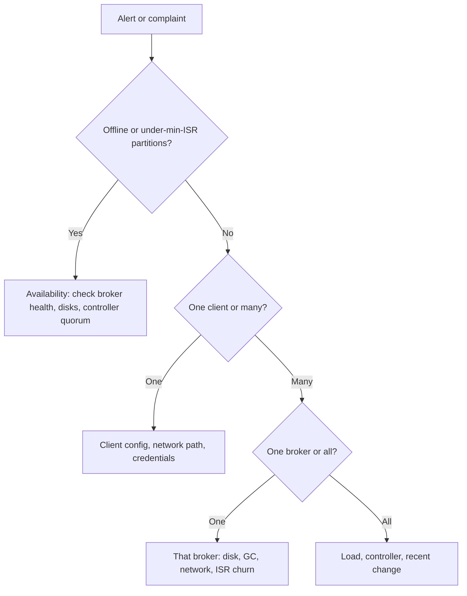

# Troubleshooting Common Problems

## Introduction

Most Kafka incidents are not new. The same dozen problems account for the vast majority of tickets: a client that connects to the bootstrap server and then hangs, producers failing with `NotEnoughReplicasException`, consumers stuck in a rebalance loop, a broker that will not start after a disk filled up. Each one has a recognizable signature and a short list of causes.

This page is organized as a field guide. It starts with a general method that works for any problem, then goes through the common failures by symptom: what you see, why it happens, how to confirm it and how to fix it. Keep it open next to the [monitoring dashboard](./1-kafka-monitoring-metrics.mdx) when an alert fires.

## A Method for Any Problem

Before reaching for fixes, narrow the problem down. Four questions eliminate most of the search space:

1. **Is data at risk, or is it slow?** Check offline partitions and under-min-ISR partitions first. If both are zero, you have a performance or client problem, not an availability one.
2. **Is it one client, one broker, one topic, or everything?** A problem limited to one client is almost always that client's configuration. A problem limited to one broker is that broker's disk, network or JVM. A problem on every broker is the controller, the network, or load.
3. **What changed?** Deploys, config changes, new topics, a big consumer replaying history, a certificate rotation. Most incidents follow a change.
4. **What do the logs say?** Broker logs in `logs/server.log` and the client's own logs. Search for `ERROR` and `WARN` around the start time; the first error is usually the cause and the rest are consequences.



## The Toolbox

These CLI tools answer most diagnostic questions. All use `--bootstrap-server` (or `--bootstrap-controller` for quorum operations).

| Tool | Use it to |
|---|---|
| `kafka-topics.sh --describe --under-replicated-partitions` | List partitions missing in-sync replicas |
| `kafka-topics.sh --describe --unavailable-partitions` | List partitions with no leader |
| `kafka-consumer-groups.sh --describe --group G --state` | See whether a group is stable, rebalancing or empty |
| `kafka-metadata-quorum.sh describe --status` | Check the KRaft leader, epoch and follower lag |
| `kafka-log-dirs.sh --describe` | See partition sizes per broker and log directory |
| `kafka-configs.sh --describe --entity-type brokers --entity-name N` | Show dynamic broker config overrides |
| `kafka-dump-log.sh --files X.log --print-data-log` | Inspect records inside a segment file |
| `kafka-broker-api-versions.sh` | Check that a client host can reach every broker and which protocol versions they support |

## Clients Connect, Then Hang or Time Out

**Symptom.** The client connects to the bootstrap address, then fails with `TimeoutException: Topic orders not present in metadata after 60000 ms`, or with repeated `Connection to node 1 (kafka-1.internal/10.0.1.11:9092) could not be established`.

**Why.** The bootstrap connection only returns metadata: the list of brokers and the address each one advertises. The client then connects directly to each broker at its **advertised** address. If that address is not reachable from the client (an internal hostname, a Docker container name, a private IP from outside the VPC), the bootstrap succeeds and everything after it fails.

**Confirm.** Look at the address in the error. Then check what the broker advertises:

```bash
kafka-broker-api-versions.sh --bootstrap-server kafka.example.com:9092 | grep -E '^[^ ]+:[0-9]+'
# kafka-1.internal:9092 (id: 1 rack: us-east-1a) -> (
# kafka-2.internal:9092 (id: 2 rack: us-east-1b) -> (
```

If those hostnames do not resolve from the client machine, that is the problem.

**Fix.** Give each audience its own listener with an address it can reach, and set `advertised.listeners` accordingly:

```properties
listeners=INTERNAL://0.0.0.0:9092,EXTERNAL://0.0.0.0:9094,CONTROLLER://0.0.0.0:9093
advertised.listeners=INTERNAL://kafka-1.internal:9092,EXTERNAL://kafka-1.example.com:9094
listener.security.protocol.map=INTERNAL:PLAINTEXT,EXTERNAL:SASL_SSL,CONTROLLER:PLAINTEXT
inter.broker.listener.name=INTERNAL
controller.listener.names=CONTROLLER
```

The same mistake is behind most "works in Docker, fails from my laptop" problems; see [Running Kafka Locally with Docker Compose](../1-kafka-getting-started/0-kafka-docker-compose.mdx).

## NotEnoughReplicasException

**Symptom.** Producers with `acks=all` fail with `NotEnoughReplicasException` or `NotEnoughReplicasAfterAppendException`. Consumers keep working.

**Why.** The partition's ISR has fewer members than `min.insync.replicas`, so the leader refuses writes that it cannot replicate safely. This is Kafka protecting your data, not a bug.

**Confirm.** `kafka-topics.sh --describe --under-min-isr-partitions` lists the affected partitions. Look at which replicas are missing from the ISR; if they all live on one broker, that broker is down or falling behind.

**Fix.** Bring the missing broker back or fix whatever is slowing it (disk, GC, network). Do **not** lower `min.insync.replicas` to 1 to make the error go away unless you have consciously decided to accept data loss on the next failure. See [acks, min.insync.replicas and Durability](../3-kafka-producers/2-kafka-producer-acks-and-durability.mdx).

## Messages Too Large

**Symptom.** Producers fail with `RecordTooLargeException` or `MESSAGE_TOO_LARGE`, or consumers seem stuck on one offset.

**Why.** Three limits must agree. The producer's `max.request.size` (default 1 MB) caps a request. The broker's `message.max.bytes` (default about 1 MB), or the topic's `max.message.bytes`, caps a record batch. Followers must also be able to fetch it, which is governed by `replica.fetch.max.bytes`. Consumers use `max.partition.fetch.bytes` and `fetch.max.bytes`, but these are soft limits since KIP-74: a consumer always gets at least one batch even if it is larger.

**Fix.** Raise the topic's `max.message.bytes` and the producer's `max.request.size` together, only for the topics that need it. Better still, avoid large messages: store the payload in object storage and send a reference (the claim-check pattern), or compress. Records of tens of megabytes hurt memory and latency for every client sharing those brokers.

## Consumers Stuck in a Rebalance Loop

**Symptom.** Lag grows, the group state flips between `PreparingRebalance`, `CompletingRebalance` and `Stable`, and consumer logs show `CommitFailedException` or messages about leaving the group because `max.poll.interval.ms` was exceeded.

**Why.** A consumer that takes longer than `max.poll.interval.ms` (default 5 minutes) between `poll()` calls is considered stuck and removed from the group. Its partitions move to others, which may also be slow, and so on. Under the classic protocol, every member stops consuming during each rebalance, which makes things worse.

**Fix.** Reduce the work per poll (lower `max.poll.records`), make processing faster, or move slow work off the poll thread. Check for long GC pauses. Using the KIP-848 consumer protocol (`group.protocol=consumer`, GA since Kafka 4.0) limits the damage, because only the affected partitions move. See [Heartbeats, max.poll.interval.ms and Liveness](../4-kafka-consumers/5-kafka-consumer-liveness.mdx).

## A Broker Will Not Start

**Symptom.** A broker exits during startup or stays up but never becomes ready.

Look at the end of `server.log`. Common causes:

| Log message (paraphrased) | Cause | Fix |
|---|---|---|
| No space left on device | A disk filled up | Free space (see below), then start |
| Invalid cluster.id in meta.properties | The log directory was formatted for a different cluster | Check you mounted the right disk; never reformat a disk that holds data you need |
| No meta.properties found | The storage directory was never formatted | Run `kafka-storage.sh format` with the cluster ID (new nodes only) |
| Too many open files | File descriptor limit too low | Raise `nofile` to 100,000 or more |
| Map failed, or OutOfMemoryError: Map failed | `vm.max_map_count` too low | Raise it, for example to 262,144 |
| Long pause loading segments | Recovering after an unclean shutdown | Wait; raise `num.recovery.threads.per.data.dir` for next time |

:::warning
When a disk fills up, do not delete segment files by hand while the broker is running, and never delete the newest segment or the `.index` files of the active segment. Instead, stop the broker, move a few of the oldest closed segments of a large, replicated topic out of the way if you must, start the broker, and then reduce that topic's `retention.ms` or `retention.bytes` so Kafka cleans up properly. The followers still have the data.
:::

## KRaft Quorum Problems

**Symptom.** No topic can be created, leader elections do not happen, brokers are fenced, and `ActiveControllerCount` sums to 0.

**Why.** The controller quorum has lost its majority: with three controllers, two are down or cannot reach each other. Without a quorum, no metadata changes can be committed. Existing leaders keep serving reads and writes for a while, but nothing recovers from further failures.

**Confirm.**

```bash
kafka-metadata-quorum.sh --bootstrap-controller ctrl-1:9093 describe --replication
```

```
NodeId  DirectoryId             LogEndOffset  Lag  LastFetchTimestamp  LastCaughtUpTimestamp  Status
9001    pZ3k...                 1288931       0    1792231845012       1792231845012          Leader
9002    Tq8m...                 1288931       0    1792231844890       1792231844890          Follower
9003    Ab4x...                 1201220       87711  1792231512001     1792231498100          Follower
```

A follower with a large and growing `Lag`, or one missing entirely, is the problem node.

**Fix.** Bring the failed controllers back; most quorum losses are two controllers sharing a failure domain (same host, same zone, same disk). Place controllers in different zones. For permanent replacement of a controller, Kafka's dynamic quorum (`kafka-metadata-quorum.sh add-controller` and `remove-controller`, KIP-853) lets you change membership without downtime.

## A Worked Scenario: Friday Afternoon at a Ride-Hailing Company

At 16:40 on a Friday, the trip-pricing service starts timing out. The on-call engineer works through the method.

Offline partitions: 0. Under-min-ISR: 0. Data is safe. Only the pricing service is affected; trip booking and payments are fine, so the cluster is probably healthy. The question becomes "what changed for this client?"

The pricing service's logs show `TimeoutException: Expiring 41 record(s) for surge-signals-7: 120000 ms has passed since batch creation`. That is `delivery.timeout.ms` expiring, which means records sat in the producer buffer for two minutes without being acknowledged. The producer metrics show `request-latency-avg` normal for brokers 1 to 5 and no successful requests at all to broker 6.

`kafka-broker-api-versions.sh` from the pricing host lists broker 6 at `kafka-6.internal:9092`, but `nc -vz kafka-6.internal 9092` from that host fails. A network policy change deployed at 16:35 allowed the pricing namespace to reach brokers by IP range, and broker 6 was replaced last week with an address outside the old range. Other services were unaffected because their policies used a wider range.

Reverting the policy fixes the problem in two minutes. The follow-up action: network policies for Kafka clients should reference the brokers' DNS names or labels, not IP ranges, and the [observability practices](../13-kafka-best-practices/5-kafka-observability-practices.mdx) page gets a new item about alerting on per-broker producer errors.

## Common Mistakes

- Restarting brokers as a first response, which hides the evidence and can make an under-replicated cluster worse.
- Lowering `min.insync.replicas` to silence `NotEnoughReplicasException`, trading an error for silent data loss later.
- Debugging advertised listeners from the broker host, where every address resolves, instead of from the client.
- Raising `message.max.bytes` broker-wide for one team's large messages.
- Deleting segment files on a running broker to free disk space.
- Putting all three controllers on the same host or in the same zone.
- Reading only the last error in a log instead of the first one.

## Summary

- Start every investigation by checking whether data is at risk, then narrow the scope to one client, one broker or everything, and look for a recent change.
- Connection timeouts after a successful bootstrap almost always mean `advertised.listeners` is unreachable from the client.
- `NotEnoughReplicasException` is a safety feature; fix the missing replica rather than lowering `min.insync.replicas`.
- Large messages need matching producer, topic and replica fetch limits; prefer claim-check over raising limits.
- Rebalance loops come from exceeding `max.poll.interval.ms`; reduce work per poll and adopt the KIP-848 protocol.
- Use `kafka-metadata-quorum.sh` to diagnose KRaft controller problems and spread controllers across failure domains.

## Further Reading

- [Kafka documentation: Operations](https://kafka.apache.org/documentation/#operations) - the official guide to the CLI tools used above.
- [Kafka documentation: Broker configs](https://kafka.apache.org/documentation/#brokerconfigs) - listener, size limit and recovery settings with defaults.
- [KIP-853: KRaft Controller Membership Changes](https://cwiki.apache.org/confluence/display/KAFKA/KIP-853%3A+KRaft+Controller+Membership+Changes) - adding and removing controllers dynamically.
- [KIP-74: Add Fetch Response Size Limit in Bytes](https://cwiki.apache.org/confluence/display/KAFKA/KIP-74%3A+Add+Fetch+Response+Size+Limit+in+Bytes) - why consumer fetch limits are soft.
- [Confluent: Kafka listeners explained](https://www.confluent.io/blog/kafka-listeners-explained/) - a detailed walkthrough of advertised listeners.
