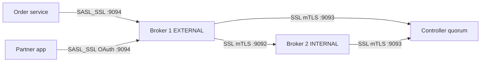

# Kafka Security Overview

## Introduction

A Kafka cluster straight out of the download is wide open. Any process that can reach port 9092 can read every topic, write garbage into any topic, delete topics and change broker configuration. Nothing is encrypted, so anyone on the network path can read your records in plain text. That is fine on a laptop. It is a serious incident waiting to happen once the cluster carries payment events, customer addresses or anything a regulator cares about.

Kafka does have a full security model. It is just switched off by default, and it is built from several independent pieces that you have to enable one by one. This page gives you the map before the later pages go into each piece. By the end you will know:

- which questions each security feature answers (who are you, what may you do, can anyone eavesdrop, how much may you use);
- how listeners and security protocols tie those features to network ports;
- what changes in a KRaft cluster, where controllers replace ZooKeeper;
- in which order to roll security out on a real cluster without breaking every client.

## Four Questions Security Has to Answer

It helps to think of a secured cluster as an office building with a front desk.

1. **Can anyone listen in?** This is encryption in transit. Kafka uses TLS, the same protocol that protects HTTPS. Without it, records, passwords and tokens cross the network readable by anyone with a packet capture.
2. **Who are you?** This is authentication. The client proves its identity with a password (SASL/SCRAM), a token from an identity provider (SASL/OAUTHBEARER), a Kerberos ticket (SASL/GSSAPI) or a client certificate (mutual TLS). The result is a *principal*, a name such as `User:order-service`.
3. **What are you allowed to do?** This is authorization. The broker looks up access control lists (ACLs) that say, for example, "`User:order-service` may WRITE to topics starting with `orders.`". Requests that no ACL allows are rejected.
4. **How much may you use?** This is quotas. A principal or client ID can be limited to a byte rate or a share of broker CPU, so one runaway job cannot starve everyone else.

Each layer depends on the one before it. Authorization is meaningless if anyone can claim to be `User:admin`, and a password is worthless if it travels in clear text. The front desk analogy holds: the badge reader (authentication) only matters if the windows are not open (encryption), and the floor permissions (authorization) only matter if badges cannot be forged.

| Layer | Kafka feature | Answers | Covered in |
| --- | --- | --- | --- |
| Encryption | TLS (`SSL`, `SASL_SSL` protocols) | Can anyone read the traffic? | [TLS Encryption in Transit](./1-kafka-tls-encryption.mdx) |
| Authentication | SASL (SCRAM, OAUTHBEARER, GSSAPI, PLAIN) or mTLS | Who is this client? | [Authentication with SASL](./2-kafka-sasl-authentication.mdx) |
| Authorization | ACLs with `StandardAuthorizer` | May this principal do this? | [Authorization with ACLs](./3-kafka-acls-authorization.mdx) |
| Resource control | Client quotas | How much may it consume? | [Quotas and Multi-Tenancy](./4-kafka-quotas.mdx) |

## Listeners and Security Protocols

Kafka applies security per *listener*. A listener is a named network endpoint on a broker or controller, and each listener is mapped to one of four security protocols:

| Protocol | Encrypted | Authenticated | Typical use |
| --- | --- | --- | --- |
| `PLAINTEXT` | No | No | Local development only |
| `SSL` | Yes | Optional, via client certificates (mTLS) | Internal traffic between brokers, or services with certificates |
| `SASL_PLAINTEXT` | No | Yes, via SASL | Rarely a good idea; passwords may cross the wire unprotected |
| `SASL_SSL` | Yes | Yes, via SASL | The usual choice for client traffic |

Because each listener has its own protocol, one broker can serve different audiences on different ports. A common production layout has three listeners:

- `CONTROLLER` for KRaft controller traffic (Raft votes and metadata fetches);
- `INTERNAL` for broker-to-broker replication;
- `EXTERNAL` for applications.



Here is what that looks like on a broker node in a KRaft cluster. The names on the left of `listener.security.protocol.map` are free text; the protocols on the right are fixed.

```properties
# Broker node 4 (process.roles=broker) in a KRaft cluster
process.roles=broker
node.id=4
controller.quorum.bootstrap.servers=ctrl-1.kafka.internal:9093,ctrl-2.kafka.internal:9093,ctrl-3.kafka.internal:9093

# Where the broker binds, and what it tells clients to connect to
listeners=INTERNAL://0.0.0.0:9092,EXTERNAL://0.0.0.0:9094
advertised.listeners=INTERNAL://kafka-4.kafka.internal:9092,EXTERNAL://kafka-4.example.com:9094

# Map each listener name to a security protocol
listener.security.protocol.map=INTERNAL:SSL,EXTERNAL:SASL_SSL,CONTROLLER:SSL

# Which listener brokers use to replicate from each other
inter.broker.listener.name=INTERNAL

# Which listener name (and therefore protocol) to use when talking to controllers
controller.listener.names=CONTROLLER

# Turn on authorization (KRaft built-in authorizer)
authorizer.class.name=org.apache.kafka.metadata.authorizer.StandardAuthorizer
super.users=User:kafka-broker;User:kafka-controller;User:platform-admin
```

The controller nodes have a smaller configuration with only the `CONTROLLER` listener. We fill in the TLS and SASL details on the next pages.

## What KRaft Changes

Kafka 4.x runs only in KRaft mode; ZooKeeper support was removed in 4.0. For security, that is mostly good news, but it moves a few things around.

- **There is no ZooKeeper to secure.** Older guides spend pages on ZooKeeper SASL, ZooKeeper ACLs and `zookeeper.set.acl`. None of that applies any more. Metadata, including ACLs and SCRAM credentials, lives in the replicated metadata log on the controllers.
- **The controller listener is a new attack surface.** Brokers connect to controllers to fetch metadata, and controllers talk to each other to elect a leader. Whoever can impersonate a broker or a controller can rewrite cluster metadata, so that listener needs encryption and strong authentication. Mutual TLS is the common choice, because SCRAM credentials are stored in the very metadata log that controllers are trying to agree on, and SCRAM is not supported for controller-to-controller authentication.
- **The authorizer is different.** ZooKeeper clusters used `kafka.security.authorizer.AclAuthorizer`. KRaft clusters use `org.apache.kafka.metadata.authorizer.StandardAuthorizer`, which reads ACLs from the metadata log. You set it on every node, brokers and controllers alike, because some admin requests are authorized on the controller.
- **Brokers and controllers need to be super users** (or hold the right ACLs). Broker-to-controller requests require cluster-level permissions. The simplest approach is to give broker and controller certificates well-known principals and list them in `super.users`.

## Principals: The Glue Between Layers

Every authenticated connection ends up with a `KafkaPrincipal`, written as `Type:Name`. The type is almost always `User`. The name depends on how the client authenticated:

| Authentication | Default principal name |
| --- | --- |
| None (`PLAINTEXT` or `SSL` without client certs) | `User:ANONYMOUS` |
| SASL/SCRAM or SASL/PLAIN | the username, for example `User:alice` |
| SASL/OAUTHBEARER | the token's `sub` claim (configurable) |
| SASL/GSSAPI (Kerberos) | the Kerberos principal after `sasl.kerberos.principal.to.local.rules` |
| mTLS | the certificate's full distinguished name, for example `User:CN=order-service,OU=Payments,O=Example` unless `ssl.principal.mapping.rules` shortens it |

ACLs and quotas are written against these names. That is why the very first design decision is a naming scheme. If your certificate principals are `CN=order-service` but your SCRAM users are `orders-svc`, you will write every ACL twice and eventually get one of them wrong.

:::tip
Pick one principal per application, not per instance. Twenty pods of the order service should all authenticate as `User:order-service`. ACLs then describe applications, which is what humans reason about, and quotas apply to the application as a whole.
:::

## A Worked Scenario: Securing a Shared Payments Cluster

A fintech company runs one Kafka cluster for three teams. The payments team writes ledger events to `payments.ledger`. The fraud team reads them and writes alerts to `fraud.alerts`. An analytics team runs a nightly batch job that reads everything. A partner company also needs to read `fraud.alerts` from outside the company network.

Until now the cluster sat in a private subnet on `PLAINTEXT`, with "network isolation" as its only protection. A security review turns up three problems: any compromised pod in the Kubernetes cluster could read ledger events, the analytics job regularly saturates broker network threads, and the partner integration needs the cluster exposed to the internet.

The team plans the rollout in stages so no client breaks overnight:

1. **Add TLS listeners alongside the existing ones.** Brokers serve `PLAINTEXT` on 9092 and `SASL_SSL` on 9094 at the same time. Clients migrate one at a time.
2. **Switch inter-broker and controller traffic to mTLS.** Brokers get certificates with `CN=kafka-broker`; controllers get `CN=kafka-controller`.
3. **Create identities.** Internal services get SCRAM users (`payments-writer`, `fraud-detector`, `analytics-batch`). The partner authenticates with OAuth tokens from the company's identity provider, so its access can be revoked centrally.
4. **Enable `StandardAuthorizer` with no ACLs, but with `allow.everyone.if.no.acl.found=true` temporarily**, then add ACLs for each application, watch the authorizer log for denials, and finally set the flag back to `false`.
5. **Add quotas** so `analytics-batch` cannot read faster than 50 MB/s.
6. **Remove the `PLAINTEXT` listener.**

The alternative the team considered was to rely on network policies and a service mesh to encrypt traffic between pods. That would have handled eavesdropping, but not "which application may write to the ledger topic", and it would not have helped with the external partner at all. Kafka-native security was needed for authorization and quotas regardless, so they used it for everything.

## Things Kafka Security Does Not Do

Knowing the limits saves a lot of false confidence.

- **No encryption at rest.** Records sit unencrypted in log segments on broker disks. Use disk or volume encryption from your OS or cloud provider, or encrypt sensitive fields in the application before producing.
- **No end-to-end encryption.** TLS protects each hop. The broker sees plaintext records. If the broker operators must not see the payload, encrypt it in the producer.
- **No built-in audit log of data access.** The authorizer logger records allowed and denied decisions, which gets you part of the way. Managed services and commercial distributions add structured audit logs.
- **No security for the ecosystem by default.** Kafka Connect's REST API, Schema Registry, Kafka UI tools and JMX ports each have their own security settings, and most are open out of the box. The [hardening checklist](./6-kafka-security-hardening.mdx) covers them.

## Common Mistakes

- Turning on the authorizer before creating ACLs for brokers and applications. Every client, and sometimes the brokers themselves, start failing with authorization errors.
- Using `SASL_PLAINTEXT` in production because "it has authentication". SCRAM does not send the password itself, but PLAIN does, and all record data is readable either way.
- Securing the client listener but leaving the `CONTROLLER` or inter-broker listener on `PLAINTEXT`, which lets anyone on the network impersonate a broker.
- Following a ZooKeeper-era guide and setting `authorizer.class.name=kafka.security.authorizer.AclAuthorizer` on a KRaft cluster. That class is gone in Kafka 4.x.
- Forgetting `advertised.listeners`. Clients bootstrap successfully, then receive an internal hostname for the TLS listener and fail hostname verification.
- Assuming network isolation is enough. One compromised pod, laptop on the VPN or misconfigured security group exposes everything.

## Summary

- Kafka security has four layers: TLS encryption, authentication, ACL authorization and quotas. All are off by default.
- Security is configured per listener; each listener maps to `PLAINTEXT`, `SSL`, `SASL_PLAINTEXT` or `SASL_SSL`.
- In Kafka 4.x (KRaft only) there is no ZooKeeper to secure, but the controller listener must be protected, ideally with mTLS.
- KRaft clusters use `org.apache.kafka.metadata.authorizer.StandardAuthorizer` on every node, with brokers and controllers listed in `super.users`.
- Every connection gets a principal such as `User:order-service`; design a consistent naming scheme before writing ACLs.
- Roll security out in stages, with old and new listeners side by side, rather than flipping everything at once.
- Kafka does not encrypt data at rest or end to end; handle that with disk encryption or application-level encryption.

## Further Reading

- [Kafka documentation: Security](https://kafka.apache.org/documentation/#security) - the official overview of SSL, SASL, authorization and quotas.
- [Kafka documentation: Authorization and ACLs](https://kafka.apache.org/43/security/authorization-and-acls/) - the `StandardAuthorizer` configuration for KRaft and the full list of operations.
- [KIP-801: StandardAuthorizer](https://cwiki.apache.org/confluence/display/KAFKA/KIP-801%3A+Implement+an+Authorizer+that+stores+metadata+in+__cluster_metadata) - why KRaft needed a new authorizer and how it stores ACLs.
- [KIP-103: Separation of Internal and External Traffic](https://cwiki.apache.org/confluence/display/KAFKA/KIP-103%3A+Separation+of+Internal+and+External+traffic) - the design of named listeners and `listener.security.protocol.map`.
- [KRaft: How Kafka Runs Without ZooKeeper](../0-kafka-fundamentals/3-kafka-kraft-and-metadata.mdx) - background on controllers and the metadata log.
