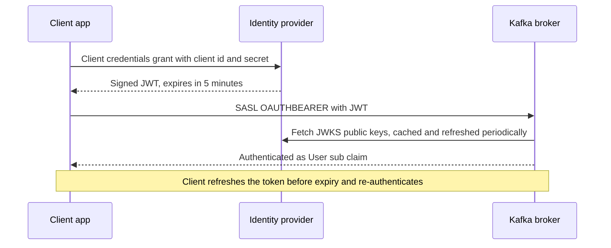

# Authentication with SASL: SCRAM, OAUTHBEARER and mTLS

## Introduction

Encryption stops eavesdroppers, but it does not tell the broker who is on the other end. Without authentication, every client is `User:ANONYMOUS`, and you cannot write a rule like "only the payments service may write to the ledger". Authentication turns a TCP connection into a named principal that ACLs and quotas can refer to.

Kafka offers two families of authentication. SASL (Simple Authentication and Security Layer) is a framework with pluggable mechanisms: SCRAM for username and password, OAUTHBEARER for tokens from an identity provider, GSSAPI for Kerberos, and PLAIN. Mutual TLS uses client certificates instead. All of them can coexist in one cluster, each on its own listener or even several on one listener.

After this page you will be able to:

- choose a mechanism based on your organization's identity infrastructure;
- set up SCRAM users on a KRaft cluster, including the bootstrap credentials created at format time;
- connect brokers to an OpenID Connect provider for OAUTHBEARER and configure Java and Python clients to fetch tokens;
- use mTLS certificates as identities and map their distinguished names to short principals.

## Choosing a Mechanism

| Mechanism | Credential | Where identities live | Strengths | Weaknesses |
| --- | --- | --- | --- | --- |
| SCRAM-SHA-512 / 256 | Username and password | Kafka metadata log | Built in, no external system, password never sent | Long-lived secrets; per-cluster user management |
| OAUTHBEARER (OIDC) | Short-lived JWT access token | Your identity provider (Keycloak, Okta, Entra ID) | Central lifecycle, short-lived tokens, easy revocation | Depends on the IdP being reachable; more moving parts |
| mTLS | Client certificate | Your PKI | No passwords; strong; already needed for TLS | Certificate issuance and rotation for every client |
| GSSAPI (Kerberos) | Kerberos ticket | Active Directory or MIT KDC | Fits Hadoop and Windows enterprises | Operationally heavy; fragile DNS and clock requirements |
| PLAIN | Username and password sent as-is | JAAS file or custom callback | Simple | Password crosses the wire; only acceptable inside TLS with a custom backend |

A simple rule of thumb:

- If your company already runs an OIDC identity provider, use **OAUTHBEARER** for applications and humans.
- If not, and you want something working today, use **SCRAM-SHA-512**.
- Use **mTLS** for brokers and controllers, and for services that already receive certificates from a service mesh or cert-manager.
- Use **GSSAPI** only if Kerberos is already the identity backbone.

The mechanism a client uses on a given connection is set with `sasl.mechanism`, and the broker accepts the mechanisms listed in `sasl.enabled.mechanisms` for that listener. Always run SASL over `SASL_SSL`, never `SASL_PLAINTEXT`, in production.

## SCRAM on a KRaft Cluster

SCRAM (Salted Challenge Response Authentication Mechanism) proves knowledge of a password without sending it. The broker stores a salted, iterated hash; the client and broker exchange challenges derived from it. Even someone who can read the stored credential cannot log in directly with it.

In KRaft clusters, SCRAM credentials are stored in the metadata log. That creates a chicken-and-egg problem: brokers that authenticate to each other with SCRAM need a credential before the cluster is running. The answer is to create bootstrap credentials when formatting storage.

```bash
# Run on every node before first start. Creates the admin user in the initial metadata.
kafka-storage.sh format \
  --config /etc/kafka/server.properties \
  --cluster-id "$(cat /etc/kafka/cluster-id)" \
  --add-scram 'SCRAM-SHA-512=[name="platform-admin",password="change-me-now"]'
```

Once the cluster is up, create application users with `kafka-configs.sh`, authenticated as that admin:

```bash
kafka-configs.sh --bootstrap-server kafka-1.example.com:9094 \
  --command-config admin.properties \
  --alter --entity-type users --entity-name payments-writer \
  --add-config 'SCRAM-SHA-512=[iterations=8192,password=Long-Random-Secret-1]'

# Verify (shows mechanism and iterations, never the password)
kafka-configs.sh --bootstrap-server kafka-1.example.com:9094 \
  --command-config admin.properties \
  --describe --entity-type users --entity-name payments-writer
```

```text
SCRAM credential configs for user-principal 'payments-writer' are SCRAM-SHA-512=iterations=8192
```

The broker side enables SCRAM on the external listener. The per-listener JAAS setting, `listener.name.<listener>.<mechanism>.sasl.jaas.config`, keeps settings for different listeners separate:

```properties
listener.security.protocol.map=INTERNAL:SSL,EXTERNAL:SASL_SSL,CONTROLLER:SSL
listener.name.external.sasl.enabled.mechanisms=SCRAM-SHA-512
# Brokers do not log in on this listener, so the server-side JAAS entry needs no credentials
listener.name.external.scram-sha-512.sasl.jaas.config=org.apache.kafka.common.security.scram.ScramLoginModule required;
```

In this layout brokers replicate over the mTLS `INTERNAL` listener, so they never need a SCRAM password themselves. If you prefer SCRAM between brokers, set `sasl.mechanism.inter.broker.protocol=SCRAM-SHA-512`, give the broker JAAS entry a `username` and `password`, and make sure that user exists from format time. Keep the controller listener on mTLS: SCRAM is not supported for controller-to-controller authentication, because the credentials live in the metadata the controllers are still agreeing on.

A Java client connecting with SCRAM:

```java
Properties props = new Properties();
props.put("bootstrap.servers", "kafka-1.example.com:9094");
props.put("security.protocol", "SASL_SSL");
props.put("sasl.mechanism", "SCRAM-SHA-512");
props.put("sasl.jaas.config",
    "org.apache.kafka.common.security.scram.ScramLoginModule required "
    + "username=\"payments-writer\" "
    + "password=\"" + System.getenv("KAFKA_PASSWORD") + "\";");
props.put("ssl.truststore.type", "PEM");
props.put("ssl.truststore.location", "/etc/app/tls/ca.crt");
```

The same in Python with `confluent-kafka`:

```python
import os
from confluent_kafka import Consumer

consumer = Consumer({
    "bootstrap.servers": "kafka-1.example.com:9094",
    "security.protocol": "SASL_SSL",
    "sasl.mechanism": "SCRAM-SHA-512",
    "sasl.username": "fraud-detector",
    "sasl.password": os.environ["KAFKA_PASSWORD"],
    "ssl.ca.location": "/etc/app/tls/ca.crt",
    "group.id": "fraud-detector",
})
consumer.subscribe(["payments.ledger"])
```

## OAUTHBEARER with an OpenID Connect Provider

With OAUTHBEARER, the client first gets a short-lived access token (a signed JWT) from an identity provider using the OAuth client credentials grant, then presents it to the broker. The broker never talks to the identity provider during login. It validates the token's signature using public keys fetched from the provider's JWKS endpoint, checks expiry, issuer and audience, and takes the principal from the `sub` claim.



The analogy is a concert wristband. The box office (identity provider) checks your ticket and gives you a wristband that is only valid tonight. The door staff (broker) only check that the wristband is genuine and current; they never call the box office.

Broker configuration for an `EXTERNAL` listener:

```properties
listener.name.external.sasl.enabled.mechanisms=OAUTHBEARER
listener.name.external.oauthbearer.sasl.jaas.config=org.apache.kafka.common.security.oauthbearer.OAuthBearerLoginModule required;
listener.name.external.oauthbearer.sasl.server.callback.handler.class=org.apache.kafka.common.security.oauthbearer.OAuthBearerValidatorCallbackHandler
listener.name.external.oauthbearer.sasl.oauthbearer.jwks.endpoint.url=https://idp.example.com/realms/kafka/protocol/openid-connect/certs

# Reject tokens not meant for Kafka or not from our provider
sasl.oauthbearer.expected.audience=kafka-prod
sasl.oauthbearer.expected.issuer=https://idp.example.com/realms/kafka
# Which claim becomes the principal name (default "sub")
sasl.oauthbearer.sub.claim.name=sub
```

Since Kafka 4.0, the Java code that fetches tokens or JWKS keys only contacts URLs you have explicitly allowed through a JVM system property. This closes a server-side request forgery hole where a malicious configuration could make a broker or Connect worker fetch arbitrary URLs. Set it on brokers and Java clients:

```bash
export KAFKA_OPTS="-Dorg.apache.kafka.sasl.oauthbearer.allowed.urls=https://idp.example.com/realms/kafka/protocol/openid-connect/certs,https://idp.example.com/realms/kafka/protocol/openid-connect/token"
```

A Java client uses the built-in login callback handler to run the client credentials flow and refresh tokens automatically:

```properties
security.protocol=SASL_SSL
sasl.mechanism=OAUTHBEARER
sasl.login.callback.handler.class=org.apache.kafka.common.security.oauthbearer.OAuthBearerLoginCallbackHandler
sasl.oauthbearer.token.endpoint.url=https://idp.example.com/realms/kafka/protocol/openid-connect/token
sasl.jaas.config=org.apache.kafka.common.security.oauthbearer.OAuthBearerLoginModule required \
  clientId="partner-acme" \
  clientSecret="${env:PARTNER_CLIENT_SECRET}" \
  scope="kafka";
ssl.truststore.type=PEM
ssl.truststore.location=/etc/app/tls/ca.crt
```

The `${env:...}` placeholder is resolved by a config provider, covered in [Managing Secrets and Client Credentials](./5-kafka-secrets-and-credentials.mdx). Kafka 4.1 also added pluggable token retrievers (`sasl.oauthbearer.jwt.retriever.class`), including a JWT bearer grant for identity providers that prefer signed client assertions over shared secrets.

In Python, librdkafka has its own built-in OIDC support:

```python
import os
from confluent_kafka import Producer

producer = Producer({
    "bootstrap.servers": "kafka-1.example.com:9094",
    "security.protocol": "SASL_SSL",
    "sasl.mechanism": "OAUTHBEARER",
    "sasl.oauthbearer.method": "oidc",
    "sasl.oauthbearer.client.id": "partner-acme",
    "sasl.oauthbearer.client.secret": os.environ["PARTNER_CLIENT_SECRET"],
    "sasl.oauthbearer.token.endpoint.url":
        "https://idp.example.com/realms/kafka/protocol/openid-connect/token",
    "sasl.oauthbearer.scope": "kafka",
    "ssl.ca.location": "/etc/app/tls/ca.crt",
})
```

:::warning
The default `OAuthBearerUnsecuredValidatorCallbackHandler` that you will find in old tutorials accepts unsigned tokens. It exists for testing only. Always configure `OAuthBearerValidatorCallbackHandler` with a JWKS URL in production.
:::

## Mutual TLS as Authentication

With `ssl.client.auth=required` on an `SSL` listener, the client's certificate is the identity. The principal defaults to the full distinguished name, such as `User:CN=order-service,OU=Payments,O=Example`, which makes ACLs long and brittle. `ssl.principal.mapping.rules` rewrites it:

```properties
# Take just the CN, lower-cased. Fall back to the full DN for anything else.
ssl.principal.mapping.rules=RULE:^CN=([^,]+),.*$/$1/L,DEFAULT
```

With this rule, the broker certificate `CN=kafka-broker,OU=Platform,O=Example` becomes `User:kafka-broker`, which matches the `super.users` entry from the [overview](./0-kafka-security-overview.mdx).

mTLS works well where certificates are already automated. On Kubernetes, cert-manager or a service mesh can issue each workload a certificate. Its weakness is revocation: Kafka does not check certificate revocation lists by default, so a leaked client certificate stays valid until it expires. Short lifetimes are the practical mitigation.

## Re-Authentication and Credential Changes

By default, a client authenticates once when the connection opens and keeps that identity for the life of the connection, which can be days. If you delete a SCRAM user or an OAuth token expires, existing connections keep working.

Set `connections.max.reauth.ms` on the broker (for example to 3600000, one hour) to make clients re-authenticate periodically. For OAUTHBEARER, the broker also caps the session at the token's expiry, so a client must present a fresh token before the old one lapses. The Java client and librdkafka both handle this automatically.

## A Worked Scenario: One Cluster, Three Kinds of Clients

A bank runs a ledger cluster used by:

- brokers and controllers themselves;
- around forty internal microservices on Kubernetes;
- an external auditing partner who needs read access to one topic.

The platform team considered Kerberos, because the bank has Active Directory. They rejected it because their Kubernetes workloads have no Kerberos tooling and ticket renewal inside containers is painful.

They settled on:

- **mTLS on `INTERNAL` and `CONTROLLER`** with certificates from the bank's PKI, mapped to `User:kafka-broker` and `User:kafka-controller`.
- **SCRAM-SHA-512 on `EXTERNAL`** for internal services, with passwords generated by a provisioning pipeline and stored in Kubernetes Secrets.
- **OAUTHBEARER on a second listener, `PARTNER`,** exposed through a load balancer. The partner gets a client ID in the bank's Keycloak realm. If the contract ends, disabling the client in Keycloak stops new tokens; with `connections.max.reauth.ms=900000`, existing sessions end within 15 minutes.

A year later they plan to move internal services from SCRAM to OAUTHBEARER as well, so that credentials are short-lived everywhere. Because principals are derived from `sub`, they configured Keycloak to emit the same names (`payments-writer`, `fraud-detector`) as the SCRAM users, so no ACL changes are needed.

## Common Mistakes

- Running SASL/PLAIN or SCRAM over `SASL_PLAINTEXT`, exposing passwords (PLAIN) or all data (both) on the network.
- Forgetting `--add-scram` at format time when brokers authenticate to each other with SCRAM, so the cluster cannot form.
- Using the unsecured OAUTHBEARER validator in production.
- Forgetting `org.apache.kafka.sasl.oauthbearer.allowed.urls` after upgrading to Kafka 4.0, so OAuth logins fail with an error about a URL not being allowed.
- Leaving `ssl.principal.mapping.rules` at the default, then writing ACLs for `User:order-service` that never match the real principal `User:CN=order-service,OU=...`.
- One shared SCRAM user for every service. You lose per-application ACLs, quotas and the ability to rotate one service's password independently.

## Summary

- Authentication gives each connection a principal; without it everyone is `User:ANONYMOUS`.
- SCRAM is built in and simple; on KRaft, create bootstrap users with `kafka-storage.sh format --add-scram` and others with `kafka-configs.sh`.
- OAUTHBEARER with OIDC gives short-lived tokens and central control; brokers validate JWTs against the JWKS endpoint, and Kafka 4.x requires allow-listing those URLs.
- mTLS turns client certificates into identities; use `ssl.principal.mapping.rules` to keep principal names short.
- Use mTLS for controller and inter-broker listeners; SCRAM is not supported between controllers.
- Set `connections.max.reauth.ms` so revoked credentials stop working on existing connections.

## Further Reading

- [Kafka documentation: Authentication using SASL](https://kafka.apache.org/43/security/authentication-using-sasl/) - configuration for every SASL mechanism, including SCRAM on KRaft and OAUTHBEARER.
- [KIP-768: Extend SASL/OAUTHBEARER with Support for OIDC](https://cwiki.apache.org/confluence/pages/viewpage.action?pageId=186877575) - the design of the built-in login and validator callback handlers.
- [KIP-900: KRaft kafka-storage.sh API additions to support SCRAM](https://cwiki.apache.org/confluence/display/KAFKA/KIP-900%3A+KRaft+kafka-storage.sh+API+additions+to+support+SCRAM+for+Kafka+Brokers) - why bootstrap SCRAM credentials are created at format time.
- [KIP-368: Allow SASL Connections to Periodically Re-Authenticate](https://cwiki.apache.org/confluence/display/KAFKA/KIP-368%3A+Allow+SASL+Connections+to+Periodically+Re-Authenticate) - how `connections.max.reauth.ms` works.
- [librdkafka configuration](https://github.com/confluentinc/librdkafka/blob/master/CONFIGURATION.md) - SASL and OIDC settings for `confluent-kafka` clients.
