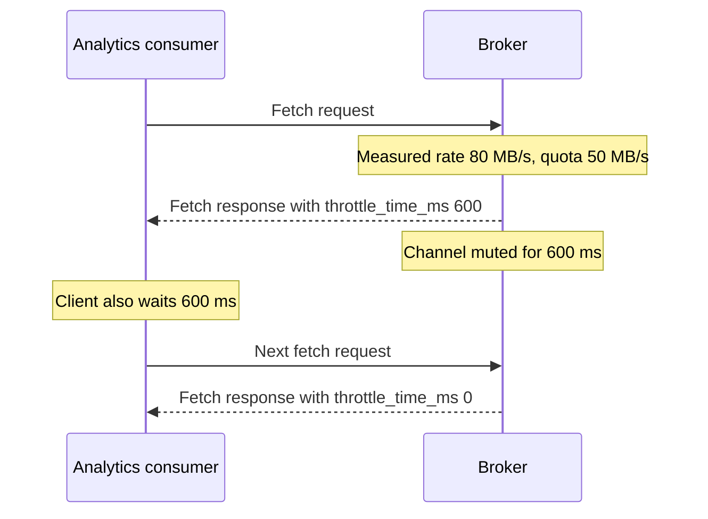

# Quotas and Multi-Tenancy

## Introduction

A shared Kafka cluster has a noisy-neighbor problem. One team starts a backfill that reads three years of history at full speed, broker network threads saturate, and the payments service's produce latency jumps from 5 ms to 2 seconds. Nobody did anything wrong in their own code; they just competed for the same brokers.

Quotas are Kafka's answer. They cap how much bandwidth or broker time a client may use, and when a client exceeds its quota the broker slows it down rather than rejecting it. Combined with authentication, ACLs and naming conventions, quotas turn one cluster into a safe shared platform for many teams.

After this page you will be able to:

- name the four kinds of client quota and what each protects;
- set quotas per user, per client ID, or both, with defaults for everyone else;
- understand how throttling works and how to spot it from the client side;
- design a multi-tenant cluster, and decide when separate clusters are the better answer.

## How Throttling Works

Kafka does not reject requests that exceed a quota. Instead, the broker computes how long the client must wait to bring its average rate back under the limit, returns that delay in the response's `throttle_time_ms` field, and mutes the client's connection for that long. Well-behaved clients also back off for the same period.

A toll booth on a highway is a good mental picture. Cars are not turned away; they are held at the gate long enough to keep the flow below what the road can handle.

Rates are measured over a sliding window: by default `quota.window.num=11` samples of `quota.window.size.seconds=1` each. Short bursts are absorbed; sustained overuse is throttled. Quotas are enforced per broker. A 10 MB/s producer quota on a six-broker cluster means 10 MB/s to each broker, so the client could reach 60 MB/s cluster-wide if its partitions are spread evenly.



Throttling is visible on the client. Java clients expose `produce-throttle-time-avg` and `produce-throttle-time-max` on producers and `fetch-throttle-time-avg` and `fetch-throttle-time-max` on consumers. On brokers, the `kafka.server:type=Produce`, `type=Fetch` and `type=Request` metric groups report throttle time per user and client ID. Alert on these, or a throttled client looks like a mysterious slowdown.

## The Four Kinds of Quota

| Quota key | Limits | Unit | Protects against |
| --- | --- | --- | --- |
| `producer_byte_rate` | Bytes produced | bytes per second, per broker | A producer flooding disks and replication |
| `consumer_byte_rate` | Bytes fetched | bytes per second, per broker | Backfills and replays saturating the network |
| `request_percentage` | Time on broker network and I/O threads | percent of one thread, per broker | Chatty clients sending many tiny requests, or expensive requests |
| `controller_mutation_rate` | Partitions created or deleted, and partition count increases | partitions per second | Scripts creating thousands of partitions and overloading the controller |

`request_percentage` deserves a closer look. A value of 100 means one full thread's worth of time across the network and I/O thread pools in each quota window. Byte-rate quotas cannot catch a client that sends ten thousand one-byte requests per second, but request quotas can.

Two more limits operate on connections rather than requests:

- `connection_creation_rate`, set per IP address, caps how fast one host can open connections. It protects brokers from a misbehaving client stuck in a reconnect loop.
- The broker settings `max.connections.per.ip` and `max.connections` cap the number of open connections.

## Quota Entities and Precedence

Quotas attach to a *user* principal, a *client ID* (the `client.id` setting on producers and consumers), or the combination. Each can also have a default that applies to anyone without a specific entry.

When a request arrives, the broker uses the most specific match, in this order:

1. user and client ID
2. user and default client ID
3. user only
4. default user and client ID
5. default user and default client ID
6. default user
7. client ID only
8. default client ID

User-based quotas are the reliable choice when authentication is enabled, because principals cannot be faked. Client IDs are set by the client and can be anything, so client-ID-only quotas are mostly useful on clusters without authentication, or for subdividing one user's quota between its applications.

## Setting Quotas

Quotas are dynamic and take effect within seconds, without restarts. Use `kafka-configs.sh` with an admin client configuration:

```bash
BS="--bootstrap-server kafka-1.example.com:9094 --command-config admin.properties"

# A safe default for every authenticated user: 20 MB/s in, 40 MB/s out, 50% of one thread
kafka-configs.sh $BS --alter --entity-type users --entity-default \
  --add-config 'producer_byte_rate=20971520,consumer_byte_rate=41943040,request_percentage=50'

# The analytics batch job may read at 50 MB/s per broker, no more
kafka-configs.sh $BS --alter --entity-type users --entity-name analytics-batch \
  --add-config 'consumer_byte_rate=52428800'

# The payments service is critical: give it generous limits
kafka-configs.sh $BS --alter --entity-type users --entity-name payments-writer \
  --add-config 'producer_byte_rate=104857600,request_percentage=200'

# Limit how fast anyone can create partitions
kafka-configs.sh $BS --alter --entity-type users --entity-default \
  --add-config 'controller_mutation_rate=10'

# One host may open at most 20 connections per second
kafka-configs.sh $BS --alter --entity-type ips --entity-default \
  --add-config 'connection_creation_rate=20'

# Inspect
kafka-configs.sh $BS --describe --entity-type users --entity-name analytics-batch
```

```text
Quota configs for user-principal 'analytics-batch' are consumer_byte_rate=5.24288E7
```

The same through the Admin API, useful when tenant onboarding is automated:

```java
import java.util.List;
import java.util.Map;
import java.util.Properties;
import org.apache.kafka.clients.admin.Admin;
import org.apache.kafka.common.quota.ClientQuotaAlteration;
import org.apache.kafka.common.quota.ClientQuotaEntity;

public class SetTenantQuota {
    public static void main(String[] args) throws Exception {
        Properties props = new Properties();
        props.load(SetTenantQuota.class.getResourceAsStream("/admin.properties"));

        try (Admin admin = Admin.create(props)) {
            ClientQuotaEntity tenant = new ClientQuotaEntity(
                Map.of(ClientQuotaEntity.USER, "team-search"));

            ClientQuotaAlteration alteration = new ClientQuotaAlteration(tenant, List.of(
                new ClientQuotaAlteration.Op("producer_byte_rate", 10.0 * 1024 * 1024),
                new ClientQuotaAlteration.Op("consumer_byte_rate", 30.0 * 1024 * 1024),
                // A null value removes the setting so the default applies again
                new ClientQuotaAlteration.Op("request_percentage", null)));

            admin.alterClientQuotas(List.of(alteration)).all().get();
        }
    }
}
```

:::tip
Replication traffic between brokers is not subject to client quotas. Throttling replication during reassignments is a separate feature, controlled by `leader.replication.throttled.rate` and `follower.replication.throttled.rate`, covered in [Partition Reassignment](../10-kafka-operations/3-kafka-partition-reassignment.mdx).
:::

## Designing a Multi-Tenant Cluster

Quotas are one ingredient. A cluster that serves many teams safely needs several working together.

**Identity per application.** Each application gets its own principal. That is the unit for ACLs, quotas and audit logs.

**Namespaces through naming.** Give each tenant a topic prefix (`search.`, `payments.`, `fraud.`) and a group prefix. Prefixed ACLs then grant a team everything under its prefix with two or three rules, and nothing outside it. See [Topic Design and Naming Conventions](../13-kafka-best-practices/0-kafka-topic-design.mdx).

**Defaults that protect, overrides that enable.** Set conservative default quotas for all users, so a new or forgotten client cannot hurt anyone. Raise limits deliberately for applications that need more, based on their measured traffic.

**Limits on structure.** Quotas do not limit how many topics or partitions a tenant owns, or how much disk they use. Control those through your provisioning process: topics created only through a pipeline that checks partition counts and `retention.bytes`, and ACLs that do not grant `CREATE` to applications.

**Capacity planning per tenant.** Sum the quotas. If the sum of all producer quotas is far beyond what the cluster can absorb, quotas only protect you from the single worst offender, not from everyone being busy at once.

### Shared Cluster or Separate Clusters?

| Factor | Shared cluster with quotas | Cluster per tenant or per domain |
| --- | --- | --- |
| Cost | Lower; better hardware utilization | Higher; each cluster has fixed overhead |
| Isolation | Logical; disk, page cache and controller are still shared | Physical; one tenant cannot affect another |
| Blast radius | A bad upgrade or broker failure hits everyone | Limited to one tenant |
| Operations | One cluster to upgrade and monitor | Many clusters; needs strong automation |
| Data sharing | Trivial; topics are in one place | Requires MirrorMaker 2 or a shared hub cluster |
| Compliance | Harder to prove separation | Easy to scope audits |

Most organizations end up with a handful of shared clusters split by criticality (for example "tier 1 transactional" and "analytics") rather than one giant cluster or one cluster per team.

## A Worked Scenario: The Nightly Backfill

A logistics company runs a shared cluster for shipment tracking. Every night at 01:00 the data science team replays the last 30 days of `tracking.events` to retrain a model. The replay reads at whatever speed the brokers allow, often 400 MB/s across the cluster. During the replay, the real-time tracking consumer's lag climbs to several minutes and customer-facing ETAs go stale.

Options considered:

- **Schedule the replay later.** It would still collide with the European morning peak.
- **Mirror the topic to an analytics cluster.** Clean isolation, but another cluster to run and pay for, for a two-hour job.
- **Quotas.** Cheap and immediate.

They chose quotas. The data science job authenticates as `User:ds-replay`; it got `consumer_byte_rate=20971520` (20 MB/s per broker, about 120 MB/s across six brokers). They also set a default user quota so that a new, unreviewed client cannot repeat the incident.

The replay now takes three hours instead of one, which the data science team accepted, and the tracking consumer's lag stays under five seconds. A Grafana panel shows `fetch-throttle-time-avg` for `ds-replay` so both teams can see the quota working. When the job later moved to reading from tiered storage, the platform team revisited the limit, since remote reads put less pressure on the page cache.

## Common Mistakes

- Setting quotas by client ID on an authenticated cluster; any client can pick another team's `client.id` to get its quota.
- Forgetting that quotas are per broker, and setting a "cluster-wide" number that is six times too generous.
- Having no default quota, so every new client is unlimited until it causes an incident.
- Not monitoring throttle time, so a throttled application is debugged for hours as a "slow Kafka" problem.
- Expecting quotas to limit disk usage or partition counts. They do not; control those through provisioning and topic configuration.
- Setting `request_percentage` very low for consumers that use many partitions, causing constant throttling even at low byte rates.

## Summary

- Quotas throttle clients that exceed their limits by delaying responses, rather than rejecting requests.
- Four client quotas exist: `producer_byte_rate`, `consumer_byte_rate`, `request_percentage` and `controller_mutation_rate`; `connection_creation_rate` limits connections per IP.
- Quotas apply per broker and attach to users, client IDs, or both, with the most specific match winning.
- Prefer user-based quotas when authentication is on; set safe defaults and raise limits deliberately.
- Multi-tenancy combines principals per application, prefix-based naming and ACLs, default quotas and controlled provisioning.
- Separate clusters give stronger isolation at higher cost; many organizations split by criticality.

## Further Reading

- [Kafka documentation: Quotas](https://kafka.apache.org/documentation/#design_quotas) - how quotas are measured and enforced.
- [KIP-13: Quotas](https://cwiki.apache.org/confluence/display/KAFKA/KIP-13+-+Quotas) - the original design of byte-rate throttling.
- [KIP-124: Request rate quotas](https://cwiki.apache.org/confluence/display/KAFKA/KIP-124+-+Request+rate+quotas) - the reasoning behind `request_percentage`.
- [KIP-599: Throttle Create Topic, Create Partition and Delete Topic Operations](https://cwiki.apache.org/confluence/display/KAFKA/KIP-599%3A+Throttle+Create+Topic%2C+Create+Partition+and+Delete+Topic+Operations) - `controller_mutation_rate`.
- [KIP-612: Ability to Limit Connection Creation Rate on Brokers](https://cwiki.apache.org/confluence/display/KAFKA/KIP-612%3A+Ability+to+Limit+Connection+Creation+Rate+on+Brokers) - connection rate quotas per IP.
