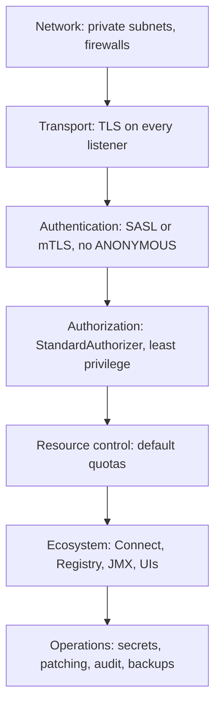

# Hardening Checklist for Production

## Introduction

The earlier pages in this section each covered one control: TLS, authentication, ACLs, quotas and secrets. A real security review asks a different question: is anything left open? Attackers do not go through the front door you secured; they go through the JMX port nobody remembered, the Kafka Connect REST API that accepts any connector config, or the test listener that was "only temporary".

This page is a checklist you can walk through before a cluster goes to production, and repeat after major changes. Each item says what to check, why it matters and how to verify it. By the end you will be able to:

- review a KRaft cluster layer by layer, from the network to the audit log;
- spot the ecosystem components (Connect, Schema Registry, UIs, JMX) that are open by default;
- turn the checklist into automated tests so the cluster stays hardened.

Think of it as a pilot's pre-flight checklist. Experienced pilots know every item by heart and still read the list, because the one item you skip is the one that fails.



## Network and Listeners

- [ ] **Brokers and controllers are in private subnets.** Only load balancers or bastions are public. Check: no broker has a public IP unless it serves an intentionally external listener.
- [ ] **Controller ports are reachable only from brokers and other controllers.** Clients never need the controller listener. Check: security groups or firewall rules for port 9093 (or your controller port) allow only node addresses.
- [ ] **No `PLAINTEXT` or `SASL_PLAINTEXT` listener remains.** Check: `listener.security.protocol.map` on every node lists only `SSL` and `SASL_SSL`.
- [ ] **`advertised.listeners` returns the intended hostnames** for each network. A wrong value leaks internal names or sends external clients to an unreachable address.
- [ ] **Connection limits are set**: `max.connections.per.ip` on brokers and a default `connection_creation_rate` quota, so one misbehaving host cannot exhaust file descriptors.

## Encryption

- [ ] **TLS 1.2 or 1.3 only**: `ssl.enabled.protocols=TLSv1.3,TLSv1.2`. Older versions should not appear anywhere.
- [ ] **Hostname verification is enabled** on clients and brokers. Check that nobody set `ssl.endpoint.identification.algorithm` to an empty string.
- [ ] **Certificates expire within a year, renew automatically, and expiry is monitored.** Alert at 30 days and again at 7.
- [ ] **Disk encryption is enabled** for log directories and metadata directories, through LUKS, cloud volume encryption or an encrypted file system. Kafka does not encrypt data at rest.
- [ ] **Highly sensitive fields are encrypted in the application** if broker operators must not see them.

## Authentication

- [ ] **Every listener authenticates**: `SASL_SSL` or `SSL` with `ssl.client.auth=required`. No listener produces `User:ANONYMOUS`, except deliberately for a read-only public feed.
- [ ] **`ssl.client.auth` is never `requested`**, which silently admits clients without certificates.
- [ ] **Controller and inter-broker listeners use mTLS** with dedicated principals (`User:kafka-controller`, `User:kafka-broker`).
- [ ] **No SASL/PLAIN with the default JAAS file of passwords.** If PLAIN is used, it is backed by a custom callback handler that checks an external store.
- [ ] **OAUTHBEARER uses `OAuthBearerValidatorCallbackHandler`** with a JWKS URL, expected issuer and audience, never the unsecured validator. `org.apache.kafka.sasl.oauthbearer.allowed.urls` lists only your identity provider.
- [ ] **`connections.max.reauth.ms` is set** (for example one hour) so revoked credentials stop working.
- [ ] **One principal per application**, no shared "apps" user.

## Authorization

- [ ] **`authorizer.class.name=org.apache.kafka.metadata.authorizer.StandardAuthorizer`** on every broker and controller.
- [ ] **`allow.everyone.if.no.acl.found=false`.** It is the default; make sure it was not left on after a migration.
- [ ] **`super.users` contains only broker, controller and break-glass admin principals.** Applications and humans in daily use are not super users.
- [ ] **No `ALL` on `TOPIC:*` or `CLUSTER`** for application principals. Check with `kafka-acls.sh --list` and search for wildcard resources.
- [ ] **Applications cannot create topics** unless that is a deliberate decision; topics come from a reviewed provisioning pipeline.
- [ ] **ACLs are stored as code** and reconciled automatically, so drift is visible in review.

A quick audit of wildcard grants:

```bash
kafka-acls.sh --bootstrap-server kafka-1.example.com:9094 \
  --command-config admin.properties --list \
  | grep -B2 -E "name=\*|operation=ALL" \
  | grep -E "ResourcePattern|principal="
```

## Broker and Topic Settings That Affect Safety

Some settings are not "security" in name but limit damage from mistakes and attacks.

| Setting | Hardened value | Why |
| --- | --- | --- |
| `auto.create.topics.enable` | `false` | A typo or a malicious client cannot create topics by producing to them |
| `delete.topic.enable` | `true`, with `DELETE` granted only to admins | Deletion controlled by ACLs, not a global switch |
| `unclean.leader.election.enable` | `false` | Avoids silent data loss when an out-of-sync replica becomes leader |
| `default.replication.factor` and `min.insync.replicas` | 3 and 2 | Topics survive a broker loss without losing acknowledged writes |
| `message.max.bytes` | Keep near the default (about 1 MB) unless needed | Huge records are a memory pressure and denial-of-service vector |
| `max.connections.per.ip` | Sized to your largest client host | Caps file descriptor use per host |

## Controllers and Metadata

- [ ] **Controllers run on dedicated nodes** (three or five) in production, so a compromised or overloaded broker process does not share a JVM with the quorum.
- [ ] **`early.start.listeners` contains only the controller listener**, the default, so nothing but super users is served before ACLs load.
- [ ] **Metadata directories are protected and backed up.** The metadata log contains ACLs, SCRAM credentials and configuration. Restrict file permissions to the Kafka service user.
- [ ] **`delegation.token.secret.key`**, if used, is a long random value delivered through a config provider, identical on brokers and controllers.

## The Ecosystem Around Kafka

This is where most real-world exposures happen.

- [ ] **Kafka Connect REST API is secured.** By default it listens on HTTP with no authentication, and anyone who can reach it can create a connector that reads files or connects anywhere the worker can. Use `listeners=https://...`, enable a REST extension for authentication (Kafka ships `BasicAuthSecurityRestExtension`), and keep the port private.
- [ ] **Connect restricts client overrides**: set `connector.client.config.override.policy` to `None` or `Principal` so connector configs cannot swap in other credentials.
- [ ] **Connect workers restrict config providers** with `allowed.paths`, or disable automatic providers with `-Dorg.apache.kafka.automatic.config.providers=none` when untrusted users submit configs.
- [ ] **Schema Registry requires authentication and TLS**, and write access to subjects is restricted. Anyone who can register an incompatible schema, or change compatibility to `NONE`, can break every consumer.
- [ ] **Web UIs (Kafka UI, AKHQ, Redpanda Console, Kafdrop) sit behind SSO**, connect with their own read-only principal, and are not exposed to the internet.
- [ ] **JMX is not open.** Setting `JMX_PORT` without authentication exposes an interface that can invoke operations on the JVM. Prefer a Prometheus JMX exporter running as a Java agent on localhost, scraped over TLS (see [Prometheus](/docs/observability/prometheus)).
- [ ] **MirrorMaker 2 and Streams apps follow the same rules**: own principals, least-privilege ACLs, credentials from config providers.

:::warning
Run a port scan of your own Kafka subnet from a normal application host. Every open port you do not recognize, typically 8083 (Connect), 8081 (Schema Registry), 9999 (JMX) or a UI on 8080, is a finding.
:::

## Operations

- [ ] **Patch promptly.** Subscribe to the Apache Kafka security announcements and CVE list. Several recent issues (SSRF through OAuth URLs, file reads through config providers, JNDI login modules in Connect) were fixed by upgrades plus new default-deny system properties.
- [ ] **Secrets come from config providers**, Kubernetes Secrets or Vault, never from property files in Git or container images.
- [ ] **The authorizer log is shipped and alerted on.** Configure `kafka.authorizer.logger` in the broker's log4j2 configuration to write to its own file, collect it centrally, and alert on spikes of `Denied`.
- [ ] **Audit admin actions**: who created, deleted or altered topics, ACLs and quotas. If you run Kafka yourself, wrap admin access in a pipeline that logs every change.
- [ ] **Run Kafka as an unprivileged user** with a restrictive umask, on a minimal OS image, and with SSH access limited to a bastion.
- [ ] **Backups and disaster recovery are tested**, including restoring ACLs and SCRAM users. See [Backup and Recovery Strategies](../10-kafka-operations/8-kafka-backup-and-recovery.mdx).

## Automating the Checklist

A checklist on a wiki decays. Turn items into automated checks that run in CI and on a schedule. A small Python script using `confluent-kafka` can verify several of them:

```python
"""Fail CI if the cluster drifts from the hardening baseline."""
import os
import sys
from confluent_kafka.admin import (AdminClient, AclBindingFilter, ResourceType,
                                   ResourcePatternType, AclOperation, AclPermissionType,
                                   ConfigResource)

admin = AdminClient({
    "bootstrap.servers": os.environ["KAFKA_BOOTSTRAP"],
    "security.protocol": "SASL_SSL",
    "sasl.mechanism": "SCRAM-SHA-512",
    "sasl.username": "security-auditor",
    "sasl.password": os.environ["KAFKA_PASSWORD"],
    "ssl.ca.location": "/etc/audit/ca.crt",
})
problems = []

# 1. No ALLOW ACL with operation ALL on wildcard resources
match_all = AclBindingFilter(ResourceType.ANY, None, ResourcePatternType.ANY,
                             None, None, AclOperation.ANY, AclPermissionType.ANY)
for acl in admin.describe_acls(match_all).result():
    if acl.name == "*" and acl.operation == AclOperation.ALL \
            and acl.permission_type == AclPermissionType.ALLOW:
        problems.append(f"Wildcard ALL grant: {acl}")

# 2. Risky broker settings on every broker
brokers = admin.list_topics(timeout=10).brokers
resources = [ConfigResource(ConfigResource.Type.BROKER, str(b)) for b in brokers]
for res, fut in admin.describe_configs(resources).items():
    cfg = fut.result()
    for key, bad in [("auto.create.topics.enable", "true"),
                     ("allow.everyone.if.no.acl.found", "true"),
                     ("unclean.leader.election.enable", "true")]:
        if key in cfg and cfg[key].value == bad:
            problems.append(f"Broker {res.name}: {key}={bad}")

for p in problems:
    print("FAIL", p)
sys.exit(1 if problems else 0)
```

```text
FAIL Broker 2: auto.create.topics.enable=true
```

Combine this with infrastructure tests (port scans, certificate expiry checks) and you will hear about drift from a failing job instead of from an incident.

## A Worked Scenario: The Pre-Launch Review

A health-tech startup is about to put patient appointment events on Kafka, which brings HIPAA obligations. The platform team spent a day walking this checklist against their staging cluster, which had been built months earlier from a tutorial.

Findings, in the order they discovered them:

1. The Docker Compose-derived configuration still had a `PLAINTEXT` listener on 9092 alongside `SASL_SSL` on 9094. Two services still used it.
2. Kafka Connect's REST API on port 8083 was reachable from the whole VPC with no authentication.
3. A Kafka UI deployment connected as `platform-admin`, a super user, and was exposed through an internal ingress without SSO.
4. `allow.everyone.if.no.acl.found=true` had been set during setup and never removed.
5. JMX was open on port 9999 for a monitoring agent.
6. EBS volumes were encrypted, but the metadata directory sat on an unencrypted root volume.

They fixed each item, then encoded the checks into a nightly job like the one above. The alternative, buying a managed Kafka service that handles most of this by default, was considered and remains on the roadmap; but they would still have needed items 2, 3 and 4 because Connect, the UI and ACLs remain their responsibility on any managed service.

## Common Mistakes

- Securing brokers carefully and forgetting Connect, Schema Registry, UIs and JMX, which are open by default.
- Treating the checklist as a one-time task instead of an automated, recurring check.
- Giving tools and UIs super-user credentials for convenience.
- Leaving "temporary" settings from a migration, such as `allow.everyone.if.no.acl.found=true` or a `PLAINTEXT` listener.
- Skipping upgrades for months; several Kafka CVEs are fixed only by upgrading and adopting new defaults.
- Relying on disk encryption alone for sensitive data that broker operators should not read.

## Summary

- Review security in layers: network, encryption, authentication, authorization, resource control, ecosystem and operations.
- Every listener, including controller and inter-broker, needs TLS and authentication; remove `PLAINTEXT` entirely.
- Use `StandardAuthorizer` everywhere with default deny and a short `super.users` list.
- Harden broker defaults that limit damage: no auto topic creation, no unclean leader election, sensible replication.
- The ecosystem (Connect REST, Schema Registry, UIs, JMX) is where many real exposures happen; secure each one.
- Automate the checklist so drift is caught by a failing job, and patch Kafka promptly.

## Further Reading

- [Kafka documentation: Security](https://kafka.apache.org/documentation/#security) - the reference for every control covered in this section.
- [Apache Kafka CVE list](https://kafka.apache.org/community/cve-list/) - published vulnerabilities and the versions that fix them.
- [Kafka documentation: Connect REST API security](https://kafka.apache.org/documentation/#connect_rest) - HTTPS listeners and REST extensions for Kafka Connect.
- [KIP-507: Securing Internal Connect REST Endpoints](https://cwiki.apache.org/confluence/display/KAFKA/KIP-507%3A+Securing+Internal+Connect+REST+Endpoints) - how Connect workers authenticate to each other.
- [Deploying and Operating Connect](../8-kafka-connect/4-kafka-connect-deployment.mdx) - running Connect workers securely in production.
