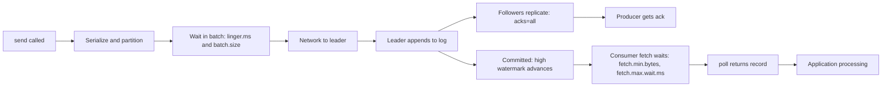

# Throughput, Latency and the Trade-Offs Between Them

## Introduction

"Make Kafka faster" is not a useful request until you say which kind of fast you mean. A clickstream pipeline wants to move as many bytes per second as possible and does not care whether an event lands 50 milliseconds later. A fraud check on a card payment wants each event delivered in a few milliseconds and handles a modest volume. The same cluster can serve both, but the client settings that suit one hurt the other.

Kafka's performance model is simple once you see it: almost every knob decides how much work to group together before doing it. Bigger groups mean fewer requests, less overhead per record and more throughput. Waiting to form a bigger group costs time. Every tuning decision in this section is a variation on that theme.

This page gives you the vocabulary and the mental model the rest of the section builds on. By the end you will be able to:

- Define throughput and latency precisely, including which latency you are measuring.
- Break end-to-end latency into its stages and name the setting that controls each one.
- Explain why a saturated system has worse latency than a well-batched one, and use that to pick settings.
- Choose a starting configuration for a throughput-first or latency-first workload.

## Two Numbers, Several Definitions

**Throughput** is how much data moves per unit of time. Kafka people quote it two ways: records per second and megabytes per second. Prefer megabytes per second for capacity planning, because brokers spend their effort on bytes (disk writes, network copies, replication), not on record counts. Ten thousand 100-byte records and one thousand 1 KB records cost about the same.

**Latency** is how long something takes, and there are at least three latencies worth separating:

| Latency | Starts | Ends | Who sees it |
|---|---|---|---|
| Produce latency | `send()` is called | The producer receives the broker acknowledgement | The producing service, for example an HTTP request waiting on a write |
| End-to-end latency | `send()` is called | A consumer's `poll()` returns the record | The business: "how stale is the dashboard?" |
| Processing latency | `poll()` returns | The consumer finishes its side effect and commits | The consumer team; usually the biggest number |

`kafka-producer-perf-test.sh` reports produce latency. Kafka's own metrics report pieces of all three. When someone says "Kafka is slow", the first question is which of these they measured.

**Report percentiles, not averages.** An average of 5 ms can hide a 99th percentile of 400 ms, and the users who hit the 400 ms are the ones who complain. Track p50, p99 and p99.9, and the maximum during incidents.

## Where End-to-End Time Goes

A record passes through a series of stages, and each one has a setting that decides how long it can wait there.



Walking through it:

1. **Batching on the producer.** Records for the same partition are collected into a batch. The producer sends a batch when it reaches `batch.size` bytes (default 16384) or when `linger.ms` has passed (default 5 ms since Kafka 4.0; it was 0 before). This is deliberate waiting traded for efficiency.
2. **Network and broker append.** The batch travels to the partition leader, which appends it to the log. This is usually under a millisecond on a healthy cluster, because the write goes to the operating system's page cache rather than straight to disk.
3. **Replication.** With `acks=all` (the default), the leader waits for every in-sync follower to copy the batch before acknowledging. This adds roughly one follower fetch round trip, typically a few milliseconds within one data center and more across availability zones.
4. **Becoming visible.** Consumers can only read records below the high watermark, the offset every in-sync replica has. So even with `acks=1`, a consumer does not see a record until replication catches up. Lowering `acks` speeds up the producer's acknowledgement, not end-to-end latency.
5. **Consumer fetch.** A fetch request returns when at least `fetch.min.bytes` is available (default 1 byte) or `fetch.max.wait.ms` passes (default 500 ms). With the defaults, a fetch returns as soon as anything arrives.
6. **Processing.** Whatever your code does with the record. In real systems this dominates: a database insert is often slower than everything Kafka did before it.

:::note
Point 4 surprises many people. `acks=1` does not make your consumers see data sooner; it only lets the producer stop waiting sooner, at the price of losing acknowledged records if the leader dies before followers copy them.
:::

## Why Batching Usually Wins Both

Here is the counter-intuitive part. You might expect that sending each record immediately gives the lowest latency. That is only true when the system is lightly loaded.

Every request has a fixed cost: a network round trip, a header, a pass through the broker's request queue, a disk append, a replication fetch. If you send 200,000 one-record requests per second, the fixed cost is paid 200,000 times. Brokers and clients run out of threads, requests queue up, and queuing time grows much faster than the load. Latency explodes not because any one step is slow but because records wait in line.

Think of a ferry. If the ferry leaves as soon as one car arrives, the first car crosses quickly, but at rush hour cars queue for hours because the ferry spends all its time on trips with one car aboard. If the ferry waits up to five minutes or until it is full, every car waits a little, but the queue never builds.

A real run on one Kafka 4.3 broker shows the effect. Both tests sent one million 1 KB records as fast as possible; the second only used bigger batches, a longer linger and compression:

```bash
# Defaults: batch.size=16384, linger.ms=5
kafka-producer-perf-test.sh --bootstrap-server localhost:9092 --topic perf-test \
  --num-records 1000000 --record-size 1024 --throughput -1 --command-property acks=all
```

```text
1000000 records sent, 210260.723297 records/sec (205.33 MB/sec), 58.19 ms avg latency, 479.00 ms max latency, 1 ms 50th, 243 ms 95th, 426 ms 99th, 474 ms 99.9th.
```

```bash
# Bigger batches, longer linger, lz4 compression
kafka-producer-perf-test.sh --bootstrap-server localhost:9092 --topic perf-test \
  --num-records 1000000 --record-size 1024 --throughput -1 \
  --command-property acks=all linger.ms=20 batch.size=131072 compression.type=lz4
```

```text
1000000 records sent, 212224.108659 records/sec (207.25 MB/sec), 1.14 ms avg latency, 317.00 ms max latency, 1 ms 50th, 2 ms 95th, 16 ms 99th, 39 ms 99.9th.
```

Same throughput, but the p99 dropped from 426 ms to 16 ms. With 16 KB batches the producer was saturated, and records spent most of their time queued in its buffer. Larger batches cleared the queue. The `linger.ms=20` setting did not add 20 ms, because at this load batches filled long before the timer expired.

The lesson: **linger.ms is a ceiling, not a delay.** Under load, batches fill by size; the timer only matters when traffic is light.

## Little's Law: Sizing the Pipeline

One formula from queuing theory explains many Kafka limits:

```text
records in flight = throughput x latency
```

If a consumer must process 5,000 records per second and each record takes 20 ms, then 100 records are being worked on at any moment. One thread doing one record at a time handles only 50 per second, so you need 100 units of concurrency: partitions, threads, or asynchronous calls.

The same law applies to the producer. With at most 5 in-flight requests per connection (`max.in.flight.requests.per.connection`, default 5) and a 10 ms round trip to a broker, one connection carries at most 500 requests per second. If each request holds one tiny batch, throughput is capped. If each holds a 128 KB batch per partition, the same 500 requests carry much more. Batching is how you get throughput without unlimited concurrency.

## Throughput-First vs Latency-First

Most workloads fall clearly on one side. Pick a starting profile, then measure.

| Setting | Throughput-first (clickstream, logs, telemetry) | Latency-first (payments, alerts, user-facing) |
|---|---|---|
| `linger.ms` | 10-100 | 0-5 (default 5) |
| `batch.size` | 64 KB-1 MB | 16-64 KB |
| `compression.type` | `lz4` or `zstd` | `lz4` or `none` |
| `acks` | `all` (keep it; the cost is small) | `all` |
| `fetch.min.bytes` (consumer) | 64 KB-1 MB | 1 (default) |
| `fetch.max.wait.ms` (consumer) | 100-500 | 100-500 (only matters with larger `fetch.min.bytes`) |
| `max.poll.records` (consumer) | 1000-5000 with batch processing | 100-500 |
| Partitions | Enough for consumer parallelism | Enough for consumer parallelism; avoid huge counts that thin batches |

Notice that durability (`acks=all`) stays the same in both columns. Giving up durability to gain speed is a separate decision, covered in [acks, min.insync.replicas and Durability](../3-kafka-producers/2-kafka-producer-acks-and-durability.mdx), and is rarely worth it.

## Worked Scenario: A Store With Two Kinds of Traffic

An online store publishes two event streams to the same three-broker cluster:

- **Clickstream:** page views and searches, about 40,000 events per second at peak, average 800 bytes as JSON. Used for analytics dashboards that refresh every minute.
- **Payments:** about 300 authorizations per second, 1.5 KB each. The checkout page waits for a fraud score that depends on a Kafka round trip.

The team first ran both producers with default settings. The clickstream producer pushed 32 MB/s uncompressed, made tens of thousands of small requests per second, and drove broker request handler idle time down to 30 percent. Payment events, sharing those request handlers, saw p99 end-to-end latency jump to 120 ms during traffic spikes.

The fix was not to touch the payments producer at all. The team changed the clickstream producer:

```properties
# clickstream-producer.properties
linger.ms=50
batch.size=262144
compression.type=zstd
acks=all
```

JSON clickstream compressed to about a quarter of its size, so 32 MB/s became 8 MB/s on the wire and on disk. Requests per second fell by more than an order of magnitude. Request handler idle time returned to 80 percent, and payment p99 went back to 15 ms.

The payments producer kept `linger.ms=5` and `batch.size=16384`. At 300 records per second there is little to batch anyway, so the defaults are already latency-friendly.

The alternative they considered was a separate cluster for payments. That isolates the workloads completely but doubles the operational work. Fixing the noisy neighbour was cheaper; they kept a separate cluster as a later option, together with [quotas](../11-kafka-security/4-kafka-quotas.mdx) to cap any one client.

## Common Mistakes

- Measuring average latency only. Averages hide the tail that users feel; always look at p99 and p99.9.
- Setting `linger.ms=0` "for low latency" on a busy producer. Under load this creates tiny batches, queues requests and makes latency worse.
- Lowering `acks` to speed up consumers. It only shortens the producer's wait; consumers still wait for replication.
- Tuning Kafka when the consumer's own processing is the bottleneck. Check processing time per record before touching fetch settings.
- Quoting records per second without record size. A benchmark at 100-byte records says nothing about 10 KB records.
- Benchmarking on a laptop and applying the numbers to production. Disks, network and replication across zones change everything.

## Summary

- Throughput is best measured in MB/s; latency must name its start and end points and be reported as percentiles.
- End-to-end latency is the sum of producer batching, network, append, replication, consumer fetch and processing; each stage has its own setting.
- Batching trades a small, bounded wait for much lower overhead per record. Under load it lowers latency as well as raising throughput.
- `linger.ms` is an upper bound on waiting; busy producers fill batches by size first. Its default is 5 ms since Kafka 4.0.
- Keep `acks=all` in both throughput and latency profiles; tune batching, compression and fetch sizes instead.
- Little's Law (in flight = throughput x latency) tells you how much concurrency a stage needs.

## Further Reading

- [Apache Kafka documentation: Design, Efficiency](https://kafka.apache.org/documentation/#maximizingefficiency) - why Kafka batches, uses the page cache and zero-copy transfer.
- [Producer configuration reference](https://kafka.apache.org/documentation/#producerconfigs) - authoritative defaults for `linger.ms`, `batch.size` and friends.
- [KIP-1030: Change constraints and default values for various configurations](https://cwiki.apache.org/confluence/display/KAFKA/KIP-1030%3A+Change+constraints+and+default+values+for+various+configurations) - the change of the `linger.ms` default from 0 to 5 in Kafka 4.0.
- [Tuning Producers](./1-kafka-producer-tuning.mdx) and [Tuning Consumers](./2-kafka-consumer-tuning.mdx) - the next pages, setting by setting.
- [Benchmarking with kafka-producer-perf-test and kafka-consumer-perf-test](./5-kafka-benchmarking.mdx) - how the numbers above were produced.
