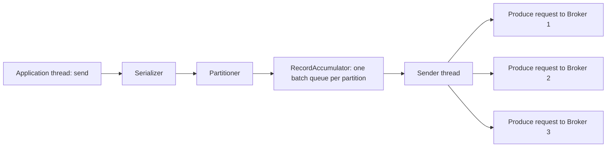

# Tuning Producers

## Introduction

The producer is where most Kafka performance is won or lost. A well-tuned producer can push hundreds of megabytes per second through a modest cluster; a badly tuned one can overload brokers with tiny requests while delivering a fraction of that. The good news is that a handful of settings matter, and the producer reports metrics that tell you exactly which one is the bottleneck.

This page assumes you know what a producer does (see [Producer Basics](../3-kafka-producers/0-kafka-producer-basics.mdx)) and that you have read [Throughput, Latency and the Trade-Offs Between Them](./0-kafka-performance-fundamentals.mdx). By the end you will be able to:

- Explain how a record moves through the producer's accumulator, sender thread and network layer.
- Pick `batch.size`, `linger.ms`, compression and `buffer.memory` for a workload.
- Read producer metrics such as `batch-size-avg`, `record-queue-time-avg` and `bufferpool-wait-ratio` and know what to change.
- Avoid the settings that look like optimizations but trade away safety.

All defaults quoted here are from the Kafka 4.3 Java client (`org.apache.kafka:kafka-clients`). The librdkafka-based clients (Python `confluent-kafka`, .NET, `@confluentinc/kafka-javascript`) use mostly the same names, with some different defaults; check their configuration pages.

## Inside the Producer

When you call `send()`, the record is not sent. It is serialized, assigned a partition and appended to an in-memory batch for that partition. A background sender thread drains ready batches, groups the batches headed to the same broker into one produce request, and sends it.



Three consequences follow:

1. **Batches are per partition.** If you spread 10,000 records per second over 1,000 partitions, each partition gets 10 records per second and batches stay tiny. Partition count affects producer efficiency.
2. **Requests are per broker.** One produce request carries batches for many partitions led by the same broker, so fewer, larger requests are possible even with many partitions.
3. **Memory is bounded.** All pending batches live in a pool of `buffer.memory` bytes. When it is full, `send()` blocks for up to `max.block.ms` and then throws.

## The Settings That Matter

| Setting | Default (4.3) | What it controls | Typical tuned range |
|---|---|---|---|
| `batch.size` | 16384 (16 KB) | Maximum bytes per partition batch | 64 KB-1 MB for throughput |
| `linger.ms` | 5 | Maximum wait for a batch to fill | 0-5 latency, 10-100 throughput |
| `compression.type` | `none` | Codec applied per batch | `lz4` or `zstd` |
| `compression.zstd.level` / `compression.lz4.level` / `compression.gzip.level` | 3 / 9 / -1 | Codec effort, added in Kafka 3.8 | Usually leave at default |
| `buffer.memory` | 33554432 (32 MB) | Total memory for unsent batches | 64-256 MB for fast producers |
| `max.in.flight.requests.per.connection` | 5 | Unacknowledged requests per broker | 5 (the idempotent maximum) |
| `acks` | `all` | Replicas that must confirm a write | Keep `all` |
| `enable.idempotence` | `true` | Duplicate-free retries | Keep `true` |
| `max.request.size` | 1048576 (1 MB) | Largest request and largest single record | Raise only with broker and topic limits |
| `delivery.timeout.ms` | 120000 | Total time a record may take, including retries | Keep; set an upper bound on retrying |
| `partitioner.adaptive.partitioning.enable` | `true` | Steers keyless records away from slow brokers | Keep `true` |

### batch.size and linger.ms

These two work together. A batch is sent when it is full or when it has waited `linger.ms`, whichever comes first. Raising `batch.size` alone does nothing on a lightly loaded producer, because the timer fires first. Raising `linger.ms` alone does nothing on a busy producer, because batches fill first.

A practical approach:

- Start from the expected per-partition rate. At 2,000 records per second per partition with 1 KB records, 2 MB arrive per second, so a 128 KB batch fills in about 64 ms. Pick `linger.ms` around the time a batch should take to fill under normal load.
- Set `batch.size` large enough that it is rarely the limit at peak. Memory is allocated in `batch.size` chunks per active partition, so 1 MB batches across 500 partitions want 500 MB of `buffer.memory`. Keep the product reasonable.

The default `linger.ms` changed from 0 to 5 in Kafka 4.0 (KIP-1030), because a few milliseconds of linger improves efficiency for nearly everyone. If you upgraded from 3.x and pinned `linger.ms=0` long ago, revisit that.

### Compression

Compression happens once per batch on the producer, and brokers store the compressed batch as is (as long as the topic's `compression.type` is `producer`, the default). Consumers decompress. So compression saves producer network, broker disk, replication traffic and consumer network, at the cost of producer and consumer CPU.

| Codec | Speed | Ratio | Notes |
|---|---|---|---|
| `lz4` | Very fast | Good | The safe default choice for most workloads |
| `zstd` | Fast | Best | Best ratio per CPU; great for JSON and logs |
| `snappy` | Very fast | Fair | Older choice; lz4 usually matches or beats it |
| `gzip` | Slow | Good | Avoid for high throughput; CPU heavy |

Larger batches compress better, because the codec sees more repeated structure. That is another reason to batch. Small batches of 1 or 2 records gain little from compression.

:::tip
Set compression on the producer, not only on the topic. If a topic sets `compression.type=zstd` and the producer sends uncompressed batches, the broker has to compress every batch itself, spending broker CPU that is shared by every client and much more precious than producer CPU.
:::

### buffer.memory and max.block.ms

`buffer.memory` is the producer's shock absorber. If brokers slow down briefly, records pile up here instead of blocking your application. When it fills, `send()` blocks. Watch `bufferpool-wait-ratio`: any value above zero means application threads are waiting for buffer space. Either raise `buffer.memory`, raise throughput (bigger batches, compression), or accept back-pressure.

### In-flight requests, acks and idempotence

With idempotence enabled (the default since Kafka 3.0), the producer can keep up to 5 requests in flight per broker without reordering records on retry. There is no reason to lower it for ordering anymore, and raising it above 5 is not allowed with idempotence.

It is tempting to set `acks=1` for speed. In a healthy cluster within one data center, `acks=all` usually costs a few milliseconds of produce latency and little throughput, because the producer pipelines several requests. The risk with `acks=1` is losing acknowledged records when a leader fails. Keep `acks=all` unless losing data is genuinely acceptable.

## Configuring a High-Throughput Producer in Java

This producer is tuned for a telemetry stream. It enables `lz4`, larger batches and a larger buffer, and logs the metrics that show whether the tuning worked.

```java
import org.apache.kafka.clients.producer.KafkaProducer;
import org.apache.kafka.clients.producer.ProducerConfig;
import org.apache.kafka.clients.producer.ProducerRecord;
import org.apache.kafka.common.Metric;
import org.apache.kafka.common.MetricName;
import org.apache.kafka.common.serialization.StringSerializer;

import java.util.Map;
import java.util.Properties;
import java.util.Set;

public class TelemetryProducer {
    public static void main(String[] args) {
        Properties props = new Properties();
        props.put(ProducerConfig.BOOTSTRAP_SERVERS_CONFIG, "localhost:9092");
        props.put(ProducerConfig.KEY_SERIALIZER_CLASS_CONFIG, StringSerializer.class.getName());
        props.put(ProducerConfig.VALUE_SERIALIZER_CLASS_CONFIG, StringSerializer.class.getName());

        // Throughput tuning
        props.put(ProducerConfig.LINGER_MS_CONFIG, 20);               // wait up to 20 ms for a batch to fill
        props.put(ProducerConfig.BATCH_SIZE_CONFIG, 128 * 1024);      // 128 KB per partition batch
        props.put(ProducerConfig.COMPRESSION_TYPE_CONFIG, "lz4");
        props.put(ProducerConfig.BUFFER_MEMORY_CONFIG, 128L * 1024 * 1024); // 128 MB shock absorber

        // Safety stays at the defaults, written out for clarity
        props.put(ProducerConfig.ACKS_CONFIG, "all");
        props.put(ProducerConfig.ENABLE_IDEMPOTENCE_CONFIG, true);

        try (KafkaProducer<String, String> producer = new KafkaProducer<>(props)) {
            for (int i = 0; i < 1_000_000; i++) {
                String sensorId = "sensor-" + (i % 5000);
                String json = "{\"sensor\":\"" + sensorId + "\",\"temp\":" + (20 + i % 15) + "}";
                producer.send(new ProducerRecord<>("telemetry", sensorId, json), (md, ex) -> {
                    if (ex != null) {
                        System.err.println("Send failed: " + ex.getMessage());
                    }
                });
            }
            producer.flush();
            printMetrics(producer.metrics());
        }
    }

    private static void printMetrics(Map<MetricName, ? extends Metric> metrics) {
        Set<String> wanted = Set.of("batch-size-avg", "records-per-request-avg", "record-queue-time-avg",
                "compression-rate-avg", "bufferpool-wait-ratio", "request-latency-avg");
        metrics.forEach((name, metric) -> {
            if (name.group().equals("producer-metrics") && wanted.contains(name.name())) {
                System.out.printf("%-25s %s%n", name.name(), metric.metricValue());
            }
        });
    }
}
```

Output from a run against a single local Kafka 4.3 broker with a 12-partition `telemetry` topic:

```text
record-queue-time-avg     24.012861736334404
compression-rate-avg      0.29185276361140405
batch-size-avg            49208.31511254019
bufferpool-wait-ratio     0.0
records-per-request-avg   38461.53846153846
request-latency-avg       14.884615384615385
```

Read it like this: batches average about 48 KB of the 128 KB allowed, and records waited about 24 ms in the accumulator, slightly more than `linger.ms`, so the timer rather than the size limit usually closed a batch; compression shrank the JSON to 29 percent of its original size; nobody waited on the buffer (`bufferpool-wait-ratio` is 0). The huge `records-per-request-avg` is a single-broker artefact: all 12 partitions share one leader, so one request carries every partition's batch. On a real cluster with several brokers it is much smaller.

The equivalent with `confluent-kafka` in Python, which uses librdkafka names for a few settings:

```python
from confluent_kafka import Producer

producer = Producer({
    "bootstrap.servers": "localhost:9092",
    "linger.ms": 20,
    "batch.size": 131072,          # bytes per partition batch
    "compression.type": "lz4",
    "acks": "all",
    "enable.idempotence": True,
    "queue.buffering.max.kbytes": 131072,  # librdkafka's local queue limit, in KB
})

for i in range(100_000):
    producer.produce("telemetry", key=f"sensor-{i % 5000}", value=f'{{"temp": {20 + i % 15}}}')
    producer.poll(0)  # serve delivery callbacks without blocking

producer.flush()
```

## Reading Producer Metrics

The producer exposes metrics through JMX (group `kafka.producer`, type `producer-metrics`) and through `producer.metrics()`. These six answer most tuning questions.

| Metric | Healthy sign | If it looks bad |
|---|---|---|
| `batch-size-avg` | Close to `batch.size` under load | Far below: raise `linger.ms`, or too many partitions per producer |
| `records-per-request-avg` | Tens to thousands | Near 1: batching is not happening |
| `record-queue-time-avg` | Near `linger.ms` or below | Much higher: producer is saturated; raise `batch.size`, compress, or add brokers |
| `compression-rate-avg` | 0.2-0.6 for text | Near 1.0: data is already compressed or batches are tiny |
| `bufferpool-wait-ratio` | 0 | Above 0: `send()` is blocking; raise `buffer.memory` or throughput |
| `request-latency-avg` | A few ms | High: broker or network problem, look at broker metrics |

The perf-test tool can print all of these with `--print-metrics`; the [benchmarking page](./5-kafka-benchmarking.mdx) shows how.

## Worked Scenario: A Fleet of Sensors

A logistics company has 50,000 refrigerated trucks. Each sends a 600-byte JSON reading every 2 seconds, keyed by truck ID: 25,000 records per second, about 15 MB/s. The topic has 48 partitions on a three-broker cluster.

With default settings the team saw:

- `batch-size-avg` around 3 KB: 25,000 records over 48 partitions is about 520 records per second per partition, so a 5 ms linger collects only 2 or 3 records.
- `records-per-request-avg` around 40 and roughly 600 produce requests per second per broker.
- No compression, so the full 15 MB/s, multiplied by 3 for replication, hit the brokers.

The readings feed a dashboard refreshed every 10 seconds and an alerting job that must fire within 5 seconds of a temperature excursion. Latency budget per stage is generous, so the team chose throughput:

```properties
linger.ms=50
batch.size=131072
compression.type=zstd
buffer.memory=67108864
```

After the change, batches averaged 18 KB (each partition now collects about 26 records in 50 ms), `compression-rate-avg` settled at 0.18, and broker network ingress fell from 15 MB/s to under 3 MB/s. Produce requests dropped by about 85 percent. End-to-end p99 rose from 12 ms to 70 ms, comfortably inside the 5-second alert budget.

The alternative was adding brokers to absorb the request rate. That would have cost three more machines; the configuration change cost nothing.

## Common Mistakes

- Raising `batch.size` without raising `linger.ms` on a low-volume producer, then concluding batching does not help.
- Creating a new `KafkaProducer` per request or per message. Producers are thread-safe and expensive to create; share one per application.
- Calling `send().get()` for every record. It turns the asynchronous producer into a synchronous one with one record per request. Use callbacks.
- Setting `acks=0` or `acks=1` for speed without accepting the data loss that comes with it.
- Lowering `max.in.flight.requests.per.connection` to 1 "for ordering". Idempotence already keeps order with up to 5.
- Compressing on the broker instead of the producer, which moves CPU cost to the most shared resource.
- Ignoring `bufferpool-wait-ratio` and then wondering why application threads stall during broker hiccups.

## Summary

- Records are batched per partition and sent per broker by a background sender thread.
- `batch.size` (default 16 KB) and `linger.ms` (default 5 ms in 4.x) together decide batch size; under load size wins, under light load time wins.
- Compress on the producer with `lz4` or `zstd`; bigger batches compress better.
- `buffer.memory` absorbs broker slowdowns; a non-zero `bufferpool-wait-ratio` means `send()` is blocking.
- Keep `acks=all`, idempotence and 5 in-flight requests; they cost little and prevent loss and duplicates.
- Let `batch-size-avg`, `records-per-request-avg` and `record-queue-time-avg` guide changes instead of guessing.

## Further Reading

- [Producer configuration reference](https://kafka.apache.org/documentation/#producerconfigs) - every producer setting with its current default.
- [Producer monitoring metrics](https://kafka.apache.org/documentation/#producer_monitoring) - the full list of producer metrics and their meaning.
- [KIP-390: Support compression level](https://cwiki.apache.org/confluence/display/KAFKA/KIP-390%3A+Support+Compression+Level) - the per-codec level settings added in Kafka 3.8.
- [KIP-794: Strictly uniform sticky partitioner](https://cwiki.apache.org/confluence/display/KAFKA/KIP-794%3A+Strictly+Uniform+Sticky+Partitioner) - how keyless records are spread and steered away from slow brokers.
- [Batching, Linger and Compression](../3-kafka-producers/4-kafka-producer-batching-and-compression.mdx) - the producer-section deep dive on the same mechanics.
- [librdkafka configuration](https://github.com/confluentinc/librdkafka/blob/master/CONFIGURATION.md) - defaults for Python, .NET and Node clients built on librdkafka.
