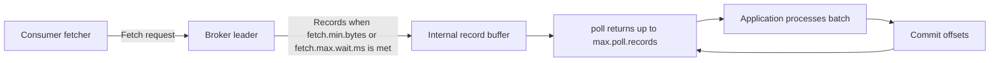

# Tuning Consumers

## Introduction

When a Kafka pipeline falls behind, the consumer is the usual suspect, and the fetch settings are almost never the real reason. A single consumer can pull hundreds of megabytes per second from a broker. What it cannot do is insert hundreds of thousands of rows per second into a database one row at a time. Consumer tuning is therefore two jobs: making fetches efficient, and making processing fast enough to keep up with them.

This page covers both. By the end you will be able to:

- Explain how `poll()`, the fetcher and the fetch settings interact.
- Choose `fetch.min.bytes`, `fetch.max.wait.ms`, `max.partition.fetch.bytes` and `max.poll.records` for a workload.
- Speed up processing with batching and with concurrency beyond one thread per partition.
- Cut cross-zone traffic with rack-aware fetching.
- Use consumer metrics and lag to confirm whether tuning helped.

Defaults quoted are from the Kafka 4.3 Java client. For the liveness side of consumers (heartbeats and `max.poll.interval.ms`), see [Heartbeats, max.poll.interval.ms and Liveness](../4-kafka-consumers/5-kafka-consumer-liveness.mdx).

## How a Consumer Gets Data

The Java consumer prefetches in the background. Fetch requests go to each broker that leads partitions assigned to the consumer; responses fill an internal buffer; `poll()` hands your code up to `max.poll.records` records from that buffer.



The broker side of a fetch is cheap. Kafka sends log data from the page cache straight to the socket (zero-copy) when TLS is off, and with TLS it still avoids most per-record work. So the questions are how often the consumer asks, how much it receives each time, and how fast the application drains it.

## Fetch Settings

| Setting | Default (4.3) | What it controls |
|---|---|---|
| `fetch.min.bytes` | 1 | Broker waits until at least this many bytes are ready |
| `fetch.max.wait.ms` | 500 | ...or until this much time has passed |
| `max.partition.fetch.bytes` | 1048576 (1 MB) | Most data returned per partition per fetch |
| `fetch.max.bytes` | 52428800 (50 MB) | Most data returned per fetch response overall |
| `max.poll.records` | 500 | Most records returned by a single `poll()` |
| `receive.buffer.bytes` | 65536 (64 KB) | TCP receive buffer; -1 uses the OS default |
| `max.poll.interval.ms` | 300000 (5 min) | Longest allowed gap between polls before the consumer is kicked out |

### fetch.min.bytes and fetch.max.wait.ms

These are the consumer's version of the producer's `batch.size` and `linger.ms`. With the default `fetch.min.bytes=1`, the broker answers as soon as any data exists, which gives the lowest latency and, on a busy topic, also good throughput because there is always plenty to return.

On a topic with steady but modest traffic, the defaults can produce many small fetch responses. Raising `fetch.min.bytes` to 64 KB or 1 MB makes the broker hold the request until a worthwhile amount has accumulated, cutting request rate and broker CPU. The cost is up to `fetch.max.wait.ms` of extra latency when traffic is light. If you raise `fetch.min.bytes`, also think about `fetch.max.wait.ms`: it is the latency ceiling you are accepting.

### max.partition.fetch.bytes and fetch.max.bytes

These cap memory. A consumer assigned 200 partitions could, in theory, buffer 200 MB from one fetch round with the default 1 MB per partition, but `fetch.max.bytes` (50 MB) bounds each response. For a consumer that must catch up after downtime, raising `max.partition.fetch.bytes` to 4-8 MB lets each round trip carry more. Note that a single record batch larger than the limit is still returned, so the consumer never gets stuck on a large record.

### max.poll.records

This one does not change what is fetched; it changes how much your loop receives at once. Raise it when you process in batches (bulk database inserts, bulk HTTP calls), so each `poll()` hands you a useful batch. Lower it when each record is slow, so one batch can always finish well inside `max.poll.interval.ms`.

A real comparison with the perf tool on one Kafka 4.3 broker, reading one million 1 KB records:

```bash
kafka-consumer-perf-test.sh --bootstrap-server localhost:9092 --topic perf-test \
  --num-records 1000000 --group perf-c1

kafka-consumer-perf-test.sh --bootstrap-server localhost:9092 --topic perf-test \
  --num-records 1000000 --group perf-c2 \
  --command-property fetch.min.bytes=1048576 max.poll.records=2000 max.partition.fetch.bytes=4194304
```

```text
start.time, end.time, data.consumed.in.MB, MB.sec, data.consumed.in.nMsg, nMsg.sec, rebalance.time.ms, fetch.time.ms, fetch.MB.sec, fetch.nMsg.sec
2026-10-17 18:42:24:906, 2026-10-17 18:42:29:226, 976.6934, 226.0864, 1000134, 231512.5000, 3568, 752, 1298.7944, 1329965.4255

start.time, end.time, data.consumed.in.MB, MB.sec, data.consumed.in.nMsg, nMsg.sec, rebalance.time.ms, fetch.time.ms, fetch.MB.sec, fetch.nMsg.sec
2026-10-17 18:42:30:365, 2026-10-17 18:42:34:289, 976.6934, 248.9025, 1000134, 254876.1468, 3212, 712, 1371.7603, 1404682.5843
```

Look at `fetch.MB.sec`: about 1,300 MB/s with defaults and 1,370 MB/s tuned. The consumer was already fast enough that a test which does nothing with the records barely notices the change. Most of the wall-clock time was spent joining the group (`rebalance.time.ms` over 3 seconds). That is the typical result: fetching is rarely the bottleneck. Processing is.

## Making Processing Keep Up

### Batch your side effects

If each record becomes one database round trip of 2 ms, one consumer thread tops out at 500 records per second no matter how you tune Kafka. Grouping the records from one `poll()` into a single bulk insert often gives a 10x-50x speedup.

```java
import org.apache.kafka.clients.consumer.ConsumerConfig;
import org.apache.kafka.clients.consumer.ConsumerRecord;
import org.apache.kafka.clients.consumer.ConsumerRecords;
import org.apache.kafka.clients.consumer.KafkaConsumer;
import org.apache.kafka.common.serialization.StringDeserializer;

import java.time.Duration;
import java.util.ArrayList;
import java.util.List;
import java.util.Properties;

public class BulkOrderConsumer {
    public static void main(String[] args) {
        Properties props = new Properties();
        props.put(ConsumerConfig.BOOTSTRAP_SERVERS_CONFIG, "localhost:9092");
        props.put(ConsumerConfig.GROUP_ID_CONFIG, "order-archiver");
        props.put(ConsumerConfig.KEY_DESERIALIZER_CLASS_CONFIG, StringDeserializer.class.getName());
        props.put(ConsumerConfig.VALUE_DESERIALIZER_CLASS_CONFIG, StringDeserializer.class.getName());
        props.put(ConsumerConfig.ENABLE_AUTO_COMMIT_CONFIG, false);      // commit after the bulk write succeeds
        props.put(ConsumerConfig.MAX_POLL_RECORDS_CONFIG, 2000);         // one poll = one bulk insert
        props.put(ConsumerConfig.FETCH_MIN_BYTES_CONFIG, 64 * 1024);     // fewer, fuller fetches
        props.put(ConsumerConfig.FETCH_MAX_WAIT_MS_CONFIG, 200);         // but never wait more than 200 ms
        props.put(ConsumerConfig.GROUP_PROTOCOL_CONFIG, "consumer");     // KIP-848 protocol, GA in Kafka 4.0

        try (KafkaConsumer<String, String> consumer = new KafkaConsumer<>(props)) {
            consumer.subscribe(List.of("orders"));
            while (true) {
                ConsumerRecords<String, String> records = consumer.poll(Duration.ofMillis(500));
                if (records.isEmpty()) {
                    continue;
                }
                List<String> rows = new ArrayList<>(records.count());
                for (ConsumerRecord<String, String> r : records) {
                    rows.add(r.value());
                }
                bulkInsert(rows);        // one round trip for the whole batch
                consumer.commitSync();   // at-least-once: commit only after the write
            }
        }
    }

    private static void bulkInsert(List<String> rows) {
        // Replace with a JDBC batch, COPY, or a bulk API call.
        System.out.printf("inserted %d rows%n", rows.size());
    }
}
```

### Add concurrency

Kafka's built-in parallelism is one consumer per partition within a group. If a topic has 12 partitions, a 13th consumer sits idle. When you need more concurrency than partitions, you have three options:

| Option | How it works | Trade-off |
|---|---|---|
| More partitions | Increase the partition count and run more consumers | Changes key-to-partition mapping for existing keys; see [Choosing the Number of Partitions](./4-kafka-partition-count.mdx) |
| Worker pool per consumer | One thread polls; a pool processes, keyed by record key to keep per-key order | You must track which offsets are complete before committing; libraries such as Confluent's Parallel Consumer do this |
| Share groups | Records from one partition are handed to many consumers individually (KIP-932) | Preview in Kafka 4.x; no per-partition ordering; see [Queues for Kafka: Share Groups](../4-kafka-consumers/7-kafka-share-groups.mdx) |

The worker pool is the most common answer for I/O-heavy processing such as calling external APIs. It raises concurrency from "number of partitions" to "number of distinct keys in flight", while keeping order for each key.

### Reduce rebalance pauses

Every rebalance stops some or all processing. With the classic protocol and the eager assignor, the whole group stops. In Kafka 4.x, set `group.protocol=consumer` to use the KIP-848 protocol: the broker computes assignments and moves partitions one at a time, so unaffected consumers keep working. Note that the Java client's default is still `classic`, so you must opt in. Under the new protocol, session timeout and heartbeat interval are broker-side group settings (`group.consumer.session.timeout.ms`, default 45 s; `group.consumer.heartbeat.interval.ms`, default 5 s). See [Rebalancing](../4-kafka-consumers/2-kafka-rebalancing.mdx).

## Fetch From the Nearest Replica

In a cluster spread across three availability zones, two thirds of partition leaders live in a zone other than any given consumer. Every byte fetched across zones costs money on most clouds. Since Kafka 2.4 (KIP-392), consumers can read from a follower in their own zone:

```properties
# Broker: allow rack-aware replica selection, and tell each broker its zone
replica.selector.class=org.apache.kafka.common.replica.RackAwareReplicaSelector
broker.rack=us-east-1a
```

```properties
# Consumer: tell the client which zone it runs in
client.rack=us-east-1a
```

Followers lag the leader slightly, so end-to-end latency rises by a few milliseconds. Since Kafka 3.5 (KIP-881), the range and cooperative-sticky assignors also take `client.rack` into account when assigning partitions. For throughput-heavy consumers the cost savings are usually large; the [Cost Optimization](./6-kafka-cost-optimization.mdx) page has the arithmetic.

## Metrics to Watch

| Metric (`consumer-fetch-manager-metrics` unless noted) | What it tells you |
|---|---|
| `records-lag-max` | Largest lag across assigned partitions; the headline number |
| `fetch-latency-avg` | Time per fetch; near `fetch.max.wait.ms` means the broker is waiting for data, which is fine |
| `fetch-size-avg` / `records-per-request-avg` | How full fetches are |
| `fetch-rate` | Requests per second; very high with tiny responses suggests raising `fetch.min.bytes` |
| `time-between-poll-avg` (`consumer-metrics`) | How long processing takes between polls; compare with `max.poll.interval.ms` |
| `poll-idle-ratio-avg` (`consumer-metrics`) | Near 1: consumer mostly waits for data. Near 0: processing is the bottleneck |

`poll-idle-ratio-avg` is the quickest diagnosis. If it is near zero, stop touching fetch settings and speed up processing. Lag itself is covered in depth in [Consumer Lag: Measuring and Fixing It](../10-kafka-operations/2-kafka-consumer-lag.mdx).

## Worked Scenario: A Bank Ledger Projection

A bank streams account postings into a `ledger-postings` topic with 24 partitions, keyed by account ID. A consumer group projects them into a PostgreSQL read model used by the mobile app's balance screen. At month end, posting volume triples to 9,000 per second and lag grows to 40 minutes.

The team checked metrics first. `poll-idle-ratio-avg` was 0.02 and `time-between-poll-avg` was about 900 ms for 500 records: nearly 2 ms per record, one `UPDATE` per posting. Fetching was irrelevant.

Changes, in order of impact:

1. **Bulk upserts.** Each poll's records were grouped by account and applied with one multi-row statement. Time per 500-record batch fell from 900 ms to 60 ms.
2. **max.poll.records raised to 2,000** so each statement carried more rows; batch time grew to 150 ms, still far inside `max.poll.interval.ms`.
3. **fetch.min.bytes=65536 and fetch.max.wait.ms=100**, which cut fetch requests by 70 percent outside peak hours without visible latency change.
4. **group.protocol=consumer**, so scaling the group from 6 to 12 instances at month end no longer paused every instance during the rebalance.

Throughput per consumer went from about 550 to 13,000 postings per second. Lag at month end now peaks under 5 seconds. The alternative the team rejected was moving the projection to Kafka Streams with a local state store; it would scale further but the balance screen needed SQL queries, and the simpler fix was enough.

## Common Mistakes

- Tuning fetch settings while `poll-idle-ratio-avg` is near zero. Processing is the bottleneck; fix that first.
- Adding consumers beyond the partition count and expecting more throughput. Extra members sit idle.
- Raising `max.poll.records` without checking that a full batch finishes within `max.poll.interval.ms`.
- Processing records one at a time against a remote database when a bulk API exists.
- Committing asynchronously before work completes, then losing records on a crash.
- Using a worker pool without per-key ordering, then applying postings for the same account out of order.
- Running consumers across zones without `client.rack` and paying for cross-zone traffic on every byte.

## Summary

- Fetches are cheap; processing is usually the bottleneck. Check `poll-idle-ratio-avg` before tuning.
- `fetch.min.bytes` (default 1) and `fetch.max.wait.ms` (default 500) trade request rate against latency on quiet topics.
- `max.partition.fetch.bytes` (1 MB) and `fetch.max.bytes` (50 MB) bound memory and help catch-up speed.
- `max.poll.records` (500) sets your processing batch; size it to your bulk operations and poll interval.
- Get concurrency beyond partitions with key-ordered worker pools or share groups (preview).
- Opt in to `group.protocol=consumer` for incremental rebalances, and set `client.rack` to read from same-zone replicas.

## Further Reading

- [Consumer configuration reference](https://kafka.apache.org/documentation/#consumerconfigs) - authoritative defaults for every consumer setting.
- [Consumer monitoring metrics](https://kafka.apache.org/documentation/#consumer_monitoring) - definitions of fetch and poll metrics.
- [KIP-392: Allow consumers to fetch from closest replica](https://cwiki.apache.org/confluence/display/KAFKA/KIP-392%3A+Allow+consumers+to+fetch+from+closest+replica) - the design of follower fetching.
- [KIP-848: The next generation of the consumer rebalance protocol](https://cwiki.apache.org/confluence/display/KAFKA/KIP-848%3A+The+Next+Generation+of+the+Consumer+Rebalance+Protocol) - broker-driven incremental rebalancing.
- [KIP-932: Queues for Kafka](https://cwiki.apache.org/confluence/display/KAFKA/KIP-932%3A+Queues+for+Kafka) - share groups for per-record parallelism.
- [Confluent Parallel Consumer](https://github.com/confluentinc/parallel-consumer) - an open-source library for key-ordered concurrent processing.
