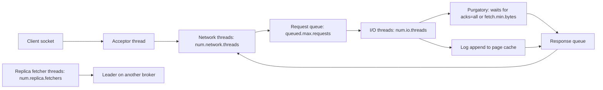

# Tuning Brokers, JVM and the Operating System

## Introduction

A Kafka broker is a thin layer of Java on top of the Linux page cache, the disk and the network card. Most of the time the defaults are good, and the biggest wins come from the machine underneath: enough memory for the page cache, fast disks with a sensible file system, a few kernel settings and a JVM heap that is neither too small nor too large.

This page goes through the broker from the outside in. By the end you will be able to:

- Explain how a request moves through the broker's network and I/O thread pools, and when to resize them.
- Size the JVM heap and leave the rest of memory to the page cache.
- Choose disks, a file system and mount options.
- Apply the Linux settings that matter for Kafka: swappiness, dirty page writeback, file descriptors and memory maps.
- Use broker metrics to find which resource is actually saturated.

Defaults quoted are from Apache Kafka 4.3 running in KRaft mode. Hardware sizing (how many brokers and how much disk) is covered in [Cluster Sizing and Capacity Planning](../10-kafka-operations/0-kafka-cluster-sizing.mdx).

## How a Request Moves Through a Broker



Network threads read requests off sockets and write responses back. I/O threads (also called request handler threads) do the work: append to the log, read for fetches, update metadata. Requests that must wait, such as a produce with `acks=all` or a fetch with `fetch.min.bytes`, park in "purgatory" without holding a thread. Replica fetcher threads are the broker acting as a client, pulling data from leaders for partitions it follows.

## Broker Settings Worth Knowing

| Setting | Default (4.3) | When to change it |
|---|---|---|
| `num.network.threads` | 3 | Raise when `NetworkProcessorAvgIdlePercent` drops below 0.3; common values 6-12 on large brokers, more with TLS |
| `num.io.threads` | 8 | Raise when `RequestHandlerAvgIdlePercent` drops below 0.3; often set to the number of disks or cores, 16-32 on big machines |
| `queued.max.requests` | 500 | Rarely; a full queue is a symptom of too few I/O threads |
| `num.replica.fetchers` | 1 | Raise to 2-8 when followers fall out of the ISR under load; each thread handles a share of leaders |
| `replica.fetch.max.bytes` | 1048576 | Raise if followers struggle to catch up on very high throughput partitions |
| `socket.send.buffer.bytes` / `socket.receive.buffer.bytes` | 102400 | Raise for high-latency links (cross-region); -1 uses OS auto-tuning |
| `num.recovery.threads.per.data.dir` | 2 (was 1 before 4.0) | Raise to speed up restart after an unclean shutdown with many partitions |
| `log.flush.interval.messages` / `log.flush.interval.ms` | Never force flush | Leave alone; Kafka relies on replication, not fsync, for durability |
| `compression.type` (broker) | `producer` | Keep; otherwise brokers recompress batches |
| `message.max.bytes` | 1048588 | Raise only with matching producer and consumer limits |

### Why Kafka does not fsync every write

New Kafka users often look for a "sync to disk" setting and are alarmed to find it off. Kafka's durability model is replication: a write acknowledged with `acks=all` exists in the memory of every in-sync replica, usually on separate machines in separate zones. The chance that all of them lose power before the OS writes the page cache to disk is far smaller than the cost of forcing a disk flush on every batch. Forcing flushes with `log.flush.interval.messages=1` will cut throughput dramatically and is almost never what you want.

### Thread pools

A rule of thumb: the defaults suit a broker with a handful of cores. On a 16- or 32-core broker serving many clients, raise `num.io.threads` to about the core count and `num.network.threads` to about half of that. Both are dynamic broker configs, so you can change them without a restart. The broker refuses any single dynamic change that more than doubles a thread pool, so grow in steps:

```bash
kafka-configs.sh --bootstrap-server localhost:9092 \
  --entity-type brokers --entity-default \
  --alter --add-config num.io.threads=16,num.network.threads=6
```

```text
Completed updating default config for brokers in the cluster.
```

Asking for `num.network.threads=8` straight from the default of 3 fails with "value should not be greater than double the current value 3". Check the effective value afterwards:

```bash
kafka-configs.sh --bootstrap-server localhost:9092 \
  --entity-type brokers --entity-name 1 --describe --all | grep -E "num\.(io|network)\.threads"
```

```text
  num.io.threads=16 sensitive=false synonyms={DYNAMIC_DEFAULT_BROKER_CONFIG:num.io.threads=16, STATIC_BROKER_CONFIG:num.io.threads=8, DEFAULT_CONFIG:num.io.threads=8}
  num.network.threads=6 sensitive=false synonyms={DYNAMIC_DEFAULT_BROKER_CONFIG:num.network.threads=6, STATIC_BROKER_CONFIG:num.network.threads=3, DEFAULT_CONFIG:num.network.threads=3}
```

## The JVM: Small Heap, Big Page Cache

Kafka keeps very little data on the Java heap. Log data lives in the operating system's page cache, which the broker reads and writes through the file system. That has a big consequence: **giving Kafka a huge heap makes it slower**, because every gigabyte you give the JVM is a gigabyte the page cache cannot use.

`kafka-server-start.sh` defaults to `-Xmx1G -Xms1G`, which is too small for production. A common production setting is 6 GB, rarely more than 8-12 GB, with G1:

```bash
# Set before starting the broker, for example in a systemd unit's Environment= lines
export KAFKA_HEAP_OPTS="-Xms6g -Xmx6g"
export KAFKA_JVM_PERFORMANCE_OPTS="-server -XX:+UseG1GC -XX:MaxGCPauseMillis=20 \
  -XX:InitiatingHeapOccupancyPercent=35 -XX:+ExplicitGCInvokesConcurrent \
  -XX:MaxInlineLevel=15 -Djava.awt.headless=true"
bin/kafka-server-start.sh config/server.properties
```

The performance options shown are close to what `kafka-run-class.sh` already sets in 4.3; you usually only need the heap line. Kafka 4.x brokers require Java 17 or later, and Java 21 is a good choice. Set `-Xms` equal to `-Xmx` so the heap does not resize at runtime.

On a broker with 64 GB of RAM and a 6 GB heap, roughly 55 GB is available for page cache. If consumers read recent data (the normal case), nearly every fetch is served from memory and the disks only see writes.

## Disks and File Systems

| Choice | Recommendation | Why |
|---|---|---|
| Disk type | SSD or NVMe for latency-sensitive clusters; HDD workable for pure sequential throughput | Kafka writes sequentially, but many partitions and lagging consumers create random reads |
| Layout | Several disks listed in `log.dirs` (JBOD), or RAID 10 | JBOD gives full capacity and Kafka spreads partitions; RAID 10 survives a disk loss without broker work |
| File system | XFS (ext4 also fine) | XFS handles large files and parallel writes well |
| Mount options | `noatime` | Avoids a metadata write on every read |
| Separate OS disk | Yes | Keeps system logs and swap from competing with Kafka |
| Network storage (EBS, Persistent Disk) | Fine with provisioned throughput | Check the volume's MB/s and IOPS cap; it is often the first limit hit |

Avoid RAID 5 and 6: rebuilds hammer every disk and writes pay a parity penalty.

## Linux Kernel Settings

These are the settings most production guides agree on. Put them in a file under `/etc/sysctl.d/` and apply with `sysctl --system`.

```bash
# /etc/sysctl.d/90-kafka.conf

# Avoid swapping the broker's heap; 1 keeps swap as a last resort
vm.swappiness = 1

# Start background writeback early so flushes are small and smooth
vm.dirty_background_ratio = 5
# Allow a larger share of dirty pages before writers are throttled
vm.dirty_ratio = 60

# Each log segment uses memory maps for its indexes; many partitions need many maps
vm.max_map_count = 262144

# Larger socket buffers for high-throughput or high-latency links
net.core.rmem_max = 16777216
net.core.wmem_max = 16777216
net.ipv4.tcp_rmem = 4096 65536 16777216
net.ipv4.tcp_wmem = 4096 65536 16777216
```

Raise the open file limit for the Kafka user; each segment file and each client connection uses a descriptor:

```bash
# /etc/security/limits.d/kafka.conf  (or LimitNOFILE=200000 in the systemd unit)
kafka  soft  nofile  200000
kafka  hard  nofile  200000
```

Check the running broker actually got it:

```bash
cat /proc/$(pgrep -f kafka.Kafka)/limits | grep "open files"
```

```text
Max open files            200000               200000               files
```

:::warning
Do not disable swap and set `vm.swappiness=0` blindly on small machines. If the heap plus off-heap usage ever exceeds RAM, the OOM killer ends the broker without warning. A swappiness of 1 keeps swap available as an emergency valve.
:::

## Finding the Bottleneck With Broker Metrics

| Metric (JMX) | Healthy | What a bad value means |
|---|---|---|
| `kafka.server:type=KafkaRequestHandlerPool,name=RequestHandlerAvgIdlePercent` | Above 0.3 | I/O threads saturated: raise `num.io.threads`, check disk |
| `kafka.network:type=SocketServer,name=NetworkProcessorAvgIdlePercent` | Above 0.3 | Network threads saturated: raise `num.network.threads`, check TLS CPU |
| `kafka.network:type=RequestChannel,name=RequestQueueSize` | Near 0 | Requests waiting for I/O threads |
| `kafka.network:type=RequestMetrics,name=TotalTimeMs,request=Produce` (and its `RequestQueueTimeMs`, `LocalTimeMs`, `RemoteTimeMs` siblings) | Low and stable | Shows which stage of a produce is slow: queue, local append or waiting for followers |
| `kafka.server:type=ReplicaManager,name=UnderReplicatedPartitions` | 0 | Followers cannot keep up: network, disk or too few replica fetchers |
| OS: disk utilization and await (`iostat -x`) | Under 70 percent | Disk is the limit |
| OS: page cache hit ratio (low disk reads during normal consumption) | Few reads | Too little RAM for the read pattern |

The request time breakdown is the most useful tool. If `RemoteTimeMs` dominates produce time, the broker is waiting for followers, so look at replication. If `LocalTimeMs` dominates, the disk append is slow. If `RequestQueueTimeMs` dominates, there are too few I/O threads. The [Monitoring](../10-kafka-operations/1-kafka-monitoring-metrics.mdx) page shows how to collect these with Prometheus.

## Worked Scenario: A Log Aggregation Cluster That Stalled

A platform team runs three brokers (16 cores, 64 GB RAM, four 2 TB NVMe drives each) collecting application logs from 2,000 services: 400 MB/s in at peak, replication factor 3, plus two consumer groups (search indexing and archiving).

Symptoms during a traffic spike: producer `record-queue-time-avg` climbed into seconds, some partitions became under-replicated, and producer timeouts appeared.

What the metrics said:

- `RequestHandlerAvgIdlePercent` was 0.05: the 8 default I/O threads were busy nearly all the time.
- `NetworkProcessorAvgIdlePercent` was 0.4: network threads were fine.
- Produce `RemoteTimeMs` was high and `UnderReplicatedPartitions` hovered at 150: followers were behind, each broker using one replica fetcher thread for roughly 800 MB/s of replication traffic.
- The JVM had a 24 GB heap "to be safe", and `iostat` showed heavy reads on the NVMe drives because the archiving consumer, catching up, read data that no longer fit in the 40 GB page cache.

Changes:

```properties
# server.properties
num.io.threads=16
num.network.threads=6
num.replica.fetchers=4
```

```bash
export KAFKA_HEAP_OPTS="-Xms6g -Xmx6g"
```

The heap reduction alone returned 18 GB to the page cache. With more I/O threads and replica fetchers, `RequestHandlerAvgIdlePercent` settled at 0.55, under-replicated partitions returned to 0, and producer queue time fell back under 30 ms. The team also asked services to enable `zstd`, which cut the 400 MB/s to about 90 MB/s on the wire, but that was a client-side change rolled out over weeks.

The alternative was adding three more brokers. That would also have worked, but the metrics showed idle cores and wasted memory on the existing machines, so tuning came first.

## Common Mistakes

- Giving the broker a 32 GB heap. It starves the page cache and lengthens GC pauses.
- Turning on per-message fsync because "durability". Use `acks=all` and `min.insync.replicas=2` instead.
- Raising thread counts without checking idle-percent metrics, which only adds context switching.
- Leaving the default 1 GB heap in production, leading to frequent GC and out-of-memory errors under load.
- Using RAID 5 or network volumes without checking their throughput cap.
- Forgetting the file descriptor limit, then seeing "Too many open files" after partitions grow.
- Running ZooKeeper-era tuning guides verbatim; Kafka 4.x is KRaft-only, and controller settings are different.

## Summary

- Requests flow through network threads, a request queue and I/O threads; idle-percent metrics tell you which pool to grow.
- Defaults: 3 network threads, 8 I/O threads, 1 replica fetcher, 2 recovery threads per data dir in 4.x.
- Keep the heap modest (around 6 GB, `-Xms` equal to `-Xmx`, G1) and let the page cache use the rest of RAM.
- Kafka relies on replication rather than fsync; leave flush settings alone.
- Use XFS with `noatime`, avoid RAID 5/6, and know your cloud volume's throughput cap.
- Set `vm.swappiness=1`, tune dirty page ratios, raise `vm.max_map_count` and the open file limit.

## Further Reading

- [Apache Kafka documentation: Hardware and OS](https://kafka.apache.org/documentation/#hwandos) - official guidance on OS, disks, file systems and flush behaviour.
- [Apache Kafka documentation: Java version and GC](https://kafka.apache.org/documentation/#java) - supported Java versions and recommended JVM options.
- [Broker configuration reference](https://kafka.apache.org/documentation/#brokerconfigs) - every broker setting with its default and whether it is dynamic.
- [Apache Kafka documentation: Monitoring](https://kafka.apache.org/documentation/#monitoring) - the JMX metrics referenced above.
- [KIP-1030: Change constraints and default values](https://cwiki.apache.org/confluence/display/KAFKA/KIP-1030%3A+Change+constraints+and+default+values+for+various+configurations) - defaults changed in 4.0, including recovery threads.
- [Monitoring: The Metrics That Matter](../10-kafka-operations/1-kafka-monitoring-metrics.mdx) - wiring broker metrics into dashboards and alerts.
