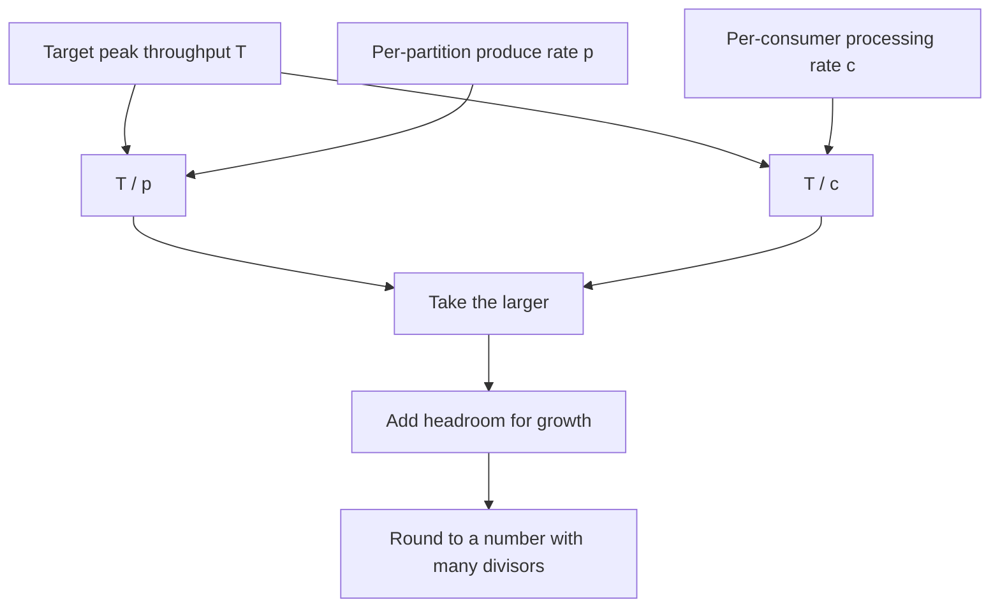

# Choosing the Number of Partitions

## Introduction

The partition count is the one topic setting that is hard to change later. You can raise it at any time, but you can never lower it, and raising it moves existing keys to different partitions, which breaks per-key ordering for anything in flight. Choosing well at creation time saves a painful migration later.

Partitions are Kafka's unit of parallelism. One partition is read by at most one consumer in a group, and one partition is a single ordered log on a single leader broker. Too few partitions cap your throughput and your consumer count. Too many waste memory and file handles, thin out producer batches, and slow down failover.

This page gives you a method rather than a magic number. By the end you will be able to:

- Compute a partition count from target throughput and measured per-partition rates.
- Explain what extra partitions cost on producers, brokers and consumers.
- Decide how much headroom to build in, especially for keyed topics.
- Increase partitions safely when you must, and know when to create a new topic instead.

## What a Partition Gives You and What It Costs

| More partitions give you | More partitions cost you |
|---|---|
| More consumers working in parallel in one group | Smaller producer batches, because batches are per partition |
| Load spread over more brokers and disks | More open files, memory maps and replica fetch work on brokers |
| Higher total throughput ceiling | Longer leader elections and broker restarts |
| Finer-grained rebalancing | More work for consumer group assignment and offset commits |
| | More end-to-end latency when replication must cover many partitions per broker |

There is no free lunch, but the costs grow slowly. A topic with 12 or 48 partitions is cheap. Problems appear when a cluster carries tens of thousands of partitions per broker, or when a low-volume topic is given hundreds of partitions "for the future".

KRaft (the only mode in Kafka 4.x) removed the old ZooKeeper-era cluster limit of around 200,000 partitions; controllers now handle millions of partitions in metadata. Per-broker costs remain: each partition replica still means segment files, indexes and fetch work on its broker. A few thousand partition replicas per broker is comfortable on modern hardware; well beyond that, test restart and failover times before committing.

## The Throughput Method

The classic approach is to measure and divide.

1. Decide the target throughput for the topic, T, in MB/s, at peak, with growth for the next one to two years.
2. Measure what one partition can sustain on the producer side, p, using your real record size, compression and `acks` setting.
3. Measure what one consumer can process from one partition, c, including the real processing work.
4. Partitions = max(T / p, T / c), rounded up, plus headroom.

The consumer number is almost always the limit. A broker partition can absorb tens of MB/s; a consumer that writes to a database might handle 2 MB/s.



You can measure p with the perf tool against a single-partition topic:

```bash
kafka-topics.sh --bootstrap-server localhost:9092 --create --topic p1-test \
  --partitions 1 --replication-factor 3

kafka-producer-perf-test.sh --bootstrap-server localhost:9092 --topic p1-test \
  --num-records 2000000 --record-size 800 --throughput -1 \
  --command-property acks=all linger.ms=10 batch.size=131072 compression.type=lz4
```

For c, run your real consumer against a topic with a known backlog and read its throughput from metrics or logs. Synthetic consumer benchmarks only tell you the Kafka side, which is rarely the bottleneck.

### Why round to "nice" numbers

Pick counts with many divisors, such as 6, 12, 24, 36, 48 or 60. A 12-partition topic divides evenly across 1, 2, 3, 4, 6 or 12 consumers, and across 3 or 6 brokers. A 10-partition topic split across 3 consumers gives one consumer 4 partitions and the others 3, so it does a third more work and limits the group's throughput.

## Keys Change the Calculation

For a keyless topic, adding partitions later is harmless: new records simply spread over more partitions. For a keyed topic, the default partitioner computes `hash(key) % partitionCount`. Change the count and most keys land somewhere else.

A quick experiment with Kafka's own murmur2 hash over 100,000 keys named `customer-0` to `customer-99999`:

```text
keys moved 12->24: 50.255%
keys moved 12->16: 75.157%
```

Doubling moves half the keys (each key either stays or moves to partition p + 12); growing to a count that is not a multiple moves three quarters. For a few seconds or minutes after the change, old records for a key sit in one partition while new ones go to another, so a consumer can process the new event before the old one. For an order system where "OrderShipped" must follow "OrderPlaced", that is a real bug.

This is why keyed topics deserve more headroom at creation time. A good rule: size keyed topics for the throughput you expect in two years, not today.

:::tip
If you must grow a keyed topic, prefer doubling (12 to 24, 24 to 48) so half of the keys stay put. Pause producers briefly or drain consumers before the change if strict per-key ordering matters.
:::

## Increasing Partitions

```bash
kafka-topics.sh --bootstrap-server localhost:9092 --alter --topic orders-v2 --partitions 24
kafka-topics.sh --bootstrap-server localhost:9092 --describe --topic orders-v2 | head -3
```

```text
Topic: orders-v2	TopicId: dYVLnp61QKi97YvOCbA4aw	PartitionCount: 24	ReplicationFactor: 1	Configs: min.insync.replicas=1,segment.bytes=1073741824
	Topic: orders-v2	Partition: 0	Leader: 1	Replicas: 1	Isr: 1	Elr: 	LastKnownElr:
	Topic: orders-v2	Partition: 1	Leader: 1	Replicas: 1	Isr: 1	Elr: 	LastKnownElr:
```

Trying to reduce the count fails:

```bash
kafka-topics.sh --bootstrap-server localhost:9092 --alter --topic orders-v2 --partitions 6
```

```text
Error while executing topic command : The topic orders-v2 currently has 24 partition(s); 6 would not be an increase.
```

To truly shrink a topic, or to grow a keyed topic without breaking ordering, create a new topic with the desired count and migrate: dual-write or mirror into the new topic, move consumers over once they have caught up, then retire the old one. It is more work but gives you a clean cut-over point.

Programmatically, the Admin API does the same as the CLI:

```java
import org.apache.kafka.clients.admin.Admin;
import org.apache.kafka.clients.admin.AdminClientConfig;
import org.apache.kafka.clients.admin.NewPartitions;

import java.util.Map;
import java.util.Properties;

public class GrowTopic {
    public static void main(String[] args) throws Exception {
        Properties props = new Properties();
        props.put(AdminClientConfig.BOOTSTRAP_SERVERS_CONFIG, "localhost:9092");
        try (Admin admin = Admin.create(props)) {
            // Grow "clickstream" to 48 partitions; Kafka places the new replicas automatically
            admin.createPartitions(Map.of("clickstream", NewPartitions.increaseTo(48))).all().get();
            System.out.println("clickstream now has 48 partitions");
        }
    }
}
```

## Worked Scenario: Sizing an Order Topic

An e-commerce company is designing the `orders` topic. Events are keyed by order ID so that every event of an order (placed, paid, packed, shipped) stays in order.

Inputs:

- Today's peak: 3,000 order events per second at 1.2 KB, about 3.6 MB/s. Black Friday peaks at 4x, and the business expects volume to double in two years: design target T = 3.6 x 4 x 2, about 29 MB/s.
- Producer test on a single partition with `lz4` and `acks=all`: p = 35 MB/s. So T / p is about 1. Producers are not the constraint.
- The fulfilment consumer calls an inventory service and writes to PostgreSQL. Measured with a backlog: c = 1.1 MB/s per consumer instance, about 900 events per second. So T / c is about 27.

The consumer drives the decision. 27 rounds up to 36 for headroom, and 36 divides evenly across 3, 4, 6, 9, 12 and 18 consumer instances and across 3 brokers. Day-to-day the team runs 6 instances (6 partitions each); on Black Friday they scale to 18.

The alternative they considered was 12 partitions now and doubling later. They rejected it because order events must stay in sequence and every growth step would need a coordinated pause. The extra cost of 36 partitions over 12 is negligible on a three-broker cluster.

For contrast, the same company's `audit-log` topic is keyless, low volume (50 events per second), and read by one archiver. It got 3 partitions, one per broker, and can grow later without consequence.

## Common Mistakes

- Choosing partition count from producer throughput alone, ignoring the slower consumer.
- Creating hundreds of partitions for a topic with a few records per second, which thins batches and adds overhead with no benefit.
- Growing a keyed topic during normal traffic and then chasing out-of-order bugs.
- Picking counts like 10 or 7 that divide poorly across consumers and brokers.
- Expecting more consumers than partitions to add throughput.
- Assuming you can shrink a topic later; you cannot without creating a new one.
- Copying "use 1,000 partitions" advice from a very different workload without measuring.

## Summary

- Partitions are the unit of parallelism and ordering; the count can only go up.
- Partitions = max(T / p, T / c) plus headroom, where the consumer rate c is usually the limit.
- Extra partitions cost producer batching efficiency, broker files and memory, and failover time; KRaft raises cluster-wide limits but not per-broker costs.
- Keyed topics need generous headroom, because changing the count moves 50 percent or more of keys.
- Pick counts with many divisors, and double when you must grow a keyed topic.
- To shrink, or to re-key cleanly, migrate to a new topic.

## Further Reading

- [Apache Kafka documentation: Topics and partitions](https://kafka.apache.org/documentation/#intro_concepts_and_terms) - the core concepts behind partitions.
- [Apache Kafka documentation: Modifying topics](https://kafka.apache.org/documentation/#basic_ops_modify_topic) - how `kafka-topics.sh --alter` behaves and its limits.
- [Admin API: createPartitions](https://kafka.apache.org/43/javadoc/org/apache/kafka/clients/admin/Admin.html) - the programmatic way to grow a topic.
- [Topics and Partitions in Depth](../2-kafka-topics-and-storage/0-kafka-topics-and-partitions.mdx) - how partitions are stored and replicated.
- [Designing Partition Keys](../13-kafka-best-practices/1-kafka-partition-key-design.mdx) - choosing keys that spread load evenly.
- [Benchmarking](./5-kafka-benchmarking.mdx) - running the measurements this method needs.
