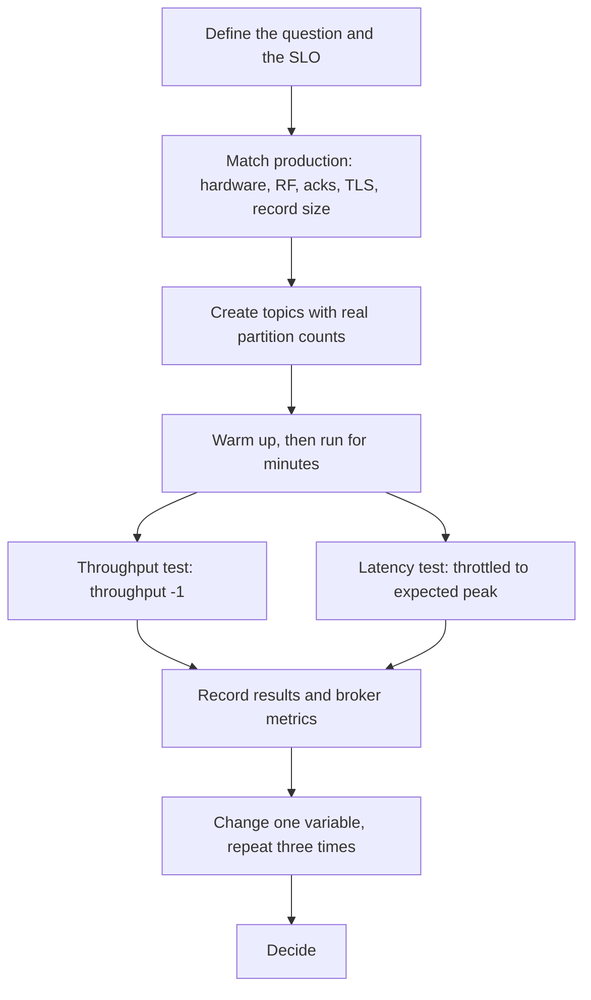

# Benchmarking with kafka-producer-perf-test and kafka-consumer-perf-test

## Introduction

Every tuning claim on the previous pages should be checked against your own hardware, records and network. Kafka ships two tools for that: `kafka-producer-perf-test.sh` and `kafka-consumer-perf-test.sh`. They are in the `bin` directory of every Kafka distribution and in the official `apache/kafka` Docker image, so you can run them without writing code.

Benchmarks are also easy to get wrong. A test that runs for ten seconds on a laptop against a single broker tells you very little about a three-zone production cluster. This page shows how to use the tools, what their output means, and how to design a benchmark whose numbers you can trust.

By the end you will be able to:

- Run producer and consumer benchmarks with the current (Kafka 4.2 and later) flags.
- Read every field of the output, including the steady-state and metrics sections.
- Separate a throughput test from a latency test, and know why you need both.
- Run a parameter sweep and turn it into a decision.
- Recognise when to reach for a heavier tool such as the OpenMessaging Benchmark.

All sample output on this page is real, captured from Apache Kafka 4.3.0 in the official Docker image: one broker, replication factor 1, on a 32-core Linux machine. The absolute numbers flatter Kafka because there is no replication network hop; the relative differences are what matter.

## The Producer Tool

### Flags you will use

| Flag | Meaning |
|---|---|
| `--bootstrap-server` | Brokers to connect to (added in Kafka 4.2; older versions use `--producer-props bootstrap.servers=...`) |
| `--topic` | Topic to write to; create it first with the partition count you want to test |
| `--num-records` | How many records to send in total |
| `--record-size` | Size of each generated record in bytes (exclusive with the two options below) |
| `--payload-file` | Send lines from a file instead of generated bytes; use real samples for realistic compression |
| `--payload-monotonic` | Payload is an increasing integer; handy for ordering checks |
| `--throughput` | Target records per second; `-1` means as fast as possible |
| `--command-property` | Producer settings such as `acks=all linger.ms=10` (replaces the deprecated `--producer-props`) |
| `--command-config` | A properties file with producer settings, for example security config (replaces `--producer.config`) |
| `--warmup-records` | Records to exclude from steady-state statistics (Kafka 4.2 and later) |
| `--print-metrics` | Dump all producer metrics at the end |
| `--transactional-id`, `--transaction-duration-ms` | Benchmark transactional producing |
| `--reporting-interval` | Milliseconds between progress lines (default 5000) |

:::note
If you are on Kafka 3.x or 4.0-4.1, write `--producer-props bootstrap.servers=localhost:9092 acks=all` instead of `--bootstrap-server` plus `--command-property`. The old flags still work in 4.3 but print as deprecated and are slated for removal in a future major version.
:::

### A first run

```bash
kafka-topics.sh --bootstrap-server localhost:9092 --create --topic perf-test \
  --partitions 6 --replication-factor 1

kafka-producer-perf-test.sh --bootstrap-server localhost:9092 --topic perf-test \
  --num-records 1000000 --record-size 1024 --throughput -1 \
  --command-property acks=all
```

```text
1000000 records sent, 210260.723297 records/sec (205.33 MB/sec), 58.19 ms avg latency, 479.00 ms max latency, 1 ms 50th, 243 ms 95th, 426 ms 99th, 474 ms 99.9th.
```

Field by field:

- **records/sec and MB/sec**: average throughput across the run.
- **avg latency, max latency**: time from `send()` to the acknowledgement callback, per record.
- **50th, 95th, 99th, 99.9th**: latency percentiles. The median of 1 ms next to a p99 of 426 ms shows a saturated producer: most records went straight out, but some waited a long time in the producer's buffer.

Long runs also print a progress line every reporting interval, like the two lines before the summary here:

```text
99996 records sent, 19995.2 records/sec (19.53 MB/sec), 2.5 ms avg latency, 278.0 ms max latency.
100036 records sent, 20007.2 records/sec (19.54 MB/sec), 0.5 ms avg latency, 6.0 ms max latency.
300000 records sent, 19992.003199 records/sec (19.52 MB/sec), 1.16 ms avg latency, 278.00 ms max latency, 0 ms 50th, 3 ms 95th, 32 ms 99th, 38 ms 99.9th.
```

That was a throttled run (`--throughput 20000`). Notice the first interval's 278 ms maximum: connection setup and metadata fetches land in the first seconds of every run.

### Warmup and steady state

Kafka 4.2 added `--warmup-records` (KIP-1052) so that startup costs do not pollute the percentiles. The tool prints the whole-run summary followed by a steady-state line:

```bash
kafka-producer-perf-test.sh --bootstrap-server localhost:9092 --topic perf-test \
  --num-records 500000 --warmup-records 100000 --record-size 512 --throughput -1 \
  --command-property linger.ms=10
```

```text
Warmup first 100000 records. Steady state results will print after the complete test summary.
500000 records sent, 366300.366300 records/sec (178.86 MB/sec), 61.76 ms avg latency, 306.00 ms max latency, 21 ms 50th, 221 ms 95th, 229 ms 99th, 231 ms 99.9th.
400000 steady state records sent, 452488.687783 records/sec (220.94 MB/sec), 28.30 ms avg latency, 148.00 ms max latency, 2 ms 50th, 111 ms 95th, 138 ms 99th, 147 ms 99.9th.
```

Excluding the first 100,000 records halved the average latency and moved the median from 21 ms to 2 ms. On older versions, get the same effect by running a throwaway warmup test first and simply making runs long (minutes, not seconds).

### Printing producer metrics

`--print-metrics` dumps hundreds of metrics. Filter for the ones that explain the result:

```bash
kafka-producer-perf-test.sh --bootstrap-server localhost:9092 --topic perf-test \
  --num-records 200000 --record-size 1024 --throughput -1 --print-metrics \
  --command-property linger.ms=0 compression.type=zstd batch.size=131072 \
  | grep -E "records sent|batch-size-avg|compression-rate-avg|record-queue-time-avg|request-latency-avg|records-per-request-avg" \
  | grep -v "node-\|topic\."
```

```text
200000 records sent, 111358.574610 records/sec (108.75 MB/sec), 1.65 ms avg latency, 215.00 ms max latency, 1 ms 50th, 3 ms 95th, 10 ms 99th, 23 ms 99.9th.
producer-metrics:batch-size-avg:{client-id=perf-producer-client}                            : 25522.906
producer-metrics:compression-rate-avg:{client-id=perf-producer-client}                      : 0.607
producer-metrics:record-queue-time-avg:{client-id=perf-producer-client}                     : 0.331
producer-metrics:records-per-request-avg:{client-id=perf-producer-client}                   : 44.663
producer-metrics:request-latency-avg:{client-id=perf-producer-client}                       : 1.230
```

With `linger.ms=0`, batches averaged only 25 KB of the 128 KB allowed, and throughput was about half of the earlier lz4 runs because zstd on the single producer thread became the limit. The compression ratio of 0.607 reflects the tool's synthetic payload (random capital letters); real JSON compresses much better, so use `--payload-file` with real samples when compression matters.

## The Consumer Tool

```bash
kafka-consumer-perf-test.sh --bootstrap-server localhost:9092 --topic perf-test \
  --num-records 1000000 --group perf-c1
```

```text
start.time, end.time, data.consumed.in.MB, MB.sec, data.consumed.in.nMsg, nMsg.sec, rebalance.time.ms, fetch.time.ms, fetch.MB.sec, fetch.nMsg.sec
2026-10-17 18:42:24:906, 2026-10-17 18:42:29:226, 976.6934, 226.0864, 1000134, 231512.5000, 3568, 752, 1298.7944, 1329965.4255
```

| Column | Meaning |
|---|---|
| `data.consumed.in.MB`, `data.consumed.in.nMsg` | Total data and records read |
| `MB.sec`, `nMsg.sec` | Throughput over the whole wall-clock time, including joining the group |
| `rebalance.time.ms` | Time spent joining the consumer group before the first records arrived |
| `fetch.time.ms` | Time spent actually fetching after the join |
| `fetch.MB.sec`, `fetch.nMsg.sec` | Throughput during fetching only: the number to compare between runs |

Here the group join took 3.6 seconds and the fetching 0.75 seconds, so `MB.sec` (226) understates the consumer's real speed (`fetch.MB.sec`, 1,299). Always compare `fetch.MB.sec`, or run long enough that the join is negligible.

Useful flags: `--num-records` (replaces the deprecated `--messages`), `--group` (use a new group each run, or the second run starts from committed offsets and reads nothing), `--command-property` for consumer settings, `--from-latest`, `--timeout` (stop if no records arrive for this many milliseconds, default 10000), and `--show-detailed-stats` with `--reporting-interval` for a time series:

```bash
kafka-consumer-perf-test.sh --bootstrap-server localhost:9092 --topic perf-test \
  --num-records 2000000 --group perf-c3 --show-detailed-stats --reporting-interval 1000
```

```text
time, threadId, data.consumed.in.MB, MB.sec, data.consumed.in.nMsg, nMsg.sec, rebalance.time.ms, fetch.time.ms, fetch.MB.sec, fetch.nMsg.sec
2026-10-17 18:42:38:566, 0, 0.0010, 0.0003, 1, 0.3085, 3207, 35, 0.0279, 28.5714
2026-10-17 18:42:39:566, 0, 1427.0459, 1427.0449, 1461295, 1461294.0000, 0, 1000, 1427.0449, 1461294.0000
```

Kafka 4.x also ships `kafka-share-consumer-perf-test.sh` for share groups, with the same style of flags.

## Designing a Benchmark You Can Trust



The rules that matter most:

1. **Ask a specific question.** "Can three brokers take 150 MB/s at p99 under 50 ms with `acks=all`?" is testable. "How fast is Kafka?" is not.
2. **Match production.** Replication factor 3, `acks=all`, TLS if you use it, the real record size, real compression on real payloads, clients in a different zone if they will be.
3. **Run throughput and latency tests separately.** `--throughput -1` finds the ceiling, but latency at the ceiling is meaningless because queues are full. For latency, throttle to your expected peak, say 70 percent of the measured ceiling, and read the percentiles there.
4. **Run long and repeat.** At least several minutes per run, with page cache, segment rolls and GC in play. Repeat each configuration three times and look at the spread.
5. **Use several client machines.** One perf-test process is a single producer with one sender thread; in these tests it topped out near 210-280 MB/s. To load a real cluster, run the tool on several machines at once and add their results.
6. **Watch the brokers while testing.** Request handler idle percent, network idle percent, disk utilization and under-replicated partitions tell you which resource set the limit.

## Worked Scenario: Choosing Batch Settings for a Clickstream

A team wants to choose `linger.ms` and `batch.size` for a clickstream producer that sends 1 KB events with lz4. They ran a sweep:

```bash
#!/usr/bin/env bash
# sweep.sh: try each linger.ms and batch.size pair; print one summary line per pair.
BOOTSTRAP=${BOOTSTRAP:-localhost:9092}
TOPIC=${TOPIC:-perf-test}
for linger in 0 5 20; do
  for batch in 16384 131072; do
    result=$(kafka-producer-perf-test.sh --bootstrap-server "$BOOTSTRAP" --topic "$TOPIC" \
      --num-records 300000 --record-size 1024 --throughput -1 \
      --command-property acks=all linger.ms=$linger batch.size=$batch compression.type=lz4 \
      | tail -1)
    echo "linger=$linger batch=$batch -> $result"
  done
done
```

```text
linger=0 batch=16384 -> 300000 records sent, 129926.375054 records/sec (126.88 MB/sec), 151.99 ms avg latency, 325.00 ms max latency, 149 ms 50th, 306 ms 95th, 311 ms 99th, 312 ms 99.9th.
linger=0 batch=131072 -> 300000 records sent, 222386.953299 records/sec (217.17 MB/sec), 0.50 ms avg latency, 203.00 ms max latency, 0 ms 50th, 2 ms 95th, 3 ms 99th, 6 ms 99.9th.
linger=5 batch=16384 -> 300000 records sent, 193174.500966 records/sec (188.65 MB/sec), 21.84 ms avg latency, 225.00 ms max latency, 1 ms 50th, 72 ms 95th, 90 ms 99th, 93 ms 99.9th.
linger=5 batch=131072 -> 300000 records sent, 206753.962784 records/sec (201.91 MB/sec), 0.63 ms avg latency, 222.00 ms max latency, 1 ms 50th, 1 ms 95th, 3 ms 99th, 7 ms 99.9th.
linger=20 batch=16384 -> 300000 records sent, 171232.876712 records/sec (167.22 MB/sec), 66.85 ms avg latency, 211.00 ms max latency, 73 ms 50th, 168 ms 95th, 173 ms 99th, 174 ms 99.9th.
linger=20 batch=131072 -> 300000 records sent, 213219.616205 records/sec (208.22 MB/sec), 0.65 ms avg latency, 233.00 ms max latency, 1 ms 50th, 1 ms 95th, 5 ms 99th, 17 ms 99.9th.
```

Summarised:

| linger.ms | batch.size | MB/s | p99 (ms) |
|---|---|---|---|
| 0 | 16 KB | 127 | 311 |
| 0 | 128 KB | 217 | 3 |
| 5 | 16 KB | 189 | 90 |
| 5 | 128 KB | 202 | 3 |
| 20 | 16 KB | 167 | 173 |
| 20 | 128 KB | 208 | 5 |

What the team concluded:

- At full speed, `batch.size` dominates. Every 16 KB row is saturated and has a terrible p99; every 128 KB row is fast. The sweep was short (300,000 records), so the differences within the 128 KB rows are noise.
- `linger.ms` hardly matters at full speed, because batches fill by size long before the timer expires.
- They picked `batch.size=131072` with `linger.ms=20`, then ran a throttled latency test at their expected peak of 60,000 records per second, three times for five minutes each, on a three-broker staging cluster with replication factor 3, to confirm p99 stayed under their 50 ms target.

The alternative was to copy settings from a blog post. The sweep took twenty minutes and showed the blog's recommended `batch.size=16384, linger.ms=20` would have been the second-worst choice for their load.

## When the Built-In Tools Are Not Enough

The perf-test tools measure one producer or one consumer at a time and do not report end-to-end latency. For larger questions:

- **OpenMessaging Benchmark (OMB)** drives many producers and consumers across machines and reports end-to-end latency. It is the usual tool for comparing Kafka with other systems or sizing a large cluster.
- **Trogdor**, in the Kafka source tree, coordinates workloads and fault injection across agents.
- **Your own application** under a load generator is the most honest benchmark of all, because it includes your serialization and processing.

## Common Mistakes

- Running the second consumer test with the same `--group` and getting zero records because offsets were committed.
- Comparing `MB.sec` between consumer runs when group join time dominates; compare `fetch.MB.sec`.
- Reporting latency from a `--throughput -1` run; at saturation latency only measures queue depth.
- Using `--record-size` payloads to judge compression; they are synthetic letters. Use `--payload-file` with real data.
- Benchmarking with replication factor 1 and `acks=1`, then deploying with RF 3 and `acks=all`.
- Running short tests once and treating the result as exact.
- Driving a big cluster from one perf-test process and concluding the cluster is the limit.

## Summary

- `kafka-producer-perf-test.sh` reports throughput and per-record produce latency percentiles; `kafka-consumer-perf-test.sh` reports consume throughput, group join time and fetch-only throughput.
- From Kafka 4.2, use `--bootstrap-server`, `--command-property`, `--command-config` and (for the consumer) `--num-records`; the older flags are deprecated.
- Use `--warmup-records` (4.2 and later) or long runs to exclude startup effects, and `--print-metrics` to explain results.
- Test throughput unthrottled and latency throttled, repeat runs, change one variable at a time, and match production conditions.
- For end-to-end latency or many-client tests, use the OpenMessaging Benchmark or your own application.

## Further Reading

- [Apache Kafka documentation: Operations](https://kafka.apache.org/documentation/#operations) - the official home of the command-line tools.
- [KIP-1147: Improve consistency of command-line arguments](https://cwiki.apache.org/confluence/display/KAFKA/KIP-1147%3A+Improve+consistency+of+command-line+arguments) - why `--bootstrap-server` and `--command-property` replaced the older flags.
- [KIP-1052: Enable warmup in producer performance test](https://cwiki.apache.org/confluence/display/KAFKA/KIP-1052%3A+Enable+warmup+in+producer+performance+test) - the design of `--warmup-records`.
- [OpenMessaging Benchmark](https://github.com/openmessaging/benchmark) - a distributed benchmark framework with end-to-end latency.
- [Tuning Producers](./1-kafka-producer-tuning.mdx) - what to change once the benchmark shows a bottleneck.
- [Cluster Sizing and Capacity Planning](../10-kafka-operations/0-kafka-cluster-sizing.mdx) - turning benchmark numbers into hardware.
