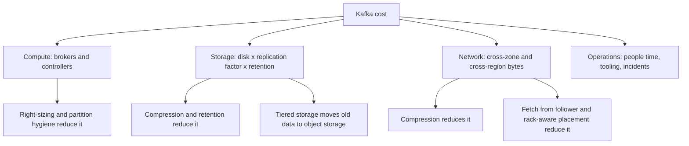

# Cost Optimization

## Introduction

Kafka clusters grow quietly. A team adds a topic, another team keeps data "just in case", a third team's consumers read across availability zones, and a year later the Kafka bill is one of the biggest lines in the infrastructure budget. Most of that cost comes from a few predictable places: bytes moving between zones, bytes stored on replicated disks, and brokers sized for a peak that never arrives.

The good news is that the biggest savings rarely need new hardware or a migration. They come from configuration: compressing data, keeping traffic inside a zone, keeping only the data you need, and moving old data to cheaper storage.

By the end of this page you will be able to:

- Identify the main cost drivers of a self-managed or managed Kafka cluster.
- Measure and apply compression savings with real numbers.
- Reduce cross-zone network charges with rack awareness.
- Use retention and tiered storage to cut disk spend.
- Right-size brokers and partitions, and understand how managed services bill.

## Where the Money Goes



On the big public clouds, data transferred between availability zones is typically billed per gigabyte in each direction. For a three-zone Kafka cluster that adds up fast:

- **Producer to leader:** a producer in zone A writes to leaders spread over A, B and C, so about two thirds of produced bytes cross a zone.
- **Leader to followers:** with replication factor 3 and one replica per zone, every byte is copied to two other zones.
- **Leader to consumer:** a consumer in zone A reading from leaders in all zones pulls about two thirds of its bytes across zones, for every consumer group.

For a workload that writes 100 MB/s and is read by three consumer groups, that is roughly 67 + 200 + 200 = 467 MB/s of cross-zone traffic, more than four times the data you actually produce. Network, not brokers, is often the largest single line of the bill.

Storage is the next driver: produced bytes, times replication factor, times retention, on block storage that costs much more per gigabyte than object storage.

## Lever 1: Compression

Compression shrinks every downstream cost at once: producer network, replication traffic, disk, and consumer network. It costs producer and consumer CPU, which is usually the cheapest resource in the system.

A real test on Apache Kafka 4.3 sent 500,000 realistic clickstream JSON events (about 415 bytes each, with user agents, URLs, IDs and timestamps) into three topics with different codecs, then measured the size on disk with `kafka-log-dirs.sh`:

```bash
for c in none lz4 zstd; do
  kafka-topics.sh --bootstrap-server localhost:9092 --create --topic clicks-$c \
    --partitions 6 --replication-factor 1
  kafka-producer-perf-test.sh --bootstrap-server localhost:9092 --topic clicks-$c \
    --num-records 500000 --payload-file clicks.json --throughput -1 \
    --command-property linger.ms=20 batch.size=262144 compression.type=$c
done

kafka-log-dirs.sh --bootstrap-server localhost:9092 --describe \
  --topic-list clicks-none,clicks-lz4,clicks-zstd
```

```text
500000 records sent, 721500.721501 records/sec (284.72 MB/sec), 1.21 ms avg latency, 233.00 ms max latency, 1 ms 50th, 3 ms 95th, 14 ms 99th, 26 ms 99.9th.
500000 records sent, 551876.379691 records/sec (217.78 MB/sec), 2.18 ms avg latency, 255.00 ms max latency, 2 ms 50th, 4 ms 95th, 6 ms 99th, 22 ms 99.9th.
500000 records sent, 320924.261874 records/sec (126.64 MB/sec), 5.96 ms avg latency, 273.00 ms max latency, 5 ms 50th, 10 ms 95th, 15 ms 99th, 45 ms 99.9th.
```

Summing partition sizes from the `kafka-log-dirs.sh` JSON output:

| Codec | Size on disk | Ratio | Producer throughput (one process) |
|---|---|---|---|
| `none` | 202.1 MB | 1.0x | 285 MB/s |
| `lz4` | 57.6 MB | 3.5x smaller | 218 MB/s |
| `zstd` | 33.7 MB | 6.0x smaller | 127 MB/s |

For this data, zstd cut storage and every network hop by 83 percent. Its lower single-producer throughput only matters if one producer process must push more than about 125 MB/s; most services produce far less. lz4 is the choice when producer CPU is tight. Your ratio depends on your data, so repeat the test with a sample of your own records.

Remember that compression works per batch: tiny batches compress poorly. Raising `linger.ms` and `batch.size` (see [Tuning Producers](./1-kafka-producer-tuning.mdx)) improves both efficiency and the compression ratio.

## Lever 2: Keep Traffic in the Zone

### Fetch from follower

Since Kafka 2.4 (KIP-392), consumers can read from a replica in their own zone rather than from the leader:

```properties
# server.properties on each broker
broker.rack=us-east-1a
replica.selector.class=org.apache.kafka.common.replica.RackAwareReplicaSelector
```

```properties
# consumer configuration, set per deployment zone
client.rack=us-east-1a
```

With one replica per zone, every consumer finds a local copy, and consumer cross-zone traffic falls to almost zero. In the example above that removes 200 of the 467 MB/s. The cost is a few milliseconds of extra end-to-end latency, because followers trail the leader slightly. Since Kafka 3.5 (KIP-881), the built-in consumer assignors also use `client.rack` to give consumers partitions with local replicas.

### Rack-aware replica placement

`broker.rack` also makes Kafka place each partition's replicas in different zones, which you want anyway for resilience. Replication traffic itself must cross zones to survive a zone failure; that part is the price of durability, not waste.

### Producer side

Producers still send to leaders in other zones. Compression is the main lever here. Some managed services and Kafka-compatible systems go further by routing produce traffic within a zone, at the cost of extra latency.

:::warning
Do not "save" cross-zone cost by putting all replicas in one zone. A single zone outage would then take the topic offline or lose data. Replication across zones is the one network cost you should keep.
:::

## Lever 3: Keep Only What You Need

Storage cost is produced bytes times replication factor times retention. Retention is often set once and forgotten.

```bash
# Find topics whose retention overrides the default
kafka-configs.sh --bootstrap-server localhost:9092 --entity-type topics --describe --all \
  | grep -E "^All configs for topic|retention.ms=" | grep -B1 "retention.ms" | head
```

Questions to ask for each large topic:

- **Does anyone read data older than a day?** Consumers usually process data within minutes. If old data is needed only for occasional replays, seven days may be enough, or tiered storage may hold it cheaply.
- **Is the topic keyed state?** If only the latest value per key matters (customer profile, inventory level), log compaction keeps one record per key instead of every change. See [Retention and Log Compaction](../2-kafka-topics-and-storage/3-kafka-retention-and-compaction.mdx).
- **Is Kafka acting as an archive?** Long-term archives belong in object storage, written by a sink connector, where storage is far cheaper and not replicated three times on block disks.

```bash
# Reduce a clickstream topic from 30 days to 3 days of retention
kafka-configs.sh --bootstrap-server localhost:9092 --entity-type topics \
  --entity-name clickstream --alter --add-config retention.ms=259200000
```

## Lever 4: Tiered Storage

Tiered storage (KIP-405, production-ready since Kafka 3.9) keeps recent segments on broker disks and moves older segments to object storage such as S3, GCS or Azure Blob. Consumers read old data transparently. Object storage is several times cheaper per gigabyte than replicated block storage, and it is not multiplied by the replication factor on your brokers.

```properties
# server.properties (plus a RemoteStorageManager plugin for your object store)
remote.log.storage.system.enable=true
```

```bash
# Per topic: keep 1 day locally, 90 days in total
kafka-configs.sh --bootstrap-server localhost:9092 --entity-type topics \
  --entity-name clickstream --alter \
  --add-config remote.storage.enable=true,local.retention.ms=86400000,retention.ms=7776000000
```

Brokers become smaller and faster to replace, because they hold a day of data instead of ninety. The trade-off is slower reads of old data and a plugin to operate. The details are in [Tiered Storage](../2-kafka-topics-and-storage/7-kafka-tiered-storage.mdx).

Going further, KIP-1150 (diskless topics) has been accepted upstream: topics that use object storage as the primary store and avoid cross-zone replication traffic, at the cost of higher latency. Several Kafka-compatible products already work this way. Check the current Kafka release notes before planning around it.

## Lever 5: Right-Size Compute and Partitions

- **Look at real utilization.** If brokers run at 15 percent CPU and 20 percent network at peak, you are paying for headroom you may not need. Keep enough spare capacity to survive losing a broker or a zone, but not three times that.
- **Fix the bottleneck instead of adding brokers.** As [Tuning Brokers, JVM and the Operating System](./3-kafka-broker-and-os-tuning.mdx) shows, an oversized heap or too few I/O threads often looks like "we need more brokers".
- **Clean up partitions.** Abandoned topics and topics with hundreds of partitions for a trickle of data cost broker memory and files. Delete what nobody uses.
- **Pick the right instance shape.** Kafka wants network bandwidth, memory for page cache and disk throughput more than many cores. Storage-optimized or network-optimized instances with tiered storage are often cheaper than large general-purpose ones.
- **Use quotas.** One runaway client can force a cluster upgrade. [Quotas](../11-kafka-security/4-kafka-quotas.mdx) cap producers and consumers per client.

## How Managed Services Bill

Managed Kafka changes which levers you pull, not whether they matter.

| Pricing element | Common in | What drives it |
|---|---|---|
| Broker or cluster hours | Provisioned offerings (for example Amazon MSK provisioned) | Instance size and count |
| Throughput units or capacity units | Confluent Cloud, Azure Event Hubs | Peak ingress and egress MB/s |
| Data ingress and egress per GB | Serverless offerings | Every byte produced and consumed |
| Storage per GB-month | Nearly all | Retention, compression, replication |
| Partition count | Some serverless tiers | Number of partitions |
| Cloud network charges | Your cloud account | Client traffic across zones, regions or private links |

Compression, retention and partition hygiene save money on every one of these models. Consult the provider's current price list for exact rates; they change often. Choosing between self-managed and managed Kafka is covered in [Managed Kafka](../1-kafka-getting-started/5-kafka-managed-services.mdx).

## Worked Scenario: Trimming a Clickstream Bill

A media company runs a self-managed Kafka cluster on six brokers across three zones. The main workload is a clickstream: 120 MB/s of uncompressed JSON at peak, replication factor 3, 14 days of retention, read by four consumer groups (real-time dashboards, recommendations, fraud, and a data-lake loader).

The monthly cost breakdown showed cross-zone network as the largest item, followed by block storage. The team made four changes over a month:

1. **zstd on all producers.** A test with real events showed 5.5x compression. Produced bytes fell from 120 MB/s to about 22 MB/s, and every downstream byte fell with them.
2. **Fetch from follower.** `broker.rack` and `RackAwareReplicaSelector` on brokers, `client.rack` on all four consumer groups. Consumer cross-zone traffic fell to nearly zero.
3. **Retention cut to 3 days locally, with tiered storage keeping 30 days.** Only the data-lake loader and occasional replays needed old data.
4. **Brokers reduced from six to four larger-disk instances** after the first three changes left CPU and network well under half used, while still surviving a zone loss.

Rough effect, using cross-zone MB/s as the proxy for network cost:

| Traffic | Before | After |
|---|---|---|
| Producer to leader (two thirds crosses zones) | 80 MB/s | 15 MB/s |
| Replication (two copies) | 240 MB/s | 44 MB/s |
| Consumers (four groups, two thirds crosses zones) | 320 MB/s | close to 0 |
| Total cross-zone | 640 MB/s | about 59 MB/s |

Cross-zone traffic fell by about 90 percent, block storage by more than 80 percent, and broker count by a third. The added latency (a few milliseconds from follower fetching, a few more from zstd) was invisible to every consumer.

The alternative they evaluated was moving to a managed service. They may still do it, but the comparison now uses a much smaller baseline, and the same four changes would lower a managed bill too.

## Common Mistakes

- Sending uncompressed JSON over the network three or more times per byte.
- Ignoring cross-zone charges because they appear on the network line of the bill, not the Kafka line.
- Setting long retention "just in case" instead of archiving to object storage or enabling tiered storage.
- Putting all replicas in one zone to save money, trading a small bill for a large outage.
- Adding brokers before checking whether the existing ones are misconfigured.
- Creating many partitions on serverless tiers that charge per partition.
- Measuring compression on synthetic data instead of a sample of real records.

## Summary

- The main Kafka cost drivers are cross-zone network, replicated storage and over-provisioned brokers.
- Compression (lz4 or zstd) shrinks every downstream cost; in a real clickstream test zstd reduced storage six-fold.
- Fetch from follower (KIP-392) plus `client.rack` removes most consumer cross-zone traffic.
- Review retention, use compaction for keyed state, and use tiered storage to keep history cheaply.
- Right-size brokers and clean up partitions after the configuration fixes, not before.
- Managed services bill differently, but the same levers lower the bill.

## Further Reading

- [KIP-392: Allow consumers to fetch from closest replica](https://cwiki.apache.org/confluence/display/KAFKA/KIP-392%3A+Allow+consumers+to+fetch+from+closest+replica) - the design of rack-aware follower fetching.
- [KIP-405: Kafka Tiered Storage](https://cwiki.apache.org/confluence/display/KAFKA/KIP-405%3A+Kafka+Tiered+Storage) - how tiered storage moves segments to object storage.
- [KIP-1150: Diskless Topics](https://cwiki.apache.org/confluence/display/KAFKA/KIP-1150%3A+Diskless+Topics) - the accepted proposal for object-storage-backed topics.
- [Apache Kafka documentation: Tiered Storage](https://kafka.apache.org/documentation/#tiered_storage) - configuration and limitations in the current release.
- [Apache Kafka documentation: Rack awareness](https://kafka.apache.org/documentation/#basic_ops_racks) - placing replicas across zones.
- [Cluster Sizing and Capacity Planning](../10-kafka-operations/0-kafka-cluster-sizing.mdx) - sizing brokers and disks once costs are under control.
