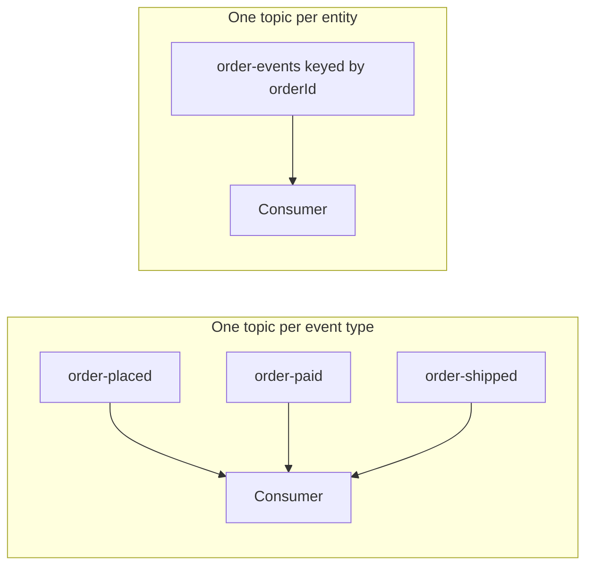

# Topic Design and Naming Conventions

## Introduction

Creating a Kafka topic takes one command. Changing one after twenty services depend on it can take a quarter. The name gets hard-coded into consumers, dashboards and alerts. The partition count fixes how keys are spread out. The retention policy decides whether a new team can replay history. Topic design is cheap to get right on day one and expensive to fix on day three hundred.

This page treats a topic the way you would treat a public API or a database table: a long-lived contract. You will learn how to decide what belongs in one topic, when to split and when to merge, how to build a naming convention that scales across teams, which settings to pin down at creation time, and how to evolve a topic without breaking its readers. The worked scenario designs the topics for an online shop's order platform.

## What a Topic Should Represent

A good topic holds one kind of fact about one part of the business. "Orders that were placed, paid, shipped or cancelled" is a coherent stream. "Everything the checkout service emits" is not, because it mixes facts that different consumers care about and that evolve at different speeds.

A useful test: could you describe the topic in one sentence to a team that has never seen your code, without mentioning the service that writes it? `orders.order-events` passes ("every state change of every order"). `checkout-service-out` fails, because it describes plumbing rather than meaning.

Topics also come in a few recognizable shapes, and it helps to decide which shape you are building before choosing settings.

| Topic shape | What each record means | Typical cleanup policy | Example |
|---|---|---|---|
| Event stream | Something happened at a point in time | `delete` with a time-based retention | `orders.order-events` |
| Entity or state | The latest known state of a thing, keyed by its ID | `compact` (often `compact,delete`) | `catalog.products` |
| Command | A request for a specific service to do something | `delete`, short retention | `payments.charge-requests` |
| Retry or dead letter | A record that failed processing and needs attention | `delete`, long enough to investigate | `notifications.email-sender.dlt` |
| Internal | State owned by one application, not a contract | Set by the framework | `order-stats-app-KSTREAM-AGGREGATE-STATE-STORE-0000000003-changelog` |

Event streams and entity topics are shared contracts. Command, retry and internal topics usually belong to one team. Making that distinction visible in the name, as we will see below, tells other teams which topics they may build on.

## How Fine-Grained Should Topics Be?

The most common design argument is "one topic per event type" versus "one topic per entity with many event types". Both are valid; the deciding question is ordering.

Kafka only guarantees order within a partition. If `OrderPlaced`, `OrderPaid` and `OrderShipped` live in three separate topics, a consumer reading all three can see "shipped" before "paid" for the same order, because the topics are consumed independently. If the three event types share one topic and are keyed by order ID, every event of one order lands in the same partition in the order it was produced.



So the rule of thumb is:

- **Put event types in the same topic when consumers need them in order for the same entity.** The lifecycle of an order, the postings of a bank account, the readings of one sensor.
- **Split into separate topics when the events are consumed by different audiences, have very different volumes, or need different retention.** Clickstream page views (billions per day, keep 7 days) do not belong with order events (thousands per day, keep a year), even if both mention a customer.

A merged topic needs a way to tell event types apart. Put the type in a record header (for example `event-type: OrderPaid`) or use a schema union. With Schema Registry, the `TopicRecordNameStrategy` subject naming strategy lets one topic carry several record schemas, each evolved on its own. The [Schemas as Contracts Between Teams](./2-kafka-schema-and-contract-practices.mdx) page covers this further.

:::tip
If you cannot decide, ask what the most important consumer does. A consumer that rebuilds the state of an order wants one topic. A consumer that only counts sign-ups wants a topic with nothing but sign-ups in it.
:::

The other extreme to avoid is a topic per entity instance: one topic per customer, per tenant or per device. Every topic adds partitions, and every partition adds metadata that the controller and every broker track, files on disk and work during leader elections. Ten thousand customers become ten thousand topics. Use a key instead; that is exactly what keys are for. [Kafka Anti-Patterns](./6-kafka-anti-patterns.mdx) covers this in more detail.

## Building a Naming Convention

Kafka is permissive about names: up to 249 characters from `a-z`, `A-Z`, `0-9`, `.`, `_` and `-`. Anything inside those rules is legal, which is why clusters without a convention end up with `Orders`, `orders_v2`, `ORDER-EVENTS-PROD` and `test123` side by side.

A naming convention exists so that a person can guess a topic's owner, meaning and audience from the name alone, and so that tools (ACLs, quotas, monitoring) can match topics by prefix. A pattern that works well for most organizations is:

```text
<domain>.<dataset>[.<qualifier>][.v<major>]
```

| Part | Meaning | Examples |
|---|---|---|
| `domain` | The business area that owns the data, not the team or service | `orders`, `payments`, `catalog`, `iot` |
| `dataset` | What the records describe, in plural or as a stream noun | `order-events`, `products`, `vehicle-telemetry` |
| `qualifier` | Optional: visibility or purpose | `internal`, `retry`, `dlt`, `cmd` |
| `v<major>` | Optional: the major contract version, added only when a breaking change forces a new topic | `v2` |

Some guidelines that save pain later:

- **Pick one separator and stick to it.** Use dots between the parts and hyphens inside a part. Do not mix dots and underscores: Kafka's consumer metrics have historically replaced dots with underscores, so `orders.events` and `orders_events` can collide in metric names, and the broker warns about it.
- **Use lowercase only.** Case-sensitive names that differ only in case are a trap for humans and for tools.
- **Name by domain, not by team or service.** Teams get reorganized and services get rewritten; the meaning of "payments" survives both.
- **Leave out the environment.** `prod.orders.order-events` implies that dev and prod share a cluster, which they should not. Use separate clusters (or separate virtual clusters in a managed service) and keep the names identical, so configuration does not change between environments.
- **Leave out the consumer.** A topic named after its reader (`orders-for-billing`) gets a second reader the following month and is now misleading.
- **Use prefixes that line up with ACLs.** Kafka ACLs support prefixed resource patterns, so a convention that starts with the domain lets you grant `orders.` to the orders team in one rule. See [Authorization with ACLs](../11-kafka-security/3-kafka-acls-authorization.mdx).

Frameworks create their own topics with their own names. Kafka Streams prefixes internal topics with the `application.id`; Kafka Connect uses the topic names you configure for its config, offset and status storage. Choose those IDs and names so they also follow your convention (for example `application.id=orders.order-stats-app`), which keeps prefix ACLs and monitoring working.

## Settings to Decide at Creation Time

Some topic settings are easy to change later (retention, for example). Others are effectively permanent. Decide these deliberately for every shared topic.

| Setting | Why it matters | Sensible starting point |
|---|---|---|
| Partition count | Caps consumer parallelism; changing it remaps keys to partitions | Size for 2-3 years of growth; see [Choosing the Number of Partitions](../12-kafka-performance/4-kafka-partition-count.mdx) |
| `replication.factor` | How many broker failures you survive | 3 for anything you cannot regenerate |
| `min.insync.replicas` | Makes `acks=all` meaningful | 2 with a replication factor of 3 |
| `cleanup.policy` | Event history or latest state per key | `delete` for events, `compact` for entities |
| `retention.ms` | How far back a new consumer can replay | Long enough for the slowest realistic recovery, often 7 days to forever |
| `max.message.bytes` | The largest record batch accepted | Keep the default near 1 MB unless you have a reason |

Two broker defaults work against you in production. `auto.create.topics.enable` is `true` by default, so a typo in a producer's topic name silently creates a new topic with the broker's `num.partitions` (default 1) and `default.replication.factor` (default 1). Turn auto-creation off in every shared cluster and create topics explicitly.

```properties
# server.properties for a production broker
auto.create.topics.enable=false
default.replication.factor=3
min.insync.replicas=2
num.partitions=6
```

Explicit creation works best as code reviewed in Git rather than as a command someone runs once. Common choices are a Terraform provider for Kafka, Strimzi `KafkaTopic` resources on Kubernetes, the Confluent or MSK APIs for managed services, or a small script that calls the Admin API. Whatever the tool, the topic definition, its owner and its settings live in a pull request that someone reviewed.

```yaml
# Strimzi KafkaTopic resource: the topic, its settings and its owner live in Git
apiVersion: kafka.strimzi.io/v1beta2
kind: KafkaTopic
metadata:
  name: orders.order-events
  labels:
    strimzi.io/cluster: main
  annotations:
    owner: "team-orders"
    description: "Every state change of every order, keyed by orderId"
spec:
  partitions: 24
  replicas: 3
  config:
    cleanup.policy: delete
    retention.ms: "31536000000"   # 365 days
    min.insync.replicas: "2"
```

For one-off local experiments, the CLI is fine:

```bash
kafka-topics.sh --bootstrap-server localhost:9092 --create \
  --topic orders.order-events --partitions 24 --replication-factor 3 \
  --config min.insync.replicas=2 --config retention.ms=31536000000
```

## Evolving and Retiring Topics

Most changes do not need a new topic. Adding an optional field to the schema, raising retention or adding a consumer all happen in place. A new topic is needed when the contract breaks: a different key (which changes ordering), an incompatible schema change, or a different cleanup policy.

When that happens, create `orders.order-events.v2` alongside the old topic rather than reusing the name. A typical migration:

1. The producer writes to both `v1` and `v2` (or a small bridge job translates `v1` into `v2`).
2. Consumers move to `v2` one at a time, each on its own schedule.
3. When the last consumer has moved (consumer group lag and ACL audit logs tell you), stop writing to `v1`.
4. Keep `v1` read-only for one retention period, then delete it.

Retiring a topic follows the same discipline: find all consumer groups that read it (`kafka-consumer-groups.sh --describe --all-groups`), announce a date, and only then delete. Deleting a topic that a forgotten batch job reads once a month is a classic Friday-evening incident.

## Worked Scenario: Topics for an Order Platform

An online shop is moving from a shared database to events. Four teams are involved: orders, payments, inventory and notifications. The first draft from the developers looked like this:

```text
checkout-out
payment_service_events
InventoryUpdates
notifications-orders
orders-prod
```

Every name uses a different style, two are named after services, one includes the environment, and `notifications-orders` is named after its consumer. After a design review they agreed on the following set:

| Topic | Shape | Key | Partitions | Policy | Owner |
|---|---|---|---|---|---|
| `orders.order-events` | Event stream, all order lifecycle events | `orderId` | 24 | delete, 365 days | Orders |
| `payments.payment-events` | Event stream | `orderId` | 24 | delete, 365 days | Payments |
| `payments.charge-requests.cmd` | Command | `orderId` | 12 | delete, 3 days | Payments |
| `inventory.stock-levels` | Entity, latest stock per SKU | `sku` | 12 | compact | Inventory |
| `notifications.email-sender.retry` | Retry | `orderId` | 6 | delete, 7 days | Notifications |
| `notifications.email-sender.dlt` | Dead letter | `orderId` | 3 | delete, 30 days | Notifications |

A few decisions are worth calling out. Order lifecycle events share one topic because the shipping and notification services need "placed, paid, shipped" in order per order. Payment events are a separate topic owned by payments, but they also use `orderId` as the key and the same partition count, so a Kafka Streams join between orders and payments needs no repartitioning. Stock levels are compacted, because a new service only needs the current level per SKU, not every change since the shop opened. The retry and dead letter topics belong to one consumer and say so in the name, which signals "do not build on this".

The team kept the decisions in a `topics/` folder in Git with one file per topic, and an ACL rule that gives each team write access to its own domain prefix.

## Common Mistakes

- Leaving `auto.create.topics.enable=true` in production, so a typo creates a one-partition, unreplicated topic that silently swallows data.
- Splitting the events of one entity across several topics and then discovering that consumers see them out of order.
- Creating a topic per customer, tenant or device instead of using a key.
- Naming topics after the producing service, the consuming service or the team, all of which change faster than the data.
- Putting the environment in the topic name, which forces config changes between environments and hints at a shared cluster.
- Mixing dots and underscores, which can make metric names collide.
- Choosing the partition count for today's traffic and having to remap every key a year later.
- Reusing a topic name for an incompatible contract instead of creating a versioned topic.

## Summary

- Treat a topic as a long-lived contract: one kind of fact about one part of the business, described without mentioning the code that writes it.
- Keep events that must stay ordered per entity in one topic keyed by that entity; split topics by audience, volume and retention.
- Use a convention such as `domain.dataset.qualifier.vN`, lowercase, one separator style, no environment and no consumer names.
- Decide partitions, replication factor, `min.insync.replicas`, cleanup policy and retention deliberately, and manage them as reviewed code.
- Disable topic auto-creation in shared clusters.
- Break a contract by creating a new versioned topic and migrating consumers, never by changing the old one in place.

## Further Reading

- [Apache Kafka documentation: Topic-level configs](https://kafka.apache.org/documentation/#topicconfigs) - every per-topic setting and its default.
- [Apache Kafka documentation: Broker configs](https://kafka.apache.org/documentation/#brokerconfigs) - `auto.create.topics.enable`, `num.partitions` and `default.replication.factor`.
- [Strimzi documentation: Using the Topic Operator](https://strimzi.io/docs/operators/latest/deploying#using-the-topic-operator-str) - managing topics as Kubernetes resources.
- [Confluent documentation: Subject name strategies](https://docs.confluent.io/platform/current/schema-registry/fundamentals/serdes-develop/index.html#subject-name-strategy) - putting several event types in one topic.
- [Topic-Level Configuration](../2-kafka-topics-and-storage/5-kafka-topic-configuration.mdx) - the settings in this page explained one by one.
- [Retention and Log Compaction](../2-kafka-topics-and-storage/3-kafka-retention-and-compaction.mdx) - choosing between event history and latest state.
