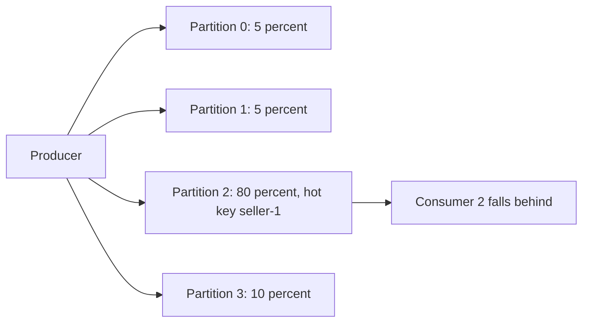

# Designing Partition Keys

## Introduction

The record key is the most consequential field in a Kafka message, and it is often chosen in five seconds ("just use the user ID"). The key decides which partition a record lands in. That in turn decides which records stay in order relative to each other, which consumer instance processes them, how evenly the load spreads over brokers and consumers, and whether two topics can be joined without reshuffling.

A good key is like a good shard key in a database: it groups together exactly what must be processed together and spreads everything else as widely as possible. A bad key gives you either broken ordering or one partition that is ten times hotter than the rest.

By the end of this page you will be able to evaluate candidate keys against four criteria, spot and fix hot keys, avoid the traps around changing partition counts and mixing client libraries, and decide when no key at all is the right answer. The worked scenario designs keys for a ride-hailing company's vehicle telemetry.

## How the Key Becomes a Partition

When a producer sends a record with a non-null key and no explicit partition, the Java client serializes the key to bytes, hashes the bytes with murmur2 and takes the result modulo the number of partitions:

```java
// What the Java client's built-in partitioner does for a keyed record
int partition = Utils.toPositive(Utils.murmur2(serializedKey)) % numPartitions;
```

Three consequences follow directly from this one line:

- **Same key, same partition**, as long as the partition count does not change. That is the basis of per-key ordering.
- **The mapping depends on the partition count.** Add partitions and most keys move to a different partition.
- **The mapping depends on the serialized bytes.** The string `"42"` and the integer `42` hash differently, and so do the same logical key written by two serializers.

Records with a null key are not hashed at all. Since Kafka 3.3 the Java producer fills one partition's batch at a time and then moves on, weighted towards faster brokers (the "uniform sticky" behaviour from KIP-794). That gives good batching and even load but no ordering between any two records. [Keys, Partitioners and Sticky Partitioning](../3-kafka-producers/1-kafka-producer-keys-and-partitioners.mdx) covers the producer mechanics in more depth.

## Four Criteria for a Good Key

Evaluate every candidate key against these four questions, in this order.

**1. Ordering scope: what must stay in order?** Find the smallest unit whose events must be processed in sequence. For a bank, that is usually an account: a withdrawal must not be applied before the deposit that funds it. For an order system, it is an order. For a sensor fleet, it is one sensor. The key must be at least that coarse; anything finer breaks ordering.

**2. Distribution: does it spread evenly?** The key needs many more distinct values than there are partitions (high cardinality), and no single value should dominate the traffic (low skew). A key with 10 distinct values on a 24-partition topic leaves at least 14 partitions empty. A key where one value carries 30% of the traffic gives one partition 30% of the work, no matter how many partitions you add.

**3. Stability: does the value ever change?** The key must be fixed for the life of the entity. If you key by `email` and a customer changes their email, their old and new events end up in different partitions with no ordering between them, and a compacted topic keeps two "latest" records for the same person.

**4. Co-partitioning: who will join this topic?** If two topics will be joined or processed together (orders and payments, say), giving them the same key, the same serializer and the same partition count means record N of order 123 and payment of order 123 sit in partitions with the same number. Kafka Streams can then join them without a repartition step.

The ordering criterion says "coarse enough", the distribution criterion says "fine enough". The right key is the finest one that still satisfies the ordering requirement.

| Candidate key | Ordering scope | Distribution | Stability | Verdict for an order platform |
|---|---|---|---|---|
| `orderId` | Per order | Excellent, millions of values | Never changes | Good default for order events |
| `customerId` | Per customer, all orders | Good, but large business customers skew | Stable | Use when you need per-customer ordering across orders |
| `country` | Per country | Poor, about 50 values, heavily skewed | Stable | Too coarse; creates hot partitions |
| `email` | Per customer | Good | Changes | Unsafe; use an immutable ID instead |
| none | No ordering | Perfect | Not applicable | Fine for independent events such as page views |

## Hot Keys and How to Cool Them

Even a high-cardinality key can have a few values far busier than the rest. A marketplace has one seller with half the listings; a social app has one celebrity account; an IoT fleet has one gateway forwarding for a thousand devices. Every record for that value goes to one partition and is processed by one consumer thread. Adding partitions does not help, because the hot key still hashes to exactly one of them.



Before changing anything, measure. A quick script over a sample of real keys shows whether you have a problem:

```python
# key_skew.py - estimate partition load for a sample of keys
# Usage: python key_skew.py keys.txt 24
import sys
from collections import Counter

def murmur2(data: bytes) -> int:
    """Port of the Java client's murmur2 hash so the partition numbers match."""
    length = len(data)
    seed, m, r = 0x9747B28C, 0x5BD1E995, 24
    h = (seed ^ length) & 0xFFFFFFFF
    for i in range(0, length - length % 4, 4):
        k = int.from_bytes(data[i:i + 4], "little")
        k = (k * m) & 0xFFFFFFFF
        k ^= k >> r
        k = (k * m) & 0xFFFFFFFF
        h = (h * m) & 0xFFFFFFFF
        h ^= k
    tail = data[length - length % 4:]
    if len(tail) == 3:
        h ^= tail[2] << 16
    if len(tail) >= 2:
        h ^= tail[1] << 8
    if len(tail) >= 1:
        h ^= tail[0]
        h = (h * m) & 0xFFFFFFFF
    h ^= h >> 13
    h = (h * m) & 0xFFFFFFFF
    h ^= h >> 15
    return h

keys = [line.strip().encode() for line in open(sys.argv[1]) if line.strip()]
partitions = int(sys.argv[2])
load = Counter((murmur2(k) & 0x7FFFFFFF) % partitions for k in keys)
average = len(keys) / partitions
for p in range(partitions):
    print(f"partition {p:3d}: {load[p]:8d} records  ({load[p] / average:.2f}x average)")
print("top keys:", Counter(keys).most_common(5))
```

```text
partition   0:     4120 records  (0.99x average)
partition   1:     4087 records  (0.98x average)
partition   2:    17950 records  (4.31x average)
...
top keys: [(b'seller-1', 13870), (b'seller-88', 410), ...]
```

When one partition carries several times the average, these are the options, from least to most invasive:

| Technique | How it works | What you give up |
|---|---|---|
| Finer key | Key by `listingId` instead of `sellerId` | Ordering across one seller's listings |
| Composite key | Key by `sellerId + ":" + listingId` | Same as above, but keeps the seller visible in the key |
| Salting | Append a bucket number: `seller-1#0` to `seller-1#7` for known hot keys only | Ordering within that seller; consumers must merge buckets |
| Dedicated topic | Route the few huge tenants to their own topic with more partitions | Extra topic and routing logic |
| Accept and scale vertically | Make the consumer of that partition faster (batching, async I/O) | Nothing structural, but there is a ceiling |

Salting deserves a warning. It turns one ordered stream into several unordered ones, so it is only safe when the work for that key is genuinely independent (counting clicks, for example) or when a downstream step re-establishes order using a sequence number. Apply it only to keys you have measured as hot, not to everything.

:::warning
Adding partitions does not fix a hot key. It also remaps every other key, so for a while the same key has records in two partitions and per-key ordering is broken across the change. Fix the key first.
:::

## Changing Partition Counts and Other Traps

Because the partition is computed as hash modulo count, increasing the partition count from 12 to 24 sends roughly half of all keys to a new partition. Records already written stay where they were. A consumer can therefore see a new event for order 123 on partition 17 before it has finished processing older events for order 123 still waiting on partition 5. Compacted topics also end up with two live records for the same key, in different partitions, until the old one is overwritten.

The practical rules:

- **Choose the partition count for future growth when the topic is created**, so you rarely need to change it. [Choosing the Number of Partitions](../12-kafka-performance/4-kafka-partition-count.mdx) explains how.
- **If you must grow a keyed topic, consider a new topic instead**: create `topic.v2` with more partitions, have a small job copy the data across in order, and move consumers over.
- **Never decrease partitions.** Kafka does not support it; you need a new topic.

The second trap is mixing client libraries. librdkafka, the engine under `confluent-kafka` for Python, Go, .NET and the Confluent JavaScript client, uses `consistent_random` by default, which hashes keys with CRC32, not murmur2. A Python producer and a Java producer writing the same key to the same topic will put it in different partitions, silently breaking ordering and co-partitioning.

```python
from confluent_kafka import Producer

producer = Producer({
    "bootstrap.servers": "localhost:9092",
    # Match the Java client's key-to-partition mapping
    "partitioner": "murmur2_random",
})
```

The third trap is the serializer. Two producers that both "use the customer ID as the key" but serialize it as a string in one and as a long or an Avro record in the other produce different bytes and therefore different partitions. Agree on one key format per topic and write it down in the topic's contract.

## When Not to Use a Key

A key is not mandatory. If your consumers treat every record independently (page views counted in aggregate, log lines shipped to a search index, metrics samples averaged over a minute), a null key gives the best batching and perfectly even distribution. Forcing a key there only creates skew risk for no benefit.

Also resist putting everything a consumer might filter on into the key. The key is for partitioning and compaction, not for querying. Put attributes such as region, tenant or event type in the value or in headers.

## Worked Scenario: Vehicle Telemetry for a Ride-Hailing Fleet

A ride-hailing company streams GPS and engine readings from 200,000 vehicles every two seconds into `fleet.vehicle-telemetry`. Three consumers read the topic: a live map, a trip-distance calculator and an anomaly detector that flags engines overheating.

The first proposal keyed records by `city`, because the live map is organized by city. Running the skew script on a day of real data showed the problem: the top three cities carried 61% of the traffic, and 30 of the 48 partitions were nearly idle. The trip-distance consumer for the busiest city fell hours behind every evening.

The team went back to the four criteria:

- **Ordering scope.** The distance calculator needs one vehicle's readings in order, or a GPS point arriving late creates a zig-zag. Nothing needs ordering across vehicles. So the key must be at least as coarse as a vehicle.
- **Distribution.** 200,000 vehicles on 48 partitions gives about 4,000 vehicles per partition, and no vehicle sends more than any other.
- **Stability.** The licence plate can change when a vehicle is re-registered; the internal `vehicleId` never does.
- **Co-partitioning.** A separate `fleet.vehicle-status` compacted topic (online, offline, in maintenance) is joined with telemetry by the anomaly detector. It was given the same key, the same string serializer and the same 48 partitions.

They switched to `vehicleId` as the key. Partition load flattened to within 3% of the average. The live map still groups by city, but it does so in its own consumer by reading the `city` field from the value, which is where filtering attributes belong.

```java
ProducerRecord<String, String> record = new ProducerRecord<>(
    "fleet.vehicle-telemetry",
    reading.vehicleId(),          // immutable, high cardinality, the ordering unit
    reading.toJson());
record.headers().add("city", reading.city().getBytes(StandardCharsets.UTF_8));
producer.send(record);
```

One edge case remained: a handful of test vehicles in the depot send readings every 100 ms. Rather than salting, the team routed vehicles flagged as test devices to `fleet.vehicle-telemetry.test`, keeping production partitions clean.

## Common Mistakes

- Choosing a low-cardinality key such as country, status or event type, which leaves partitions empty and others overloaded.
- Using a mutable attribute (email, licence plate, username) as the key, which splits one entity across partitions over time.
- Adding partitions to fix a hot key, which does not cool the key and breaks ordering for every other key during the change.
- Mixing librdkafka-based and Java producers on the same keyed topic without setting `partitioner=murmur2_random`.
- Serializing the same logical key differently in different producers.
- Keying records that need no ordering at all, giving up even distribution for nothing.
- Salting every key "just in case" and losing the ordering the key was meant to provide.

## Summary

- The key decides ordering, distribution, consumer assignment and co-partitioning, so choose it deliberately.
- Pick the finest key that still covers the unit that must stay in order, with high cardinality, low skew and a value that never changes.
- Measure skew on real keys before going live; fix hot keys with a finer key, a composite key, targeted salting or a dedicated topic.
- Size partitions for the future, because changing the count remaps keys; prefer a new topic over growing a keyed one.
- Align partitioners and key serializers across all producers of a topic.
- Use null keys when records are truly independent.

## Further Reading

- [Apache Kafka documentation: Producer configs](https://kafka.apache.org/documentation/#producerconfigs) - `partitioner.class` and related settings.
- [KIP-794: Strictly Uniform Sticky Partitioner](https://cwiki.apache.org/confluence/display/KAFKA/KIP-794%3A+Strictly+Uniform+Sticky+Partitioner) - how null-key records are spread since Kafka 3.3.
- [librdkafka CONFIGURATION.md](https://github.com/confluentinc/librdkafka/blob/master/CONFIGURATION.md) - the `partitioner` property and its CRC32 default.
- [Ordering Guarantees and Message Keys](../2-kafka-topics-and-storage/1-kafka-ordering-and-keys.mdx) - the ordering model this page builds on.
- [Joins: Stream-Stream, Stream-Table and Table-Table](../7-kafka-streams/5-kafka-streams-joins.mdx) - why co-partitioning matters for joins.
