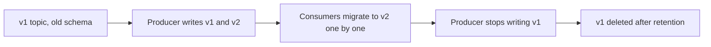

# Schemas as Contracts Between Teams

## Introduction

A REST API has an obvious contract: the endpoint, the request and the response, usually written down in an OpenAPI file. A Kafka topic has a contract too, but it is easy to forget because nobody calls anybody. The producer writes bytes, and somewhere, maybe months later, a consumer the producer has never heard of reads them. If the producer renames a field, nothing fails at deploy time. The consumer fails at 3 a.m., or worse, silently writes nulls into a report.

Decoupling is Kafka's great strength, and it is also why the contract has to be explicit. Because producer and consumer never talk directly, the schema is the only thing they agree on.

This page is about the team practices around schemas rather than the serialization mechanics (those live in [Schemas and Serialization](../6-kafka-schemas/0-kafka-serialization-formats.mdx)). You will learn what a Kafka contract contains beyond the field list, who should own it, how to choose a compatibility mode, how to stop breaking changes in CI before they reach a cluster, and how to ship a change that genuinely must break compatibility. The worked scenario follows a payments team changing how they represent money.

## What the Contract Actually Contains

The value schema is the part everyone thinks of, but consumers depend on more than that. A complete contract for a topic answers these questions:

| Part of the contract | Example | Why consumers care |
|---|---|---|
| Value schema | Avro record `PaymentCaptured` with fields and types | Deserialization and field access |
| Key format | String `orderId`, UTF-8 | Partitioning, joins, compaction |
| Headers | `event-type`, `event-id`, `traceparent` | Routing, deduplication, tracing |
| Semantics | "Emitted once per successful capture; amounts are in minor units" | Correct interpretation |
| Ordering | "Ordered per `orderId`" | Whether consumers can rely on sequence |
| Delivery | "At least once; deduplicate on `event-id`" | Idempotency design |
| Retention | "365 days" | Whether a new consumer can rebuild state from history |
| Owner and support | "Team Payments, #payments-events" | Who to ask and who approves changes |

A schema registry enforces the first row automatically. The rest is documentation, and that is fine, as long as it is written down somewhere consumers can find it. A short README next to the schema file in Git, or an AsyncAPI document, works well. AsyncAPI describes channels (topics), messages and their schemas in the same spirit as OpenAPI does for HTTP, and tools can render it as a browsable catalogue.

A small, consistent set of headers also makes every topic easier to consume. Many organizations adopt the CloudEvents Kafka binding, which puts metadata in headers prefixed with `ce_`:

```text
ce_specversion: 1.0
ce_id:          5f0c2a4e-8d1b-4a7e-9c55-0b1f6f7e2a91
ce_source:      /payments/capture-service
ce_type:        com.example.payments.PaymentCaptured
ce_time:        2026-10-17T09:12:44Z
```

With an ID and a type on every record, any consumer can deduplicate and route without parsing the payload.

## Ownership: The Producer Owns the Schema

The team that writes a topic owns its schema. They decide what the data means, they are the only ones who can guarantee it, and they are the ones who will be paged if it is wrong. This mirrors service ownership: you own your API.

Ownership does not mean consumers have no voice. Two practices keep the relationship healthy:

- **Changes go through review.** Schema files live in Git, usually in the producing service's repository or in a shared schema repository, and changes are pull requests. Known consumers are added as reviewers or notified automatically.
- **Consumers declare what they depend on.** A consumer that relies on a field being present, or on an enum having a certain set of values, says so, ideally as a test (see [Testing Kafka Applications](./4-kafka-testing-strategies.mdx)). That turns "I didn't know anyone used that field" into a failing build.

The opposite model, where a central data team owns every schema, tends to become a bottleneck. It works for a small number of very important, cross-company topics (customer master data, for example) but not as the default. [Schema Governance in a Team](../6-kafka-schemas/5-kafka-schema-governance.mdx) discusses organizational models in more detail.

## Choosing a Compatibility Mode

A schema registry rejects a new schema version that breaks the subject's compatibility rule. The rule you choose decides which changes are allowed and, just as important, which side must be deployed first.

| Mode | New schema can read old data? | Old schema can read new data? | Who upgrades first | Safe changes |
|---|---|---|---|---|
| `BACKWARD` (registry default) | Yes | Not guaranteed | Consumers | Add optional fields, delete fields |
| `FORWARD` | Not guaranteed | Yes | Producers | Add fields, delete optional fields |
| `FULL` | Yes | Yes | Either, independently | Add or delete optional fields only |
| `*_TRANSITIVE` variants | Checked against every earlier version, not just the latest | | Same as base mode | Same as base mode |
| `NONE` | No checks | No checks | Coordinated release | Anything, at your own risk |

Here "optional" means a field with a default value in Avro, a field in Protobuf (all are optional in proto3) or a non-required property in JSON Schema.

How to choose:

- **Topics with many consumers you do not control: `FULL_TRANSITIVE` or `FORWARD_TRANSITIVE`.** With an event stream read by ten teams, you cannot make all ten upgrade before you deploy. Forward compatibility guarantees that consumers still on the old schema can read records written with the new one, so the producer can ship whenever it likes.
- **Topics replayed from the beginning: a transitive mode.** A consumer reprocessing a year of history will meet every schema version ever written. Checking only against the latest version does not prove that version 7 can read version 2.
- **Kafka Streams state and internal topics: `BACKWARD` is fine.** The same application reads what it wrote, and you control the deployment order.
- **`NONE`: only for topics nobody outside your team reads.** Even then, prefer a real rule; the cost is near zero.

Set the mode per subject so the decision is explicit:

```bash
# Set FULL_TRANSITIVE for the value subject of payments.payment-events
curl -s -X PUT http://localhost:8081/config/payments.payment-events-value \
  -H "Content-Type: application/vnd.schemaregistry.v1+json" \
  -d '{"compatibility": "FULL_TRANSITIVE"}'
```

```json
{"compatibility":"FULL_TRANSITIVE"}
```

## Rules for Evolving a Schema

Whatever the mode, the same handful of habits keeps changes safe:

- **Add fields with a default.** A new `currency` field with default `"EUR"` can be read by old and new code alike.
- **Never rename a field.** A rename is a delete plus an add, and breaks every consumer that reads the old name. Add the new field, populate both for a while, and delete the old one later.
- **Never change a field's type in place**, except for the few promotions the format explicitly allows (for example `int` to `long` in Avro).
- **Never reuse a field name or Protobuf field number** for a different meaning. Old records in the topic still carry the old meaning.
- **Be careful with enums.** Adding a symbol breaks old readers in Avro unless the enum declares a default symbol. Give every enum a fallback such as `UNKNOWN` from day one.
- **Deprecate before you delete.** Mark the field deprecated in the schema documentation, announce a date, check that no consumer still reads it, then remove it.

[Schema Evolution and Compatibility Rules](../6-kafka-schemas/4-kafka-schema-evolution.mdx) walks through these rules format by format.

## Enforcing the Contract in CI and at Runtime

The registry is the last line of defence, not the first. If an incompatible schema is only rejected when the producer starts in production, the deployment fails at the worst moment. Check compatibility in the pull request instead.

The registry's REST API can test a candidate schema without registering it:

```bash
# Ask the registry whether a candidate schema would be accepted
SCHEMA=$(jq -Rs . < src/main/avro/payment-captured.avsc)
curl -s -X POST \
  http://schema-registry:8081/compatibility/subjects/payments.payment-events-value/versions/latest \
  -H "Content-Type: application/vnd.schemaregistry.v1+json" \
  -d "{\"schema\": $SCHEMA}"
```

```json
{"is_compatible":false,"messages":["READER_FIELD_MISSING_DEFAULT_VALUE: currency"]}
```

For Java builds, Confluent's `kafka-schema-registry-maven-plugin` wraps the same check in its `test-compatibility` goal, so `mvn verify` fails when a schema change is incompatible. Gradle and standalone CLI tools offer the same.

At runtime, stop producers from registering schemas on their own. By default the Confluent serializers register whatever schema the producer was compiled with, which means a developer's laptop can push a new version to a shared registry. In production, register schemas from CI only and configure producers to look them up:

```properties
# Producer serializer settings for production
schema.registry.url=https://schema-registry.internal:8081
auto.register.schemas=false
use.latest.version=true
```

With `auto.register.schemas=false`, a producer whose schema was never registered fails fast at startup instead of quietly creating version 14.

:::tip
Treat the schema registry like a production database: CI registers schemas, applications only read them, and humans change compatibility settings through reviewed code.
:::

## Shipping a Breaking Change

Sometimes a change cannot be made compatible: the key has to change, a field's meaning is wrong, or a type was a mistake. Do not set the subject to `NONE` and hope. Treat it like a new major API version.



1. Create a new topic, for example `payments.payment-events.v2`, with the new schema in its own subject.
2. Have the producer write both versions, or run a small translator that reads `v1` and writes `v2`.
3. Announce the migration and the sunset date to every consumer team.
4. Track progress with consumer group lag on `v1`: when no active group reads it, nobody depends on it.
5. Stop writing `v1`, keep it readable for one retention period, then delete it.

This costs more than an in-place change, which is the point: it makes breaking changes rare and deliberate.

## Worked Scenario: Changing How Money Is Represented

The payments team publishes `PaymentCaptured` events to `payments.payment-events`, read by billing, analytics, fraud detection and a partner-reporting job. The original schema stored the amount as a floating-point number:

```json
{
  "type": "record",
  "name": "PaymentCaptured",
  "namespace": "com.example.payments",
  "fields": [
    {"name": "paymentId", "type": "string"},
    {"name": "orderId", "type": "string"},
    {"name": "amount", "type": "double"}
  ]
}
```

Analytics discovered rounding errors (0.1 plus 0.2 is not 0.3 in floating point) and the company started selling in a second currency. A developer opened a pull request changing `amount` to a `long` of minor units and adding `currency`. The CI compatibility check failed: changing `double` to `long` is not an allowed promotion, and the subject is configured `FULL_TRANSITIVE`.

The team chose a compatible path instead of a new topic:

```json
{
  "type": "record",
  "name": "PaymentCaptured",
  "namespace": "com.example.payments",
  "fields": [
    {"name": "paymentId", "type": "string"},
    {"name": "orderId", "type": "string"},
    {"name": "amount", "type": "double", "doc": "Deprecated: use amountMinor and currency. Removal planned for 2027-04."},
    {"name": "amountMinor", "type": ["null", "long"], "default": null, "doc": "Amount in minor units, for example cents"},
    {"name": "currency", "type": "string", "default": "EUR", "doc": "ISO 4217 currency code"}
  ]
}
```

Both new fields have defaults, so old consumers ignore them and new consumers reading old records get `null` and `"EUR"`. The producer populates all three fields. Consumers moved to `amountMinor` over the following two months, each adding a test that asserts the field is present. The README beside the schema recorded the semantics ("minor units, never negative, refunds are a separate event"). When the last consumer had migrated, the deprecated `amount` field was given a default and then removed, a change `FULL_TRANSITIVE` accepts because the field is now optional.

The alternative, a `payments.payment-events.v2` topic, was considered and rejected: the change could be made compatibly, so the cost of dual topics was not justified.

## Common Mistakes

- Treating the schema as the whole contract and leaving key format, ordering, semantics and ownership undocumented.
- Leaving `auto.register.schemas` at its default in production, so any producer build can push a new schema version.
- Using the default `BACKWARD` mode on a topic with many independent consumers, then deploying the producer first.
- Checking compatibility only against the latest version on topics that are replayed from the beginning.
- Renaming fields or changing types in place.
- Enums without a default symbol, so adding a value breaks old readers.
- Setting compatibility to `NONE` "just for this one deploy".

## Summary

- A topic's contract covers the value schema, key format, headers, semantics, ordering, delivery guarantees, retention and ownership.
- The producing team owns the schema; consumers make their dependencies visible through review and tests.
- Choose a compatibility mode by asking who deploys first and whether history is replayed; transitive forward or full modes suit shared event streams.
- Add fields with defaults, never rename or retype, give enums a fallback and deprecate before deleting.
- Check compatibility in CI, register schemas from CI only and set `auto.register.schemas=false` in production producers.
- Ship unavoidable breaking changes as a new versioned topic with a planned migration.

## Further Reading

- [Confluent documentation: Schema evolution and compatibility](https://docs.confluent.io/platform/current/schema-registry/fundamentals/schema-evolution.html) - the compatibility modes and allowed changes per format.
- [Confluent documentation: Schema Registry Maven plugin](https://docs.confluent.io/platform/current/schema-registry/develop/maven-plugin.html) - the `test-compatibility` and `register` goals.
- [Apache Avro specification: Schema resolution](https://avro.apache.org/docs/current/specification/#schema-resolution) - exactly how Avro reconciles reader and writer schemas.
- [CloudEvents Kafka protocol binding](https://github.com/cloudevents/spec/blob/main/cloudevents/bindings/kafka-protocol-binding.md) - a standard set of metadata headers.
- [AsyncAPI specification](https://www.asyncapi.com/docs/reference/specification/latest) - documenting topics and messages as a contract.
- [Schema Registry: Why and How](../6-kafka-schemas/1-kafka-schema-registry.mdx) - setting up and using a registry.
