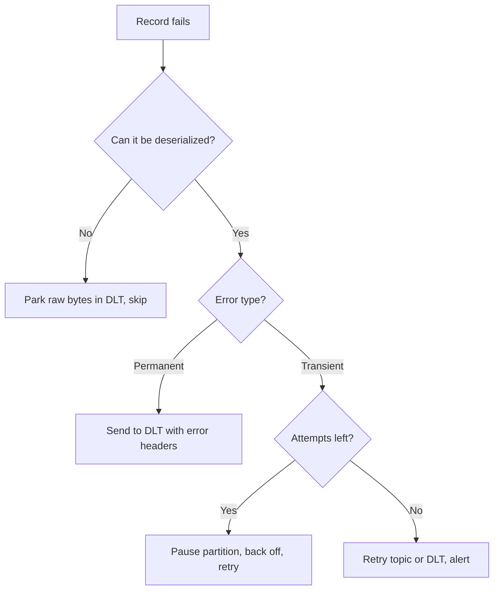

# Designing for Failure

## Introduction

In a distributed system, failure is not an exception path; it is a normal Tuesday. Brokers restart during rolling upgrades. Networks drop packets. A consumer pod is evicted halfway through a batch. A third-party API goes down for an hour. A producer in another team ships a record your deserializer has never seen. Kafka itself is very good at surviving the first two. Whether your application survives the rest depends on design decisions you make before the first incident.

The goal is not to prevent failure but to make every failure boring: no lost data, no duplicated side effects, no partition stuck forever behind one bad record, and an alert that tells a human what to do.

This page gives you a vocabulary for the failures a Kafka application meets, a set of principles that address them, and a concrete consumer loop that puts the principles together. You will be able to classify errors as transient or permanent, choose between retrying, pausing and dead-lettering, and design processing that tolerates the duplicates at-least-once delivery will hand you. The worked scenario is a notification service whose email provider has an outage.

## A Map of What Goes Wrong

It helps to sort failures by where they happen and whether they fix themselves.

| Failure | Where | Transient? | What you see | Primary defence |
|---|---|---|---|---|
| Broker restart, leader election | Cluster | Yes, seconds | `NotLeaderOrFollowerException`, brief latency spike | Client retries (built in) |
| Not enough in-sync replicas | Cluster | Usually | `NotEnoughReplicasException` on `acks=all` | Retries within `delivery.timeout.ms`, alerting |
| Producer cannot deliver in time | Producer | Maybe | `TimeoutException` in the send callback | Handle the callback; outbox for critical data |
| Consumer crash mid-batch | Consumer | Yes | Records reprocessed after restart | Idempotent processing |
| Poison pill: record cannot be deserialized | Consumer | No | `RecordDeserializationException` from `poll()` | Skip and park the raw bytes |
| Invalid business data | Consumer | No | Validation error in your code | Dead letter topic |
| Downstream outage (database, API) | Consumer | Yes, minutes to hours | Timeouts, 5xx responses | Pause, back off, resume |
| Slow processing | Consumer | Yes | Rebalances, `max.poll.interval.ms` exceeded | Smaller batches, async work, tuning |
| Region loss | Everything | Hours | Cluster unreachable | Multi-region design |

The most important column is the third. Transient failures should be retried, ideally without a human. Permanent failures must not be retried, because retrying a record that can never succeed blocks everything behind it in the partition. Getting this classification wrong is the root of most Kafka incidents.

## Principle 1: Assume At-Least-Once, Build Idempotent Consumers

With the usual pattern of processing a batch and then committing offsets, a crash between the two means the batch is processed again after restart. A rebalance can do the same. So can a producer retry when the acknowledgement, not the write, was lost (the idempotent producer removes that last case within one producer session, but not the others).

Exactly-once transactions exist, but they only cover Kafka-to-Kafka flows. The moment your consumer writes to a database, calls an API or sends an email, you are back to at-least-once. The robust answer is to make the side effect safe to repeat:

- **Natural idempotency:** "set order 123 status to SHIPPED" is safe to repeat; "add 10 to the balance" is not.
- **Deduplication by event ID:** store processed event IDs in the same database transaction as the side effect, and skip IDs you have seen.
- **Upserts keyed by a business ID** instead of inserts.
- **Idempotency keys for external APIs**, when the provider supports them (most payment APIs do).

[Idempotent Consumers and Deduplication](../9-kafka-patterns/4-kafka-idempotent-consumers.mdx) covers the implementation patterns.

## Principle 2: Classify Every Error

Every exception your handler can throw belongs in one of two buckets, and the code should make the bucket explicit rather than catching `Exception` and hoping.

```java
/** Retrying may succeed: timeouts, 503s, deadlocks, connection resets. */
class TransientProcessingException extends RuntimeException {
    TransientProcessingException(String message, Throwable cause) { super(message, cause); }
}

/** Retrying will never succeed: validation failures, unknown references, 4xx responses. */
class PermanentProcessingException extends RuntimeException {
    PermanentProcessingException(String message, Throwable cause) { super(message, cause); }
}
```

When in doubt, treat an unknown error as transient for a bounded number of attempts and then as permanent. That bound matters: an infinite retry loop on one record is the same as an outage for the whole partition.



## Principle 3: Never Block a Partition on a Permanent Error

A Kafka partition is a queue with a single reader. If the record at offset 1,000 can never be processed and the consumer keeps retrying it, offsets 1,001 onwards wait forever. Consumer lag grows, and every customer whose key hashes to that partition is affected by one bad record.

The standard answer is a dead letter topic (DLT): publish the failed record to a separate topic, with headers explaining what went wrong, commit past it, and carry on. The DLT is monitored, and a human or a repair job decides what to do with its contents. Useful headers include the original topic, partition and offset, the exception class and message, the number of attempts and a timestamp.

Deserialization failures are a special case because there is no object to hand to your code. The Java consumer throws `RecordDeserializationException` from `poll()`, and since Kafka 3.8 the exception carries the partition, offset and raw key and value bytes, so you can park the record and seek past it.

There is one important caveat. Dead-lettering breaks per-key ordering: if event 5 for an order goes to the DLT and event 6 is processed, the consumer has now applied 6 without 5. For order lifecycles or account ledgers, either park all subsequent events for that key too (keep a small "blocked keys" set and route their events to the DLT until the first is fixed), or stop and alert instead of skipping. [Dead Letter Topics and Retry Topics](../9-kafka-patterns/3-kafka-dead-letter-queues.mdx) discusses these variants.

## Principle 4: Pause, Do Not Drown, When Downstream Is Down

When the database or an external API is unavailable, every record fails with the same transient error. Sending them all to the DLT would bury the real poison pills under thousands of perfectly good records. Retrying each record in a tight loop hammers a service that is already struggling.

Instead, stop consuming the affected partitions for a while. `KafkaConsumer.pause()` stops fetching from the given partitions while `poll()` keeps the consumer alive in its group. After a back-off, `resume()` and try again, starting from the failed record. Combine that with exponential back-off and a circuit breaker around the downstream call so the whole consumer slows down together rather than one partition at a time.

:::warning
Do not sleep inside the poll loop to back off. If the time between two `poll()` calls exceeds `max.poll.interval.ms` (5 minutes by default), the consumer is removed from the group and its partitions are handed to another instance, which will hit the same outage and do the same thing. Pause and keep polling.
:::

## Principle 5: Make the Producer Side Explicit

Producer failures are quieter than consumer failures because `send()` is asynchronous. If you ignore the returned future or callback, a record that could not be delivered within `delivery.timeout.ms` (two minutes by default) is simply gone, and the only trace is a log line.

```java
producer.send(record, (metadata, exception) -> {
    if (exception != null) {
        // Retries are already exhausted here. Decide: fail the request, alert, or store for later.
        log.error("Could not publish order event {}", record.key(), exception);
        failedPublishes.increment();
    }
});
```

Since Kafka 3.0 the producer defaults to `acks=all` and idempotence, with effectively unlimited retries bounded by `delivery.timeout.ms`. Leave those defaults alone for anything important and pair them with `min.insync.replicas=2` on the topic.

The harder problem is the dual write: updating a database and publishing an event as two separate steps. If the process dies between them, one happens without the other. When the database is the source of truth, use the [Transactional Outbox Pattern](../9-kafka-patterns/1-kafka-outbox-pattern.mdx): write the event to an outbox table in the same transaction and let a relay (often Debezium) publish it.

## Putting It Together: A Resilient Consumer Loop

The loop below applies the principles with the plain Java client. It parks poison pills, dead-letters permanent failures, pauses partitions on transient failures and commits only what it has finished. Spring Kafka users get most of this from `DefaultErrorHandler` with a `DeadLetterPublishingRecoverer`, but seeing it written out shows what those components do.

```java
public void run() {
    consumer.subscribe(List.of("payments.payment-events"));
    Map<TopicPartition, Long> pausedUntil = new HashMap<>();
    try {
        while (running) {
            resumeDuePartitions(pausedUntil);

            ConsumerRecords<String, PaymentEvent> records;
            try {
                records = consumer.poll(Duration.ofMillis(500));
            } catch (RecordDeserializationException e) {
                // Poison pill: keep the raw bytes for inspection, then skip it
                parkRaw(e.topicPartition(), e.offset(), e.keyBuffer(), e.valueBuffer(), e);
                consumer.seek(e.topicPartition(), e.offset() + 1);
                continue;
            }

            Map<TopicPartition, OffsetAndMetadata> done = new HashMap<>();
            for (TopicPartition tp : records.partitions()) {
                for (ConsumerRecord<String, PaymentEvent> rec : records.records(tp)) {
                    try {
                        handler.handle(rec.value());              // idempotent side effect
                    } catch (PermanentProcessingException e) {
                        deadLetter(rec, e);                         // park it and move on
                    } catch (TransientProcessingException e) {
                        // Downstream is unhealthy: rewind to this record and stop fetching for a while
                        consumer.seek(tp, rec.offset());
                        consumer.pause(Set.of(tp));
                        pausedUntil.put(tp, System.currentTimeMillis() + backoff.nextDelayMs(tp));
                        break;                                      // skip the rest of this partition's batch
                    }
                    done.put(tp, new OffsetAndMetadata(rec.offset() + 1));
                }
            }
            if (!done.isEmpty()) {
                consumer.commitSync(done);                          // commit only finished work
            }
        }
    } catch (WakeupException e) {
        if (running) throw e;                                       // unexpected wakeup
    } finally {
        consumer.close();
    }
}

private void resumeDuePartitions(Map<TopicPartition, Long> pausedUntil) {
    long now = System.currentTimeMillis();
    Set<TopicPartition> due = new HashSet<>();
    pausedUntil.forEach((tp, until) -> { if (until <= now) due.add(tp); });
    due.retainAll(consumer.assignment());                           // a rebalance may have moved them
    consumer.resume(due);
    pausedUntil.keySet().removeIf(tp -> due.contains(tp) || !consumer.assignment().contains(tp));
}

private void deadLetter(ConsumerRecord<String, PaymentEvent> rec, Exception e) {
    ProducerRecord<String, PaymentEvent> dlt =
        new ProducerRecord<>("notifications.payment-notifier.dlt", rec.key(), rec.value());
    dlt.headers()
        .add("dlt.original.topic", rec.topic().getBytes(StandardCharsets.UTF_8))
        .add("dlt.original.partition", Integer.toString(rec.partition()).getBytes(StandardCharsets.UTF_8))
        .add("dlt.original.offset", Long.toString(rec.offset()).getBytes(StandardCharsets.UTF_8))
        .add("dlt.exception", e.getClass().getName().getBytes(StandardCharsets.UTF_8))
        .add("dlt.message", String.valueOf(e.getMessage()).getBytes(StandardCharsets.UTF_8));
    try {
        dltProducer.send(dlt).get();       // wait: never commit past a record we failed to park
    } catch (Exception sendFailure) {
        throw new TransientProcessingException("DLT unavailable", sendFailure);
    }
}
```

Two details are easy to miss. The dead-letter send is synchronous, because committing past a record that was neither processed nor parked would lose it. And a shutdown hook calls `consumer.wakeup()` after setting `running` to false, so the loop exits cleanly, commits what it finished and leaves the group immediately instead of waiting for a session timeout.

## Worked Scenario: The Email Provider Goes Down

A payments company runs a notification service that reads `payments.payment-events` and emails a receipt for every captured payment. One afternoon the email provider starts returning HTTP 503 for every request, and stays down for 70 minutes.

In the original design, the handler caught every exception and sent the record to the DLT. Within minutes the DLT held 180,000 receipts. When the provider recovered, someone had to write a one-off job to replay them, and while doing so they sent 9,000 duplicates because some "failed" requests had actually been delivered before timing out.

The redesign applied the principles on this page:

- **Classification.** HTTP 503, 429 and timeouts are transient. HTTP 400 (malformed address) and "unknown customer" are permanent.
- **Pause instead of dead-lettering.** On a transient error the partition is paused with exponential back-off (1 s, 2 s, 4 s, capped at 60 s). A circuit breaker opens after 20 consecutive failures, so all partitions back off together.
- **Idempotency key.** Each email request carries the payment's event ID as the provider's idempotency key, so a request that timed out but was delivered is not delivered twice on retry.
- **Alerting on lag in time.** An alert fires when the oldest unprocessed receipt is more than 10 minutes old, not on each failed request.

During the next outage the DLT stayed nearly empty (three genuinely malformed addresses). Consumer lag grew to 70 minutes, the alert fired, the on-call engineer confirmed the provider's status page and did nothing else. When the provider recovered, the service drained the backlog in nine minutes with no duplicates.

The alternative the team considered, a chain of retry topics with delays (`retry-1m`, `retry-10m`), suits failures that affect individual records. For an outage that affects every record, pausing is simpler and preserves per-key ordering.

## Common Mistakes

- Catching every exception and dead-lettering it, so a downstream outage floods the DLT with good records.
- Retrying a permanent error forever, which blocks the partition and every key behind it.
- Sleeping in the poll loop to back off, which triggers a rebalance once `max.poll.interval.ms` passes.
- Ignoring the producer's callback or future, so delivery failures disappear into a log.
- Committing offsets before the side effect has completed, or committing past a record that failed to reach the DLT.
- Assuming exactly-once covers database writes or HTTP calls.
- Dead-lettering one event of an ordered stream and then applying later events for the same key.
- Updating a database and publishing to Kafka as two independent steps.

## Summary

- Sort failures into transient and permanent; retry the first with bounds and back-off, never retry the second.
- Assume at-least-once delivery and make side effects idempotent with event IDs, upserts or idempotency keys.
- Move permanent failures and poison pills to a dead letter topic with context headers so the partition keeps flowing.
- When a dependency is down, pause partitions and keep polling rather than retrying in a tight loop or dead-lettering everything.
- Always handle producer callbacks, keep `acks=all` and idempotence, and use an outbox for database-plus-Kafka writes.
- Alert on the age of unprocessed work, not on individual errors.

## Further Reading

- [Apache Kafka javadoc: KafkaConsumer](https://kafka.apache.org/43/javadoc/org/apache/kafka/clients/consumer/KafkaConsumer.html) - `pause()`, `resume()`, `wakeup()` and the threading rules.
- [Apache Kafka documentation: Producer configs](https://kafka.apache.org/documentation/#producerconfigs) - `delivery.timeout.ms`, `retries` and idempotence defaults.
- [KIP-1036: Extend RecordDeserializationException exception](https://cwiki.apache.org/confluence/display/KAFKA/KIP-1036%3A+Extend+RecordDeserializationException+exception) - access to raw bytes of poison pills.
- [Spring Kafka reference: Handling exceptions](https://docs.spring.io/spring-kafka/reference/kafka/annotation-error-handling.html) - `DefaultErrorHandler` and `DeadLetterPublishingRecoverer`.
- [Producer Errors, Retries and Timeouts](../3-kafka-producers/6-kafka-producer-errors-and-retries.mdx) - the producer side of failure in depth.
- [At-Most-Once, At-Least-Once and Exactly-Once](../4-kafka-consumers/4-kafka-delivery-semantics.mdx) - the delivery guarantees behind Principle 1.
