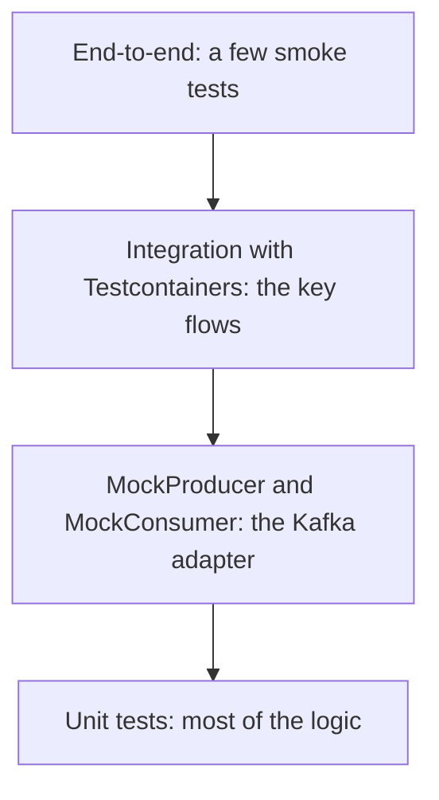

# Testing Kafka Applications

## Introduction

Kafka code has a reputation for being hard to test. Messages are asynchronous, a broker is a heavyweight dependency, consumer groups take time to settle, and the bugs that matter (a wrong key, a missing header, an offset committed too early, a serializer mismatch) tend to show up only when real bytes go through a real broker. Teams react in one of two ways: they mock everything and miss those bugs, or they test everything end-to-end in a shared staging cluster and live with slow, flaky builds.

There is a better middle path. Keep business logic free of Kafka so it can be tested in milliseconds, use the client library's mocks for the thin layer that talks to Kafka, and run a focused set of integration tests against a real, throwaway broker started by Testcontainers in a few seconds.

This page shows each layer with runnable Java and Python code, explains what each layer can and cannot catch, and covers the techniques that keep asynchronous tests reliable. You will also see how to test failure behaviour, which is where most production incidents start. The worked scenario tests an order service's event publisher and consumer.

## A Testing Pyramid for Kafka

Each layer catches a different class of bug, at a different cost.

| Layer | What runs | Speed | Catches | Misses |
|---|---|---|---|---|
| Unit tests | Your business logic, no Kafka types | Milliseconds | Wrong calculations, wrong decisions | Anything about serialization, keys, offsets |
| Client mocks | `MockProducer`, `MockConsumer` | Milliseconds | Wrong topic, key or headers; callback and error handling; commit logic | Real serializers against a registry, broker behaviour, rebalances |
| Integration tests | Real broker in Docker via Testcontainers | Seconds | Serialization, topic config, consumer group behaviour, end-to-end flow inside one service | Interactions with other teams' services |
| Contract tests | Schema compatibility checks in CI | Seconds | Breaking schema changes before they ship | Semantics not captured by the schema |
| End-to-end | Several services in a staging environment | Minutes | Wiring and configuration across services | Little, but slow and flaky |



The structure of the code decides how much of the pyramid is cheap. If the logic that turns an order into an event lives inside a `KafkaConsumer` poll loop, every test of that logic needs Kafka. If it lives in a plain function that takes a domain object and returns a domain object, a one-line unit test covers it. Keep the poll loop and the `send()` call in a thin adapter and push everything else out of it.

## Layer 1 and 2: Unit Tests and Client Mocks

The Java client ships `MockProducer` and `MockConsumer` in `kafka-clients` itself, so there is nothing extra to install. They implement the same `Producer` and `Consumer` interfaces as the real clients. That only helps if your code depends on the interfaces, so inject a `Producer<String, String>` rather than constructing a `KafkaProducer` inside the class.

Here is the adapter under test:

```java
public class OrderEventPublisher {
    private final Producer<String, String> producer;
    private final String topic;

    public OrderEventPublisher(Producer<String, String> producer, String topic) {
        this.producer = producer;
        this.topic = topic;
    }

    public CompletableFuture<Void> orderPlaced(String orderId, String json) {
        CompletableFuture<Void> result = new CompletableFuture<>();
        ProducerRecord<String, String> record = new ProducerRecord<>(topic, orderId, json);
        record.headers().add("event-type", "OrderPlaced".getBytes(StandardCharsets.UTF_8));
        producer.send(record, (metadata, exception) -> {
            if (exception != null) result.completeExceptionally(exception);
            else result.complete(null);
        });
        return result;
    }
}
```

And the tests. With `autoComplete` set to `false`, the mock holds every send until the test decides whether it succeeds or fails, which makes the error path as easy to test as the happy path.

```java
class OrderEventPublisherTest {

    @Test
    void sendsKeyedRecordWithEventTypeHeader() {
        MockProducer<String, String> producer =
            new MockProducer<>(true, null, new StringSerializer(), new StringSerializer());
        OrderEventPublisher publisher = new OrderEventPublisher(producer, "orders.order-events");

        publisher.orderPlaced("order-42", "{\"total\":4999}").join();

        ProducerRecord<String, String> sent = producer.history().get(0);
        assertThat(sent.topic()).isEqualTo("orders.order-events");
        assertThat(sent.key()).isEqualTo("order-42");   // the key decides ordering, so test it
        assertThat(new String(sent.headers().lastHeader("event-type").value(), StandardCharsets.UTF_8))
            .isEqualTo("OrderPlaced");
    }

    @Test
    void surfacesDeliveryFailures() {
        MockProducer<String, String> producer =
            new MockProducer<>(false, null, new StringSerializer(), new StringSerializer());
        OrderEventPublisher publisher = new OrderEventPublisher(producer, "orders.order-events");

        CompletableFuture<Void> result = publisher.orderPlaced("order-42", "{}");
        producer.errorNext(new TimeoutException("simulated delivery timeout"));

        assertThat(result).isCompletedExceptionally();
    }
}
```

`MockConsumer` works the other way round: the test assigns partitions, sets starting offsets and feeds records in. In Kafka 4.x the constructor takes the `auto.offset.reset` value as a string; the older constructor that took an `OffsetResetStrategy` enum is deprecated.

```java
@Test
void commitsOnlyAfterProcessing() {
    MockConsumer<String, String> consumer = new MockConsumer<>("earliest");
    TopicPartition tp = new TopicPartition("orders.order-events", 0);
    consumer.assign(List.of(tp));
    consumer.updateBeginningOffsets(Map.of(tp, 0L));
    consumer.addRecord(new ConsumerRecord<>("orders.order-events", 0, 0L, "order-42", "{\"total\":4999}"));

    List<String> processed = new ArrayList<>();
    OrderEventsWorker worker = new OrderEventsWorker(consumer, processed::add);
    worker.pollOnce();

    assertThat(processed).containsExactly("order-42");
    assertThat(consumer.committed(Set.of(tp)).get(tp).offset()).isEqualTo(1L);
}
```

Mocks are fast and precise, but they do not serialize against a schema registry, enforce topic configuration, run a group coordinator or rebalance. For those you need a real broker.

## Layer 3: Integration Tests with Testcontainers

Testcontainers starts Docker containers from your test code and throws them away afterwards. Its Kafka module starts a single-node KRaft broker in a few seconds and tells you the bootstrap address. Each test run gets a clean broker, so there is no shared state, no "who left a consumer group running in staging", and the same tests run on a laptop and in CI.

In Testcontainers for Java 2.x the module artifacts carry a `testcontainers-` prefix, and there are two Kafka container classes in the `org.testcontainers.kafka` package: `KafkaContainer` for the official `apache/kafka` and `apache/kafka-native` images, and `ConfluentKafkaContainer` for `confluentinc/cp-kafka` 7.4 and later. The older `org.testcontainers.containers.KafkaContainer` is deprecated.

```xml
<dependencies>
  <dependency>
    <groupId>org.apache.kafka</groupId>
    <artifactId>kafka-clients</artifactId>
    <version>4.3.1</version>
  </dependency>
  <dependency>
    <groupId>org.testcontainers</groupId>
    <artifactId>testcontainers-kafka</artifactId>
    <version>2.0.5</version>
    <scope>test</scope>
  </dependency>
  <dependency>
    <groupId>org.testcontainers</groupId>
    <artifactId>testcontainers-junit-jupiter</artifactId>
    <version>2.0.5</version>
    <scope>test</scope>
  </dependency>
  <dependency>
    <groupId>org.junit.jupiter</groupId>
    <artifactId>junit-jupiter</artifactId>
    <version>5.13.4</version>
    <scope>test</scope>
  </dependency>
  <dependency>
    <groupId>org.assertj</groupId>
    <artifactId>assertj-core</artifactId>
    <version>3.27.3</version>
    <scope>test</scope>
  </dependency>
  <dependency>
    <groupId>org.awaitility</groupId>
    <artifactId>awaitility</artifactId>
    <version>4.3.0</version>
    <scope>test</scope>
  </dependency>
</dependencies>
```

The test below creates a topic, publishes through the real `OrderEventPublisher` with a real `KafkaProducer`, and reads the result back with a real consumer group:

```java
@Testcontainers
class OrderEventPublisherIT {

    // static: one broker for every test in this class, started before the first test
    @Container
    static final KafkaContainer kafka = new KafkaContainer("apache/kafka:4.3.1");

    @Test
    void publishedEventCanBeConsumed() throws Exception {
        String topic = "orders.order-events." + UUID.randomUUID();   // isolate this test's data
        try (Admin admin = Admin.create(Map.of(
                AdminClientConfig.BOOTSTRAP_SERVERS_CONFIG, kafka.getBootstrapServers()))) {
            admin.createTopics(List.of(new NewTopic(topic, 3, (short) 1))).all().get();
        }

        Map<String, Object> producerProps = Map.of(
            ProducerConfig.BOOTSTRAP_SERVERS_CONFIG, kafka.getBootstrapServers(),
            ProducerConfig.KEY_SERIALIZER_CLASS_CONFIG, StringSerializer.class,
            ProducerConfig.VALUE_SERIALIZER_CLASS_CONFIG, StringSerializer.class);
        try (KafkaProducer<String, String> producer = new KafkaProducer<>(producerProps)) {
            new OrderEventPublisher(producer, topic).orderPlaced("order-42", "{\"total\":4999}").get();
        }

        Map<String, Object> consumerProps = Map.of(
            ConsumerConfig.BOOTSTRAP_SERVERS_CONFIG, kafka.getBootstrapServers(),
            ConsumerConfig.GROUP_ID_CONFIG, "test-" + UUID.randomUUID(),
            ConsumerConfig.AUTO_OFFSET_RESET_CONFIG, "earliest",
            ConsumerConfig.KEY_DESERIALIZER_CLASS_CONFIG, StringDeserializer.class,
            ConsumerConfig.VALUE_DESERIALIZER_CLASS_CONFIG, StringDeserializer.class);
        try (KafkaConsumer<String, String> consumer = new KafkaConsumer<>(consumerProps)) {
            consumer.subscribe(List.of(topic));
            List<ConsumerRecord<String, String>> received = new ArrayList<>();

            // Poll until the record arrives instead of sleeping for a guessed duration
            await().atMost(Duration.ofSeconds(15)).untilAsserted(() -> {
                consumer.poll(Duration.ofMillis(200)).forEach(received::add);
                assertThat(received).hasSize(1);
            });

            assertThat(received.get(0).key()).isEqualTo("order-42");
            assertThat(received.get(0).headers().lastHeader("event-type")).isNotNull();
        }
    }
}
```

```text
[INFO] Running OrderEventPublisherIT
... Creating container for image: apache/kafka:4.3.1
... Container apache/kafka:4.3.1 started in PT3.8S
[INFO] Tests run: 1, Failures: 0, Errors: 0, Skipped: 0, Time elapsed: 6.2 s
```

The `apache/kafka-native` image, a GraalVM native build of the broker, starts noticeably faster and uses less memory, which adds up across a large test suite. It is intended for local development and testing, not production. Swap the image name to try it: `new KafkaContainer("apache/kafka-native:4.3.1")`.

:::tip
Spring Boot users can annotate the container field with `@ServiceConnection`, and Spring Boot points `spring.kafka.bootstrap-servers` at the container automatically. Spring Kafka's `@EmbeddedKafka` is a lighter alternative that runs a broker inside the test JVM, at the cost of being less like production than a real container.
:::

The same approach works in Python with `testcontainers` and `confluent-kafka`. Note that recent versions of the Python library moved the Kafka module to `testcontainers.community.kafka`; it uses the Confluent image and needs `with_kraft()` to start without ZooKeeper.

```python
# test_orders.py - run with: pip install "testcontainers[kafka]" confluent-kafka pytest
import uuid
import pytest
from confluent_kafka import Consumer, Producer
from testcontainers.community.kafka import KafkaContainer

@pytest.fixture(scope="module")
def bootstrap():
    with KafkaContainer("confluentinc/cp-kafka:7.9.0").with_kraft() as kafka:
        yield kafka.get_bootstrap_server()

def test_order_event_round_trip(bootstrap):
    topic = f"orders.order-events.{uuid.uuid4()}"
    producer = Producer({"bootstrap.servers": bootstrap})
    producer.produce(topic, key="order-42", value='{"total": 4999}')
    assert producer.flush(10) == 0          # 0 means nothing is still waiting to be delivered

    consumer = Consumer({
        "bootstrap.servers": bootstrap,
        "group.id": f"test-{uuid.uuid4()}",
        "auto.offset.reset": "earliest",
    })
    consumer.subscribe([topic])
    try:
        msg = None
        for _ in range(50):                  # up to about 10 seconds
            msg = consumer.poll(0.2)
            if msg is not None and msg.error() is None:
                break
        assert msg is not None and msg.key() == b"order-42"
    finally:
        consumer.close()
```

## Keeping Asynchronous Tests Reliable

Flaky Kafka tests nearly always come from one of a handful of causes. Each has a simple fix.

| Cause of flakiness | Fix |
|---|---|
| `Thread.sleep(2000)` before asserting | Poll until a condition holds, with a timeout (Awaitility, or a loop in Python) |
| Tests share a topic and see each other's records | Unique topic name per test, or unique keys and filtering |
| Tests share a consumer group and steal each other's partitions | Unique `group.id` per test |
| Consumer subscribes after the record was produced and starts at the end | `auto.offset.reset=earliest` in tests |
| Topic auto-created with one partition, test assumes three | Create topics explicitly with the Admin API |
| Producer buffered the record and the test checked too early | Wait on the send future or call `flush()` |
| A new broker per test method makes the suite slow and resource-hungry | One container per test class (`static`), or one per suite |

For local development, Testcontainers can also keep a container running between test runs when you opt in with `testcontainers.reuse.enable=true` in `~/.testcontainers.properties` and call `.withReuse(true)` on the container. Do not enable it in CI, where each build should start clean.

## Testing Failure Behaviour

The tests that pay off most in production are the ones that prove your code does the right thing when Kafka misbehaves. Testcontainers gives you the container, so you can make it misbehave. This test pauses the broker and checks that the publisher reports a failure instead of hanging or swallowing it:

```java
@Test
void reportsFailureWhenBrokerIsUnreachable() throws Exception {
    Map<String, Object> props = Map.of(
        ProducerConfig.BOOTSTRAP_SERVERS_CONFIG, kafka.getBootstrapServers(),
        ProducerConfig.KEY_SERIALIZER_CLASS_CONFIG, StringSerializer.class,
        ProducerConfig.VALUE_SERIALIZER_CLASS_CONFIG, StringSerializer.class,
        ProducerConfig.MAX_BLOCK_MS_CONFIG, 3000,
        ProducerConfig.REQUEST_TIMEOUT_MS_CONFIG, 2000,
        ProducerConfig.DELIVERY_TIMEOUT_MS_CONFIG, 5000);   // must be at least linger.ms + request.timeout.ms

    try (KafkaProducer<String, String> producer = new KafkaProducer<>(props)) {
        OrderEventPublisher publisher = new OrderEventPublisher(producer, "orders.order-events.failure");
        publisher.orderPlaced("warm-up", "{}").get();      // metadata is fetched while the broker is up

        kafka.getDockerClient().pauseContainerCmd(kafka.getContainerId()).exec();
        try {
            CompletableFuture<Void> result = publisher.orderPlaced("order-42", "{}");
            assertThatThrownBy(() -> result.get(15, TimeUnit.SECONDS))
                .hasCauseInstanceOf(org.apache.kafka.common.errors.TimeoutException.class);
        } finally {
            kafka.getDockerClient().unpauseContainerCmd(kafka.getContainerId()).exec();
        }
    }
}
```

For finer control (added latency, dropped connections, bandwidth limits), put a Toxiproxy container between the client and the broker. The Kafka container's `withListener` method adds a listener with a host name reachable from other containers on the same Docker network, which is exactly what a proxy needs.

Failure scenarios worth a test each: a poison-pill record reaches the dead letter topic and the consumer moves on; a downstream outage pauses consumption rather than dead-lettering everything; a consumer restarted mid-batch does not duplicate its side effects; and a schema change that a consumer depends on fails the build. [Designing for Failure](./3-kafka-failure-handling-practices.mdx) describes the behaviour these tests should verify.

## Worked Scenario: Testing an Order Service

An order service publishes `OrderPlaced` events and consumes `PaymentCaptured` events to mark orders as paid. Before this redesign its only tests ran against a shared staging cluster, took 25 minutes and failed about one run in five, usually because another team's test had consumed the records first.

The team restructured the code and the tests:

- **Unit tests (about 400).** Pricing, validation and the "order becomes paid" state machine moved out of the consumer into plain classes. These tests take under two seconds in total.
- **Mock tests (about 30).** The publisher and the consumer worker take `Producer` and `Consumer` interfaces. Tests check topic names, keys, headers, the error callback path and that offsets are committed only after the database update.
- **Testcontainers integration tests (8).** One broker per class, a unique topic and group per test. They cover the full publish-consume round trip with the real Avro serializers against a Schema Registry container, the dead letter path for an undeserializable record, and idempotency when the same `PaymentCaptured` event is delivered twice.
- **Contract test (1 CI step).** The schema compatibility check described in [Schemas as Contracts Between Teams](./2-kafka-schema-and-contract-practices.mdx).
- **Staging smoke test (1).** Places an order and waits for the "paid" state, to catch wiring and configuration problems.

The build dropped to four minutes and the flakiness disappeared. The duplicate-delivery integration test caught a real bug in its first week: the payment handler inserted a row instead of upserting it, so a redelivered event failed with a constraint violation and went to the dead letter topic.

Kafka Streams applications have their own tool for the mock layer, `TopologyTestDriver`, covered in [Testing and Deploying Kafka Streams Applications](../7-kafka-streams/7-kafka-streams-testing-and-deployment.mdx).

## Common Mistakes

- Burying business logic inside the poll loop, so every test needs a broker.
- Constructing `KafkaProducer` inside classes instead of injecting the `Producer` interface, which makes `MockProducer` unusable.
- Using `Thread.sleep` instead of polling with a timeout.
- Sharing topics or consumer group IDs between tests.
- Relying on topic auto-creation in tests, so partition counts differ from production.
- Running integration tests only against a shared staging cluster.
- Testing only the happy path and never the error callback, the dead letter route or duplicate delivery.
- Starting a new container for every test method.

## Summary

- Keep logic out of Kafka adapters so most tests are fast unit tests.
- Use `MockProducer` and `MockConsumer` from `kafka-clients` to test keys, headers, callbacks and commit logic.
- Use Testcontainers (`testcontainers-kafka` 2.x with `org.testcontainers.kafka.KafkaContainer` and an `apache/kafka` image) for a real, disposable KRaft broker in integration tests.
- Make asynchronous tests deterministic: unique topics and groups, explicit topic creation, `earliest` offsets and polling with timeouts.
- Test failure paths deliberately by pausing the broker or adding a proxy.
- Check schema compatibility in CI and keep end-to-end tests to a few smoke tests.

## Further Reading

- [Testcontainers for Java: Kafka module](https://java.testcontainers.org/modules/kafka/) - the container classes, supported images and listener options.
- [Testcontainers for Java: JUnit 5 integration](https://java.testcontainers.org/test_framework_integration/junit_5/) - `@Testcontainers`, `@Container` and container lifecycles.
- [Apache Kafka javadoc: MockProducer](https://kafka.apache.org/43/javadoc/org/apache/kafka/clients/producer/MockProducer.html) - every method for controlling and inspecting sends.
- [Apache Kafka javadoc: MockConsumer](https://kafka.apache.org/43/javadoc/org/apache/kafka/clients/consumer/MockConsumer.html) - feeding records and simulating rebalances.
- [testcontainers-python documentation](https://testcontainers-python.readthedocs.io/) - the Python equivalent.
- [A Local Development Workflow for Kafka Applications](../1-kafka-getting-started/6-kafka-development-workflow.mdx) - running Kafka locally outside of tests.
