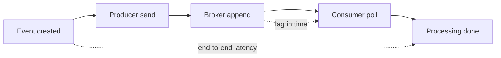

# Observability Practices for Kafka Applications

## Introduction

When a synchronous HTTP call fails, the caller knows immediately. When an event-driven system fails, often nobody knows at all. A consumer that has quietly stopped makes no noise; its lag just grows. A producer whose sends are timing out logs a warning that scrolls past. A dashboard shows yesterday's numbers and everyone assumes the business had a slow morning. Asynchrony is what makes Kafka systems resilient, and it is also what makes their failures silent.

Observability is the practice of making those silent failures loud and their causes findable. Broker monitoring, covered in [Monitoring: The Metrics That Matter](../10-kafka-operations/1-kafka-monitoring-metrics.mdx), tells you whether the cluster is healthy. This page is about the other half, which application teams own: whether your producers and consumers are doing their job.

You will learn which client metrics deserve a dashboard, why lag should be measured in seconds rather than offsets, how to measure end-to-end latency, what to put in every log line, how distributed tracing follows a message across services, and how to turn all of it into a handful of alerts that wake someone up only when users are affected. The worked scenario debugs a stale clickstream dashboard.

## The Questions Observability Must Answer

Start from questions, not from metrics. For a Kafka application, an on-call engineer needs to answer five quickly:

1. **Is data flowing?** Are producers sending and consumers receiving at the expected rate?
2. **Is it on time?** How old is the data a user is seeing right now?
3. **Is it correct?** Are records failing, being retried or ending up in a dead letter topic?
4. **Where is it stuck?** In which service, partition or downstream dependency?
5. **Why?** Rebalances, slow processing, a hot partition, a broker problem, a bad deploy?

Metrics answer the first three, tracing and partition-level metrics answer the fourth, and logs together with traces answer the fifth.

## Client Metrics Worth a Dashboard

The Java client exposes hundreds of metrics through JMX and through `producer.metrics()` and `consumer.metrics()`. Most are useful only when you are already deep in an investigation. These are the ones worth a permanent panel:

| Client | Metric (group) | What it tells you | Watch for |
|---|---|---|---|
| Producer | `record-send-rate` (producer-metrics) | Records sent per second | Drops to zero, or far from normal |
| Producer | `record-error-rate` | Sends that failed after all retries | Anything above zero |
| Producer | `record-retry-rate` | Sends being retried | Sustained increase: broker or network trouble |
| Producer | `request-latency-avg` | Time for a produce request round trip | Rising with `acks=all`: slow replication |
| Producer | `buffer-available-bytes` | Free space in the send buffer | Approaching zero: sends will block |
| Consumer | `records-consumed-rate` (consumer-fetch-manager-metrics) | Records received per second | Drops while producers keep sending |
| Consumer | `records-lag-max` | Largest offset lag over this consumer's partitions | Growing steadily |
| Consumer | `time-between-poll-max` (consumer-metrics) | Longest gap between `poll()` calls | Approaching `max.poll.interval.ms` |
| Consumer | `poll-idle-ratio-avg` | Share of time spent waiting in `poll()` | Near 0: processing is the bottleneck |
| Consumer | `rebalance-rate-per-hour`, `failed-rebalance-total` (consumer-coordinator-metrics) | How often the group reshuffles | More than a few per hour without deploys |
| Consumer | `commit-latency-avg` | Time taken by offset commits | Spikes: coordinator or broker trouble |

Getting these into Prometheus or another backend is usually one line. With Micrometer, which Spring Boot uses by default, bind the client:

```java
MeterRegistry registry = new PrometheusMeterRegistry(PrometheusConfig.DEFAULT);
KafkaConsumer<String, String> consumer = new KafkaConsumer<>(props);
new KafkaClientMetrics(consumer).bindTo(registry);   // exposes kafka_consumer_* meters
```

Spring Kafka does this automatically for clients created by its factories. Without Micrometer, the Prometheus JMX exporter running as a Java agent can scrape the same metrics from JMX.

Since Kafka 3.7, Java clients can also push their metrics to the brokers (KIP-714, `enable.metrics.push`, on by default in the client). The cluster operator configures which metrics to collect and plugs in a reporter, which gives a central view of every client without each team wiring up exporters. It complements your own application metrics rather than replacing them, because only you know your business counters.

## Lag in Time, Not Offsets

Consumer lag in offsets (the latest offset minus the committed offset) is the standard Kafka metric, and it is hard to interpret. A lag of 50,000 records is nothing on a topic receiving 100,000 per second and a disaster on one receiving ten per minute. It also hides the question users actually care about: how stale is the data?

Lag in time answers that directly. There are two good ways to get it:

- **Estimate it from rates:** offset lag divided by the recent production rate per partition. Several lag exporters compute this for you.
- **Measure it in the consumer:** compare the current time with the timestamp of the record being processed. This is end-to-end latency, and it also captures time spent in upstream services.

[Consumer Lag: Measuring and Fixing It](../10-kafka-operations/2-kafka-consumer-lag.mdx) covers the external tools; measuring in the consumer is a few lines:

```java
Timer endToEnd = Timer.builder("orders.event.end_to_end_latency")
    .description("Time from record creation to processing completion")
    .publishPercentileHistogram()      // buckets, so p99 can be computed in Prometheus
    .register(registry);

for (ConsumerRecord<String, String> rec : records) {
    handler.handle(rec);
    // With the default CreateTime, the timestamp is set by the producer when the record is created
    long ageMs = System.currentTimeMillis() - rec.timestamp();
    endToEnd.record(Duration.ofMillis(Math.max(0, ageMs)));
}
```

Two caveats. Clocks on producer and consumer hosts must be synchronized (NTP), or the numbers drift. And a topic configured with `message.timestamp.type=LogAppendTime` stores the broker's time instead, which measures only the time since the record reached Kafka.



## Logs That Point Somewhere

A log line saying `Failed to process order event` is nearly useless during an incident. Which order? Which partition? Which offset, so you can find the record and replay it? Every log line written while handling a record should carry the record's coordinates.

With SLF4J, put them in the MDC (mapped diagnostic context) for the duration of processing, and configure the log encoder to include MDC fields. JSON logs make them searchable.

```java
for (ConsumerRecord<String, String> rec : records) {
    try (MDC.MDCCloseable t = MDC.putCloseable("kafka.topic", rec.topic());
         MDC.MDCCloseable p = MDC.putCloseable("kafka.partition", String.valueOf(rec.partition()));
         MDC.MDCCloseable o = MDC.putCloseable("kafka.offset", String.valueOf(rec.offset()));
         MDC.MDCCloseable k = MDC.putCloseable("kafka.key", rec.key())) {
        handler.handle(rec);
    } catch (Exception e) {
        log.error("Processing failed", e);   // the MDC fields make this line findable
        throw e;
    }
}
```

```json
{"level":"ERROR","message":"Processing failed","kafka.topic":"orders.order-events","kafka.partition":"7","kafka.offset":"1882301","kafka.key":"order-42","trace_id":"4bf92f3577b34da6a3ce929d0e0e4736","exception":"PermanentProcessingException: unknown SKU 991"}
```

Some guidelines:

- **Log the coordinates, not the payload.** Payloads often contain personal data and can be large. With topic, partition and offset you can fetch the record when you need it.
- **Log at the right level.** A transient error that will be retried is a warning; a record sent to the dead letter topic is an error; a successful record is not worth a log line at all in a high-volume consumer. Use metrics for counts.
- **Log lifecycle events.** Partition assignment and revocation (from a `ConsumerRebalanceListener`), pauses and resumes, and shutdown are cheap to log and invaluable when reconstructing an incident.

:::note
Never log credentials. Client configuration dumps at startup are useful, and the Java client already masks password-type settings, but custom code that prints the whole `Properties` object can leak SASL secrets.
:::

## Distributed Tracing Across Topics

In a synchronous system a trace follows a request from service to service. In an event-driven system the "request" is a record that may pass through three topics and five services over several seconds. Without tracing, finding where a specific order got stuck means grepping logs in every service.

OpenTelemetry solves this by putting the trace context into Kafka record headers. The producer adds a W3C `traceparent` header to each record; the consumer reads it and starts its processing span as part of the same trace (or, for batch processing, links to it). The OpenTelemetry Java agent does this automatically for `kafka-clients`, Spring Kafka and Kafka Streams with no code changes:

```bash
# Run the service with the OpenTelemetry Java agent; it instruments kafka-clients automatically
export OTEL_SERVICE_NAME=order-service
export OTEL_EXPORTER_OTLP_ENDPOINT=http://otel-collector:4317
java -javaagent:/opt/otel/opentelemetry-javaagent.jar -jar order-service.jar
```

```text
$ kafka-console-consumer.sh --bootstrap-server localhost:9092 --topic orders.order-events \
    --from-beginning --max-messages 1 --property print.headers=true
traceparent:00-4bf92f3577b34da6a3ce929d0e0e4736-00f067aa0ba902b7-01,event-type:OrderPlaced	{"orderId":"order-42","total":4999}
```

Instrumentation libraries exist for Python, Go, Node.js and .NET clients too, and they use the same header, so a trace can cross languages.

Two design points matter. First, if a consumer processes records long after they were produced (a nightly batch, a replay), making its span a child of the producer's span creates a trace that lasts hours; span links are the better relationship there. Second, put the trace ID into your log MDC (the agent does this for common logging frameworks), so a log line leads to the trace and the trace leads to the logs.

## Alerts That Respect Sleep

Dashboards are for investigating; alerts are for interrupting a human. Alert on symptoms that affect users, and keep causes on dashboards. For Kafka applications, a small set covers most incidents:

| Alert | Condition (example) | Why it is a symptom |
|---|---|---|
| Data is stale | p99 end-to-end latency, or lag in time, above 10 minutes for 10 minutes | Users see old data |
| Consumer stopped | `records-consumed-rate` is 0 while the topic's produce rate is above 0 | Nothing is being processed |
| Producer failing | `record-error-rate` above 0 for 5 minutes | Data is being lost or rejected |
| Dead letters arriving | DLT produce rate above its normal baseline | Records are failing permanently |
| Rebalance storm | More than 10 rebalances in an hour outside a deploy | Processing keeps stopping |

```yaml
# Prometheus alert rule: page when order events are more than 10 minutes old
groups:
  - name: order-service
    rules:
      - alert: OrderEventsStale
        expr: |
          histogram_quantile(0.99,
            sum by (le) (rate(orders_event_end_to_end_latency_seconds_bucket[5m]))) > 600
        for: 10m
        labels:
          severity: page
        annotations:
          summary: "Order events are more than 10 minutes old when processed"
          runbook: "https://wiki.example.com/runbooks/order-service-lag"
```

The rule relies on the histogram buckets that `publishPercentileHistogram()` exports from the timer shown earlier. Every alert links to a runbook that says what to check first.

Avoid alerting on single errors, single rebalances or offset lag thresholds copied between topics with very different traffic. They produce noise, and noisy alerts get muted.

## Worked Scenario: The Stale Clickstream Dashboard

A media company streams page-view events from its websites into `web.page-views` (96 partitions). A Kafka Streams application aggregates them per article per minute, and a sink writes the results to a database behind an editorial dashboard showing what is trending. One Monday the editors complain that the dashboard is "about half an hour behind". No alert had fired.

The only lag alert was an offset threshold of 1,000,000 records, chosen when traffic was lower. With traffic now at 40,000 records per second, it would take 25 seconds of lag to cross it in theory, but the lag was unevenly spread: most partitions were current and six were 30 minutes behind, so the total stayed under the threshold.

Investigation followed the questions from the start of this page:

- **Is data flowing?** Producer `record-send-rate` was normal and `record-error-rate` zero. Consumer `records-consumed-rate` was normal in total.
- **Is it on time?** There was no end-to-end latency metric yet. The team added the timer from this page and deployed it; it immediately showed p99 at 31 minutes.
- **Where is it stuck?** Per-partition lag showed six partitions far behind, all assigned to one instance. That instance's `poll-idle-ratio-avg` was near zero and its `time-between-poll-max` was close to the limit.
- **Why?** Traces for records on those partitions showed a span for a GeoIP lookup taking 400 ms instead of 2 ms. The instance had been rescheduled onto a node in another zone the night before, far from its GeoIP cache.

The fix for the incident was a restart. The fixes for the next one were observability changes: an end-to-end latency timer on every consumer, an alert on p99 latency above five minutes, per-partition lag on the dashboard, and the trace ID in every log line. The offset-threshold alert was deleted.

## Common Mistakes

- Alerting on offset lag with one threshold for all topics, which is wrong for both busy and quiet topics.
- Looking only at total lag, which hides a few stuck partitions behind many healthy ones.
- Not measuring end-to-end latency, so nobody knows how stale the data is.
- Logging messages without topic, partition, offset and key, so failed records cannot be found.
- Logging full payloads, including personal data, at high volume.
- Ignoring `record-error-rate` and producer callbacks, so lost sends go unnoticed.
- Starting consumer spans as children of producer spans for batch or replay workloads, creating misleading hours-long traces.
- Building dashboards with dozens of panels and no alerts linked to runbooks.

## Summary

- Observe your applications, not only the brokers: producers and consumers fail silently.
- Put a short list of client metrics on a dashboard: send, error and retry rates; consume rate; lag; time between polls; rebalances.
- Measure lag and end-to-end latency in time, using record timestamps, and look at it per partition.
- Put topic, partition, offset, key and trace ID in every log line written while handling a record.
- Use OpenTelemetry to propagate trace context in record headers across services and languages.
- Alert on user-facing symptoms such as stale data, stopped consumers, failing producers and dead letters, with a runbook for each.

## Further Reading

- [Apache Kafka documentation: Monitoring](https://kafka.apache.org/documentation/#monitoring) - the full list of producer, consumer and Streams client metrics.
- [KIP-714: Client metrics and observability](https://cwiki.apache.org/confluence/display/KAFKA/KIP-714%3A+Client+metrics+and+observability) - pushing client metrics to the brokers.
- [OpenTelemetry: Messaging spans semantic conventions](https://opentelemetry.io/docs/specs/semconv/messaging/messaging-spans/) - how producer and consumer spans and links should be modelled.
- [OpenTelemetry blog: Instrumenting Apache Kafka clients](https://opentelemetry.io/blog/2022/instrument-kafka-clients/) - automatic and manual instrumentation options.
- [Micrometer documentation: Apache Kafka metrics](https://docs.micrometer.io/micrometer/reference/reference/kafka.html) - binding client metrics to a registry.
- [Prometheus](/docs/observability/prometheus) - the Compile N Run tutorial on collecting and alerting on metrics.
