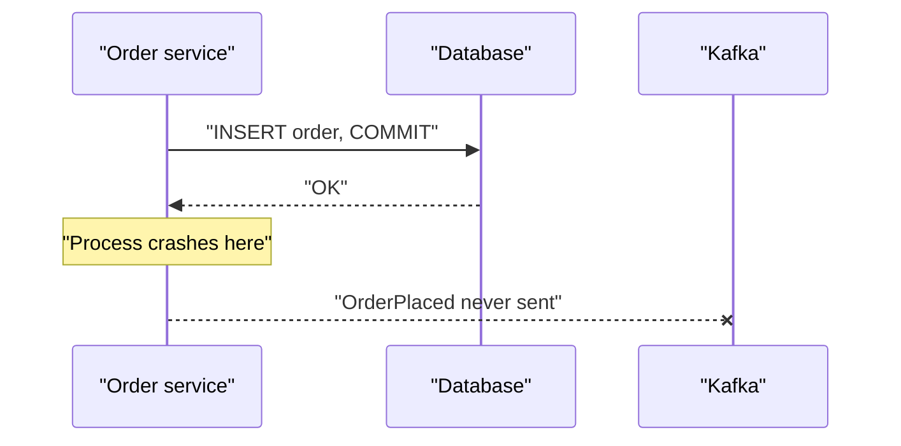

# Kafka Anti-Patterns

## Introduction

Most Kafka trouble does not come from bugs in Kafka. It comes from using Kafka in a way it was not designed for, or from a shortcut that works perfectly in development and fails at scale. These shortcuts are so common that they have become recognizable patterns, and the same handful show up again and again in design reviews and incident post-mortems.

An anti-pattern is not a mistake made by careless people. Each one on this page is a reasonable-looking decision with a hidden cost. A topic per customer looks tidy. Querying a topic like a table looks convenient. Writing to the database and then to Kafka looks obviously correct. The costs arrive later, as metadata limits, data loss, or a partition that stops for a day.

This page groups the anti-patterns into four families (data modelling, application code, architecture and operations). For each you get the symptom, why it hurts, and what to do instead, with a link to the page that covers the fix in depth. The worked scenario reviews a notification system that collected several of them at once.

## Data Modelling Anti-Patterns

### A Topic per Entity Instance

**Symptom:** Topics such as `notifications-user-18233`, one per customer, tenant or device, created on the fly.

**Why it hurts:** Every topic brings at least one partition, and every partition is metadata that the KRaft controller replicates and every broker loads, plus log segment files and index files on disk, plus work during every leader election and restart. Tens of thousands of topics slow down controller failover, broker startup and every tool that lists topics. Consumers cannot easily subscribe to "all users" either, short of a regex subscription that must be refreshed as topics appear.

**Instead:** One topic for the stream, keyed by the entity ID. The key gives per-entity ordering, and consumers filter by key if they need one entity. Multi-tenant isolation that genuinely requires separation (for security or quotas) is better achieved with a prefix per tenant and a modest number of tenants, or with separate clusters for the largest ones. See [Topic Design and Naming Conventions](./0-kafka-topic-design.mdx).

### Huge Messages

**Symptom:** Records of 5, 20 or 100 MB: PDFs, images, whole database exports. Broker and topic limits raised to match, then the producer, consumer and replica fetch limits, one by one, until it works.

**Why it hurts:** Kafka is optimized for many small records in large batches. The default limit for a record batch is about 1 MB for good reason. Huge records consume broker memory, slow replication for every other partition on the broker, cause consumer fetches to time out and make a single poison pill expensive to skip. Raising limits on the broker but forgetting one client setting gives errors that are hard to diagnose.

**Instead:** Use the claim-check pattern: put the payload in object storage (S3, GCS, Azure Blob) and send a small record with its location, size and checksum. Compression helps for records of a few megabytes of text, but it is not a fix for binary blobs.

```json
{
  "documentId": "inv-2026-10-17-0042",
  "contentType": "application/pdf",
  "location": "s3://invoices-prod/2026/10/17/inv-2026-10-17-0042.pdf",
  "sizeBytes": 18733412,
  "sha256": "9c1e0f4b..."
}
```

### Schemaless or "Generic" Events

**Symptom:** One topic called `events` containing JSON with a `type` field and a free-form `data` map, written by a dozen services.

**Why it hurts:** Nobody can tell what a consumer depends on, so nobody can change anything safely. Different producers spell the same field three ways. Consumers fill with defensive parsing code. The first breaking change is discovered in production.

**Instead:** Topics with one clear meaning each, a registered schema per event type and a compatibility rule enforced in CI. See [Schemas as Contracts Between Teams](./2-kafka-schema-and-contract-practices.mdx).

## Application Code Anti-Patterns

### A New Producer per Message

**Symptom:** `new KafkaProducer<>(props)` inside a request handler, followed by `send()` and `close()`.

**Why it hurts:** Creating a producer opens connections, fetches metadata and, with idempotence enabled (the default), obtains a producer ID from the cluster. Doing that per message multiplies latency by orders of magnitude, defeats batching completely and can overload brokers with connection and producer ID requests.

**Instead:** Create one producer per application (it is thread-safe), share it, and close it on shutdown.

```java
// Wrong: a new producer for every message
public void publish(OrderPlaced event) {
    try (KafkaProducer<String, String> producer = new KafkaProducer<>(props)) {
        producer.send(new ProducerRecord<>("orders.order-events", event.orderId(), event.toJson()));
    }
}

// Right: one long-lived, shared producer
public class OrderEventPublisher implements AutoCloseable {
    private final KafkaProducer<String, String> producer = new KafkaProducer<>(props);

    public void publish(OrderPlaced event) {
        producer.send(new ProducerRecord<>("orders.order-events", event.orderId(), event.toJson()),
            (metadata, e) -> { if (e != null) log.error("Publish failed for {}", event.orderId(), e); });
    }

    @Override
    public void close() { producer.close(Duration.ofSeconds(10)); }
}
```

### Blocking on Every Send

**Symptom:** `producer.send(record).get()` in a loop.

**Why it hurts:** Each call waits a full round trip, including replication with `acks=all`, before the next record is even handed to the client. Throughput drops to a few hundred records per second per thread, because batching never gets a chance to work.

**Instead:** Send asynchronously with a callback. If a request handler must confirm durability before responding, block once on the futures for that request, or call `flush()` at a natural boundary, not per record.

### Committing Before Processing, or Auto-Commit with Async Work

**Symptom:** `enable.auto.commit=true` (the default) with records handed off to a thread pool or an async framework, or a manual commit placed before the processing step.

**Why it hurts:** Auto-commit commits the offsets returned by the previous `poll()`, on the assumption that you finished those records before polling again. If processing happens on other threads, the commit can run before the work completes. A crash then loses those records: the committed offset says they are done.

**Instead:** Commit after processing, explicitly. If you process asynchronously, track the highest completed offset per partition and commit only offsets for which every earlier record is also done. Or use a library that does this for you (Confluent's Parallel Consumer, Spring Kafka's listener containers). See [Offsets, Commits and Where to Resume](../4-kafka-consumers/3-kafka-offsets-and-commits.mdx).

### Infinite Retries on One Record

**Symptom:** A consumer catches an exception, seeks back to the same offset and tries again, forever.

**Why it hurts:** Kafka partitions are processed in order. One record that can never succeed blocks every record behind it, for every key in that partition.

**Instead:** Classify errors, retry transient ones with a bound and back-off, and move permanent failures to a dead letter topic. See [Designing for Failure](./3-kafka-failure-handling-practices.mdx).

## Architecture Anti-Patterns

### Dual Writes

**Symptom:** A service updates its database and then publishes an event in the same request, as two independent operations.

**Why it hurts:** Any crash, timeout or deploy between the two leaves them inconsistent: an order exists in the database but no event announces it, or an event announces an order the database rolled back. It happens rarely enough to pass every test and often enough to cause monthly reconciliation work at scale.



**Instead:** The [Transactional Outbox Pattern](../9-kafka-patterns/1-kafka-outbox-pattern.mdx): write the event to an outbox table in the same database transaction and let a relay or Debezium publish it. Alternatively, make Kafka the source of truth and derive the database from the topic.

### Kafka as a Database You Query

**Symptom:** Code that reads a topic from the beginning to find the current state of one customer, or a service that "looks up" a record by scanning a partition.

**Why it hurts:** Kafka has no index by key. Finding one record means reading everything, which gets slower every day the topic grows. Kafka is an excellent system of record for a history of events, and a poor engine for point lookups or ad hoc queries.

**Instead:** Materialize the state you need into something built for queries: a database or search index fed by a consumer or Kafka Connect sink, or a Kafka Streams state store with interactive queries. Keep the topic as the replayable source from which those views can be rebuilt.

### Kafka as a Job Queue for Slow Tasks

**Symptom:** Each record is a job that takes minutes (video transcoding, report generation), you want to add workers freely, and occasionally a job should be retried or delayed individually.

**Why it hurts:** In a classic consumer group, parallelism is capped by the partition count, one slow job holds up its whole partition, and there is no per-message acknowledgement, delay or redelivery. Teams work around this with huge partition counts and custom retry machinery.

**Instead:** For genuine work-queue semantics, use a broker built for it, such as RabbitMQ or a cloud queue service, or consider Kafka's share groups (KIP-932), which add per-record acknowledgement and consumers beyond the partition count. Share groups are still a preview feature, so evaluate their status before relying on them. See [Queues for Kafka: Share Groups (Preview)](../4-kafka-consumers/7-kafka-share-groups.mdx) and the [RabbitMQ tutorial](/docs/middleware/rabbitmq).

### Request-Reply Everywhere

**Symptom:** Service A publishes a request to a topic and waits for service B's response on a reply topic, for every interaction, with timeouts in the HTTP layer above.

**Why it hurts:** It recreates synchronous coupling (A cannot finish without B) while adding the latency and complexity of two topic hops, correlation IDs and reply routing. Failures are harder to reason about than a plain HTTP call.

**Instead:** Use HTTP or gRPC where you need an answer now, and events where you are announcing something that happened. Request-reply over Kafka has legitimate uses (see [Request-Reply over Kafka](../9-kafka-patterns/5-kafka-request-reply.mdx)), but it should be the exception.

## Operational Anti-Patterns

### Weak Durability Settings for Critical Data

**Symptom:** Replication factor 1 "because it is only a few events", or `acks=1` copied from an old tutorial, or `min.insync.replicas=1` with `acks=all`.

**Why it hurts:** A single broker failure, or a leader crash before followers caught up, loses acknowledged data. It works fine until the first disk failure.

**Instead:** Replication factor 3, `min.insync.replicas=2` and `acks=all` (the producer default since Kafka 3.0) for anything you cannot regenerate. See [acks, min.insync.replicas and Durability](../3-kafka-producers/2-kafka-producer-acks-and-durability.mdx).

### Partition Counts by Guesswork

**Symptom:** Either one partition everywhere (the broker default) or 1,000 partitions on every topic "for future scale".

**Why it hurts:** Too few partitions cap consumer parallelism, and adding more later remaps keys. Too many inflate metadata, increase end-to-end latency at low throughput, lengthen recovery and make every consumer group rebalance more work.

**Instead:** Size from target throughput and per-consumer processing rate, with headroom for growth. See [Choosing the Number of Partitions](../12-kafka-performance/4-kafka-partition-count.mdx).

### Sharing a Consumer Group ID Between Services

**Symptom:** Two different services both configured with `group.id=app` because they were copied from the same template.

**Why it hurts:** They join the same group, split the partitions between them and each sees only part of the data, silently.

**Instead:** One group ID per logical consumer (per service, per purpose), named after the consumer, for example `notifications.email-sender`.

### Flying Blind

**Symptom:** No consumer lag monitoring, no alert on producer errors, dead letter topics nobody reads.

**Why it hurts:** Kafka systems fail silently; without monitoring you learn about problems from customers.

**Instead:** End-to-end latency, lag in time per partition, producer error rate and DLT arrival rate, each with an alert and a runbook. See [Observability Practices for Kafka Applications](./5-kafka-observability-practices.mdx).

:::tip
Use this page as a design-review checklist. Before a new Kafka application goes live, walk through each heading and ask whether it applies. Most of them take minutes to fix before launch and weeks to fix after.
:::

## Worked Scenario: Reviewing a Notification System

A fintech startup built its notification system in three weeks. A year later, with a million customers, it was the most frequent source of incidents, and an architect was asked to review it. The review found:

| Finding | Anti-pattern | Impact |
|---|---|---|
| A topic per customer, `notify-<customerId>`, about 400,000 topics | Topic per entity instance | Controller failover took minutes; topic listing timed out |
| The account service committed its transaction, then sent the event | Dual write | Roughly 30 missing notifications a day, found by support tickets |
| Statement PDFs attached to records, up to 12 MB | Huge messages | Replica fetches stalled during month-end |
| Email sender used auto-commit and a thread pool | Commit before processing | Lost emails after every deploy |
| Failed sends retried in place forever | Infinite retries | One bad address stopped a partition for 9 hours |
| Every topic at replication factor 1 | Weak durability | A broker disk failure lost a day of events |
| No lag alerting | Flying blind | Delays discovered by customers |

The remediation took a quarter, in order of risk:

1. Replication factor raised to 3 with `min.insync.replicas=2` on the existing topics (a partition reassignment), stopping the data-loss risk first.
2. An outbox table in the account service with Debezium publishing to `accounts.account-events.v2`, removing the dual write.
3. One topic, `notifications.requests`, keyed by `customerId` with 48 partitions, replacing 400,000 per-customer topics. A bridge consumer subscribed to the old topics by pattern and forwarded records during the migration, after which the old topics were deleted in batches.
4. PDFs moved to object storage, with records carrying a link.
5. The email sender rewritten with manual commits after delivery, bounded retries with back-off, and a dead letter topic.
6. End-to-end latency metrics and alerts on every consumer.

Six months later the notification system had gone from weekly incidents to none, and controller failover was back to a few seconds.

## Common Mistakes

- Treating a topic as a cheap, disposable resource and creating one per user, tenant or device.
- Pushing large binary payloads through Kafka instead of sending a reference.
- Constructing a producer per message or calling `send().get()` per record.
- Using auto-commit when processing is asynchronous, or committing before the work is done.
- Retrying a permanently failing record in place.
- Writing to a database and Kafka as two independent steps.
- Scanning topics to look up current state instead of materializing a view.
- Running critical topics with a replication factor of 1 or `acks=1`.
- Reusing one consumer group ID across different services.

## Summary

- Model streams, not instances: one topic per kind of fact, keyed by entity ID.
- Keep records small; use the claim-check pattern for large payloads.
- Share one long-lived producer, send asynchronously and commit offsets only after processing.
- Bound retries and dead-letter permanent failures so partitions keep moving.
- Avoid dual writes with the outbox pattern, and serve queries from materialized views, not from topics.
- Use Kafka for event streams and reach for a real queue, share groups (preview) or HTTP when the problem is a job queue or a synchronous request.
- Run replication factor 3 with `min.insync.replicas=2`, size partitions deliberately, give each service its own group ID and alert on lag in time.

## Further Reading

- [Apache Kafka documentation: Design](https://kafka.apache.org/documentation/#design) - why Kafka favours small records, batching and sequential I/O.
- [Apache Kafka documentation: Broker configs](https://kafka.apache.org/documentation/#brokerconfigs) - `message.max.bytes` and related limits.
- [KIP-932: Queues for Kafka](https://cwiki.apache.org/confluence/display/KAFKA/KIP-932%3A+Queues+for+Kafka) - share groups and their current status.
- [Confluent Parallel Consumer](https://github.com/confluentinc/parallel-consumer) - safe parallel processing with correct offset commits.
- [Debezium documentation: Outbox Event Router](https://debezium.io/documentation/reference/stable/transformations/outbox-event-router.html) - the standard way to publish from an outbox table.
- [Troubleshooting Common Problems](../10-kafka-operations/7-kafka-troubleshooting.mdx) - diagnosing problems once they occur.
