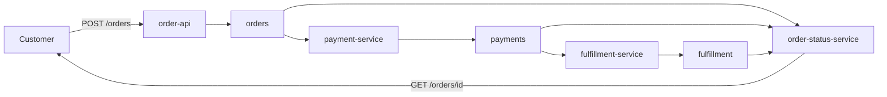

# Project: An Order Processing Pipeline

## Introduction

An online shop takes an order, charges the card, ships the parcel and tells the customer where things stand. The classic way to build that is one service calling the next over HTTP: the order API calls payments, payments calls the warehouse, and if the warehouse is slow the customer stares at a spinner. If the warehouse is down, the order fails even though the card was fine.

In this project you build the same flow as a chain of services that never call each other. Each one reads facts from a Kafka topic, does its own job, and publishes a new fact. The order API answers in milliseconds because it only has to write one record. A warehouse outage delays shipping but loses nothing: the events wait in the topic until the service comes back.

By the end you will have four small Java programs running against a local broker, and you will have watched the things that make this design work or break: keys and partitions, at-least-once delivery, consumer groups and replaying a topic to rebuild state.

## Goal and Architecture

The pipeline handles one order from placement to shipment:

1. **order-api** accepts `POST /orders`, assigns an order id and publishes `OrderPlaced`.
2. **payment-service** consumes orders, asks a (fake) payment gateway to charge the total, and publishes `PaymentResult`.
3. **fulfillment-service** consumes payment results, reserves stock for approved ones and publishes `FulfillmentResult`.
4. **order-status-service** consumes all three topics and serves the current status of each order at `GET /orders/<id>`.



This style is called **choreography**: there is no central coordinator, each service reacts to events. The alternative is **orchestration**, where one workflow service tells each step what to do and tracks progress (see [Sagas and Long-Running Workflows](../9-kafka-patterns/6-kafka-sagas.mdx)). Choreography is the better fit here because the flow is a straight line with three steps. Once you have branches, compensations and timeouts, an orchestrator becomes easier to reason about.

## Topic Design

| Topic | Key | Value | Partitions | Producer | Consumers |
|---|---|---|---|---|---|
| `orders` | order id | `OrderPlaced` JSON | 6 | order-api | payment-service, order-status-service |
| `payments` | order id | `PaymentResult` JSON | 6 | payment-service | fulfillment-service, order-status-service |
| `fulfillment` | order id | `FulfillmentResult` JSON | 6 | fulfillment-service | order-status-service |

Three decisions matter more than the rest.

**Every topic is keyed by order id.** All events for one order land in the same partition of each topic, so each consumer sees them in the order they were written. Keying by customer id would also preserve per-order ordering, but one very busy customer (a reseller placing thousands of orders) would make one partition hot.

**One topic per event stream, not one topic for everything.** A single `order-events` topic with a type field would give you a total order of all events per order, which is attractive. It also forces every consumer to read and discard events it does not care about, and lets one team's schema change break everyone. Three topics owned by three services keep ownership clear. The price is that the status service now reads three topics, and Kafka gives no ordering guarantee across topics; you will handle that in code.

**Events carry the data the next step needs.** `PaymentResult` repeats the line items so that fulfillment does not have to look up the original order. This is called event-carried state transfer. It costs a few bytes and removes a runtime dependency between services.

Six partitions caps each consumer group at six active members, which is plenty for a demo and for a shop doing a few hundred orders a second. Partition counts are hard to change later because changing them moves keys to different partitions; [Choosing the Number of Partitions](../12-kafka-performance/4-kafka-partition-count.mdx) covers how to size them for real.

## Running Kafka with Docker Compose

The file starts one KRaft broker (the same setup as [Running Kafka Locally with Docker Compose](../1-kafka-getting-started/0-kafka-docker-compose.mdx)), creates the topics with a one-shot init container, and adds Kafka UI so you can look inside the topics.

```yaml title="docker-compose.yml"
services:
  kafka:
    image: apache/kafka:4.3.1
    hostname: kafka
    ports:
      - "9092:9092"
    environment:
      KAFKA_NODE_ID: 1
      KAFKA_PROCESS_ROLES: broker,controller
      CLUSTER_ID: MkU3OEVBNTcwNTJENDM2Qk
      KAFKA_LISTENERS: PLAINTEXT_HOST://:9092,PLAINTEXT://:19092,CONTROLLER://:29093
      KAFKA_ADVERTISED_LISTENERS: PLAINTEXT_HOST://localhost:9092,PLAINTEXT://kafka:19092
      KAFKA_LISTENER_SECURITY_PROTOCOL_MAP: PLAINTEXT_HOST:PLAINTEXT,PLAINTEXT:PLAINTEXT,CONTROLLER:PLAINTEXT
      KAFKA_INTER_BROKER_LISTENER_NAME: PLAINTEXT
      KAFKA_CONTROLLER_LISTENER_NAMES: CONTROLLER
      KAFKA_CONTROLLER_QUORUM_VOTERS: 1@kafka:29093
      KAFKA_OFFSETS_TOPIC_REPLICATION_FACTOR: 1
      KAFKA_TRANSACTION_STATE_LOG_REPLICATION_FACTOR: 1
      KAFKA_TRANSACTION_STATE_LOG_MIN_ISR: 1
      KAFKA_SHARE_COORDINATOR_STATE_TOPIC_REPLICATION_FACTOR: 1
      KAFKA_SHARE_COORDINATOR_STATE_TOPIC_MIN_ISR: 1
      KAFKA_GROUP_INITIAL_REBALANCE_DELAY_MS: 0
      KAFKA_AUTO_CREATE_TOPICS_ENABLE: "false"
    healthcheck:
      test: ["CMD-SHELL", "/opt/kafka/bin/kafka-broker-api-versions.sh --bootstrap-server localhost:9092 > /dev/null 2>&1"]
      interval: 5s
      timeout: 5s
      retries: 20

  kafka-init:
    image: apache/kafka:4.3.1
    depends_on:
      kafka:
        condition: service_healthy
    entrypoint: ["/bin/bash", "-c"]
    command:
      - |
        for t in orders payments fulfillment; do
          /opt/kafka/bin/kafka-topics.sh --bootstrap-server kafka:19092 \
            --create --if-not-exists --topic "$$t" --partitions 6 --replication-factor 1
        done

  kafka-ui:
    image: ghcr.io/kafbat/kafka-ui:latest
    ports:
      - "8080:8080"
    environment:
      KAFKA_CLUSTERS_0_NAME: local
      KAFKA_CLUSTERS_0_BOOTSTRAPSERVERS: kafka:19092
    depends_on:
      kafka:
        condition: service_healthy
```

The Java services run on your host, so they connect to `localhost:9092`. Containers on the Compose network use `kafka:19092`. Mixing the two up is the most common reason a client "connects" and then hangs.

## The Code

The project is one Maven module with four `main` classes. Java 21 is required for records and the `HttpServer` features used here.

```xml title="pom.xml"
<project xmlns="http://maven.apache.org/POM/4.0.0">
  <modelVersion>4.0.0</modelVersion>
  <groupId>com.example</groupId>
  <artifactId>order-pipeline</artifactId>
  <version>1.0</version>

  <properties>
    <maven.compiler.release>21</maven.compiler.release>
    <project.build.sourceEncoding>UTF-8</project.build.sourceEncoding>
  </properties>

  <dependencies>
    <dependency>
      <groupId>org.apache.kafka</groupId>
      <artifactId>kafka-clients</artifactId>
      <version>4.3.1</version>
    </dependency>
    <dependency>
      <groupId>com.fasterxml.jackson.core</groupId>
      <artifactId>jackson-databind</artifactId>
      <version>2.22.3</version>
    </dependency>
    <dependency>
      <groupId>org.slf4j</groupId>
      <artifactId>slf4j-simple</artifactId>
      <version>2.0.17</version>
    </dependency>
  </dependencies>

  <build>
    <plugins>
      <plugin>
        <groupId>org.codehaus.mojo</groupId>
        <artifactId>exec-maven-plugin</artifactId>
        <version>3.6.4</version>
      </plugin>
    </plugins>
  </build>
</project>
```

### Events and Shared Client Setup

The event classes are plain records serialized as JSON. In a team setting you would put them behind a schema registry ([Schema Registry: Why and How](../6-kafka-schemas/1-kafka-schema-registry.mdx)); JSON keeps this project readable.

```java title="src/main/java/com/example/orders/Events.java"
package com.example.orders;

import java.math.BigDecimal;
import java.util.List;

public final class Events {
    private Events() {}

    public record LineItem(String sku, int quantity, BigDecimal unitPrice) {}

    public record OrderPlaced(String orderId, String customerId, List<LineItem> items,
                              BigDecimal total, long placedAtMs) {}

    // Repeats the items so fulfillment never has to look up the order.
    public record PaymentResult(String orderId, boolean approved, String reason,
                                List<LineItem> items, long atMs) {}

    public record FulfillmentResult(String orderId, boolean shipped, String reason, long atMs) {}
}
```

```java title="src/main/java/com/example/orders/Kafka.java"
package com.example.orders;

import com.fasterxml.jackson.databind.ObjectMapper;
import java.io.IOException;
import java.io.UncheckedIOException;
import java.util.Properties;
import org.apache.kafka.clients.consumer.ConsumerConfig;
import org.apache.kafka.clients.consumer.KafkaConsumer;
import org.apache.kafka.clients.producer.KafkaProducer;
import org.apache.kafka.clients.producer.ProducerConfig;
import org.apache.kafka.common.serialization.StringDeserializer;
import org.apache.kafka.common.serialization.StringSerializer;

public final class Kafka {
    public static final String BOOTSTRAP =
            System.getenv().getOrDefault("BOOTSTRAP_SERVERS", "localhost:9092");
    public static final String ORDERS = "orders";
    public static final String PAYMENTS = "payments";
    public static final String FULFILLMENT = "fulfillment";
    public static final ObjectMapper JSON = new ObjectMapper();

    private Kafka() {}

    public static KafkaProducer<String, String> producer(String clientId) {
        Properties p = new Properties();
        p.put(ProducerConfig.BOOTSTRAP_SERVERS_CONFIG, BOOTSTRAP);
        p.put(ProducerConfig.CLIENT_ID_CONFIG, clientId);
        p.put(ProducerConfig.KEY_SERIALIZER_CLASS_CONFIG, StringSerializer.class);
        p.put(ProducerConfig.VALUE_SERIALIZER_CLASS_CONFIG, StringSerializer.class);
        // Both are already the defaults in Kafka 3.0+; spelled out because the design depends on them.
        p.put(ProducerConfig.ACKS_CONFIG, "all");
        p.put(ProducerConfig.ENABLE_IDEMPOTENCE_CONFIG, true);
        return new KafkaProducer<>(p);
    }

    public static KafkaConsumer<String, String> consumer(String groupId) {
        Properties p = new Properties();
        p.put(ConsumerConfig.BOOTSTRAP_SERVERS_CONFIG, BOOTSTRAP);
        p.put(ConsumerConfig.GROUP_ID_CONFIG, groupId);
        p.put(ConsumerConfig.GROUP_PROTOCOL_CONFIG, "consumer"); // KIP-848 rebalance protocol
        p.put(ConsumerConfig.KEY_DESERIALIZER_CLASS_CONFIG, StringDeserializer.class);
        p.put(ConsumerConfig.VALUE_DESERIALIZER_CLASS_CONFIG, StringDeserializer.class);
        p.put(ConsumerConfig.ENABLE_AUTO_COMMIT_CONFIG, false);   // commit only after the work is done
        p.put(ConsumerConfig.AUTO_OFFSET_RESET_CONFIG, "earliest");
        return new KafkaConsumer<>(p);
    }

    public static String toJson(Object value) {
        try {
            return JSON.writeValueAsString(value);
        } catch (IOException e) {
            throw new UncheckedIOException(e);
        }
    }

    public static <T> T fromJson(String json, Class<T> type) {
        try {
            return JSON.readValue(json, type);
        } catch (IOException e) {
            throw new UncheckedIOException(e);
        }
    }
}
```

`group.protocol=consumer` opts into the KIP-848 rebalance protocol, which is generally available since Kafka 4.0 and makes adding or removing a consumer much less disruptive. The client default is still `classic`.

### The Order API

The API's only job is to turn an HTTP request into an `OrderPlaced` event. It waits for the broker's acknowledgement before answering, so a `202 Accepted` really means "this order is durably stored".

```java title="src/main/java/com/example/orders/OrderApi.java"
package com.example.orders;

import com.sun.net.httpserver.HttpServer;
import java.math.BigDecimal;
import java.net.InetSocketAddress;
import java.nio.charset.StandardCharsets;
import java.util.List;
import java.util.Map;
import java.util.UUID;
import java.util.concurrent.TimeUnit;
import org.apache.kafka.clients.producer.KafkaProducer;
import org.apache.kafka.clients.producer.ProducerRecord;
import org.apache.kafka.clients.producer.RecordMetadata;

public class OrderApi {
    record PlaceOrderRequest(String customerId, List<Events.LineItem> items) {}

    public static void main(String[] args) throws Exception {
        KafkaProducer<String, String> producer = Kafka.producer("order-api");
        HttpServer server = HttpServer.create(new InetSocketAddress(8081), 0);

        server.createContext("/orders", exchange -> {
            try {
                if (!"POST".equals(exchange.getRequestMethod())) {
                    exchange.sendResponseHeaders(405, -1);
                    return;
                }
                PlaceOrderRequest req =
                        Kafka.JSON.readValue(exchange.getRequestBody(), PlaceOrderRequest.class);
                String orderId = UUID.randomUUID().toString();
                BigDecimal total = req.items().stream()
                        .map(i -> i.unitPrice().multiply(BigDecimal.valueOf(i.quantity())))
                        .reduce(BigDecimal.ZERO, BigDecimal::add);

                var event = new Events.OrderPlaced(orderId, req.customerId(), req.items(),
                        total, System.currentTimeMillis());
                var record = new ProducerRecord<>(Kafka.ORDERS, orderId, Kafka.toJson(event));
                record.headers().add("event-type", "OrderPlaced".getBytes(StandardCharsets.UTF_8));

                // Block until the broker has the record (acks=all); fine for a demo API.
                RecordMetadata md = producer.send(record).get(10, TimeUnit.SECONDS);

                byte[] body = Kafka.toJson(Map.of("orderId", orderId,
                        "partition", md.partition(), "offset", md.offset()))
                        .getBytes(StandardCharsets.UTF_8);
                exchange.getResponseHeaders().add("Content-Type", "application/json");
                exchange.sendResponseHeaders(202, body.length);
                exchange.getResponseBody().write(body);
            } catch (Exception e) {
                e.printStackTrace();
                exchange.sendResponseHeaders(500, -1);
            } finally {
                exchange.close();
            }
        });

        Runtime.getRuntime().addShutdownHook(new Thread(() -> {
            server.stop(1);
            producer.close();
        }));
        server.start();
        System.out.println("order-api listening on :8081");
    }
}
```

### The Payment Service

This is the heart of the pipeline and the place where delivery semantics bite. The loop is: poll a batch, process each order, flush the produced results, then commit the input offsets. If the service crashes between the flush and the commit, the batch is processed again on restart. That is **at-least-once** delivery.

For a payment that is only safe if charging twice is impossible. Real gateways solve this with an idempotency key: you send the same key with a retry and the gateway returns the original result instead of charging again. Using the order id as that key makes the whole step idempotent end to end. Kafka transactions would not help here, because they only cover writes to Kafka, not the HTTP call to the gateway ([Idempotent Consumers and Deduplication](../9-kafka-patterns/4-kafka-idempotent-consumers.mdx)).

```java title="src/main/java/com/example/orders/PaymentService.java"
package com.example.orders;

import java.math.BigDecimal;
import java.time.Duration;
import java.util.List;
import org.apache.kafka.clients.consumer.ConsumerRecord;
import org.apache.kafka.clients.consumer.KafkaConsumer;
import org.apache.kafka.clients.producer.KafkaProducer;
import org.apache.kafka.clients.producer.ProducerRecord;
import org.apache.kafka.common.errors.WakeupException;

public class PaymentService {
    private static final BigDecimal CARD_LIMIT = new BigDecimal("500");

    // Stand-in for a real gateway call that takes orderId as its idempotency key.
    static Events.PaymentResult charge(Events.OrderPlaced order) {
        boolean ok = order.total().compareTo(CARD_LIMIT) <= 0;
        return new Events.PaymentResult(order.orderId(), ok, ok ? "approved" : "card limit exceeded",
                order.items(), System.currentTimeMillis());
    }

    public static void main(String[] args) {
        KafkaConsumer<String, String> consumer = Kafka.consumer("payment-service");
        KafkaProducer<String, String> producer = Kafka.producer("payment-service");

        Thread mainThread = Thread.currentThread();
        Runtime.getRuntime().addShutdownHook(new Thread(() -> {
            consumer.wakeup();                     // makes poll() throw WakeupException
            try { mainThread.join(); } catch (InterruptedException ignored) { }
        }));

        try {
            consumer.subscribe(List.of(Kafka.ORDERS));
            while (true) {
                var records = consumer.poll(Duration.ofMillis(500));
                for (ConsumerRecord<String, String> rec : records) {
                    var order = Kafka.fromJson(rec.value(), Events.OrderPlaced.class);
                    var result = charge(order);
                    producer.send(new ProducerRecord<>(Kafka.PAYMENTS, order.orderId(), Kafka.toJson(result)));
                    System.out.printf("p%d@%d order %s -> %s%n",
                            rec.partition(), rec.offset(), order.orderId(), result.reason());
                }
                if (!records.isEmpty()) {
                    producer.flush();      // results are durable before we move past the inputs
                    consumer.commitSync();
                }
            }
        } catch (WakeupException e) {
            // normal shutdown
        } finally {
            consumer.close();
            producer.close();
        }
    }
}
```

### The Fulfillment Service

Fulfillment reacts only to approved payments, reserves stock and reports the outcome. The stock lives in memory to keep the example short, which is also why you should run only one instance of it; the extensions section shows how to fix that.

```java title="src/main/java/com/example/orders/FulfillmentService.java"
package com.example.orders;

import java.time.Duration;
import java.util.HashMap;
import java.util.List;
import java.util.Map;
import org.apache.kafka.clients.consumer.ConsumerRecord;
import org.apache.kafka.clients.consumer.KafkaConsumer;
import org.apache.kafka.clients.producer.KafkaProducer;
import org.apache.kafka.clients.producer.ProducerRecord;
import org.apache.kafka.common.errors.WakeupException;

public class FulfillmentService {
    private static final Map<String, Integer> STOCK = new HashMap<>(Map.of(
            "BOOK-1", 100, "MUG-2", 3, "LAMP-3", 10));

    static Events.FulfillmentResult reserve(Events.PaymentResult payment) {
        for (Events.LineItem item : payment.items()) {
            if (STOCK.getOrDefault(item.sku(), 0) < item.quantity()) {
                return new Events.FulfillmentResult(payment.orderId(), false,
                        "out of stock: " + item.sku(), System.currentTimeMillis());
            }
        }
        payment.items().forEach(i -> STOCK.merge(i.sku(), -i.quantity(), Integer::sum));
        return new Events.FulfillmentResult(payment.orderId(), true, "shipped",
                System.currentTimeMillis());
    }

    public static void main(String[] args) {
        KafkaConsumer<String, String> consumer = Kafka.consumer("fulfillment-service");
        KafkaProducer<String, String> producer = Kafka.producer("fulfillment-service");
        Thread mainThread = Thread.currentThread();
        Runtime.getRuntime().addShutdownHook(new Thread(() -> {
            consumer.wakeup();
            try { mainThread.join(); } catch (InterruptedException ignored) { }
        }));

        try {
            consumer.subscribe(List.of(Kafka.PAYMENTS));
            while (true) {
                var records = consumer.poll(Duration.ofMillis(500));
                for (ConsumerRecord<String, String> rec : records) {
                    var payment = Kafka.fromJson(rec.value(), Events.PaymentResult.class);
                    if (!payment.approved()) {
                        continue;                  // nothing to ship
                    }
                    var result = reserve(payment);
                    producer.send(new ProducerRecord<>(Kafka.FULFILLMENT, payment.orderId(), Kafka.toJson(result)));
                    System.out.printf("order %s -> %s, stock now %s%n", payment.orderId(), result.reason(), STOCK);
                }
                if (!records.isEmpty()) {
                    producer.flush();
                    consumer.commitSync();
                }
            }
        } catch (WakeupException e) {
            // normal shutdown
        } finally {
            consumer.close();
            producer.close();
        }
    }
}
```

### The Order Status Service

The status service builds a read model: a map from order id to its latest status. Two details are worth reading closely.

First, it uses a fresh consumer group on every start and reads from the earliest offset. That means it rebuilds its whole map from the topics each time it boots, instead of storing state somewhere else. The log is the source of truth and the map is a cache of it. This works while the topics are small; for years of orders you would store the view in a database or use a Kafka Streams state store.

Second, it reads three topics, and Kafka does not order records across topics. A `PaymentResult` can be processed before its `OrderPlaced` if the payments partition happens to be fetched first. The service therefore ranks statuses and never moves an order backwards.

```java title="src/main/java/com/example/orders/OrderStatusService.java"
package com.example.orders;

import com.sun.net.httpserver.HttpServer;
import java.net.InetSocketAddress;
import java.nio.charset.StandardCharsets;
import java.time.Duration;
import java.util.List;
import java.util.Map;
import java.util.UUID;
import java.util.concurrent.ConcurrentHashMap;
import org.apache.kafka.clients.consumer.ConsumerRecord;
import org.apache.kafka.clients.consumer.KafkaConsumer;
import org.apache.kafka.common.errors.WakeupException;

public class OrderStatusService {
    enum Status { PLACED, PAID, PAYMENT_FAILED, SHIPPED, OUT_OF_STOCK }

    record OrderView(String orderId, Status status, String detail) {}

    private static final Map<Status, Integer> RANK = Map.of(
            Status.PLACED, 1, Status.PAID, 2, Status.PAYMENT_FAILED, 2,
            Status.SHIPPED, 3, Status.OUT_OF_STOCK, 3);
    private static final Map<String, OrderView> VIEWS = new ConcurrentHashMap<>();

    static void apply(String orderId, Status status, String detail) {
        VIEWS.merge(orderId, new OrderView(orderId, status, detail),
                (old, neu) -> RANK.get(neu.status()) >= RANK.get(old.status()) ? neu : old);
    }

    static void handle(ConsumerRecord<String, String> rec) {
        switch (rec.topic()) {
            case Kafka.ORDERS -> apply(rec.key(), Status.PLACED, "order received");
            case Kafka.PAYMENTS -> {
                var p = Kafka.fromJson(rec.value(), Events.PaymentResult.class);
                apply(p.orderId(), p.approved() ? Status.PAID : Status.PAYMENT_FAILED, p.reason());
            }
            case Kafka.FULFILLMENT -> {
                var f = Kafka.fromJson(rec.value(), Events.FulfillmentResult.class);
                apply(f.orderId(), f.shipped() ? Status.SHIPPED : Status.OUT_OF_STOCK, f.reason());
            }
            default -> { }
        }
    }

    public static void main(String[] args) throws Exception {
        HttpServer server = HttpServer.create(new InetSocketAddress(8082), 0);
        server.createContext("/orders/", exchange -> {
            String id = exchange.getRequestURI().getPath().substring("/orders/".length());
            OrderView view = VIEWS.get(id);
            byte[] body = (view == null ? "{\"error\":\"unknown order\"}" : Kafka.toJson(view))
                    .getBytes(StandardCharsets.UTF_8);
            exchange.getResponseHeaders().add("Content-Type", "application/json");
            exchange.sendResponseHeaders(view == null ? 404 : 200, body.length);
            exchange.getResponseBody().write(body);
            exchange.close();
        });
        server.start();

        // A new group id each start: no committed offsets, so we replay from earliest.
        KafkaConsumer<String, String> consumer = Kafka.consumer("order-status-" + UUID.randomUUID());
        Thread mainThread = Thread.currentThread();
        Runtime.getRuntime().addShutdownHook(new Thread(() -> {
            consumer.wakeup();
            try { mainThread.join(); } catch (InterruptedException ignored) { }
            server.stop(1);
        }));

        try {
            consumer.subscribe(List.of(Kafka.ORDERS, Kafka.PAYMENTS, Kafka.FULFILLMENT));
            System.out.println("order-status-service listening on :8082");
            while (true) {
                consumer.poll(Duration.ofMillis(500)).forEach(OrderStatusService::handle);
            }
        } catch (WakeupException e) {
            // normal shutdown
        } finally {
            consumer.close();
        }
    }
}
```

## Running It

Start the infrastructure, then each service in its own terminal:

```bash
docker compose up -d
docker compose logs kafka-init       # should show "Created topic orders." and so on

mvn -q compile exec:java -Dexec.mainClass=com.example.orders.OrderApi
mvn -q compile exec:java -Dexec.mainClass=com.example.orders.PaymentService
mvn -q compile exec:java -Dexec.mainClass=com.example.orders.FulfillmentService
mvn -q compile exec:java -Dexec.mainClass=com.example.orders.OrderStatusService
```

Place a few orders: one normal, one over the card limit, and several that will drain the mug stock.

```bash
place() {
  curl -s -X POST localhost:8081/orders -H 'Content-Type: application/json' -d "$1"; echo
}
place '{"customerId":"c-1","items":[{"sku":"BOOK-1","quantity":2,"unitPrice":19.99}]}'
place '{"customerId":"c-2","items":[{"sku":"LAMP-3","quantity":9,"unitPrice":89.00}]}'
for i in 1 2 3; do
  place '{"customerId":"c-3","items":[{"sku":"MUG-2","quantity":2,"unitPrice":12.50}]}'
done
```

```
{"partition":2,"offset":0,"orderId":"2508abe5-b94b-43ee-a6eb-f18f7492abd2"}
{"partition":4,"offset":0,"orderId":"e9520aaa-1a36-4942-8999-58eb9410633b"}
{"partition":1,"offset":0,"orderId":"6613f7d8-a5c2-4266-b953-31d9ef77e964"}
{"partition":0,"offset":0,"orderId":"ff6b09ad-2d5b-4042-813c-4d4118030140"}
{"partition":0,"offset":1,"orderId":"d4dba884-88ce-457b-a33a-c674a3aa3849"}
```

Then ask for the status of each id:

```bash
curl -s localhost:8082/orders/2508abe5-b94b-43ee-a6eb-f18f7492abd2
```

```json
{"orderId":"2508abe5-b94b-43ee-a6eb-f18f7492abd2","status":"SHIPPED","detail":"shipped"}
```

The lamp order shows `PAYMENT_FAILED` (801 is over the 500 limit) and the second and third mug orders show `OUT_OF_STOCK` because the first one took two of the three mugs. The fulfillment log prints the stock after each order:

```
order 2508abe5-... -> shipped, stock now {MUG-2=3, LAMP-3=10, BOOK-1=98}
order 6613f7d8-... -> shipped, stock now {MUG-2=1, LAMP-3=10, BOOK-1=98}
order ff6b09ad-... -> out of stock: MUG-2, stock now {MUG-2=1, LAMP-3=10, BOOK-1=98}
order d4dba884-... -> out of stock: MUG-2, stock now {MUG-2=1, LAMP-3=10, BOOK-1=98}
```

## What to Observe

**Decoupling under failure.** Stop the fulfillment service with Ctrl+C and place more orders. The API still answers instantly and statuses stop at `PAID`. Start fulfillment again and the backlog drains within a second. Check the lag while it is stopped:

```bash
docker compose exec kafka /opt/kafka/bin/kafka-consumer-groups.sh \
  --bootstrap-server localhost:9092 --describe --group fulfillment-service
```

The `LAG` column counts the payment results waiting for it ([Consumer Lag: Measuring and Fixing It](../10-kafka-operations/2-kafka-consumer-lag.mdx)).

**Partitions and keys.** In Kafka UI (`http://localhost:8080`), open the `orders` topic and then the `payments` topic. Each order id sits in the same partition number in both, because the topics have the same partition count and the producer hashes the same key. That alignment is what makes a later Kafka Streams join between them possible without repartitioning.

**Scaling with a consumer group.** Start a second `PaymentService` in another terminal. Its log will show it took over some of the six partitions; the first instance gives them up without stopping its own work, thanks to the KIP-848 protocol. Kill one instance and the other picks its partitions back up.

**Replay.** Restart the status service. It prints nothing new, yet every order is still there, rebuilt from the topics in a few milliseconds.

**At-least-once.** Add `if (Math.random() < 0.3) System.exit(1);` after the `producer.flush()` call in `PaymentService`, place orders and restart it each time it dies. Some orders get a second `PaymentResult` in the `payments` topic. The status view does not care because applying the same status twice is harmless, but fulfillment would ship twice if the duplicate were an approval. That is the motivation for the first extension below.

:::warning
The in-memory stock in `FulfillmentService` is the weakest part of this design. It is lost on restart and goes wrong as soon as two instances run, because each has its own copy. It is there to keep the example short, not as a pattern to copy.
:::

## Common Mistakes

- Committing offsets before the produced records are acknowledged, which silently loses events on a crash. Flush (or wait for the send futures), then commit.
- Keying by something with a few very hot values, such as country or merchant, which makes one partition do most of the work.
- Assuming the status service sees events in the order they happened across topics. Ordering is per partition only; design state transitions that tolerate reordering.
- Using `localhost:9092` from inside a container or `kafka:19092` from the host.
- Sharing one consumer group id between two different services. They would split the partitions between them and each would see only part of the data.
- Writing to the database and then to Kafka from the order API without the outbox pattern, which can leave the two out of sync when one write fails.

## Summary

- Choreographed services connected by topics let each step fail and recover on its own, at the cost of a less visible overall flow.
- Key every topic in a workflow by the entity id so that per-entity ordering holds everywhere.
- Process, flush, then commit gives at-least-once delivery; make side effects idempotent with a natural key such as the order id.
- A read model can be rebuilt by replaying topics from the start, which is simple and powerful while topics are small.
- Kafka orders records within a partition, never across topics, so consumers of several topics must handle reordering.

## Extensions

1. **Deduplicate in fulfillment.** Keep a set of order ids already fulfilled in a compacted topic or a database table, and skip duplicates before reserving stock.
2. **Persist the order before publishing it.** Give the API a Postgres table and publish through the [Transactional Outbox Pattern](../9-kafka-patterns/1-kafka-outbox-pattern.mdx) with Debezium.
3. **Exactly-once fulfillment.** Move stock into a Kafka Streams state store keyed by SKU and enable `exactly_once_v2`, so the stock update, the output event and the offset commit happen atomically ([Exactly-Once Processing in Kafka Streams](../7-kafka-streams/6-kafka-streams-exactly-once.mdx)).
4. **Compensation.** When fulfillment reports `OUT_OF_STOCK`, have the payment service consume that event and issue a refund event.
5. **Schemas.** Replace JSON strings with Avro or Protobuf and a schema registry, and add a compatibility check to your build.

## Further Reading

- [Apache Kafka documentation: producer configs](https://kafka.apache.org/documentation/#producerconfigs) - acks, idempotence and retries in detail.
- [Apache Kafka documentation: consumer configs](https://kafka.apache.org/documentation/#consumerconfigs) - `group.protocol`, offsets and commit behavior.
- [KIP-848: The Next Generation of the Consumer Rebalance Protocol](https://cwiki.apache.org/confluence/display/KAFKA/KIP-848%3A+The+Next+Generation+of+the+Consumer+Rebalance+Protocol) - why the new protocol rebalances incrementally.
- [Event-Driven Architecture with Kafka](../9-kafka-patterns/0-kafka-event-driven-architecture.mdx) - the patterns this project is built from.
- [Kafka with Java (kafka-clients)](../5-kafka-clients/0-kafka-java-client.mdx) - the client API used here, explained step by step.
