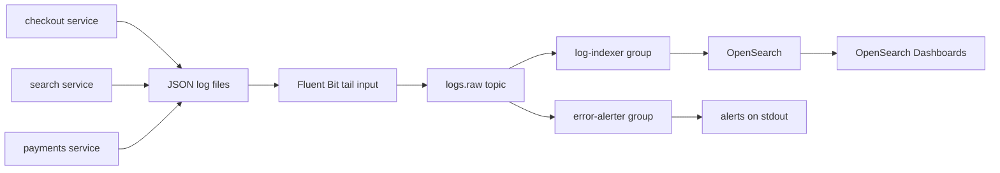

# Project: Centralized Log Aggregation

## Introduction

When a checkout fails at 2 a.m., the on-call engineer needs one place to search the logs of every service, not twenty SSH sessions. The usual setup is an agent on each host (Fluent Bit, Vector, Filebeat) that ships log lines to a search engine (OpenSearch or Elasticsearch). That works until the day the search cluster slows down during an incident, which is exactly when every service is logging ten times more than usual. The agents back up, their buffers fill, and the logs you most need are the ones that get dropped.

Putting Kafka between the agents and the search engine fixes that. Agents write to a topic, which accepts writes at disk speed and keeps days of data. The search indexer reads at whatever pace the search cluster can handle and catches up after an outage. And because a topic can have many independent readers, the same log stream can also feed an alerting job, a security tool or a cheap archive in object storage without touching the agents.

In this project you build that pipeline: a log generator, Fluent Bit, Kafka, a Python indexer that bulk-loads OpenSearch, and a second consumer that raises alerts on error bursts. You will break OpenSearch on purpose and watch nothing get lost.

## Goal and Architecture



The pieces and why each is there:

- **Log generator.** A Python script that pretends to be three services and writes JSON lines to files, as most containerized apps do with structured logging.
- **Fluent Bit.** Tails the files and produces each line to Kafka. It is small (a few MB of memory), speaks Kafka natively through librdkafka, and keeps a position database so a restart does not resend everything.
- **Kafka topic `logs.raw`.** The buffer and the fan-out point.
- **log-indexer.** A consumer group that writes batches into daily OpenSearch indexes.
- **error-alerter.** A separate consumer group that counts errors per service per minute and prints an alert when a threshold is crossed.

The alternative this replaces is Fluent Bit writing straight to OpenSearch. That is simpler and fine for a handful of hosts with steady volume. Choose the Kafka version when you have bursty traffic, more than one consumer of logs, or a requirement that logs survive a search outage.

## Topic Design

| Setting | Value | Why |
|---|---|---|
| Name | `logs.raw` | Raw, unparsed-by-us lines; a later job could publish `logs.enriched` |
| Key | none | Log lines need no per-key ordering, and keyless records spread evenly with the sticky partitioner |
| Partitions | 6 | Lets up to six indexer instances share the work |
| `retention.ms` | 259200000 (3 days) | Long enough to survive a weekend outage of the search cluster, short enough to bound disk |
| Compression | zstd, set on the producer | Log text compresses 4 to 10 times; the broker stores what the producer sent |

Not keying is a deliberate choice. Keying by service name sounds tidy, but the busiest service would pin one partition and one indexer thread at 100% while the rest idle. Search engines sort by timestamp anyway, so the order in which lines arrive does not matter.

If you need per-host ordering (say, to reconstruct a multi-line stack trace), key by host and do the multi-line joining in Fluent Bit before it reaches Kafka.

## Running the Stack with Docker Compose

Create this layout:

```
log-aggregation/
  docker-compose.yml
  fluent-bit.yaml
  generator.py
  indexer.py
  alerter.py
```

```yaml title="docker-compose.yml"
services:
  kafka:
    image: apache/kafka:4.3.1
    hostname: kafka
    ports:
      - "9092:9092"
    environment:
      KAFKA_NODE_ID: 1
      KAFKA_PROCESS_ROLES: broker,controller
      CLUSTER_ID: MkU3OEVBNTcwNTJENDM2Qk
      KAFKA_LISTENERS: PLAINTEXT_HOST://:9092,PLAINTEXT://:19092,CONTROLLER://:29093
      KAFKA_ADVERTISED_LISTENERS: PLAINTEXT_HOST://localhost:9092,PLAINTEXT://kafka:19092
      KAFKA_LISTENER_SECURITY_PROTOCOL_MAP: PLAINTEXT_HOST:PLAINTEXT,PLAINTEXT:PLAINTEXT,CONTROLLER:PLAINTEXT
      KAFKA_INTER_BROKER_LISTENER_NAME: PLAINTEXT
      KAFKA_CONTROLLER_LISTENER_NAMES: CONTROLLER
      KAFKA_CONTROLLER_QUORUM_VOTERS: 1@kafka:29093
      KAFKA_OFFSETS_TOPIC_REPLICATION_FACTOR: 1
      KAFKA_TRANSACTION_STATE_LOG_REPLICATION_FACTOR: 1
      KAFKA_TRANSACTION_STATE_LOG_MIN_ISR: 1
      KAFKA_SHARE_COORDINATOR_STATE_TOPIC_REPLICATION_FACTOR: 1
      KAFKA_SHARE_COORDINATOR_STATE_TOPIC_MIN_ISR: 1
      KAFKA_GROUP_INITIAL_REBALANCE_DELAY_MS: 0
      KAFKA_AUTO_CREATE_TOPICS_ENABLE: "false"
    healthcheck:
      test: ["CMD-SHELL", "/opt/kafka/bin/kafka-broker-api-versions.sh --bootstrap-server localhost:9092 > /dev/null 2>&1"]
      interval: 5s
      timeout: 5s
      retries: 20

  kafka-init:
    image: apache/kafka:4.3.1
    depends_on:
      kafka:
        condition: service_healthy
    command: >
      /opt/kafka/bin/kafka-topics.sh --bootstrap-server kafka:19092 --create --if-not-exists
      --topic logs.raw --partitions 6 --replication-factor 1 --config retention.ms=259200000

  generator:
    image: python:3.12-slim
    volumes:
      - ./generator.py:/app/generator.py:ro
      - app-logs:/logs
    command: ["python", "-u", "/app/generator.py"]

  fluent-bit:
    image: fluent/fluent-bit:5.1
    command: ["-c", "/fluent-bit/etc/fluent-bit.yaml"]
    volumes:
      - ./fluent-bit.yaml:/fluent-bit/etc/fluent-bit.yaml:ro
      - app-logs:/logs:ro
      - fluent-bit-state:/fluent-bit/state
    depends_on:
      kafka-init:
        condition: service_completed_successfully

  opensearch:
    image: opensearchproject/opensearch:3.9.0
    environment:
      discovery.type: single-node
      DISABLE_SECURITY_PLUGIN: "true"            # local only; never in production
      OPENSEARCH_JAVA_OPTS: -Xms1g -Xmx1g
    ports:
      - "9200:9200"

  dashboards:
    image: opensearchproject/opensearch-dashboards:3.9.0
    environment:
      OPENSEARCH_HOSTS: '["http://opensearch:9200"]'
      DISABLE_SECURITY_DASHBOARDS_PLUGIN: "true"
    ports:
      - "5601:5601"
    depends_on:
      - opensearch

volumes:
  app-logs:
  fluent-bit-state:
```

### The Log Generator

```python title="generator.py"
"""Pretend to be three services writing structured JSON logs."""
import json
import random
import socket
import time
import uuid
from datetime import datetime, timezone

SERVICES = {
    "checkout": ["order created", "payment authorized", "cart loaded", "payment declined"],
    "search": ["query served", "cache miss", "index refreshed"],
    "payments": ["charge captured", "refund issued", "gateway timeout"],
}
HOST = socket.gethostname()
files = {name: open(f"/logs/{name}.log", "a", buffering=1) for name in SERVICES}

start = time.time()
while True:
    # Every 2 minutes, checkout has a 20-second error storm.
    storm = (time.time() - start) % 120 < 20
    for name, messages in SERVICES.items():
        error_rate = 0.5 if storm and name == "checkout" else 0.02
        level = "ERROR" if random.random() < error_rate else random.choice(["INFO", "INFO", "DEBUG", "WARN"])
        line = {
            "ts": datetime.now(timezone.utc).isoformat(timespec="milliseconds"),
            "level": level,
            "service": name,
            "host": HOST,
            "trace_id": uuid.uuid4().hex[:16],
            "msg": random.choice(messages),
            "latency_ms": round(random.lognormvariate(3, 0.6), 1),
        }
        files[name].write(json.dumps(line) + "\n")
    time.sleep(0.05)   # about 60 lines per second in total
```

### Fluent Bit Configuration

```yaml title="fluent-bit.yaml"
service:
  flush: 1
  log_level: info

parsers:
  - name: json
    format: json

pipeline:
  inputs:
    - name: tail
      path: /logs/*.log
      tag: app.*
      parser: json                          # each line becomes a structured record
      path_key: file                        # remember which file it came from
      db: /fluent-bit/state/tail.db         # read positions survive restarts
      read_from_head: true

  outputs:
    - name: kafka
      match: "app.*"
      brokers: kafka:19092
      topics: logs.raw
      format: json
      timestamp_format: iso8601
      rdkafka.compression.codec: zstd
      rdkafka.linger.ms: 200                # bigger batches, better compression
      rdkafka.request.required.acks: -1     # wait for all in-sync replicas
      rdkafka.enable.idempotence: true
```

The `rdkafka.*` keys pass straight through to librdkafka, the same C client used by the Python code below. `acks=-1` (all) costs a little latency but is the right choice for logs you may need in an audit. Fluent Bit's own docs suggest `acks=1` for throughput; on a three-broker cluster that risks losing the last few lines if a leader dies.

### The Indexer

The indexer is the interesting part. It reads batches, sends them to OpenSearch with the bulk API, and commits offsets only after OpenSearch has accepted the batch. Two techniques make it safe to crash or replay at any point:

- **Deterministic document ids.** Each document's `_id` is built from the topic, partition and offset. If a batch is indexed twice (crash after bulk, before commit), the second write overwrites the first instead of creating duplicates. The Kafka coordinates of a record are a free, unique, stable id.
- **Rewind instead of block.** When OpenSearch is down, the indexer does not sit in a retry loop inside one poll, which would exceed `max.poll.interval.ms` and get it kicked out of the group. It seeks every partition back to its last committed offset, sleeps with backoff, and polls again.

```python title="indexer.py"
"""Consume logs.raw and bulk-index into daily OpenSearch indexes."""
import json
import os
import signal
import time

from confluent_kafka import OFFSET_BEGINNING, Consumer, KafkaException, TopicPartition
from opensearchpy import OpenSearch, helpers
from opensearchpy.exceptions import ConnectionError as SearchUnavailable

BOOTSTRAP = os.getenv("BOOTSTRAP_SERVERS", "localhost:9092")
SEARCH_URL = os.getenv("OPENSEARCH_URL", "http://localhost:9200")
BATCH_SIZE = 1000
BATCH_SECONDS = 2.0

consumer = Consumer({
    "bootstrap.servers": BOOTSTRAP,
    "group.id": "log-indexer",
    "enable.auto.commit": False,      # we commit after OpenSearch confirms
    "auto.offset.reset": "earliest",
})
search = OpenSearch(SEARCH_URL, timeout=30)

running = True


def stop(*_):
    global running
    running = False


signal.signal(signal.SIGINT, stop)
signal.signal(signal.SIGTERM, stop)


def to_action(msg):
    doc = json.loads(msg.value())
    day = doc["ts"][:10].replace("-", ".")            # 2026-10-17 -> 2026.10.17
    return {
        "_index": f"logs-{day}",
        "_id": f"{msg.topic()}-{msg.partition()}-{msg.offset()}",
        "_source": doc,
    }


def rewind_to_committed():
    """Seek every assigned partition back to its last committed offset."""
    for tp in consumer.committed(consumer.assignment(), timeout=10):
        offset = tp.offset if tp.offset >= 0 else OFFSET_BEGINNING
        consumer.seek(TopicPartition(tp.topic, tp.partition, offset))


consumer.subscribe(["logs.raw"])
batch, batch_started, backoff = [], time.monotonic(), 1

try:
    while running:
        for msg in consumer.consume(num_messages=BATCH_SIZE, timeout=0.5):
            if msg.error():
                raise KafkaException(msg.error())
            try:
                batch.append(to_action(msg))
            except (ValueError, KeyError) as exc:     # not JSON, or no ts field
                print(f"skip p{msg.partition()}@{msg.offset()}: {exc}")

        due = len(batch) >= BATCH_SIZE or time.monotonic() - batch_started >= BATCH_SECONDS
        if not batch or not due:
            continue
        try:
            ok, errors = helpers.bulk(search, batch, raise_on_error=False)
            for err in errors[:5]:
                print("rejected:", err)           # mapping conflicts and the like
            consumer.commit(asynchronous=False)
            print(f"indexed {ok} docs, {len(errors)} rejected")
            backoff = 1
        except SearchUnavailable:
            print(f"OpenSearch unavailable; rewinding and retrying in {backoff}s")
            rewind_to_committed()
            time.sleep(backoff)
            backoff = min(backoff * 2, 30)    # stays well under max.poll.interval.ms
        batch, batch_started = [], time.monotonic()
finally:
    consumer.close()
```

### The Error Alerter

The alerter subscribes to the same topic with a different group id, so it gets its own copy of every record and its own offsets. It counts errors per service in one-minute buckets based on the log timestamp. Auto-commit is left on and it starts from the latest offset: an alert that is missed or repeated around a crash or restart is acceptable, and it keeps the code short. That is a conscious trade-off, the opposite of the indexer, which must not lose a line.

```python title="alerter.py"
"""Raise an alert when a service logs too many errors in one minute."""
import json
import os
from collections import Counter

from confluent_kafka import Consumer

THRESHOLD = int(os.getenv("ERROR_THRESHOLD", "50"))
consumer = Consumer({
    "bootstrap.servers": os.getenv("BOOTSTRAP_SERVERS", "localhost:9092"),
    "group.id": "error-alerter",
    "auto.offset.reset": "latest",    # alerts are about now, not last week
})
consumer.subscribe(["logs.raw"])

counts = Counter()          # (service, minute) -> errors
alerted = set()

try:
    while True:
        msg = consumer.poll(1.0)
        if msg is None or msg.error():
            continue
        line = json.loads(msg.value())
        if line.get("level") != "ERROR":
            continue
        key = (line["service"], line["ts"][:16])            # minute bucket: 2026-10-17T02:14
        counts[key] += 1
        if counts[key] >= THRESHOLD and key not in alerted:
            alerted.add(key)
            print(f"ALERT {key[0]}: {counts[key]} errors in minute {key[1]}")
        if len(counts) > 1000:                               # forget old minutes
            for old in sorted(counts)[:500]:
                counts.pop(old)
except KeyboardInterrupt:
    pass
finally:
    consumer.close()
```

## Running It

```bash
docker compose up -d
docker compose logs -f fluent-bit        # wait for "[output:kafka:kafka.0] ... connected"

python -m venv .venv && . .venv/bin/activate
pip install confluent-kafka opensearch-py

python indexer.py        # terminal 1
python alerter.py        # terminal 2
```

Within a few seconds the indexer prints a line every two seconds:

```
indexed 117 docs, 0 rejected
indexed 121 docs, 0 rejected
```

and about once every two minutes the alerter fires:

```
ALERT checkout: 50 errors in minute 2026-10-17T02:14
```

Search the logs from the command line:

```bash
curl -s 'localhost:9200/logs-*/_search?q=level:ERROR+AND+service:checkout&size=1&sort=ts:desc' | python -m json.tool
curl -s 'localhost:9200/_cat/indices/logs-*?v'
```

Or open OpenSearch Dashboards at `http://localhost:5601`, create an index pattern `logs-*` with `ts` as the time field, and use Discover.

## What to Observe

**The buffer at work.** Stop OpenSearch while everything else runs:

```bash
docker compose stop opensearch
```

The indexer starts printing `OpenSearch unavailable; rewinding and retrying in 1s`, then 2, 4, 8 seconds. Fluent Bit does not notice anything, and neither does the alerter. Watch lag grow:

```bash
docker compose exec kafka /opt/kafka/bin/kafka-consumer-groups.sh \
  --bootstrap-server localhost:9092 --describe --group log-indexer
```

Start OpenSearch again. The next retry succeeds, the indexer drains the backlog in batches of 1,000, and lag returns to zero. Count documents before and after: none are missing and none are duplicated, because of the offset-based ids.

**Independent consumers.** The alerter kept working the whole time OpenSearch was down. In a direct agent-to-search design, the alerting (usually built as saved searches inside OpenSearch) would have been down too.

**Compression.** Compare the bytes the broker stores for the topic with the bytes the generator wrote:

```bash
docker compose exec -T kafka /opt/kafka/bin/kafka-log-dirs.sh --bootstrap-server localhost:9092 \
  --describe --topic-list logs.raw | tail -1 \
  | python3 -c "import json,sys; d=json.load(sys.stdin); print(sum(p['size'] for b in d['brokers'] for l in b['logDirs'] for p in l['partitions']))"
docker compose exec generator sh -c 'cat /logs/*.log | wc -c'
```

In a test run, 417,166 bytes of JSON lines became 85,982 bytes on the broker, a ratio of almost 5 with only 200 ms of batching; larger batches compress better. That ratio is why retention of several days is cheap.

**Scaling out.** Run a second `indexer.py`. The six partitions split between the two instances (the log shows a smaller `indexed` count per batch in each), and total throughput roughly doubles as long as OpenSearch has spare indexing capacity.

:::tip
In production, make the indexer's bulk size and the OpenSearch refresh interval work together. Batches of 5 to 15 MB and `index.refresh_interval` of 10 to 30 seconds on log indexes give much better indexing throughput than the defaults, at the cost of logs appearing a few seconds later.
:::

## Common Mistakes

- Keying log records by service or level, which turns the busiest service into a hot partition.
- Committing offsets before the bulk request succeeds, so an OpenSearch outage silently loses the batch.
- Retrying inside the poll loop for minutes, which exceeds `max.poll.interval.ms` and triggers a rebalance storm.
- Letting OpenSearch generate document ids, which turns every replay into duplicates.
- Setting topic retention shorter than the longest outage you want to survive. A buffer that expires before the consumer recovers is not a buffer.
- Ignoring the per-document errors in the bulk response. A single mapping conflict (a field that is a number in one service and a string in another) rejects those documents while the request as a whole returns 200.

## Summary

- Kafka between log agents and the search engine absorbs bursts and outages and lets several consumers share one stream.
- Keyless records are right for logs: even load matters, cross-line ordering does not.
- Commit after the sink confirms, and use topic-partition-offset as the document id to make replays idempotent.
- On sink failure, rewind to the last commit and back off rather than blocking the poll loop.
- Different consumer groups can choose different delivery trade-offs on the same data.

## Extensions

1. **Archive to object storage.** Add a Kafka Connect S3 sink (or MinIO locally) as a third consumer group, writing hourly Parquet files for cheap long-term retention.
2. **Enrich in flight.** Add a small Kafka Streams or Python job that parses user agents, adds GeoIP data and publishes `logs.enriched`; point the indexer at that topic.
3. **Route by severity.** Use Fluent Bit's `topic_key` so `ERROR` lines go to a short-retention, high-priority topic watched by the alerter only.
4. **Use the sink connector.** Replace `indexer.py` with the Aiven OpenSearch sink connector and compare how it handles ids, batching and errors ([Sink Connectors](../8-kafka-connect/2-kafka-connect-sink-connectors.mdx)).
5. **Ship traces too.** Switch the generator to OpenTelemetry and Fluent Bit's `otlp_json` output, and correlate logs and spans by `trace_id`.

## Further Reading

- [Fluent Bit Kafka output](https://docs.fluentbit.io/manual/data-pipeline/outputs/kafka) - every option of the output plugin used here.
- [librdkafka configuration](https://github.com/confluentinc/librdkafka/blob/master/CONFIGURATION.md) - the properties behind both Fluent Bit and `confluent-kafka`.
- [OpenSearch bulk API](https://docs.opensearch.org/latest/api-reference/document-apis/bulk/) - request format and per-item error handling.
- [Retention and Log Compaction](../2-kafka-topics-and-storage/3-kafka-retention-and-compaction.mdx) - how `retention.ms` and segments decide what stays on disk.
- [Kafka with Python (confluent-kafka)](../5-kafka-clients/2-kafka-python-client.mdx) - the consumer API in more depth.
