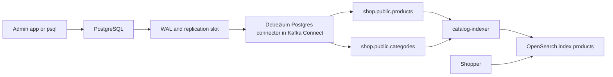

# Project: Database Changes to a Search Index with Debezium

## Introduction

A shop keeps its product catalog in PostgreSQL, because prices, stock and categories need transactions and constraints. Customers search that catalog through OpenSearch, because "wireless headphnes under 100" needs typo tolerance, relevance ranking and facets that a relational database does badly. The hard part is not either system; it is keeping the second one in sync with the first.

The obvious approach is a **dual write**: whenever the application updates a product row, it also updates the search index. It breaks in quiet ways. If the database commit succeeds and the index call fails, search shows a stale price. If two requests update the same product, the two index calls can arrive in the opposite order to the two commits. And every new code path that touches products (an admin script, a bulk import, a SQL hotfix) must remember to update the index too.

**Change data capture (CDC)** turns this around. Instead of the application announcing changes, a connector reads the database's own transaction log, the write-ahead log (WAL) in PostgreSQL, and publishes every committed change to Kafka in commit order. Nothing that writes to the database can bypass it, because the WAL is how the database itself stays durable. In this project you wire up Debezium, Kafka Connect, Kafka and a small Python indexer, and keep an OpenSearch index exactly in step with two Postgres tables.

## Goal and Architecture



- **PostgreSQL** runs with `wal_level=logical`, which lets an external client decode the WAL into row changes.
- **Debezium** runs as a source connector inside a **Kafka Connect** worker. On first start it takes a consistent snapshot of the tables, then streams changes from a replication slot. It stores its WAL position in a Connect offsets topic, so a restart resumes where it left off.
- **catalog-indexer** is a Python consumer that turns change events into OpenSearch documents. It **denormalizes**: each product document carries its category name, so a search for "kitchen" finds products in the Kitchen category.

Why a custom indexer instead of an off-the-shelf OpenSearch sink connector? A sink connector maps one topic to one index, record by record. The moment you need to combine two tables (product plus category) or react to a category rename by updating many products, you need code. The sink connector is the right choice when each table maps cleanly to one index; you will try it in the extensions.

## Topic Design

Debezium names topics `<topic.prefix>.<schema>.<table>`, so with the prefix `shop` you get:

| Topic | Key | Value | Cleanup policy | Partitions |
|---|---|---|---|---|
| `shop.public.products` | `{"id": 7}` (primary key) | row after the change, flattened | compact | 3 |
| `shop.public.categories` | `{"id": 2}` | row after the change, flattened | compact | 1 |

**Keyed by primary key.** All changes to one row go to the same partition, in commit order. The indexer can apply them one after another and the last one wins, which is exactly the semantics you want.

**Compacted.** A compacted topic keeps at least the latest record for every key and eventually drops older ones. For a change stream of a table that is ideal: the topic becomes a replayable copy of the table's current state, so you can rebuild the whole search index from offset zero without a new database snapshot. Deletes are followed by a tombstone (a record with a null value), which tells compaction it may remove the key entirely.

**Flattened values.** A raw Debezium event is an envelope with `before`, `after`, `source` and `op` fields. The `ExtractNewRecordState` transform (often called "unwrap") reduces it to the row itself plus a few metadata fields you ask for, which is what most consumers want.

## Running It with Docker Compose

Project layout:

```
cdc-to-search/
  docker-compose.yml
  init.sql
  connector.json
  indexer.py
```

```yaml title="docker-compose.yml"
services:
  kafka:
    image: apache/kafka:4.3.1
    hostname: kafka
    ports:
      - "9092:9092"
    environment:
      KAFKA_NODE_ID: 1
      KAFKA_PROCESS_ROLES: broker,controller
      CLUSTER_ID: MkU3OEVBNTcwNTJENDM2Qk
      KAFKA_LISTENERS: PLAINTEXT_HOST://:9092,PLAINTEXT://:19092,CONTROLLER://:29093
      KAFKA_ADVERTISED_LISTENERS: PLAINTEXT_HOST://localhost:9092,PLAINTEXT://kafka:19092
      KAFKA_LISTENER_SECURITY_PROTOCOL_MAP: PLAINTEXT_HOST:PLAINTEXT,PLAINTEXT:PLAINTEXT,CONTROLLER:PLAINTEXT
      KAFKA_INTER_BROKER_LISTENER_NAME: PLAINTEXT
      KAFKA_CONTROLLER_LISTENER_NAMES: CONTROLLER
      KAFKA_CONTROLLER_QUORUM_VOTERS: 1@kafka:29093
      KAFKA_OFFSETS_TOPIC_REPLICATION_FACTOR: 1
      KAFKA_TRANSACTION_STATE_LOG_REPLICATION_FACTOR: 1
      KAFKA_TRANSACTION_STATE_LOG_MIN_ISR: 1
      KAFKA_SHARE_COORDINATOR_STATE_TOPIC_REPLICATION_FACTOR: 1
      KAFKA_SHARE_COORDINATOR_STATE_TOPIC_MIN_ISR: 1
      KAFKA_GROUP_INITIAL_REBALANCE_DELAY_MS: 0
      KAFKA_AUTO_CREATE_TOPICS_ENABLE: "false"
    healthcheck:
      test: ["CMD-SHELL", "/opt/kafka/bin/kafka-broker-api-versions.sh --bootstrap-server localhost:9092 > /dev/null 2>&1"]
      interval: 5s
      timeout: 5s
      retries: 20

  postgres:
    image: postgres:17
    command: ["postgres", "-c", "wal_level=logical"]   # required for logical decoding
    environment:
      POSTGRES_DB: shop
      POSTGRES_USER: postgres
      POSTGRES_PASSWORD: postgres
    ports:
      - "5432:5432"
    volumes:
      - ./init.sql:/docker-entrypoint-initdb.d/init.sql:ro

  connect:
    image: quay.io/debezium/connect:3.7.0.Final
    ports:
      - "8083:8083"
    environment:
      BOOTSTRAP_SERVERS: kafka:19092
      GROUP_ID: shop-connect                  # workers with the same id form one Connect cluster
      CONFIG_STORAGE_TOPIC: connect_configs
      OFFSET_STORAGE_TOPIC: connect_offsets   # where Debezium remembers its WAL position
      STATUS_STORAGE_TOPIC: connect_statuses
      CONNECT_CONFIG_STORAGE_REPLICATION_FACTOR: 1
      CONNECT_OFFSET_STORAGE_REPLICATION_FACTOR: 1
      CONNECT_STATUS_STORAGE_REPLICATION_FACTOR: 1
    depends_on:
      kafka:
        condition: service_healthy
      postgres:
        condition: service_started

  opensearch:
    image: opensearchproject/opensearch:3.9.0
    environment:
      discovery.type: single-node
      DISABLE_SECURITY_PLUGIN: "true"            # local only
      OPENSEARCH_JAVA_OPTS: -Xms1g -Xmx1g
    ports:
      - "9200:9200"
```

The `CONNECT_` prefixed variables are passed straight into the worker configuration. The three internal Connect topics default to replication factor 3, which a single broker cannot satisfy.

### The Database

```sql title="init.sql"
CREATE TABLE categories (
    id   SERIAL PRIMARY KEY,
    name TEXT NOT NULL
);

CREATE TABLE products (
    id          SERIAL PRIMARY KEY,
    sku         TEXT UNIQUE NOT NULL,
    name        TEXT NOT NULL,
    description TEXT,
    price       NUMERIC(10, 2) NOT NULL,
    category_id INT REFERENCES categories (id),
    in_stock    BOOLEAN NOT NULL DEFAULT true,
    updated_at  TIMESTAMPTZ NOT NULL DEFAULT now()
);

INSERT INTO categories (name) VALUES ('Audio'), ('Kitchen'), ('Books');

INSERT INTO products (sku, name, description, price, category_id) VALUES
  ('AUD-100', 'Wireless Headphones', 'Over-ear, noise cancelling, 30 h battery', 89.00, 1),
  ('AUD-200', 'Bluetooth Speaker', 'Waterproof portable speaker', 49.90, 1),
  ('KIT-100', 'Chef Knife', '20 cm stainless steel', 35.00, 2),
  ('KIT-200', 'Espresso Maker', 'Stovetop, 6 cups', 29.50, 2),
  ('BK-100', 'Designing Data-Intensive Applications', 'Martin Kleppmann', 42.00, 3);
```

### The Connector

```json title="connector.json"
{
  "connector.class": "io.debezium.connector.postgresql.PostgresConnector",
  "database.hostname": "postgres",
  "database.port": "5432",
  "database.user": "postgres",
  "database.password": "postgres",
  "database.dbname": "shop",
  "topic.prefix": "shop",
  "plugin.name": "pgoutput",
  "slot.name": "shop_catalog",
  "publication.name": "shop_catalog",
  "publication.autocreate.mode": "filtered",
  "table.include.list": "public.products,public.categories",
  "decimal.handling.mode": "double",

  "key.converter": "org.apache.kafka.connect.json.JsonConverter",
  "key.converter.schemas.enable": "false",
  "value.converter": "org.apache.kafka.connect.json.JsonConverter",
  "value.converter.schemas.enable": "false",

  "transforms": "unwrap",
  "transforms.unwrap.type": "io.debezium.transforms.ExtractNewRecordState",
  "transforms.unwrap.delete.tombstone.handling.mode": "rewrite-with-tombstone",
  "transforms.unwrap.add.fields": "op,source.ts_ms",

  "topic.creation.default.partitions": "3",
  "topic.creation.default.replication.factor": "1",
  "topic.creation.default.cleanup.policy": "compact"
}
```

The settings that are easy to get wrong:

| Setting | Why this value |
|---|---|
| `plugin.name: pgoutput` | The decoder built into PostgreSQL 10 and later. Debezium's default, `decoderbufs`, needs an extension the official image does not ship. |
| `slot.name` | The replication slot holds WAL on the server until Debezium confirms it. One slot per connector; never share. |
| `publication.autocreate.mode: filtered` | Creates a publication for only the included tables, instead of every table in the database. |
| `decimal.handling.mode: double` | The default `precise` encodes `NUMERIC` as base64 bytes in JSON, which no search engine understands. For money you would pick `string` and parse it; `double` is fine for a search index. |
| `delete.tombstone.handling.mode: rewrite-with-tombstone` | A delete arrives as a normal record with `__deleted: "true"` (easy to handle in code) followed by a tombstone (so compaction can drop the key). |
| `add.fields: op,source.ts_ms` | Adds `__op` (`r` snapshot read, `c` create, `u` update, `d` delete) and `__source_ts_ms` (commit time in the database), useful for logging and lag measurement. |
| `topic.creation.default.*` | The broker has auto-creation off, so Connect creates the change topics itself with these settings. |

### The Indexer

The indexer reads both topics in one consumer. Category events update an in-memory map from category id to name and then rewrite the `category_name` of every product in that category with one `update_by_query` call. Product events become index or delete operations.

Kafka does not order records across the two topics, so a product can arrive before its category, especially during the initial snapshot. The indexer handles that by indexing the product with an empty category name; when the category record arrives, the `update_by_query` fills it in. Either order converges to the same final document. One subtlety: `update_by_query` finds documents by searching, and a document indexed less than a second ago is not searchable until the index refreshes, so the code forces a refresh before each category update.

```python title="indexer.py"
"""Keep an OpenSearch 'products' index in sync with Debezium change topics."""
import json
import os
import time

from confluent_kafka import Consumer, KafkaException
from opensearchpy import OpenSearch, NotFoundError

BOOTSTRAP = os.getenv("BOOTSTRAP_SERVERS", "localhost:9092")
search = OpenSearch(os.getenv("OPENSEARCH_URL", "http://localhost:9200"))
INDEX = "products"
PRODUCTS, CATEGORIES = "shop.public.products", "shop.public.categories"

MAPPING = {
    "mappings": {
        "properties": {
            "sku": {"type": "keyword"},
            "name": {"type": "text"},
            "description": {"type": "text"},
            "price": {"type": "float"},
            "category_id": {"type": "integer"},
            "category_name": {"type": "text", "fields": {"raw": {"type": "keyword"}}},
            "in_stock": {"type": "boolean"},
            "updated_at": {"type": "date"},
        }
    }
}
if not search.indices.exists(index=INDEX):
    search.indices.create(index=INDEX, body=MAPPING)

categories = {}   # id -> name, rebuilt from the compacted topic on every start


def is_delete(row):
    return str(row.get("__deleted", "false")).lower() == "true"


def handle_category(row):
    cat_id = row["id"]
    name = None if is_delete(row) else row["name"]
    if name is None:
        categories.pop(cat_id, None)
    else:
        categories[cat_id] = name
    # A product indexed a moment ago is not searchable until the next refresh (1 s by default),
    # and update_by_query finds documents by searching. Category changes are rare, so refresh first.
    search.indices.refresh(index=INDEX)
    # Rewrite every product document in this category; usually a handful, sometimes thousands.
    search.update_by_query(
        index=INDEX,
        body={
            "query": {"term": {"category_id": cat_id}},
            "script": {"source": "ctx._source.category_name = params.name",
                       "params": {"name": name}},
        },
        conflicts="proceed",
    )


def handle_product(row):
    if is_delete(row):
        try:
            search.delete(index=INDEX, id=row["id"])
        except NotFoundError:
            pass                                  # already gone: deletes are idempotent too
        return
    doc = {k: row.get(k) for k in
           ("sku", "name", "description", "price", "category_id", "in_stock", "updated_at")}
    doc["category_name"] = categories.get(row["category_id"])
    search.index(index=INDEX, id=row["id"], body=doc)   # same id = overwrite = idempotent


consumer = Consumer({
    "bootstrap.servers": BOOTSTRAP,
    # A fresh group id rebuilds the category map; see "What to Observe" for the trade-off.
    "group.id": os.getenv("GROUP_ID", f"catalog-indexer-{int(time.time())}"),
    "auto.offset.reset": "earliest",
    "enable.auto.commit": False,
})
consumer.subscribe([CATEGORIES, PRODUCTS])

try:
    while True:
        msgs = consumer.consume(num_messages=200, timeout=1.0)
        for msg in msgs:
            if msg.error():
                raise KafkaException(msg.error())
            if msg.value() is None:
                continue                          # tombstone: the delete record before it did the work
            row = json.loads(msg.value())
            if msg.topic() == CATEGORIES:
                handle_category(row)
            else:
                handle_product(row)
            lag_ms = int(time.time() * 1000) - row.get("__source_ts_ms", 0)
            print(f"{msg.topic()} op={row.get('__op')} id={row['id']} "
                  f"end-to-end {lag_ms} ms")
        if msgs:
            consumer.commit(asynchronous=False)
except KeyboardInterrupt:
    pass
finally:
    consumer.close()
```

Every operation is idempotent: indexing uses the primary key as the document id and deletes ignore missing documents. That makes at-least-once delivery from Kafka safe, which is important because Debezium itself is at-least-once: after a crash it can re-emit changes since its last flushed WAL position.

## Running It

```bash
docker compose up -d
# Wait until Connect answers (it takes 20 to 40 seconds the first time):
until curl -sf localhost:8083/connectors > /dev/null; do sleep 2; done

# Create or update the connector (PUT is idempotent, unlike POST /connectors):
curl -s -X PUT -H 'Content-Type: application/json' \
  --data @connector.json localhost:8083/connectors/shop-catalog/config

curl -s localhost:8083/connectors/shop-catalog/status
```

```json
{"name":"shop-catalog","connector":{"state":"RUNNING","worker_id":"172.18.0.4:8083"},"tasks":[{"id":0,"state":"RUNNING","worker_id":"172.18.0.4:8083"}],"type":"source"}
```

Look at a raw change event before writing any code. It is the fastest way to learn the format:

```bash
docker compose exec kafka /opt/kafka/bin/kafka-console-consumer.sh \
  --bootstrap-server localhost:9092 --topic shop.public.products \
  --from-beginning --formatter-property print.key=true --max-messages 1
```

```
{"id":1}	{"id":1,"sku":"AUD-100","name":"Wireless Headphones","description":"Over-ear, noise cancelling, 30 h battery","price":89.0,"category_id":1,"in_stock":true,"updated_at":"2026-10-17T09:12:44.120391Z","__op":"r","__source_ts_ms":1792228364120,"__deleted":"false"}
```

Now start the indexer and search:

```bash
pip install confluent-kafka opensearch-py
python indexer.py
```

```bash
curl -s 'localhost:9200/products/_search?pretty' -H 'Content-Type: application/json' -d '{
  "query": {"multi_match": {"query": "headphnes audio", "fields": ["name^2", "description", "category_name"], "fuzziness": "AUTO"}}
}'
```

The misspelled query still finds the headphones, ranked first, with `"category_name": "Audio"` in the source.

## What to Observe

Open `psql` and change data the way a careless admin would, bypassing any application code:

```bash
docker compose exec postgres psql -U postgres shop
```

```sql
UPDATE products SET price = 79.00, updated_at = now() WHERE sku = 'AUD-100';
UPDATE categories SET name = 'Home Audio' WHERE id = 1;
DELETE FROM products WHERE sku = 'KIT-200';
INSERT INTO products (sku, name, price, category_id) VALUES ('BK-200', 'Kafka: The Definitive Guide', 45.00, 3);
```

Each statement shows up in the indexer log within a fraction of a second:

```
shop.public.products op=u id=1 end-to-end 412 ms
shop.public.categories op=u id=1 end-to-end 380 ms
shop.public.products op=d id=4 end-to-end 395 ms
shop.public.products op=c id=6 end-to-end 401 ms
```

Most of that latency is Connect's producer batching and the indexer's poll timeout, not Debezium. Search again: the headphones cost 79, both Audio products now say "Home Audio", the espresso maker is gone.

**Restart resilience.** Stop Connect (`docker compose stop connect`), make a few more changes, then start it again. Debezium resumes from the offset it stored in `connect_offsets`, and the changes made while it was down flow through. Postgres kept that WAL for it because of the replication slot.

**The replication slot is a liability as well as a feature.** Check how much WAL the slot is holding back:

```sql
SELECT slot_name, active,
       pg_size_pretty(pg_wal_lsn_diff(pg_current_wal_lsn(), confirmed_flush_lsn)) AS retained
FROM pg_replication_slots;
```

If the connector stays down for days, that number grows until the database disk fills. Alert on it in production, and set `max_slot_wal_keep_size` in Postgres as a safety valve.

:::warning
Deleting a connector does not drop its replication slot. If you remove the connector for good, also run `SELECT pg_drop_replication_slot('shop_catalog');`, or Postgres will keep WAL forever.
:::

**Rebuild from the topic.** Delete the index (`curl -X DELETE localhost:9200/products`) and restart the indexer. It reads both compacted topics from the start and recreates every document, without touching the database. The fresh group id per start is what makes this happen; in production you would use a fixed group id and keep the category map in a lookup store (or a Kafka Streams `GlobalKTable`), so restarts are fast and a rebuild is a deliberate operation.

## Common Mistakes

- Forgetting `wal_level=logical`. The connector fails at startup with an error about logical decoding.
- Leaving `decimal.handling.mode` at `precise` with the JSON converter, then wondering why prices look like `"AzA="`.
- Using auto-generated document ids in the search index, which turns every replay into duplicates and makes deletes impossible.
- Treating a tombstone (null value) as an error and crashing the consumer.
- Abandoning a replication slot after removing a connector, which fills the database disk.
- Assuming related tables arrive in order. Changes are ordered per row (per key), not across tables; design the consumer to converge regardless of arrival order.
- Expecting `REPLICA IDENTITY DEFAULT` to give full `before` images. It only includes the primary key on updates and deletes; set `REPLICA IDENTITY FULL` on a table if a consumer needs old values.

## Summary

- CDC reads the database's transaction log, so every committed change is captured, in commit order, whatever wrote it.
- Debezium runs inside Kafka Connect, snapshots first, then streams, and stores its position in Kafka.
- Keyed, compacted change topics are a replayable copy of each table's current state.
- A custom indexer earns its keep when documents combine several tables; a sink connector is simpler when they do not.
- Idempotent writes (primary key as document id) make at-least-once delivery from both Debezium and Kafka harmless.

## Extensions

1. **Use the sink connector.** Install the Aiven OpenSearch sink connector into the Connect image, index `shop.public.products` directly with `key.ignore=false` and `behavior.on.null.values=delete`, and compare it with the Python indexer.
2. **Stream joins instead of update_by_query.** Write a Kafka Streams app that joins products with a `GlobalKTable` of categories and publishes ready-to-index documents to `search.products`.
3. **Schemas.** Switch the converters to Avro with a schema registry and add a column to `products`; watch the schema evolve without breaking the indexer ([Schema Evolution and Compatibility Rules](../6-kafka-schemas/4-kafka-schema-evolution.mdx)).
4. **The outbox pattern.** Capture an `outbox` table instead of the domain tables, so the application decides the event shape ([The Transactional Outbox Pattern](../9-kafka-patterns/1-kafka-outbox-pattern.mdx)).
5. **Dead letters.** Make the indexer send documents OpenSearch rejects to a `catalog-indexer.dlt` topic instead of crashing.

## Further Reading

- [Debezium PostgreSQL connector](https://debezium.io/documentation/reference/stable/connectors/postgresql.html) - every connector property and the PostgreSQL setup it needs.
- [Debezium New Record State Extraction](https://debezium.io/documentation/reference/stable/transformations/event-flattening.html) - the unwrap transform and its delete handling modes.
- [Kafka Connect in the Apache Kafka documentation](https://kafka.apache.org/documentation/#connect) - workers, internal topics and the REST API.
- [Change Data Capture with Debezium](../8-kafka-connect/5-kafka-connect-debezium-cdc.mdx) - a deeper look at snapshots, slots and failure modes.
- [Retention and Log Compaction](../2-kafka-topics-and-storage/3-kafka-retention-and-compaction.mdx) - how compacted topics keep the latest value per key.
