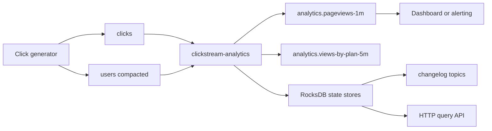
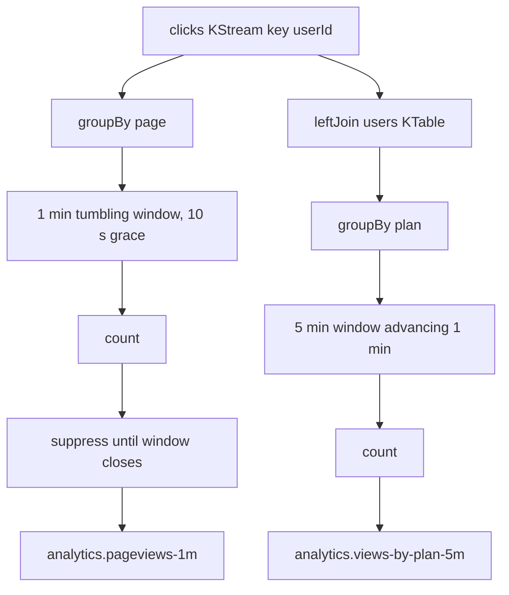

# Project: Real-Time Analytics with Kafka Streams

## Introduction

A product team wants to know, right now, which pages are getting traffic and whether paying customers behave differently from free ones. The classic answer is a nightly batch job that loads click logs into a warehouse and runs SQL. It is cheap and flexible, but the numbers are a day old. During a launch, an outage or a marketing campaign, a day is useless.

Stream processing computes the same aggregates continuously, as events arrive. Kafka Streams does it as a Java library inside your own application: no separate cluster to run, state kept in local RocksDB stores backed by Kafka topics, and scaling by starting more copies of the app. The alternatives are Apache Flink (more powerful, especially for complex event time handling and large state, but a separate cluster to operate) and ksqlDB (SQL instead of Java, fewer moving parts in your code, less control). For a team already writing Java services, Kafka Streams is usually the shortest path.

In this project you build `clickstream-analytics`, a Kafka Streams app that counts page views per minute, joins clicks with user profiles to break traffic down by subscription plan, writes the results to output topics with exactly-once guarantees, and answers live queries over HTTP from its own state store.

## Goal and Architecture



Inside the app there are two topologies sharing one input:

1. **Page views per minute.** Re-key clicks by page, count them in one-minute tumbling windows, and emit one final count per page per minute once the window closes.
2. **Views by plan.** Join each click with the user's profile (`free`, `pro`, `team`), re-key by plan, and count in five-minute windows that advance every minute, emitting updates as they happen.



## Topic Design

| Topic | Key | Value | Partitions | Cleanup | Notes |
|---|---|---|---|---|---|
| `clicks` | user id | click JSON | 6 | delete, 7 days | record timestamp is the click time |
| `users` | user id | profile JSON | 6 | compact | must match `clicks` partition count for the join |
| `analytics.pageviews-1m` | page | final count per window | 3 | delete | one record per page per minute |
| `analytics.views-by-plan-5m` | plan | running count per window | 3 | delete | several updates per window |

**Clicks keyed by user id.** That keeps one user's clicks ordered and, more importantly, lines them up with the `users` table for the join. A stream-table join in Kafka Streams requires **co-partitioning**: both topics must have the same number of partitions and use the same partitioner, so that user 42's clicks and user 42's profile land in the same partition number and therefore in the same task. If they do not, Streams refuses to start with a `TopologyException`.

**Event time from the record timestamp.** The generator sets each record's timestamp to the moment of the click. Kafka Streams windows by that timestamp by default, so a click that arrives 20 seconds late (a phone coming back online) still counts toward the minute in which it happened. If your timestamp lived inside the JSON instead, you would plug in a custom `TimestampExtractor`.

**Repartition and changelog topics are created for you.** `groupBy` with a new key forces a repartition through an internal topic (named after the application id), and every state store is backed by a compacted changelog topic. You do not create these, but you should know they exist: they count toward your partition budget and disk usage.

## Running Kafka with Docker Compose

```yaml title="docker-compose.yml"
services:
  kafka:
    image: apache/kafka:4.3.1
    hostname: kafka
    ports:
      - "9092:9092"
    environment:
      KAFKA_NODE_ID: 1
      KAFKA_PROCESS_ROLES: broker,controller
      CLUSTER_ID: MkU3OEVBNTcwNTJENDM2Qk
      KAFKA_LISTENERS: PLAINTEXT_HOST://:9092,PLAINTEXT://:19092,CONTROLLER://:29093
      KAFKA_ADVERTISED_LISTENERS: PLAINTEXT_HOST://localhost:9092,PLAINTEXT://kafka:19092
      KAFKA_LISTENER_SECURITY_PROTOCOL_MAP: PLAINTEXT_HOST:PLAINTEXT,PLAINTEXT:PLAINTEXT,CONTROLLER:PLAINTEXT
      KAFKA_INTER_BROKER_LISTENER_NAME: PLAINTEXT
      KAFKA_CONTROLLER_LISTENER_NAMES: CONTROLLER
      KAFKA_CONTROLLER_QUORUM_VOTERS: 1@kafka:29093
      KAFKA_OFFSETS_TOPIC_REPLICATION_FACTOR: 1
      KAFKA_TRANSACTION_STATE_LOG_REPLICATION_FACTOR: 1   # exactly-once needs the transaction log
      KAFKA_TRANSACTION_STATE_LOG_MIN_ISR: 1
      KAFKA_SHARE_COORDINATOR_STATE_TOPIC_REPLICATION_FACTOR: 1
      KAFKA_SHARE_COORDINATOR_STATE_TOPIC_MIN_ISR: 1
      KAFKA_GROUP_INITIAL_REBALANCE_DELAY_MS: 0
      KAFKA_AUTO_CREATE_TOPICS_ENABLE: "false"
    healthcheck:
      test: ["CMD-SHELL", "/opt/kafka/bin/kafka-broker-api-versions.sh --bootstrap-server localhost:9092 > /dev/null 2>&1"]
      interval: 5s
      timeout: 5s
      retries: 20

  kafka-init:
    image: apache/kafka:4.3.1
    depends_on:
      kafka:
        condition: service_healthy
    entrypoint: ["/bin/bash", "-c"]
    command:
      - |
        T="/opt/kafka/bin/kafka-topics.sh --bootstrap-server kafka:19092 --create --if-not-exists --replication-factor 1"
        $$T --topic clicks --partitions 6 --config retention.ms=604800000
        $$T --topic users --partitions 6 --config cleanup.policy=compact
        $$T --topic analytics.pageviews-1m --partitions 3
        $$T --topic analytics.views-by-plan-5m --partitions 3
```

Kafka Streams creates its internal topics itself, but not the source and sink topics; those must exist before the app starts.

## The Code

### Maven Project

```xml title="pom.xml"
<project xmlns="http://maven.apache.org/POM/4.0.0">
  <modelVersion>4.0.0</modelVersion>
  <groupId>com.example</groupId>
  <artifactId>clickstream-analytics</artifactId>
  <version>1.0</version>

  <properties>
    <maven.compiler.release>21</maven.compiler.release>
    <project.build.sourceEncoding>UTF-8</project.build.sourceEncoding>
  </properties>

  <dependencies>
    <dependency>
      <groupId>org.apache.kafka</groupId>
      <artifactId>kafka-streams</artifactId>
      <version>4.3.1</version>
    </dependency>
    <dependency>
      <groupId>com.fasterxml.jackson.core</groupId>
      <artifactId>jackson-databind</artifactId>
      <version>2.22.3</version>
    </dependency>
    <dependency>
      <groupId>org.slf4j</groupId>
      <artifactId>slf4j-simple</artifactId>
      <version>2.0.17</version>
    </dependency>
  </dependencies>

  <build>
    <plugins>
      <plugin>
        <groupId>org.codehaus.mojo</groupId>
        <artifactId>exec-maven-plugin</artifactId>
        <version>3.6.4</version>
        <configuration>
          <mainClass>com.example.analytics.ClickstreamAnalytics</mainClass>
        </configuration>
      </plugin>
    </plugins>
  </build>
</project>
```

### Data Model and Serdes

A serde (serializer plus deserializer) tells Kafka Streams how to turn keys and values into bytes. This one-method JSON serde covers every record type in the project.

```java title="src/main/java/com/example/analytics/Model.java"
package com.example.analytics;

import com.fasterxml.jackson.databind.DeserializationFeature;
import com.fasterxml.jackson.databind.ObjectMapper;
import java.io.IOException;
import java.io.UncheckedIOException;
import org.apache.kafka.common.serialization.Deserializer;
import org.apache.kafka.common.serialization.Serde;
import org.apache.kafka.common.serialization.Serdes;
import org.apache.kafka.common.serialization.Serializer;

public final class Model {
    private Model() {}

    public record Click(String userId, String sessionId, String page, String referrer) {}
    public record User(String userId, String plan, String country) {}
    public record EnrichedClick(String page, String plan, String country) {}
    public record WindowCount(String key, String windowStart, String windowEnd, long count) {}

    private static final ObjectMapper JSON = new ObjectMapper()
            .configure(DeserializationFeature.FAIL_ON_UNKNOWN_PROPERTIES, false);

    public static <T> Serde<T> json(Class<T> type) {
        Serializer<T> serializer = (topic, value) -> {
            try {
                return value == null ? null : JSON.writeValueAsBytes(value);
            } catch (IOException e) {
                throw new UncheckedIOException(e);
            }
        };
        Deserializer<T> deserializer = (topic, bytes) -> {
            try {
                return bytes == null ? null : JSON.readValue(bytes, type);
            } catch (IOException e) {
                throw new UncheckedIOException(e);
            }
        };
        return Serdes.serdeFrom(serializer, deserializer);
    }

    public static final Serde<Click> CLICK = json(Click.class);
    public static final Serde<User> USER = json(User.class);
    public static final Serde<EnrichedClick> ENRICHED = json(EnrichedClick.class);
    public static final Serde<WindowCount> WINDOW_COUNT = json(WindowCount.class);
}
```

### The Topology and the Query API

```java title="src/main/java/com/example/analytics/ClickstreamAnalytics.java"
package com.example.analytics;

import static com.example.analytics.Model.*;

import com.sun.net.httpserver.HttpServer;
import java.net.InetSocketAddress;
import java.nio.charset.StandardCharsets;
import java.time.Duration;
import java.time.Instant;
import java.util.LinkedHashMap;
import java.util.Map;
import java.util.Properties;
import java.util.concurrent.CountDownLatch;
import org.apache.kafka.common.serialization.Serdes;
import org.apache.kafka.common.utils.Bytes;
import org.apache.kafka.streams.KafkaStreams;
import org.apache.kafka.streams.KeyValue;
import org.apache.kafka.streams.StoreQueryParameters;
import org.apache.kafka.streams.StreamsBuilder;
import org.apache.kafka.streams.StreamsConfig;
import org.apache.kafka.streams.Topology;
import org.apache.kafka.streams.errors.InvalidStateStoreException;
import org.apache.kafka.streams.kstream.*;
import org.apache.kafka.streams.state.QueryableStoreTypes;
import org.apache.kafka.streams.state.ReadOnlyWindowStore;
import org.apache.kafka.streams.state.WindowStore;

public class ClickstreamAnalytics {
    static final String PAGEVIEWS_STORE = "pageviews-1m-store";

    static Topology buildTopology() {
        StreamsBuilder builder = new StreamsBuilder();

        KStream<String, Click> clicks =
                builder.stream("clicks", Consumed.with(Serdes.String(), CLICK));
        KTable<String, User> users =
                builder.table("users", Consumed.with(Serdes.String(), USER));

        // 1. Final page-view count per page per minute.
        clicks.groupBy((userId, click) -> click.page(),
                        Grouped.with("by-page", Serdes.String(), CLICK))
              .windowedBy(TimeWindows.ofSizeAndGrace(Duration.ofMinutes(1), Duration.ofSeconds(10)))
              .count(Materialized.<String, Long, WindowStore<Bytes, byte[]>>as(PAGEVIEWS_STORE)
                      .withKeySerde(Serdes.String()))
              .suppress(Suppressed.untilWindowCloses(Suppressed.BufferConfig.unbounded()))
              .toStream()
              .map((windowed, count) -> KeyValue.pair(windowed.key(), new WindowCount(
                      windowed.key(), windowed.window().startTime().toString(),
                      windowed.window().endTime().toString(), count)))
              .to("analytics.pageviews-1m", Produced.with(Serdes.String(), WINDOW_COUNT));

        // 2. Running count per subscription plan over a sliding 5-minute view.
        clicks.leftJoin(users,
                        (click, user) -> new EnrichedClick(click.page(),
                                user == null ? "unknown" : user.plan(),
                                user == null ? "unknown" : user.country()),
                        Joined.with(Serdes.String(), CLICK, USER))
              .groupBy((userId, e) -> e.plan(), Grouped.with("by-plan", Serdes.String(), ENRICHED))
              .windowedBy(TimeWindows.ofSizeAndGrace(Duration.ofMinutes(5), Duration.ofSeconds(30))
                      .advanceBy(Duration.ofMinutes(1)))
              .count()
              .toStream()
              .map((windowed, count) -> KeyValue.pair(windowed.key(), new WindowCount(
                      windowed.key(), windowed.window().startTime().toString(),
                      windowed.window().endTime().toString(), count)))
              .to("analytics.views-by-plan-5m", Produced.with(Serdes.String(), WINDOW_COUNT));

        return builder.build();
    }

    static Properties config() {
        Properties p = new Properties();
        p.put(StreamsConfig.APPLICATION_ID_CONFIG, "clickstream-analytics");  // also the group id
        p.put(StreamsConfig.BOOTSTRAP_SERVERS_CONFIG,
                System.getenv().getOrDefault("BOOTSTRAP_SERVERS", "localhost:9092"));
        p.put(StreamsConfig.PROCESSING_GUARANTEE_CONFIG, StreamsConfig.EXACTLY_ONCE_V2);
        p.put(StreamsConfig.COMMIT_INTERVAL_MS_CONFIG, 1000);                 // EOS default is 100 ms
        p.put(StreamsConfig.STATE_DIR_CONFIG,
                System.getenv().getOrDefault("STATE_DIR", "/tmp/kafka-streams"));
        return p;
    }

    public static void main(String[] args) throws Exception {
        Topology topology = buildTopology();
        System.out.println(topology.describe());                 // print the processor graph
        KafkaStreams streams = new KafkaStreams(topology, config());

        int port = Integer.parseInt(System.getenv().getOrDefault("HTTP_PORT", "7070"));
        HttpServer http = HttpServer.create(new InetSocketAddress(port), 0);
        http.createContext("/pageviews/", exchange -> {
            String page = exchange.getRequestURI().getPath().substring("/pageviews".length());
            int status = 200;
            String body;
            try {
                ReadOnlyWindowStore<String, Long> store = streams.store(StoreQueryParameters
                        .fromNameAndType(PAGEVIEWS_STORE, QueryableStoreTypes.windowStore()));
                Map<String, Long> perMinute = new LinkedHashMap<>();
                Instant now = Instant.now();
                try (var it = store.fetch(page, now.minus(Duration.ofMinutes(10)), now)) {
                    it.forEachRemaining(kv -> perMinute.put(Instant.ofEpochMilli(kv.key).toString(), kv.value));
                }
                body = perMinute.toString();
            } catch (InvalidStateStoreException e) {                // rebalancing or still restoring
                status = 503;
                body = "store not ready: " + e.getMessage();
            }
            byte[] bytes = body.getBytes(StandardCharsets.UTF_8);
            exchange.sendResponseHeaders(status, bytes.length);
            exchange.getResponseBody().write(bytes);
            exchange.close();
        });

        CountDownLatch done = new CountDownLatch(1);
        Runtime.getRuntime().addShutdownHook(new Thread(() -> {
            http.stop(0);
            streams.close(Duration.ofSeconds(10));
            done.countDown();
        }));

        streams.setStateListener((now, before) -> System.out.println("state " + before + " -> " + now));
        streams.start();
        http.start();

        // Every 30 s, print how many late records were dropped because their window had closed.
        while (!done.await(30, java.util.concurrent.TimeUnit.SECONDS)) {
            double dropped = streams.metrics().values().stream()
                    .filter(m -> m.metricName().name().equals("dropped-records-total"))
                    .mapToDouble(m -> ((Number) m.metricValue()).doubleValue())
                    .sum();
            System.out.printf("dropped late records so far: %.0f%n", dropped);
        }
    }
}
```

A few choices in that code deserve a sentence each.

- **`leftJoin`, not `join`.** An inner stream-table join silently drops a click whose user is not in the table yet. In a real system, sign-up events and first clicks race each other; counting those clicks as `unknown` is better than losing them.
- **`suppress` only on the first topology.** Suppression holds results back until the window plus grace has passed, so `analytics.pageviews-1m` gets exactly one record per page per minute. That is what a downstream alerting job or a "last minute's top pages" table wants. The plan counts are left unsuppressed to show the other style: a stream of updates, each one replacing the previous value for that window, good for a live chart.
- **`EXACTLY_ONCE_V2`.** Reading input, updating the store's changelog and writing output happen in one Kafka transaction. A crash never double-counts a click. It costs some latency (output is only visible to `read_committed` consumers after each commit) and needs a broker cluster with a working transaction log.
- **The HTTP endpoint reads the store before suppression.** So the API shows the current, still-changing count for the minute in progress, while the topic shows only final counts. Both views are useful; they are just different.

### The Click Generator

```python title="generator.py"
"""Produce user profiles once, then a steady stream of clicks with some late arrivals."""
import json
import os
import random
import time
import uuid

from confluent_kafka import Producer

producer = Producer({"bootstrap.servers": os.getenv("BOOTSTRAP_SERVERS", "localhost:9092"),
                     "linger.ms": 20})
PAGES = ["/", "/pricing", "/docs", "/blog/kafka-streams", "/signup", "/checkout"]
PAGE_WEIGHTS = [30, 10, 25, 15, 8, 4]
PLANS, PLAN_WEIGHTS = ["free", "pro", "team"], [80, 15, 5]

users = [f"u{i:04d}" for i in range(500)]
for uid in users[:450]:          # 50 users have no profile yet: they will show up as "unknown"
    profile = {"userId": uid,
               "plan": random.choices(PLANS, PLAN_WEIGHTS)[0],
               "country": random.choice(["US", "DE", "IN", "BR", "JP"])}
    producer.produce("users", key=uid, value=json.dumps(profile))
producer.flush()

sessions = {}
sent = late = 0
while True:
    uid = random.choice(users)
    sessions.setdefault(uid, uuid.uuid4().hex[:8])
    click = {"userId": uid, "sessionId": sessions[uid],
             "page": random.choices(PAGES, PAGE_WEIGHTS)[0], "referrer": "google"}
    ts = int(time.time() * 1000)
    if random.random() < 0.02:   # 2% of clicks arrive late, from a phone that was offline
        ts -= random.randint(5_000, 90_000)
        late += 1
    producer.produce("clicks", key=uid, value=json.dumps(click), timestamp=ts)
    producer.poll(0)
    sent += 1
    if sent % 1000 == 0:
        print(f"sent {sent} clicks ({late} late)")
    time.sleep(0.01)             # about 100 clicks per second
```

## Running It

```bash
docker compose up -d
pip install confluent-kafka
python generator.py                         # terminal 1
mvn -q compile exec:java                    # terminal 2
```

The app first prints its topology (the processor graph, including the two repartition topics), then the state change `REBALANCING -> RUNNING`. Read the results:

```bash
docker compose exec kafka /opt/kafka/bin/kafka-console-consumer.sh \
  --bootstrap-server localhost:9092 --topic analytics.pageviews-1m \
  --formatter-property print.key=true --isolation-level read_committed
```

```
/pricing	{"key":"/pricing","windowStart":"2026-10-17T19:06:00Z","windowEnd":"2026-10-17T19:07:00Z","count":611}
/signup	{"key":"/signup","windowStart":"2026-10-17T19:06:00Z","windowEnd":"2026-10-17T19:07:00Z","count":489}
/blog/kafka-streams	{"key":"/blog/kafka-streams","windowStart":"2026-10-17T19:06:00Z","windowEnd":"2026-10-17T19:07:00Z","count":961}
```

Nothing appears for the first minute or so: a window only closes when **stream time** (the largest record timestamp seen so far) passes its end plus the 10-second grace period. Query the live store meanwhile:

```bash
curl -s localhost:7070/pageviews/docs
```

```
{2026-10-17T19:05:00Z=598, 2026-10-17T19:06:00Z=1551, 2026-10-17T19:07:00Z=1606, 2026-10-17T19:08:00Z=203}
```

The first entry is the partial minute in which the app started, and the last is the minute in progress, which grows every time you ask.

## What to Observe

**Late data and grace.** Every 30 seconds the app prints `dropped late records so far`. The generator sends 2% of clicks between 5 and 90 seconds late. A late click still counts if stream time has not yet passed its window's end plus the grace period; otherwise it is dropped, because that window already closed and its final result was emitted. In a test run, 280 drops were recorded for 304 late clicks (the metric counts drops in both topologies, and a hopping-window click can be dropped from its oldest window while still counting in the newer ones). Raise both grace periods to `Duration.ofMinutes(2)` and the count stays at zero, but each final page-view result now arrives two minutes after its minute ends. Grace is a direct trade between completeness and latency.

**Updates versus final results.** Consume `analytics.views-by-plan-5m` and you will see the same plan and window appear again and again with growing counts, about once per second (the commit interval, because the record cache sends only the latest update per key at each commit). Hopping windows also overlap, so each click is counted five times: a click at 19:03:30 belongs to the windows starting 18:59, 19:00, 19:01, 19:02 and 19:03. That is why the five-minute counts add up to five times the number of clicks.

**Unknown users.** About 10% of the plan counts land under `unknown`: the 50 users with no profile. Produce a profile for one of them and their next clicks move to the right plan. Earlier clicks stay where they were: a stream-table join looks up the table at the moment the click is processed, it does not rewrite history.

**State restoration.** Stop the app, delete its local state (`rm -rf /tmp/kafka-streams/clickstream-analytics`), and start it again. It shows `REBALANCING` for a little longer while it replays the changelog topics into fresh RocksDB stores, then carries on with no lost counts. On a laptop with a few minutes of data this takes a second; with gigabytes of state it can take many minutes, which is why production deployments keep state on persistent volumes and may configure standby replicas.

**Scaling.** Start a second instance with `HTTP_PORT=7071 STATE_DIR=/tmp/kafka-streams-2 mvn -q exec:java`. The six input partitions become six tasks split across the two instances. Each instance's HTTP endpoint now only knows the pages whose repartitioned keys it owns; finding the right instance for a key is what `streams.queryMetadataForKey(...)` is for.

:::note
The output topics are written transactionally. Consumers that do not set `isolation.level=read_committed` also see records from aborted transactions after a crash. The console consumer flag above, or `isolation.level` in your client config, avoids that.
:::

## Common Mistakes

- Creating the `users` topic with a different partition count from `clicks`. The join fails at startup because the topics are not co-partitioned.
- Expecting suppressed output immediately. With no new records, stream time does not advance and windows never close; a quiet test topic looks broken.
- Using processing time (when the record was read) instead of event time, so a consumer restart that replays an hour of data counts it all in the current minute.
- Forgetting that `groupBy` with a new key repartitions. Every extra `groupBy` adds an internal topic and a network hop.
- Running two instances with the same `application.id` and the same `state.dir` on one machine. They fight over the state directory lock.
- Reading output without `read_committed` in an exactly-once pipeline, and seeing duplicates that the app never committed.

## Summary

- Kafka Streams is a library: aggregations, joins and windows run inside your Java app, with state in local RocksDB stores backed by changelog topics.
- Windows are based on event time; grace decides how long late events are accepted, at the cost of later final results.
- `suppress(untilWindowCloses)` turns a stream of updates into one final record per window.
- Stream-table joins need co-partitioned inputs and see the table as it is when each event is processed.
- Interactive queries let the app serve its own state over HTTP without an extra database.

## Extensions

1. **Sessionization.** Add `SessionWindows.ofInactivityGapWithNoGrace(Duration.ofMinutes(30))` grouped by session id to compute session length and pages per session.
2. **Top N pages.** Aggregate the per-minute counts into a sorted list per window and publish the top five pages each minute.
3. **Test the topology.** Write `TopologyTestDriver` tests that pipe clicks with chosen timestamps and assert exact window outputs ([Testing and Deploying Kafka Streams Applications](../7-kafka-streams/7-kafka-streams-testing-and-deployment.mdx)).
4. **Dashboard.** Push `analytics.pageviews-1m` into a time-series database and chart it, or expose the metrics to Prometheus.
5. **Standby replicas.** Set `num.standby.replicas=1`, run two instances, kill one and measure how much faster failover is than a full changelog restore.

## Further Reading

- [Kafka Streams documentation](https://kafka.apache.org/documentation/streams/) - concepts, the DSL and configuration.
- [Kafka Streams DSL: windowing](https://kafka.apache.org/documentation/streams/developer-guide/dsl-api.html#windowing) - tumbling, hopping, session and sliding windows with grace.
- [KIP-129: Streams Exactly-Once Semantics](https://cwiki.apache.org/confluence/display/KAFKA/KIP-129%3A+Streams+Exactly-Once+Semantics) and KIP-447 (the basis of `exactly_once_v2`) - how transactions make processing exactly once.
- [Windowing and Time Semantics](../7-kafka-streams/4-kafka-streams-windowing.mdx) - event time, stream time and grace in depth.
- [Joins: Stream-Stream, Stream-Table and Table-Table](../7-kafka-streams/5-kafka-streams-joins.mdx) - every join type and its co-partitioning rules.
