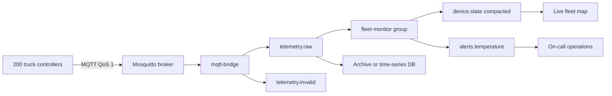

# Project: IoT Telemetry Ingestion

## Introduction

A logistics company runs 200 refrigerated trucks carrying vaccines and fresh food. Each truck has a small controller that reports temperature, door state, position and battery every two seconds over a cellular link. If a compressor fails and the cargo warms above 8 °C for more than a few minutes, the load may have to be thrown away. Operations wants an alert within seconds, a map of where every truck is right now, and the full history for audits and for training a model that predicts compressor failures.

It is tempting to let every truck produce directly to Kafka. That is usually the wrong first move. Kafka clients are heavyweight for a microcontroller, keep long-lived TCP connections to several brokers, and Kafka is not designed for hundreds of thousands of flaky client connections. **MQTT** is: a tiny publish-subscribe protocol built for constrained devices and unreliable networks, with persistent sessions, small headers and per-message delivery guarantees. The common architecture is MQTT at the edge and Kafka in the middle: an MQTT broker terminates device connections, a bridge moves messages into Kafka, and everything after that is ordinary Kafka processing.

In this project you build that pipeline end to end with Mosquitto, a Python MQTT-to-Kafka bridge that never loses an acknowledged reading, and a fleet monitor that maintains a compacted "latest state per truck" topic and raises temperature alerts with hysteresis.

## Goal and Architecture



- **Simulated trucks** publish JSON readings to MQTT topics named `fleet/<deviceId>/telemetry` with QoS 1 (at least once). Three of them have failing compressors.
- **Mosquitto** holds device sessions. When the bridge is down it queues messages for the bridge's persistent session.
- **mqtt-bridge** subscribes to `fleet/+/telemetry`, produces each reading to Kafka keyed by device id, and only acknowledges the MQTT message once Kafka has confirmed the write.
- **fleet-monitor** consumes `telemetry.raw`, keeps the latest reading of each truck in a compacted topic, and emits alert-opened and alert-resolved events.

The alternatives: Kafka Connect has MQTT source connectors (several commercial, a few community ones), and brokers like EMQX and HiveMQ have built-in Kafka integrations. They save you writing a bridge, and you should consider them in production. Writing the bridge yourself here shows exactly where the delivery guarantees come from, which is what you need to judge those products.

## Topic Design

| Topic | Key | Partitions | Cleanup | Purpose |
|---|---|---|---|---|
| `telemetry.raw` | device id | 12 | delete, 7 days | every reading, in order per device |
| `telemetry.invalid` | device id | 1 | delete, 7 days | payloads that failed to parse, for debugging firmware |
| `device.state` | device id | 12 | compact | the latest reading per device |
| `alerts.temperature` | device id | 3 | delete, 30 days | alert opened and resolved events |

**Keyed by device id.** Every reading from one truck goes to one partition in order, so the monitor can evaluate "three readings in a row above 8 °C" with simple per-device state. Device ids are numerous and evenly active, which makes them a near-perfect partition key. Keying by region or customer would create hot partitions when one region has a heat wave.

**Twelve partitions** for 200 trucks is generous, but partitions are hard to add later without moving keys, and the same pipeline should handle 50,000 trucks. At one reading per two seconds that is 25,000 records per second, comfortably handled by 12 partitions and a few monitor instances.

**A compacted state topic.** `device.state` holds a record per reading, but compaction eventually keeps only the newest one per key. A new service that needs "where is every truck right now" reads it from the beginning and has the answer in seconds, without scanning a week of raw telemetry. That is the same idea as a table in a database, kept as a Kafka topic.

**Bad data has its own topic.** A firmware bug that sends malformed JSON should not crash the bridge or poison `telemetry.raw`. Routing it to `telemetry.invalid` keeps the main stream clean and gives firmware engineers something to look at.

## Running It with Docker Compose

Layout:

```
iot-telemetry/
  docker-compose.yml
  mosquitto.conf
  simulator.py
  bridge.py
  monitor.py
```

```yaml title="docker-compose.yml"
services:
  kafka:
    image: apache/kafka:4.3.1
    hostname: kafka
    ports:
      - "9092:9092"
    environment:
      KAFKA_NODE_ID: 1
      KAFKA_PROCESS_ROLES: broker,controller
      CLUSTER_ID: MkU3OEVBNTcwNTJENDM2Qk
      KAFKA_LISTENERS: PLAINTEXT_HOST://:9092,PLAINTEXT://:19092,CONTROLLER://:29093
      KAFKA_ADVERTISED_LISTENERS: PLAINTEXT_HOST://localhost:9092,PLAINTEXT://kafka:19092
      KAFKA_LISTENER_SECURITY_PROTOCOL_MAP: PLAINTEXT_HOST:PLAINTEXT,PLAINTEXT:PLAINTEXT,CONTROLLER:PLAINTEXT
      KAFKA_INTER_BROKER_LISTENER_NAME: PLAINTEXT
      KAFKA_CONTROLLER_LISTENER_NAMES: CONTROLLER
      KAFKA_CONTROLLER_QUORUM_VOTERS: 1@kafka:29093
      KAFKA_OFFSETS_TOPIC_REPLICATION_FACTOR: 1
      KAFKA_TRANSACTION_STATE_LOG_REPLICATION_FACTOR: 1
      KAFKA_TRANSACTION_STATE_LOG_MIN_ISR: 1
      KAFKA_SHARE_COORDINATOR_STATE_TOPIC_REPLICATION_FACTOR: 1
      KAFKA_SHARE_COORDINATOR_STATE_TOPIC_MIN_ISR: 1
      KAFKA_GROUP_INITIAL_REBALANCE_DELAY_MS: 0
      KAFKA_AUTO_CREATE_TOPICS_ENABLE: "false"
    healthcheck:
      test: ["CMD-SHELL", "/opt/kafka/bin/kafka-broker-api-versions.sh --bootstrap-server localhost:9092 > /dev/null 2>&1"]
      interval: 5s
      timeout: 5s
      retries: 20

  kafka-init:
    image: apache/kafka:4.3.1
    depends_on:
      kafka:
        condition: service_healthy
    entrypoint: ["/bin/bash", "-c"]
    command:
      - |
        T="/opt/kafka/bin/kafka-topics.sh --bootstrap-server kafka:19092 --create --if-not-exists --replication-factor 1"
        $$T --topic telemetry.raw --partitions 12 --config retention.ms=604800000
        $$T --topic telemetry.invalid --partitions 1 --config retention.ms=604800000
        $$T --topic alerts.temperature --partitions 3 --config retention.ms=2592000000
        # Small segments and a low dirty ratio so you can watch compaction happen in minutes.
        $$T --topic device.state --partitions 12 --config cleanup.policy=compact \
            --config segment.ms=60000 --config min.cleanable.dirty.ratio=0.1

  mosquitto:
    image: eclipse-mosquitto:2
    ports:
      - "1883:1883"
    volumes:
      - ./mosquitto.conf:/mosquitto/config/mosquitto.conf:ro
```

```properties title="mosquitto.conf"
listener 1883
# Local demo only: real deployments use TLS and per-device credentials.
allow_anonymous true
# Keep up to 100k QoS 1 messages for a disconnected persistent session (the bridge).
max_queued_messages 100000
persistence true
persistence_location /mosquitto/data/
```

## The Code

Install the two client libraries: `pip install confluent-kafka paho-mqtt`.

### The Truck Simulator

```python title="simulator.py"
"""Simulate refrigerated trucks publishing telemetry over MQTT every 2 seconds."""
import json
import os
import random
import time

import paho.mqtt.client as mqtt

DEVICES = int(os.getenv("DEVICES", "200"))
client = mqtt.Client(mqtt.CallbackAPIVersion.VERSION2, client_id="fleet-simulator")
client.connect(os.getenv("MQTT_HOST", "localhost"), int(os.getenv("MQTT_PORT", "1883")))
client.loop_start()                       # network I/O on a background thread

trucks = {f"truck-{i:04d}": {"temp": random.uniform(2.5, 4.5),
                             "lat": 40 + random.random(), "lon": -74 - random.random()}
          for i in range(DEVICES)}
failing = set(random.sample(sorted(trucks), 3))     # compressors about to fail
print("failing compressors:", sorted(failing))

while True:
    now = int(time.time() * 1000)
    for device_id, t in trucks.items():
        if device_id in failing:
            t["temp"] += random.uniform(0.05, 0.2)        # slowly warming up
        else:
            t["temp"] += (3.5 - t["temp"]) * 0.1 + random.gauss(0, 0.15)
        t["lat"] += random.gauss(0, 0.0005)
        t["lon"] += random.gauss(0, 0.0005)
        reading = {"deviceId": device_id, "ts": now, "tempC": round(t["temp"], 2),
                   "doorOpen": random.random() < 0.01,
                   "lat": round(t["lat"], 5), "lon": round(t["lon"], 5)}
        client.publish(f"fleet/{device_id}/telemetry", json.dumps(reading), qos=1)
    if random.random() < 0.05:                            # a buggy firmware build
        client.publish("fleet/truck-9999/telemetry", b"\x00garbage", qos=1)
    time.sleep(2)
```

### The MQTT-to-Kafka Bridge

The bridge is small, but it is where delivery guarantees are won or lost. MQTT QoS 1 means the broker resends a message until the subscriber acknowledges it. By default paho acknowledges as soon as your `on_message` callback returns, but the Kafka `produce` call inside it is asynchronous: the record is only in a local buffer at that point. A crash then would lose readings that MQTT believes were delivered.

The fix is **manual acknowledgement**. The bridge acks each MQTT message only from the Kafka delivery callback, after the broker has confirmed the write with `acks=all`. Combined with a persistent MQTT session (`clean_session=False` and a fixed client id), anything not yet acknowledged is redelivered after a restart. The result is at-least-once from truck to Kafka.

```python title="bridge.py"
"""Bridge MQTT telemetry into Kafka; ack MQTT only after Kafka has the record."""
import json
import os
import signal

import paho.mqtt.client as mqtt
from confluent_kafka import Producer

producer = Producer({
    "bootstrap.servers": os.getenv("BOOTSTRAP_SERVERS", "localhost:9092"),
    "client.id": "mqtt-bridge",
    "acks": "all",
    "enable.idempotence": True,        # no duplicates from producer retries
    "compression.type": "lz4",         # telemetry JSON compresses well and lz4 is cheap on CPU
    "linger.ms": 50,                   # batch for 50 ms: higher throughput, still low latency
})
stats = {"ok": 0, "invalid": 0, "failed": 0}


def on_connect(client, userdata, flags, reason_code, properties):
    print("MQTT connected:", reason_code, "session present:", flags.session_present)
    client.subscribe("fleet/+/telemetry", qos=1)


def on_message(client, userdata, msg):
    device_id = msg.topic.split("/")[1]
    try:
        reading = json.loads(msg.payload)
        topic, ts = "telemetry.raw", int(reading["ts"])   # device time becomes the record timestamp
    except (ValueError, KeyError, TypeError):
        topic, ts = "telemetry.invalid", 0                 # 0 = let the producer stamp it

    def delivered(err, record, mid=msg.mid, invalid=(topic == "telemetry.invalid")):
        if err is not None:
            stats["failed"] += 1
            print("Kafka write failed, MQTT will redeliver after reconnect:", err)
            return
        client.ack(mid, 1)                                 # now MQTT may forget the message
        stats["invalid" if invalid else "ok"] += 1

    while True:
        try:
            producer.produce(topic, key=device_id, value=msg.payload,
                             timestamp=ts, on_delivery=delivered)
            return
        except BufferError:                                # local queue full: Kafka is slow
            producer.poll(0.5)                             # serve callbacks to free space


client = mqtt.Client(mqtt.CallbackAPIVersion.VERSION2, client_id="kafka-bridge-1",
                     clean_session=False, manual_ack=True)
client.on_connect = on_connect
client.on_message = on_message
client.connect(os.getenv("MQTT_HOST", "localhost"), int(os.getenv("MQTT_PORT", "1883")))
client.loop_start()

running = True
signal.signal(signal.SIGTERM, lambda *_: globals().update(running=False))
try:
    ticks = 0
    while running:
        producer.poll(0.1)                                 # runs delivery callbacks
        ticks += 1
        if ticks % 100 == 0:
            print(f"bridged {stats['ok']} readings, {stats['invalid']} invalid, "
                  f"{stats['failed']} failed, {len(producer)} in flight")
except KeyboardInterrupt:
    pass
finally:
    client.loop_stop()
    producer.flush(10)
```

The `BufferError` branch is backpressure. If Kafka is slow or down, the producer's local queue fills, `produce` raises, and the bridge stops reading from MQTT until there is room. Unacknowledged messages stay with Mosquitto, which is exactly where you want them.

### The Fleet Monitor

The monitor does two jobs per reading. It republishes the reading to `device.state`, and it runs a small state machine per truck for alerts. The alert rule uses **hysteresis**: open an alert after three consecutive readings above 8 °C, resolve it only after three consecutive readings below 7 °C. Without the gap between the two thresholds, a truck hovering around 8 °C would flap between open and resolved every few seconds and page someone each time.

```python title="monitor.py"
"""Maintain latest state per device and raise temperature alerts with hysteresis."""
import json
import os
from collections import defaultdict

from confluent_kafka import Consumer, KafkaException, Producer

BOOTSTRAP = os.getenv("BOOTSTRAP_SERVERS", "localhost:9092")
HIGH, LOW, STREAK = 8.0, 7.0, 3

consumer = Consumer({
    "bootstrap.servers": BOOTSTRAP,
    "group.id": "fleet-monitor",
    "enable.auto.commit": False,
    "auto.offset.reset": "latest",       # alerts are about now; history lives in telemetry.raw
})
producer = Producer({"bootstrap.servers": BOOTSTRAP, "acks": "all", "linger.ms": 20})

# Per-device state. Safe in memory because each device's readings go to one partition,
# and each partition to exactly one member of the group.
state = defaultdict(lambda: {"last_ts": 0, "high": 0, "low": 0, "alert_open": False})


def on_revoke(consumer, partitions):
    # Another instance takes over these devices; it starts with fresh counters.
    print("revoked", [p.partition for p in partitions])


def evaluate(device_id, reading):
    s = state[device_id]
    if reading["ts"] <= s["last_ts"]:
        return None                                   # duplicate or out-of-order redelivery
    s["last_ts"] = reading["ts"]
    temp = reading["tempC"]
    s["high"] = s["high"] + 1 if temp > HIGH else 0
    s["low"] = s["low"] + 1 if temp < LOW else 0
    if not s["alert_open"] and s["high"] >= STREAK:
        s["alert_open"] = True
        return "OPENED"
    if s["alert_open"] and s["low"] >= STREAK:
        s["alert_open"] = False
        return "RESOLVED"
    return None


consumer.subscribe(["telemetry.raw"], on_revoke=on_revoke)
try:
    while True:
        msgs = consumer.consume(num_messages=500, timeout=1.0)
        for msg in msgs:
            if msg.error():
                raise KafkaException(msg.error())
            device_id, reading = msg.key().decode(), json.loads(msg.value())
            producer.produce("device.state", key=device_id, value=msg.value())
            change = evaluate(device_id, reading)
            if change:
                alert = {"alertId": f"{device_id}-{reading['ts']}", "deviceId": device_id,
                         "status": change, "tempC": reading["tempC"], "ts": reading["ts"],
                         "lat": reading["lat"], "lon": reading["lon"]}
                producer.produce("alerts.temperature", key=device_id, value=json.dumps(alert))
                print(f"ALERT {change}: {device_id} at {reading['tempC']} C")
        if msgs:
            producer.flush()                          # outputs durable before inputs are committed
            consumer.commit(asynchronous=False)
except KeyboardInterrupt:
    pass
finally:
    consumer.close()
    producer.flush(10)
```

The `alertId` is built from the device id and the timestamp of the reading that triggered it. If the monitor crashes after producing an alert but before committing, it reprocesses the batch and produces the same alert again, with the same id. A paging system that deduplicates on `alertId` turns at-least-once into exactly-one page.

## Running It

```bash
docker compose up -d
pip install confluent-kafka paho-mqtt

python bridge.py         # terminal 1
python monitor.py        # terminal 2
python simulator.py      # terminal 3
```

The bridge reports progress every ten seconds:

```
MQTT connected: Success session present: False
bridged 1000 readings, 0 invalid, 0 failed, 0 in flight
bridged 2000 readings, 1 invalid, 0 failed, 0 in flight
```

After a minute or so, as the failing trucks cross 8 °C, the monitor prints:

```
ALERT OPENED: truck-0057 at 8.11 C
ALERT OPENED: truck-0142 at 8.06 C
ALERT OPENED: truck-0019 at 8.17 C
```

Read the alert topic, and look at the bad payloads:

```bash
docker compose exec kafka /opt/kafka/bin/kafka-console-consumer.sh \
  --bootstrap-server localhost:9092 --topic alerts.temperature --from-beginning

docker compose exec kafka /opt/kafka/bin/kafka-console-consumer.sh \
  --bootstrap-server localhost:9092 --topic telemetry.invalid --from-beginning --max-messages 2
```

## What to Observe

**Nothing is lost when the bridge dies.** Stop the bridge with Ctrl+C while the simulator runs, wait 30 seconds, and start it again. The first line now says `session present: True`, and the bridged counter jumps by the 3,000 or so readings Mosquitto queued while it was away. Check that the gap is filled:

```bash
docker compose exec -T kafka /opt/kafka/bin/kafka-get-offsets.sh \
  --bootstrap-server localhost:9092 --topic telemetry.raw | awk -F: '{s+=$3} END {print s}'
```

The sum of the end offsets keeps matching what the simulator sent (200 readings every 2 seconds), with no hole for the outage. In a test run with a 20-second bridge outage, a 150-second simulation sent 15,000 readings and `telemetry.raw` held exactly 15,000. Remove `manual_ack=True` and `client.ack(...)`, kill the bridge with `kill -9` during a burst, and you can lose the few hundred readings that were in the producer's buffer.

**Backpressure.** Stop Kafka (`docker compose stop kafka`) for a minute. The bridge's "in flight" count climbs, the producer retries in the background, and Mosquitto starts queueing. Start Kafka and watch everything drain. If Kafka stayed down longer than `message.timeout.ms` (five minutes by default in librdkafka), delivery would fail and the bridge would rely on MQTT redelivery at the next reconnect.

**Compaction.** Count the records in `device.state` now and again in five minutes:

```bash
docker compose exec kafka /opt/kafka/bin/kafka-console-consumer.sh \
  --bootstrap-server localhost:9092 --topic device.state --from-beginning \
  --timeout-ms 5000 2>/dev/null | wc -l
```

The topic receives 100 records per second, but the count stays far below that total because the log cleaner keeps removing older readings for each truck in closed segments. In a test run, 15,000 state records written over two and a half minutes were already down to about 3,200 a minute later. What survives is the newest reading of each of the 200 trucks plus whatever is still in the active segment. A dashboard that starts up reads this topic to draw the map instead of scanning `telemetry.raw`.

**Rebalance and in-memory state.** Start a second `monitor.py`. Half of the partitions move to it, and the first instance prints `revoked`. For the devices that moved, the new owner starts counting from zero, so an alert might fire up to two readings later than it otherwise would. That is acceptable for this rule. For rules that need long histories (average over the last hour), keep the state in Kafka Streams state stores, which move with the partitions.

:::tip
Use the device timestamp, not the arrival time, for anything time-based. Trucks drive through tunnels; a reading that arrives 40 seconds late should still be judged by when it was measured. The bridge copies the device time into the Kafka record timestamp for exactly this reason.
:::

## Common Mistakes

- Connecting thousands of devices directly to Kafka. Use MQTT or HTTP at the edge and a small number of producers into Kafka.
- Acknowledging MQTT messages before the Kafka write is confirmed, which quietly turns QoS 1 into "at most once".
- Using `clean_session=True` for the bridge, so Mosquitto drops everything queued while it was down.
- Keying by region or customer instead of device id, producing hot partitions and breaking per-device ordering.
- Alerting on a single reading without hysteresis or a streak, which floods on-call with flapping alerts.
- Letting malformed payloads crash the consumer. Route them to a separate topic and keep going.
- Trusting arrival order. Redelivery and multiple network paths can reorder readings, so compare device timestamps.

## Summary

- MQTT is built for devices; Kafka is built for durable, replayable streams. Bridge the two and let each do its job.
- Acknowledge upstream only after downstream confirms, and keep a persistent session, to get at-least-once end to end.
- Key telemetry by device id for even load and per-device ordering.
- A compacted topic of latest state per device gives new consumers an instant snapshot.
- Hysteresis and deterministic alert ids keep alerts stable and deduplicable.

## Extensions

1. **Scale the bridge.** Run two bridges with MQTT shared subscriptions (`$share/bridges/fleet/+/telemetry`) so Mosquitto load-balances between them.
2. **Downsample for storage.** Add a Kafka Streams job that computes one-minute min, max and average per truck into `telemetry.1m`, and sink that to TimescaleDB with a JDBC sink connector.
3. **Offline detection.** Use a punctuator in Kafka Streams (or a timer in the monitor) to raise a `DEVICE_SILENT` alert when a truck has sent nothing for two minutes.
4. **Schemas for firmware.** Define the reading as Protobuf, version it, and reject incompatible firmware builds at the bridge ([Protobuf and JSON Schema with Kafka](../6-kafka-schemas/3-kafka-protobuf-and-json-schema.mdx)).
5. **Tiered storage.** Keep a year of `telemetry.raw` for model training by offloading old segments to object storage ([Tiered Storage](../2-kafka-topics-and-storage/7-kafka-tiered-storage.mdx)).

## Further Reading

- [MQTT Version 5.0 specification](https://docs.oasis-open.org/mqtt/mqtt/v5.0/mqtt-v5.0.html) - QoS levels, sessions and shared subscriptions.
- [Eclipse Paho Python client](https://eclipse.dev/paho/files/paho.mqtt.python/html/client.html) - manual acknowledgement and the version 2 callback API.
- [Mosquitto configuration](https://mosquitto.org/man/mosquitto-conf-5.html) - persistence and queue limits.
- [Retention and Log Compaction](../2-kafka-topics-and-storage/3-kafka-retention-and-compaction.mdx) - how the log cleaner decides what to keep.
- [Designing Partition Keys](../13-kafka-best-practices/1-kafka-partition-key-design.mdx) - why device id is a good key and region is not.
