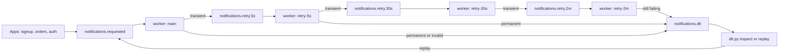

# Project: A Notification Service with Retries and Dead Letters

## Introduction

Every product sends notifications: a welcome email, a password reset, an SMS that the parcel is out for delivery. The sending part is easy. The hard part is that the email or SMS provider fails a few percent of the time. Some failures are **transient** (a timeout, a 503, a greylisting server that says "try again in a minute") and go away if you wait. Others are **permanent** (the mailbox does not exist) and will fail forever no matter how often you retry.

A naive Kafka consumer handles both badly. If it retries in place, one message stuck on a provider outage blocks every message behind it in the partition: a single bad address can delay thousands of password resets. If it skips failures, people silently never get their emails. If it crashes on an unexpected payload, it restarts, reads the same message and crashes again, forever. That last case has a name: a **poison pill**.

The standard answer is **retry topics and a dead letter topic**. A failed message is moved out of the way into a retry topic that is consumed after a delay, then a longer delay, and finally, if it still fails, into a dead letter topic (DLT) where a human or a tool can look at it and replay it. The main topic never stops. In this project you build that pattern in Python with three retry tiers, a DLT, deduplication so nobody gets the same email twice, and a replay tool, then you break the provider and watch the system heal.

## Goal and Architecture



Each worker is the same program started with a different tier. On success it records the notification id as sent. On a transient error it forwards the message to the next tier with an incremented `attempt` header. On a permanent error, or a payload it cannot parse, it sends the message straight to the DLT, because retrying cannot help.

The retry delays are short (5 seconds, 30 seconds, 2 minutes) so you can watch them in a demo. Production systems typically use something like 1 minute, 10 minutes and 1 hour, sized to outlast the provider's typical incidents.

### Why Not Retry in Place?

| Approach | Main topic keeps flowing | Per-key ordering | Complexity |
|---|---|---|---|
| Retry in the poll loop with sleeps | No: the partition is blocked | Kept | Low |
| Retry topics with delays | Yes | Lost for retried messages | Medium |
| Share groups (KIP-932) with per-message release | Yes | Not guaranteed | Low; needs Kafka 4.2 or later |

For notifications, losing ordering is fine: nobody cares whether the welcome email arrived before or after the newsletter. For a bank ledger, where a debit must never overtake the deposit before it, retry topics are the wrong tool; you would block the partition (or park the key) instead. Share groups ([Queues for Kafka: Share Groups](../4-kafka-consumers/7-kafka-share-groups.mdx)) bring queue-style per-message acknowledgement and delivery counts to Kafka, which covers part of this pattern natively. They were a preview in Kafka 4.0 and 4.1 and are production-ready since 4.2, but a released record is redelivered right away: there is no built-in growing delay between attempts, which is the part this project needs.

## Topic Design

| Topic | Key | Partitions | Retention | Notes |
|---|---|---|---|---|
| `notifications.requested` | user id | 6 | 3 days | written by every app that wants to notify someone |
| `notifications.retry.5s` | user id | 6 | 3 days | consumed 5 s after each record was written |
| `notifications.retry.30s` | user id | 6 | 3 days | 30 s delay |
| `notifications.retry.2m` | user id | 6 | 3 days | 2 min delay |
| `notifications.dlt` | user id | 1 | 14 days | low volume; long retention so people have time to look |

Failed messages keep their key, value and headers when they move between topics, and gain a few headers of their own: `attempt`, `last-error`, `error-kind` (`transient`, `permanent` or `invalid`), `original-topic` and `first-failed-at`. Those headers are what make the DLT useful: without them, a dead letter is a payload with no story.

**How the delay works.** Each retry topic has one fixed delay, and records are appended in time order, so the record at the head of each partition is always the one that becomes due first. A retry worker looks at the head record's timestamp: if it is not due yet, the worker **pauses** that partition, seeks back to the record, and keeps polling the others. When the time comes, it resumes the partition. The worker never sleeps inside the poll loop, so it does not exceed `max.poll.interval.ms` and get thrown out of its group.

## Running It with Docker Compose

```yaml title="docker-compose.yml"
services:
  kafka:
    image: apache/kafka:4.3.1
    hostname: kafka
    ports:
      - "9092:9092"
    environment:
      KAFKA_NODE_ID: 1
      KAFKA_PROCESS_ROLES: broker,controller
      CLUSTER_ID: MkU3OEVBNTcwNTJENDM2Qk
      KAFKA_LISTENERS: PLAINTEXT_HOST://:9092,PLAINTEXT://:19092,CONTROLLER://:29093
      KAFKA_ADVERTISED_LISTENERS: PLAINTEXT_HOST://localhost:9092,PLAINTEXT://kafka:19092
      KAFKA_LISTENER_SECURITY_PROTOCOL_MAP: PLAINTEXT_HOST:PLAINTEXT,PLAINTEXT:PLAINTEXT,CONTROLLER:PLAINTEXT
      KAFKA_INTER_BROKER_LISTENER_NAME: PLAINTEXT
      KAFKA_CONTROLLER_LISTENER_NAMES: CONTROLLER
      KAFKA_CONTROLLER_QUORUM_VOTERS: 1@kafka:29093
      KAFKA_OFFSETS_TOPIC_REPLICATION_FACTOR: 1
      KAFKA_TRANSACTION_STATE_LOG_REPLICATION_FACTOR: 1
      KAFKA_TRANSACTION_STATE_LOG_MIN_ISR: 1
      KAFKA_SHARE_COORDINATOR_STATE_TOPIC_REPLICATION_FACTOR: 1
      KAFKA_SHARE_COORDINATOR_STATE_TOPIC_MIN_ISR: 1
      KAFKA_GROUP_INITIAL_REBALANCE_DELAY_MS: 0
      KAFKA_AUTO_CREATE_TOPICS_ENABLE: "false"
    healthcheck:
      test: ["CMD-SHELL", "/opt/kafka/bin/kafka-broker-api-versions.sh --bootstrap-server localhost:9092 > /dev/null 2>&1"]
      interval: 5s
      timeout: 5s
      retries: 20

  kafka-init:
    image: apache/kafka:4.3.1
    depends_on:
      kafka:
        condition: service_healthy
    entrypoint: ["/bin/bash", "-c"]
    command:
      - |
        T="/opt/kafka/bin/kafka-topics.sh --bootstrap-server kafka:19092 --create --if-not-exists --replication-factor 1"
        for t in notifications.requested notifications.retry.5s notifications.retry.30s notifications.retry.2m; do
          $$T --topic $$t --partitions 6 --config retention.ms=259200000
        done
        $$T --topic notifications.dlt --partitions 1 --config retention.ms=1209600000
```

## The Code

All three programs use `confluent-kafka` (`pip install confluent-kafka`); deduplication uses SQLite from the Python standard library.

### The Request Producer

Apps publish a small JSON request with a unique id. The id is generated once, by the requester, and is what makes deduplication possible later.

```python title="request.py"
"""Publish a burst of notification requests, with a realistic mix of recipients."""
import json
import os
import random
import uuid

from confluent_kafka import Producer

producer = Producer({"bootstrap.servers": os.getenv("BOOTSTRAP_SERVERS", "localhost:9092"),
                     "acks": "all", "enable.idempotence": True})

for i in range(int(os.getenv("COUNT", "200"))):
    roll = random.random()
    if roll < 0.05:
        to = f"user{i}@bounce.test"          # mailbox does not exist: permanent failure
    elif roll < 0.15:
        to = f"user{i}@greylist.test"        # server defers the first two attempts
    else:
        to = f"user{i}@example.com"
    request = {"id": str(uuid.uuid4()), "userId": f"u{i % 50}", "channel": "email",
               "to": to, "template": random.choice(["welcome", "password-reset", "order-shipped"])}
    producer.produce("notifications.requested", key=request["userId"], value=json.dumps(request))

producer.produce("notifications.requested", key="u0", value=b"{not json")   # one poison pill
producer.flush()
print("requests published")
```

### The Worker

```python title="notifier.py"
"""Notification worker. Run one process per tier: main, retry-5s, retry-30s, retry-2m."""
import argparse
import json
import os
import random
import sqlite3
import time

from confluent_kafka import Consumer, KafkaException, Producer, TopicPartition

BOOTSTRAP = os.getenv("BOOTSTRAP_SERVERS", "localhost:9092")
DLT = "notifications.dlt"
TIERS = {
    "main":      {"topic": "notifications.requested", "delay": 0,   "next": "notifications.retry.5s"},
    "retry-5s":  {"topic": "notifications.retry.5s",  "delay": 5,   "next": "notifications.retry.30s"},
    "retry-30s": {"topic": "notifications.retry.30s", "delay": 30,  "next": "notifications.retry.2m"},
    "retry-2m":  {"topic": "notifications.retry.2m",  "delay": 120, "next": DLT},
}


class TransientError(Exception):
    """Worth retrying later: timeouts, 5xx, rate limits, greylisting."""


class PermanentError(Exception):
    """Retrying cannot help: bad address, rejected content."""


def send_via_provider(n, attempt):
    """Fake email provider. A real one would receive n['id'] as its idempotency key."""
    time.sleep(0.01)
    if os.path.exists("outage"):                       # touch outage / rm outage
        raise TransientError("503 service unavailable")
    if n["to"].endswith("@bounce.test"):
        raise PermanentError("550 mailbox does not exist")
    if n["to"].endswith("@greylist.test") and attempt < 3:
        raise TransientError("451 greylisted, try again later")
    if random.random() < 0.05:
        raise TransientError("provider timeout")


# Deduplication store. SQLite is enough on one machine; use a shared database in production.
db = sqlite3.connect("sent.db", isolation_level=None, timeout=10)   # autocommit; wait on locks
db.execute("CREATE TABLE IF NOT EXISTS sent (id TEXT PRIMARY KEY, sent_at INTEGER)")


def already_sent(nid):
    return db.execute("SELECT 1 FROM sent WHERE id = ?", (nid,)).fetchone() is not None


def mark_sent(nid):
    db.execute("INSERT OR IGNORE INTO sent VALUES (?, ?)", (nid, int(time.time())))


def header(msg, name, default=None):
    for key, value in msg.headers() or []:
        if key == name:
            return value.decode()
    return default


def forward(producer, msg, target, attempt, error, kind):
    headers = {
        "attempt": str(attempt),
        "last-error": error,
        "error-kind": kind,
        "original-topic": header(msg, "original-topic", msg.topic()),
        "first-failed-at": header(msg, "first-failed-at", str(int(time.time() * 1000))),
    }
    producer.produce(target, key=msg.key(), value=msg.value(), headers=headers)


def process(producer, tier, msg):
    attempt = int(header(msg, "attempt", "0")) + 1
    try:
        n = json.loads(msg.value())
        nid, to = n["id"], n["to"]
    except (ValueError, KeyError, TypeError) as exc:     # poison pill: never retry
        forward(producer, msg, DLT, attempt, f"invalid payload: {exc}", "invalid")
        print(f"[{tier}] invalid payload at p{msg.partition()}@{msg.offset()} -> DLT")
        return
    if already_sent(nid):
        print(f"[{tier}] {nid[:8]} already sent, skipping duplicate")
        return
    try:
        send_via_provider(n, attempt)
        mark_sent(nid)
        print(f"[{tier}] sent {nid[:8]} to {to} (attempt {attempt})")
    except PermanentError as exc:
        forward(producer, msg, DLT, attempt, str(exc), "permanent")
        print(f"[{tier}] {nid[:8]} permanent failure -> DLT: {exc}")
    except TransientError as exc:
        target = TIERS[tier]["next"]
        forward(producer, msg, target, attempt, str(exc), "transient")
        print(f"[{tier}] {nid[:8]} attempt {attempt} failed -> {target}: {exc}")


def main():
    parser = argparse.ArgumentParser()
    parser.add_argument("tier", choices=TIERS)
    tier_name = parser.parse_args().tier
    tier = TIERS[tier_name]

    consumer = Consumer({
        "bootstrap.servers": BOOTSTRAP,
        "group.id": f"notifier-{tier_name}",
        "auto.offset.reset": "earliest",
        "enable.auto.commit": False,
        "enable.auto.offset.store": False,   # we choose which offsets count as done
    })
    producer = Producer({"bootstrap.servers": BOOTSTRAP, "acks": "all", "enable.idempotence": True})
    paused = {}                              # (topic, partition) -> time when it becomes due

    def on_revoke(_consumer, partitions):
        for p in partitions:
            paused.pop((p.topic, p.partition), None)

    consumer.subscribe([tier["topic"]], on_revoke=on_revoke)
    print(f"[{tier_name}] consuming {tier['topic']} with a {tier['delay']} s delay")

    try:
        while True:
            now = time.time()
            due = [tp for tp, at in paused.items() if at <= now]
            if due:
                consumer.resume([TopicPartition(t, p) for t, p in due])
                for tp in due:
                    del paused[tp]

            done = []
            for msg in consumer.consume(num_messages=100, timeout=0.5):
                if msg.error():
                    raise KafkaException(msg.error())
                tp = (msg.topic(), msg.partition())
                if tp in paused:
                    continue                 # an earlier record in this partition is not due yet
                ready_at = msg.timestamp()[1] / 1000 + tier["delay"]
                if ready_at > time.time():
                    part = TopicPartition(msg.topic(), msg.partition(), msg.offset())
                    consumer.pause([part])
                    consumer.seek(part)      # read this record again after resuming
                    paused[tp] = ready_at
                    continue
                process(producer, tier_name, msg)
                done.append(msg)

            if done:
                producer.flush()             # forwarded copies are durable...
                for msg in done:
                    consumer.store_offsets(message=msg)
                consumer.commit(asynchronous=False)   # ...before the originals count as handled
    except KeyboardInterrupt:
        pass
    finally:
        consumer.close()
        producer.flush(10)


if __name__ == "__main__":
    main()
```

Three details carry most of the correctness:

- **`enable.auto.offset.store=False` plus `store_offsets`.** By default, librdkafka marks a record as processed the moment it hands it to you. A record that was paused and sought back would then be committed even though it was never handled. Storing offsets explicitly, only for records that were fully handled, closes that gap.
- **Flush, then commit.** If the worker crashes after forwarding a message but before committing, the message is processed again and forwarded twice. That is the at-least-once trade, and the dedup check makes it harmless.
- **The dedup check is per notification id.** It cannot cover the narrow window between the provider accepting a send and `mark_sent` running. Only the provider can close that window, which is why real email and SMS APIs accept an idempotency key: pass the notification id.

### The DLT Tool

A dead letter topic with no tooling becomes a graveyard. This script lists dead letters with their headers and can replay the ones that died from transient errors (an outage longer than all the retry delays) back into the main topic.

```python title="dlt.py"
"""Inspect notifications.dlt, or replay its transient failures with --replay."""
import os
import sys
import time

from confluent_kafka import Consumer, Producer

BOOTSTRAP = os.getenv("BOOTSTRAP_SERVERS", "localhost:9092")
replay = "--replay" in sys.argv

consumer = Consumer({
    "bootstrap.servers": BOOTSTRAP,
    # The replayer remembers its position so a record is replayed once;
    # inspection uses a throwaway group and always reads everything.
    "group.id": "dlt-replayer" if replay else f"dlt-inspect-{int(time.time())}",
    "auto.offset.reset": "earliest",
    "enable.auto.commit": False,
})
producer = Producer({"bootstrap.servers": BOOTSTRAP, "acks": "all"})
consumer.subscribe(["notifications.dlt"])

counts, idle_since = {}, time.time()
while time.time() - idle_since < 5:                  # stop after 5 s with nothing new
    msg = consumer.poll(1.0)
    if msg is None or msg.error():
        continue
    idle_since = time.time()
    h = {k: v.decode() for k, v in msg.headers() or []}
    kind = h.get("error-kind", "?")
    counts[kind] = counts.get(kind, 0) + 1
    if replay and kind == "transient":
        producer.produce("notifications.requested", key=msg.key(), value=msg.value(),
                         headers={"replayed-from": f"dlt@{msg.offset()}"})
        print(f"replayed offset {msg.offset()}")
    elif not replay:
        print(f"@{msg.offset()} kind={kind} attempts={h.get('attempt')} "
              f"error={h.get('last-error')!r} value={msg.value()[:60]!r}")

producer.flush()
if replay and counts:
    consumer.commit(asynchronous=False)          # nothing consumed means nothing to commit
consumer.close()
print("summary:", counts)
```

Replayed records deliberately have no `attempt` header, so they start a fresh retry cycle. Permanent failures are not replayed: a mailbox that does not exist will not start existing because you tried again. Those need a data fix (correct the address in the user database) and a new request.

## Running It

```bash
docker compose up -d
pip install confluent-kafka

# Four workers, one per tier (four terminals, or append & to each):
python notifier.py main
python notifier.py retry-5s
python notifier.py retry-30s
python notifier.py retry-2m

python request.py
```

The main worker races through the burst:

```
[main] sent 3f2a9c1e to user0@example.com (attempt 1)
[main] invalid payload at p2@37 -> DLT
[main] 9b0d44aa permanent failure -> DLT: 550 mailbox does not exist
[main] c81e07f2 attempt 1 failed -> notifications.retry.5s: 451 greylisted, try again later
```

Five seconds later the retry-5s worker wakes up for those records, fails the greylisted ones a second time and passes them on; 30 seconds after that, the retry-30s worker delivers them on their third attempt:

```
[retry-5s] c81e07f2 attempt 2 failed -> notifications.retry.30s: 451 greylisted, try again later
[retry-30s] sent c81e07f2 to user7@greylist.test (attempt 3)
```

Then inspect the DLT:

```bash
python dlt.py
```

```
@0 kind=permanent attempts=1 error='550 mailbox does not exist' value=b'{"id": "9b0d44aa-...", "userId": "u3", ...'
@1 kind=invalid attempts=1 error='invalid payload: Expecting property name enclosed in double quotes: line 1 column 2 (char 1)' value=b'{not json'
summary: {'permanent': 9, 'invalid': 1}
```

## What to Observe

**Head-of-line blocking does not happen.** Because only failing messages move to retry topics, the main worker finishes all 200 requests in a couple of seconds, even though about 15% of them need retries. Compare with a version that sleeps and retries inside the poll loop: one greylisted address would hold up every message behind it in the partition for minutes.

**A provider outage.** Create the outage file and send another burst:

```bash
touch outage
COUNT=100 python request.py
```

Every send fails. Messages flow from the main topic through retry-5s and retry-30s into retry-2m, and you can watch the lag of each tier grow and shrink:

```bash
for g in main retry-5s retry-30s retry-2m; do
  docker compose exec kafka /opt/kafka/bin/kafka-consumer-groups.sh \
    --bootstrap-server localhost:9092 --describe --group notifier-$g | awk 'NR>2 {lag+=$6} END {print "'$g'", lag}'
done
```

Remove the file (`rm outage`) within two and a half minutes and the retry tiers deliver everything, with no human involvement. Leave it longer and the messages land in the DLT with `kind=transient`; once the outage is over, `python dlt.py --replay` sends them back through and they are delivered. Run `--replay` a second time and it replays nothing, because the replayer group committed its position.

**Deduplication.** Stop the main worker with `kill -9` in the middle of a large burst (`COUNT=5000 python request.py`) and start it again. It reprocesses the last uncommitted batch and prints `already sent, skipping duplicate` for the ones it had already delivered. Without the `sent` table, those users would get the email twice.

**Paused partitions.** While the retry-2m worker waits, it holds no thread hostage: it polls continuously with the waiting partitions paused. Its group stays stable in `kafka-consumer-groups.sh --describe --state`, with no rebalances, even though it waits much longer than a `sleep` inside the poll loop could get away with.

:::warning
Retry topics give up per-key ordering for retried messages. If user u7's "password changed" email fails and goes to retry, a later "password reset" email for the same user can arrive first. Fine for notifications, but check your domain before you copy this pattern to anything where order carries meaning.
:::

## Common Mistakes

- Retrying permanent errors. Classify errors first; a 4xx that means "bad request" should go to the DLT immediately, not after an hour of retries.
- Sleeping inside the poll loop for the retry delay, which exceeds `max.poll.interval.ms` and triggers rebalances. Pause the partition instead.
- Letting librdkafka store offsets automatically while also seeking back, so un-handled records get committed.
- Dead letters without headers. Record the error, the attempt count and where the message came from, or nobody can act on them.
- No replay tooling and no alert on DLT growth. A DLT that nobody watches just loses messages more slowly.
- Sharing one consumer group across tiers. Each tier is a separate group with its own offsets and its own delay.
- Forgetting deduplication. Every hop between tiers is at-least-once, so duplicates will happen.

## Summary

- Classify failures as transient, permanent or invalid; only transient ones are worth retrying.
- Retry topics with growing delays keep the main topic flowing at the cost of per-key ordering for retried messages.
- Implement delays by pausing partitions and seeking back, never by sleeping in the poll loop.
- Store offsets only for fully handled records, flush forwarded copies, then commit.
- Give dead letters rich headers, watch the DLT, and build a replay tool from day one.
- Deduplicate on a requester-generated id, and pass it to the provider as an idempotency key.

## Extensions

1. **Spring version.** Rebuild the worker with Spring Kafka's `@RetryableTopic`, which creates the retry topics and the DLT for you, and compare the generated topic names and headers ([Kafka with Spring Boot and Spring Kafka](../5-kafka-clients/1-kafka-spring-kafka.mdx)).
2. **Exponential backoff with jitter.** Add random jitter to each tier's delay so a burst of failures does not hit the provider again all at the same second.
3. **Circuit breaker.** When the provider's error rate crosses a threshold, pause the main topic entirely for a minute instead of pushing every message into the retry tiers.
4. **Status events.** Publish `notifications.status` events (sent, retrying, dead) keyed by notification id, so other services can show delivery state to users.
5. **Share groups.** Try the same worker on a share group with the Java `KafkaShareConsumer` and compare per-message release and delivery counts with this topic-based design.

## Further Reading

- [Dead Letter Topics and Retry Topics](../9-kafka-patterns/3-kafka-dead-letter-queues.mdx) - the pattern in general, with its variations.
- [Idempotent Consumers and Deduplication](../9-kafka-patterns/4-kafka-idempotent-consumers.mdx) - strategies for dedup stores and their trade-offs.
- [librdkafka configuration](https://github.com/confluentinc/librdkafka/blob/master/CONFIGURATION.md) - `enable.auto.offset.store`, `max.poll.interval.ms` and friends.
- [KIP-932: Queues for Kafka](https://cwiki.apache.org/confluence/display/KAFKA/KIP-932%3A+Queues+for+Kafka) - share groups and per-message acknowledgement.
- [Spring Kafka non-blocking retries](https://docs.spring.io/spring-kafka/reference/retrytopic.html) - the framework implementation of this pattern.
