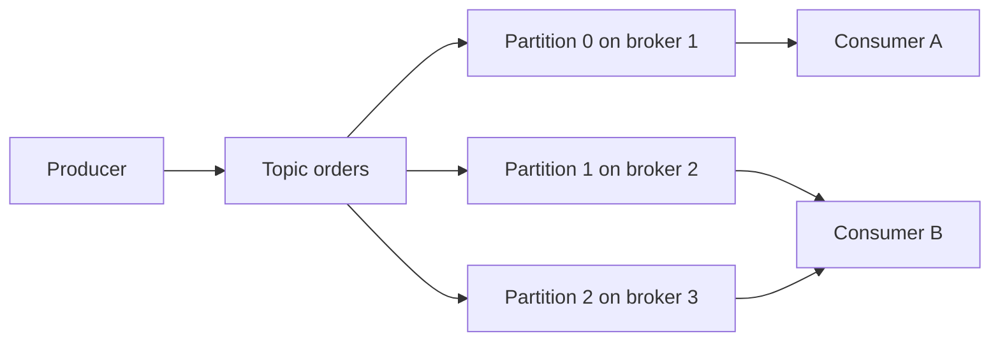

# Topics and Partitions in Depth

## Introduction

A Kafka topic looks like a single named stream from the outside. Inside, it is a set of independent logs called partitions, and almost every important property of Kafka follows from that split: how much data a topic can hold, how fast it can be written and read, which records stay in order, and how much work a cluster has to do when something fails.

This page explains what a partition really is, how partitions are placed on brokers, what "offset" means inside one, and how to choose a partition count that you will not regret in a year. By the end you should be able to look at a topic description, understand every number in it, and defend the partition count you chose for a new topic.

The scenario throughout is an online shop. The `orders` topic receives an event every time a customer places, pays for, or cancels an order. It must handle Black Friday traffic, keep each customer's events in order, and be read by several teams at once.

## A Topic Is a Set of Logs

Each partition is an append-only file sequence on disk. A producer appends records to the end; a consumer reads them from some position forward. Nothing is ever rewritten in place and nothing is removed from the middle. That constraint is what makes Kafka fast: sequential disk I/O and the operating system's page cache do most of the work.

A partition is also the unit of everything:

| What | Scoped to |
|---|---|
| Ordering | one partition |
| Offsets | one partition (offset 42 in partition 0 is unrelated to offset 42 in partition 1) |
| Replication | one partition, copied to several brokers |
| Parallelism | one partition can be read by at most one consumer in a consumer group at a time |
| Storage limits | one partition lives entirely on one broker's disk (per replica) |

The topic is just the name that groups those partitions and gives them shared settings such as retention.



Compare that with a classic queue in RabbitMQ: a queue is one ordered buffer that any number of consumers compete over, and the broker deletes a message when it is acknowledged. Kafka chose partitions instead so that many readers can share the same data without stealing from each other and so that the data survives being read. You pay for that with the need to decide how many partitions you want.

## Offsets: Positions, Not Identifiers

Every record in a partition gets a 64-bit offset, assigned by the leader broker when the record is appended. Offsets start at 0 and increase by exactly one per record. They are dense inside a partition (unless compaction has removed some, which a later page covers) and they never change.

Three offsets matter when you look at a partition:

- **Log start offset** is the oldest record still on disk. Retention moves it forward.
- **High watermark** is the first offset that has not yet been replicated to every in-sync replica. Consumers can read everything below it.
- **Log end offset** is the next offset the leader will assign.

A consumer does not ask Kafka for "the next message." It asks for "records in partition 2 from offset 1,045 onward," and it is the consumer's job (or the consumer group machinery's job) to remember where it stopped. That is the opposite of a queue, where the broker tracks delivery, and it is why a Kafka topic can be replayed from any point and read by many independent applications.

:::note
Offsets are per partition. If you need a globally unique identifier for an event, put one in the record (an order ID, a UUID). The pair `(partition, offset)` is unique within a topic, which is enough for deduplication, but it is not a business identifier.
:::

## How Partitions Are Placed on Brokers

When you create a topic with `--partitions 6 --replication-factor 3`, the controller assigns each partition's three replicas to three different brokers and spreads leaders around so that no single broker leads everything. If brokers have `broker.rack` set, the controller also puts the replicas of a partition in different racks (or cloud availability zones), so losing a rack does not lose a partition.

Describe the topic to see the result:

```bash
kafka-topics.sh --bootstrap-server localhost:9092 --describe --topic orders
```

```text
Topic: orders	TopicId: Qx3kL1m0S4a7bZcD9eFgHw	PartitionCount: 6	ReplicationFactor: 3	Configs: min.insync.replicas=2
	Topic: orders	Partition: 0	Leader: 1	Replicas: 1,2,3	Isr: 1,2,3	Elr: N/A	LastKnownElr: N/A
	Topic: orders	Partition: 1	Leader: 2	Replicas: 2,3,1	Isr: 2,3,1	Elr: N/A	LastKnownElr: N/A
	Topic: orders	Partition: 2	Leader: 3	Replicas: 3,1,2	Isr: 3,1,2	Elr: N/A	LastKnownElr: N/A
	Topic: orders	Partition: 3	Leader: 1	Replicas: 1,3,2	Isr: 1,3,2	Elr: N/A	LastKnownElr: N/A
	Topic: orders	Partition: 4	Leader: 2	Replicas: 2,1,3	Isr: 2,1,3	Elr: N/A	LastKnownElr: N/A
	Topic: orders	Partition: 5	Leader: 3	Replicas: 3,2,1	Isr: 3,2,1	Elr: N/A	LastKnownElr: N/A
```

Reading one line: partition 0 has copies on brokers 1, 2 and 3, broker 1 is the leader (the only broker producers write to and, by default, consumers read from), and all three copies are currently in sync. The `Elr` columns belong to the Eligible Leader Replicas feature of Kafka 4.x and are explained on the [replication page](./2-kafka-replication.mdx). `Configs:` lists only the settings that differ from the broker defaults, which is why it shows just `min.insync.replicas`.

The `TopicId` is a UUID that Kafka assigns at creation. If you delete `orders` and create it again, the name is the same but the ID is new, which lets brokers and clients tell the two apart. The on-disk directory for a partition is still named `orders-0`, and the ID is written to a `partition.metadata` file inside it.

Placement is decided once, at creation. Adding a broker later does not move any partition onto it; you have to run a reassignment, which the [operations section](../10-kafka-operations/3-kafka-partition-reassignment.mdx) covers.

## Choosing the Partition Count

The partition count is the knob that sets the ceiling on consumer parallelism. A consumer group with eight members reading a six-partition topic leaves two members idle, forever. More partitions therefore sound better, but every partition costs something:

| More partitions give you | More partitions cost you |
|---|---|
| Higher consumer parallelism | More open files and memory on every broker |
| Higher write throughput spread over more leaders | Longer leader elections and recovery after a broker failure |
| Finer-grained placement across brokers | Smaller batches per partition, so lower compression ratio and more requests |
| | More end-to-end latency when `acks=all` waits on more replicas |
| | Larger consumer group rebalances |

A reasonable procedure for `orders`:

1. Estimate peak throughput. Black Friday peaks at 20,000 orders per second at about 1 KB each: 20 MB/s in.
2. Measure what one consumer instance can process. The fulfilment service does a database write per order and manages about 2,000 records per second.
3. Divide: 20,000 / 2,000 = 10 consumers, so at least 10 partitions.
4. Add headroom for growth and for uneven keys. 12 to 24 partitions is sensible; pick 12 if you expect to move to a bigger cluster later anyway, pick 24 if you want to avoid touching the topic for years.

Partition counts in the thousands per topic are a smell. If you need that, you probably need more topics or a reconsideration of what one topic is for. The [performance section](../12-kafka-performance/4-kafka-partition-count.mdx) goes into sizing with numbers; the point here is that you choose the count up front, and you choose it for the consumers, not the producers.

### Why You Cannot Shrink a Topic

Kafka can add partitions to a topic but cannot remove them. Removing a partition would mean deciding what to do with its records: delete them (data loss), or move them to another partition (which changes their offsets and breaks every consumer's saved position). Neither is acceptable, so the operation does not exist. If you truly need fewer partitions, you create a new topic and copy data into it.

Adding partitions is allowed but has a trap. A producer picks a partition for a keyed record by hashing the key modulo the partition count. Change the count and `customer-42` suddenly lands in a different partition from where its earlier events live. Any consumer that relies on all events for a key arriving in order on one partition will see history split across two. The [ordering page](./1-kafka-ordering-and-keys.mdx) covers that in detail. The practical rule: adding partitions is safe for unkeyed topics and dangerous for keyed ones, so size keyed topics generously from the start.

```bash
# Allowed: grow from 6 to 12. Not allowed: --partitions 3 on a 6-partition topic.
kafka-topics.sh --bootstrap-server localhost:9092 --alter --topic clickstream --partitions 12
```

## Worked Scenario: Designing the Order Topics

The shop has three kinds of order traffic, and it is tempting to put them all in one topic. Walk through the decision.

**Order lifecycle events** (`order.placed`, `order.paid`, `order.cancelled`). The fulfilment service needs all events for one order in sequence, so these go into one topic, keyed by order ID. Twelve partitions, replication factor 3, seven days of retention so a bug in fulfilment can be fixed and the week replayed.

**Clickstream** from the storefront: 200,000 events per second, no ordering requirement beyond "roughly by time", read by an analytics job that scales horizontally. Separate topic, 48 partitions, no key, two days of retention. Putting these in the orders topic would force the fulfilment consumer to skip 99% of what it reads.

**Current inventory level per product**, published whenever stock changes. Consumers want the latest value for each product rather than history. Separate topic again, keyed by product ID, with `cleanup.policy=compact` so Kafka keeps only the last value per key. The [retention and compaction page](./3-kafka-retention-and-compaction.mdx) explains that choice.

Creating the first one:

```bash
kafka-topics.sh --bootstrap-server localhost:9092 --create \
  --topic orders \
  --partitions 12 \
  --replication-factor 3 \
  --config min.insync.replicas=2 \
  --config retention.ms=604800000   # 7 days, which is also the default
```

Three topics instead of one costs almost nothing and buys independent retention, independent partition counts and independent access control. The alternative, one `shop-events` topic with a type field, is the most common early mistake in Kafka projects and the hardest to undo because every consumer must then be rewritten to filter.

## Auto-Creation and Why to Turn It Off

By default (`auto.create.topics.enable=true`) a broker creates a topic the first time a client produces to or fetches metadata for a name that does not exist, using `num.partitions` (default 1) and `default.replication.factor` (default 1). On a laptop that is convenient. In production it means a typo in a producer config quietly creates `oders` with one partition and one replica, and nobody notices until that broker's disk dies.

Set `auto.create.topics.enable=false` on production brokers and create topics deliberately, through the CLI, the [Admin API](./6-kafka-admin-api.mdx), or an infrastructure tool such as Strimzi's `KafkaTopic` resource. Treat topic definitions as code that is reviewed.

## Common Mistakes

- Creating one giant topic for all event types and relying on consumers to filter, which wastes read bandwidth and ties every team to one partition count and one retention.
- Choosing a partition count equal to today's consumer count with no headroom, then discovering that adding partitions scrambles key ordering.
- Assuming offsets are global across a topic, or using them as business identifiers.
- Leaving `auto.create.topics.enable=true` in production and inheriting single-partition, single-replica topics from typos.
- Running thousands of partitions on a three-broker cluster and then wondering why a broker restart takes ten minutes to re-elect leaders.
- Confusing replication factor (copies of each partition) with partition count (independent logs). More replicas add safety; more partitions add parallelism.

## Summary

- A topic is a named set of partitions; a partition is an ordered, append-only log that lives on one broker (per replica) and is the unit of ordering, replication and parallelism.
- Offsets are per-partition positions, assigned densely by the leader, and never change. Consumers track their own offsets, which is what makes replay possible.
- The controller spreads partitions and leaders across brokers at creation time and respects `broker.rack`; it does not rebalance automatically when brokers are added.
- Size partitions for consumer parallelism with headroom. You can add partitions later but never remove them, and adding partitions changes which partition a key maps to.
- Separate topics for separate data: different ordering needs, retention needs or consumers mean different topics.
- Disable topic auto-creation in production and manage topics deliberately.

## Further Reading

- [Kafka documentation: Design](https://kafka.apache.org/documentation/#design) explains the log abstraction and why partitions are the unit of parallelism.
- [Kafka documentation: Basic Kafka Operations](https://kafka.apache.org/documentation/#basic_ops) covers adding, modifying and deleting topics with `kafka-topics.sh`, including the warning about adding partitions to keyed topics.
- [Kafka broker configuration](https://kafka.apache.org/documentation/#brokerconfigs) documents `num.partitions`, `default.replication.factor`, `auto.create.topics.enable` and `broker.rack`.
- [KIP-516: Topic Identifiers](https://cwiki.apache.org/confluence/display/KAFKA/KIP-516%3A+Topic+Identifiers) introduced the UUID that distinguishes a topic from a recreated one with the same name.
