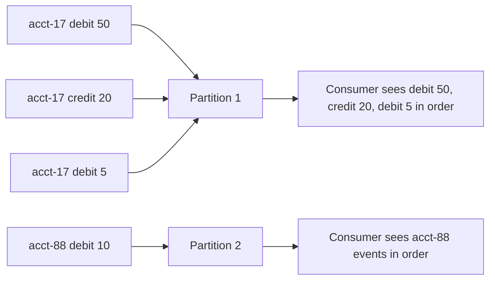

# Ordering Guarantees and Message Keys

## Introduction

"Kafka preserves order" is one of the most repeated and most misunderstood sentences about the system. Kafka preserves order within a partition, from one producer, under specific producer settings. Everything outside that boundary is unordered by design, and the tool you use to put related events on the same side of the boundary is the record key.

This page spells out the guarantee precisely, shows how keys are turned into partition numbers, explains the producer settings that can silently break order, and works through how a bank ledger keeps every account's transactions in sequence while still spreading load over a whole cluster. You will also see when you should deliberately give up ordering for throughput.

## What Kafka Actually Guarantees

The guarantee has three parts, and all three are needed:

1. **Within one partition**, records are stored in the order the leader appended them, and a consumer reads them in that order. Offsets increase monotonically.
2. **From one producer instance**, records sent to the same partition are appended in the order `send()` was called, provided the producer is configured so that retries cannot reorder them (see below).
3. **Across partitions**, there is no order at all. Partition 3's offset 10 may have been written before or after partition 4's offset 10; Kafka does not know and does not care.

Nothing is said about two different producers. If the payment service and the fraud service both write to `orders` partition 2, the interleaving of their records depends on network timing. If that matters, the fix is at the application level (a single writer for a given entity, or a sequence number in the event), not in Kafka.

The analogy that holds up: a partition is a single lane of a road. Cars in one lane stay in order. Cars in different lanes can pass each other, and nobody promises anything about which lane's car reaches the end first.



## How Keys Choose Partitions

Each record has an optional key, a byte array that the producer serializes just like the value. The default partitioner in the Java client does this:

- If the key is present: `partition = murmur2(keyBytes) & 0x7fffffff mod numPartitions`. Same key, same partition count, same partition, every time, from any producer that uses this hash.
- If the key is null: since Kafka 3.3 (KIP-794), the producer sticks to one partition until it has written about `batch.size` bytes there, then moves to another. Records without keys are spread uniformly but have no stable home.

```java
// Java: the key decides the partition. Both records land on the same partition.
producer.send(new ProducerRecord<>("ledger", "acct-17", "{\"type\":\"debit\",\"amount\":50}"));
producer.send(new ProducerRecord<>("ledger", "acct-17", "{\"type\":\"credit\",\"amount\":20}"));

// A null key: the producer picks a sticky partition, so these may land anywhere.
producer.send(new ProducerRecord<>("clicks", null, "{\"page\":\"/home\"}"));
```

Two consequences follow. First, keys do not need to be unique; they need to be the identity you want ordering for. An account ID, an order ID, a device ID. Second, the mapping is only stable while the partition count is constant. Grow the topic from 12 to 16 partitions and `murmur2("acct-17") mod 16` is a different number from `mod 12`: new events for the account land on a different partition from its history, and a consumer reading both partitions can see the new events before the old ones.

:::warning
Different client libraries do not all use the same hash. librdkafka, which backs the Confluent Python, Go and .NET clients, defaults its `partitioner` setting to `consistent_random` (a CRC32 hash); set it to `murmur2_random` to match Java. Some Go libraries default to an FNV-based hash. If two services in different languages produce to the same keyed topic, verify that both use murmur2-compatible partitioning, or the "same key, same partition" promise is broken between them.
:::

### Custom Partitioners

You can replace the hash. A common reason is a topic where a few keys are enormous: one retailer in a marketplace produces 40% of all events, and hashing puts all of that on one partition. A custom partitioner can send that one key round-robin across several partitions, at the cost of ordering for that key. In Java, implement `org.apache.kafka.clients.producer.Partitioner` and set `partitioner.class`. The [producers section](../3-kafka-producers/1-kafka-producer-keys-and-partitioners.mdx) has a full example. Before you write one, consider whether the ordering requirement for that key is real.

## The Producer Settings That Protect Order

A producer sends batches to a partition leader over one TCP connection and can have several requests in flight at once (`max.in.flight.requests.per.connection`, default 5). Suppose batch A is sent, then batch B. A fails with a transient error and is retried; B succeeds first. Without protection, the partition now contains B's records before A's.

Since Kafka 3.0 the Java producer defaults to `enable.idempotence=true`, which assigns each batch a sequence number per partition. The broker rejects a batch whose sequence is out of order, so the producer re-sends A and then B in the right sequence. With idempotence on, ordering is preserved even with five in-flight requests. Idempotence requires `acks=all` (also the default) and at most five in-flight requests.

| Setting | Default (Java client 4.x) | Effect on ordering |
|---|---|---|
| `enable.idempotence` | `true` | Sequence numbers prevent reordering and duplicates on retry |
| `max.in.flight.requests.per.connection` | `5` | Must be 5 or less for idempotence; order is kept at 5 with idempotence on |
| `retries` | `2147483647` | With idempotence off and in-flight above 1, retries can reorder |
| `acks` | `all` | Required by idempotence |

If you turn idempotence off (some teams do for `acks=1` fire-and-forget telemetry), the only way to keep order is `max.in.flight.requests.per.connection=1`, which costs throughput. The [idempotent producer page](../3-kafka-producers/3-kafka-idempotent-producer.mdx) covers the mechanism in depth.

Also watch the Python and Node clients: `confluent-kafka` for Python inherits librdkafka's `enable.idempotence=false` default, so set it explicitly when order matters.

```python
from confluent_kafka import Producer

producer = Producer({
    "bootstrap.servers": "localhost:9092",
    "enable.idempotence": True,   # librdkafka defaults to False
    "partitioner": "murmur2_random",  # same key -> same partition as the Java client
    # acks=all and max.in.flight<=5 are set automatically once idempotence is on
})

for event in ledger_events:
    # key keeps each account's events on one partition
    producer.produce("ledger", key=event["account_id"], value=event["payload"])
producer.flush()
```

## Ordering on the Consumer Side

A consumer group assigns each partition to exactly one consumer, so one consumer sees one partition's records in order. That holds only if the consumer processes them in order. Three ways applications break it:

- Handing records to a thread pool and committing offsets as the batch finishes. Records 10 and 11 for the same key are now processed concurrently.
- Retrying a failed record "later" while continuing with the next one. Record 10 fails, record 11 succeeds, record 10 is retried: the account balance is applied out of order.
- Having consumers in two different groups write to the same downstream table. Each group is ordered on its own; the table sees both interleaved.

The usual solution for parallelism inside a consumer is to shard work by key within the consumer: records for the same key go to the same worker thread, so per-key order survives while different keys proceed in parallel. For failures, either block the partition until the record succeeds or route the record to a retry topic and accept that this key's order is now broken for the affected events. The [dead letter and retry topics page](../9-kafka-patterns/3-kafka-dead-letter-queues.mdx) weighs those options.

## Worked Scenario: A Bank Ledger

A bank writes every account movement to a `ledger` topic and a downstream service maintains balances. Requirements: every account's movements must be applied in order (a withdrawal before the deposit it depended on must bounce, not succeed), throughput is 50,000 movements per second, and the service must scale to many instances.

**Key choice.** Key by account ID. Ordering is only needed per account, and there are millions of accounts, so hashing spreads them evenly. Keying by customer ID would also work (a customer's accounts move together) but creates bigger hot keys for corporate customers; keying by transaction ID gives no ordering at all because each key appears once.

**Partition count.** 50,000 per second divided by roughly 3,000 per consumer instance means at least 17 consumers. Pick 32 partitions, because the topic is keyed and cannot be grown without breaking order. If the bank expects to triple, pick 64 now.

**Producer.** One ledger-writing service, Java client with defaults (`enable.idempotence=true`, `acks=all`). Any second writer to `ledger` must go through the same service or accept interleaving.

**Consumer.** Each balance-service instance reads its partitions in order and applies movements in order per account. It processes records sequentially per partition and commits after each batch is fully applied. When the account database is down, the consumer stops and retries the same record rather than skipping it. That is slower than a retry topic but it is the only choice that keeps ordering for a ledger.

**Growing later.** When the bank does need 128 partitions, it creates `ledger-v2`, points producers at it, lets consumers drain `ledger` fully, then switches them to `ledger-v2`. Awkward, but correct, and avoided entirely by sizing generously up front.

**The alternative not chosen.** A single partition would give total order across all accounts and make the balance service trivially correct, but it caps throughput at what one consumer can handle and puts all 50,000 writes per second through one broker. Total order is almost never required; per-entity order almost always is.

## When to Give Up Ordering

Clickstream data, metrics, logs and IoT telemetry rarely need per-key order, and insisting on it costs throughput twice: keyed records cannot use the sticky partitioner's large batches, and hot keys create hot partitions. For those topics send without a key, let the producer fill whole batches per partition, and put a timestamp in the event so consumers that care can sort within a window. The [event streaming concepts page](../0-kafka-fundamentals/1-kafka-event-streaming-concepts.mdx) distinguishes events that are facts (where order can matter) from measurements (where it usually does not).

The middle ground is a coarse key. Sensor readings keyed by device keep each device's readings in order while still spreading across partitions; keyed by `region` they create a handful of enormous partitions. Pick the finest-grained identity that still gives the ordering you need.

## Common Mistakes

- Believing order is preserved across a whole topic, then building logic that compares offsets between partitions.
- Adding partitions to a keyed topic in production and breaking per-key order for every key whose hash changed.
- Running two services in different languages with incompatible partitioners against the same keyed topic.
- Disabling idempotence while leaving `max.in.flight.requests.per.connection` at 5, so retries reorder records.
- Processing a partition with a thread pool and committing before every record in the batch is applied.
- Keying by a value that is unique per event (a UUID), which gives perfect spreading and no ordering, when ordering was the whole point.
- Choosing a key with a few enormous values (country, tenant, event type) and getting hot partitions.

## Summary

- Order is guaranteed within one partition, from one producer, with idempotence or a single in-flight request. Across partitions and across producers there is no order.
- The record key chooses the partition through a murmur2 hash modulo the partition count. Same key, same partition, as long as the count does not change.
- Null keys are spread with the sticky partitioner and have no stable partition; use them when order does not matter and throughput does.
- The Java client's defaults (`enable.idempotence=true`, `acks=all`, five in-flight) preserve order; librdkafka-based clients need `enable.idempotence` set explicitly.
- Consumers must process a partition in order, and parallelism inside a consumer must be sharded by key.
- Size keyed topics for the future, because growing them later splits a key's history across partitions.

## Further Reading

- [Kafka documentation: Message Delivery Semantics](https://kafka.apache.org/documentation/#semantics) states the ordering and delivery guarantees precisely.
- [Kafka producer configuration](https://kafka.apache.org/documentation/#producerconfigs) documents `enable.idempotence`, `max.in.flight.requests.per.connection`, `partitioner.class` and `partitioner.ignore.keys`.
- [KIP-794: Strictly Uniform Sticky Partitioner](https://cwiki.apache.org/confluence/display/KAFKA/KIP-794%3A+Strictly+Uniform+Sticky+Partitioner) describes how records without keys are assigned since Kafka 3.3.
- [KIP-679: Producer will enable the strongest delivery guarantee by default](https://cwiki.apache.org/confluence/display/KAFKA/KIP-679%3A+Producer+will+enable+the+strongest+delivery+guarantee+by+default) explains why idempotence and `acks=all` became the defaults in Kafka 3.0.
- [librdkafka configuration](https://github.com/confluentinc/librdkafka/blob/master/CONFIGURATION.md) lists the `partitioner` and `enable.idempotence` settings for the C-based clients.
