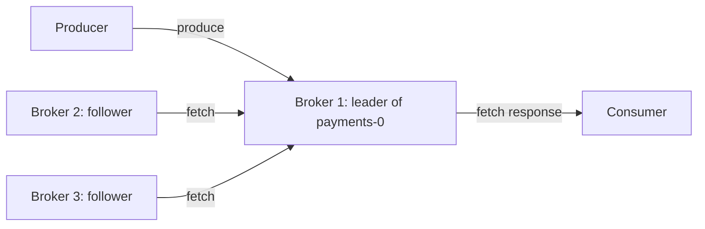
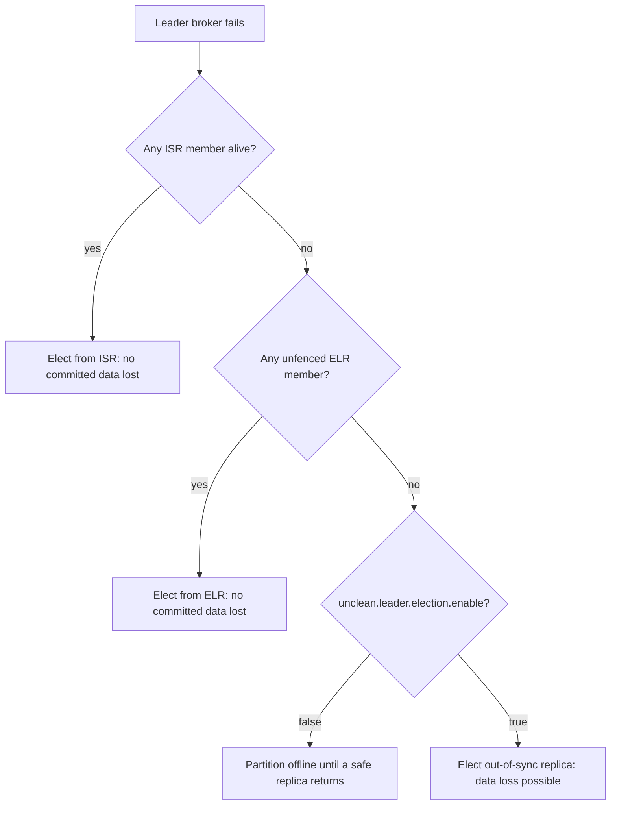

# Replication, Leaders, Followers and the ISR

## Introduction

Disks fail, virtual machines get recycled, and somebody will eventually reboot the wrong broker. Kafka's answer is replication: every partition is copied to several brokers, and one of those copies is in charge at any moment. If you understand how those copies agree on what has been written, you can predict exactly what happens to your data when a broker dies, and you can choose settings that match how much loss your system can tolerate.

This page explains the leader and follower roles, the in-sync replica set (ISR), the high watermark, leader election (clean, unclean and the newer Eligible Leader Replicas), and the knobs that control all of it. By the end you should be able to read a `kafka-topics.sh --describe` line and say how many brokers can fail before writes stop, and how many before data is lost.

The scenario is a payments company. Its `payments` topic records every card authorization. Losing an acknowledged record means money moves without a trace, so durability matters more than a few milliseconds of latency.

## Leaders and Followers

Every partition has a replication factor, usually 3. Of those three replicas, exactly one is the **leader**. Producers send writes to the leader, and by default consumers read from it too. The others are **followers**: they fetch new records from the leader, using the same fetch protocol a consumer uses, and append them to their own copy of the log.



Two design choices are worth noticing. First, followers pull rather than the leader pushing. A slow follower therefore only slows itself down; the leader is not blocked waiting to send. Second, there is no voting per record. The leader decides the order of records, and followers copy that order. This makes Kafka's replication closer to primary-backup than to a quorum system like Raft, which is one reason it can sustain high throughput.

The controller (the KRaft quorum, covered in the [KRaft page](../0-kafka-fundamentals/3-kafka-kraft-and-metadata.mdx)) decides which replica leads each partition and records that decision in the cluster metadata. Each time leadership changes, the partition's **leader epoch** increases by one. The epoch acts like a term number: a broker that was leader in epoch 7 and comes back after a network split knows it is stale as soon as it sees epoch 8.

## The In-Sync Replica Set

A replica is "in sync" if it is caught up with the leader recently enough. Specifically, a follower stays in the ISR as long as it has fully caught up to the leader's log end within the last `replica.lag.time.max.ms` (default 30,000 ms). A follower that stops fetching, or keeps fetching but falls behind for longer than that, is removed from the ISR. When it catches up again, it is added back.

The ISR matters because of the **high watermark**. The leader only advances the high watermark, the boundary below which consumers can read, once every member of the current ISR has the record. A record below the high watermark is called committed. Committed records survive any failure that leaves at least one ISR member alive, because any new leader will be chosen from the ISR, and every ISR member has them.

The analogy is a meeting where the minutes are only "official" once every attendee still in the room has signed them. People who stepped out are not waited for, but they cannot be made chair until they have read up.

| Term | Meaning |
|---|---|
| Replicas | All brokers assigned a copy of the partition |
| ISR | Replicas caught up within `replica.lag.time.max.ms` |
| Log end offset | Next offset the leader will assign |
| High watermark | First offset not yet held by every ISR member; consumers read below it |
| Leader epoch | Counter incremented on each leadership change |

## Producer acks and min.insync.replicas

The ISR can shrink. If it shrinks to just the leader, "every ISR member has it" means "the leader has it", and a single disk failure loses data. Two settings close that gap together:

- The producer's `acks` decides when the producer considers a write successful. With `acks=all` (the default since Kafka 3.0), the leader waits until every ISR member has the record.
- The topic's `min.insync.replicas` (default 1) sets the smallest ISR size at which the leader will accept an `acks=all` write. If the ISR is smaller, the leader rejects the write with `NotEnoughReplicasException` rather than accepting it with weaker durability.

The classic production combination is replication factor 3, `min.insync.replicas=2`, `acks=all`. One broker can be down (for maintenance or a crash) and writes continue with two copies of every record. If two brokers are down, writes stop instead of silently becoming single-copy. Reads continue in both cases.

```bash
kafka-topics.sh --bootstrap-server localhost:9092 --create \
  --topic payments \
  --partitions 12 \
  --replication-factor 3 \
  --config min.insync.replicas=2
```

| Replication factor / min ISR | Brokers you can lose and keep writing | Acknowledged copies guaranteed |
|---|---|---|
| 3 / 1 | 2 | 1 (risky) |
| 3 / 2 | 1 | 2 (common choice) |
| 3 / 3 | 0 | 3 (any restart blocks writes) |
| 5 / 3 | 2 | 3 (critical data, more brokers) |

The producer side of this trade-off, including what `acks=1` and `acks=0` give up, is covered in [acks, min.insync.replicas and Durability](../3-kafka-producers/2-kafka-producer-acks-and-durability.mdx).

:::warning
`min.insync.replicas` only affects producers using `acks=all`. A producer with `acks=1` is acknowledged as soon as the leader writes the record, regardless of the ISR size. Setting the topic config without checking producer settings gives a false sense of safety.
:::

## Leader Election

When a leader's broker stops heartbeating to the controller, the controller fences it and picks a new leader for each partition it led.

**Clean election.** The new leader is chosen from the ISR. Because every ISR member has all committed records, nothing acknowledged under `acks=all` is lost. Followers that had records past the new leader's log end (records that were never committed) truncate them, using the leader epoch history to find the exact divergence point. This truncation is correct behaviour: those records were never acknowledged.

**Unclean election.** If every ISR member is gone and only out-of-sync replicas remain, Kafka must choose between availability and consistency. With `unclean.leader.election.enable=false` (the default) the partition stays offline until an ISR member returns. With `true`, an out-of-sync replica becomes leader immediately and any committed records it lacked are lost for good. For a clickstream, availability may be worth that. For `payments`, never.

**Eligible Leader Replicas.** Kafka 4.x adds a refinement from KIP-966. In older versions, a replica dropped from the ISR because of strict `min.insync.replicas` accounting could hold every committed record yet still not be eligible for clean election. ELR tracks those replicas: when the ISR shrinks below `min.insync.replicas`, the high watermark stops advancing, so replicas that leave the ISR at that point are known to have all committed data and are kept in an eligible set. The controller prefers ISR members, then unfenced ELR members. ELR is controlled by the `eligible.leader.replicas.version` feature; it was off by default in 4.0 and is on by default for new clusters from 4.1. That is what the `Elr` and `LastKnownElr` columns in `--describe` output show.



### Preferred Leaders

The first broker in a partition's replica list is its **preferred leader**. At creation, preferred leaders are spread evenly, so each broker leads about the same number of partitions. After a broker restarts, its partitions are led elsewhere and the load is lopsided. With `auto.leader.rebalance.enable=true` (the default), the controller checks every `leader.imbalance.check.interval.seconds` (300) and moves leadership back when a broker's imbalance exceeds `leader.imbalance.per.broker.percentage` (10). You can also trigger it by hand:

```bash
kafka-leader-election.sh --bootstrap-server localhost:9092 \
  --election-type PREFERRED --all-topic-partitions
```

## Reading from Followers

Reading from the leader is the default, but in a cloud deployment that spreads brokers over three availability zones, two-thirds of consumer traffic crosses zones and is billed for it. KIP-392 lets consumers fetch from a nearby follower instead. Set `broker.rack` on each broker, set `replica.selector.class=org.apache.kafka.common.replica.RackAwareReplicaSelector` on the brokers, and set `client.rack` on the consumer to its zone.

```properties
# broker (server.properties)
broker.rack=eu-west-1a
replica.selector.class=org.apache.kafka.common.replica.RackAwareReplicaSelector

# consumer
client.rack=eu-west-1a
```

Followers only serve records below the high watermark, so consistency is unchanged; the cost is slightly higher latency, because a follower learns of a new high watermark one fetch later than the leader.

## Worked Scenario: Losing a Broker in the Payments Cluster

The payments cluster has three brokers in three zones. `payments` has 12 partitions, replication factor 3, `min.insync.replicas=2`; producers use the Java defaults (`acks=all`, idempotence on).

**Normal operation.** Partition 4 is led by broker 2, ISR `2,3,1`. An authorization is acknowledged once all three have it.

**Broker 3 is patched and restarted.** It stops fetching. After 30 seconds the leader removes it from the ISR: `2,1`. Writes continue, because the ISR size equals `min.insync.replicas`. Partitions that broker 3 led get new leaders from their ISRs within seconds; producers see a brief `NOT_LEADER_OR_FOLLOWER` error, refresh metadata and retry automatically. When broker 3 returns, it truncates to the last point it agreed with the leader, catches up and rejoins the ISR.

**Broker 1 fails while broker 3 is still down.** The ISR for partition 4 is now `2`, below the minimum. Producers get `NotEnoughReplicasException` and retry until `delivery.timeout.ms` (two minutes by default) runs out, then fail the send. The payments API returns "try again later." Consumers keep reading everything already committed. This is the system working as intended: refusing to take a payment it could lose.

**The alternative not chosen.** With `min.insync.replicas=1` the company would have kept accepting payments on broker 2 alone. If broker 2's disk had then failed, those payments would be gone, with no record that they were ever authorized. The team decided a few minutes of rejected writes is a smaller cost than unrecoverable money movements. A clickstream team at the same company made the opposite choice for their topics, and that is fine too.

Checking the state during the incident:

```bash
kafka-topics.sh --bootstrap-server localhost:9092 --describe --under-min-isr-partitions
```

```text
	Topic: payments	Partition: 4	Leader: 2	Replicas: 2,3,1	Isr: 2	Elr: 1	LastKnownElr: N/A
```

Other useful filters are `--under-replicated-partitions` (ISR smaller than the replica list) and `--unavailable-partitions` (no leader). The [monitoring page](../10-kafka-operations/1-kafka-monitoring-metrics.mdx) turns these into alerts.

## Common Mistakes

- Using replication factor 3 with `min.insync.replicas=1` and believing data is triple-protected; under a shrunken ISR it can be single-copy.
- Setting `min.insync.replicas` equal to the replication factor, so any single broker restart blocks all writes.
- Assuming `min.insync.replicas` protects producers that use `acks=1`.
- Enabling `unclean.leader.election.enable` cluster-wide for convenience, including on topics that hold money or orders.
- Placing all replicas in one availability zone because `broker.rack` was never set, so one zone outage takes a partition fully offline.
- Treating under-replicated partitions as cosmetic; each one is a partition that is one failure closer to blocking writes or losing data.
- Running a replication factor of 2: one broker down leaves a single copy, and `min.insync.replicas=2` would block writes during every rolling restart.

## Summary

- Each partition has one leader and several followers; followers pull from the leader, and the leader alone decides record order.
- The ISR is the set of replicas caught up within `replica.lag.time.max.ms`. The high watermark advances only when every ISR member has a record, and consumers read only below it.
- `acks=all` plus `min.insync.replicas` sets the minimum number of copies an acknowledged write has. Replication factor 3 with a minimum of 2 is the common production choice.
- Clean elections pick from the ISR (and, in Kafka 4.1+, from Eligible Leader Replicas) and lose nothing committed; unclean elections trade data for availability and are off by default.
- Preferred leader election rebalances leadership after restarts, and rack-aware follower fetching cuts cross-zone traffic.

## Further Reading

- [Kafka documentation: Replication](https://kafka.apache.org/documentation/#replication) describes the ISR, committed records and unclean leader election.
- [Eligible Leader Replicas](https://kafka.apache.org/41/operations/eligible-leader-replicas/) explains the ELR feature flag and its interaction with `min.insync.replicas`.
- [KIP-966: Eligible Leader Replicas](https://cwiki.apache.org/confluence/display/KAFKA/KIP-966%3A+Eligible+Leader+Replicas) gives the full design and the failure scenarios it fixes.
- [KIP-101: Alter Replication Protocol to use Leader Epoch rather than High Watermark for Truncation](https://cwiki.apache.org/confluence/display/KAFKA/KIP-101+-+Alter+Replication+Protocol+to+use+Leader+Epoch+rather+than+High+Watermark+for+Truncation) explains why leader epochs prevent divergent logs.
- [KIP-392: Allow consumers to fetch from closest replica](https://cwiki.apache.org/confluence/display/KAFKA/KIP-392%3A+Allow+consumers+to+fetch+from+closest+replica) covers follower fetching and `client.rack`.
